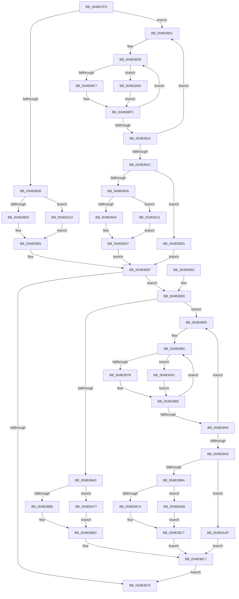

# HalpTimerSavePerformanceCounter

- RVA: `0x004B37F0`–`0x004B3A9E` (길이 `686` bytes)
- VA: `0x00000001404B37F0`
- 실행 섹션: `.text`
- PDB 이름 있음: `예`; PDB Function 태그: `아니요`
- unwind 정보 RVA: `0x000B9A50`
- 디코드: `168`개 명령, `686/686` bytes 표시
- 미해석 바이트: `0` (있으면 어셈블리에 `.byte`로 보존)

> 이 문서는 커널 이미지의 기계어와 PDB 기호를 분석해 생성했습니다. 4번과 5번은 함수 원형과 자료형을 바이너리 사용 방식에서 추정한 C 해석이며 원본 소스 복구 결과는 아닙니다.

## 1. Dependencies

- 직접 호출 지점: **12**; 고유 호출 대상: **4**
- 직접 호출자로 확인된 함수: **1**
- RIP 상대 이미지 참조: **4**

### Outgoing calls
- `0x004B383B` → [HalpTimerGetInternalData](../20/HalpTimerGetInternalData_function_00209500.md) (function, `0x00209500`)
- `0x004B3850` → [HalpHvCounterQueryCounter](../37/HalpHvCounterQueryCounter_function_00378F50.md) (function, `0x00378F50`)
- `0x004B38A3` → [HalpTimerGetInternalData](../20/HalpTimerGetInternalData_function_00209500.md) (function, `0x00209500`)
- `0x004B38B8` → [HalpHvCounterQueryCounter](../37/HalpHvCounterQueryCounter_function_00378F50.md) (function, `0x00378F50`)
- `0x004B38E2` → [HalpTimerGetInternalData](../20/HalpTimerGetInternalData_function_00209500.md) (function, `0x00209500`)
- `0x004B38F7` → [HalpHpetQueryCounter](../37/HalpHpetQueryCounter_function_00379660.md) (function, `0x00379660`)
- `0x004B3966` → [HalpTimerGetInternalData](../20/HalpTimerGetInternalData_function_00209500.md) (function, `0x00209500`)
- `0x004B397B` → [HalpHpetQueryCounter](../37/HalpHpetQueryCounter_function_00379660.md) (function, `0x00379660`)
- `0x004B3A25` → [guard_dispatch_icall](../6B/guard_dispatch_icall_function_006BAAD0.md) (function, `0x006BAAD0`)
- `0x004B3A7A` → [guard_dispatch_icall](../6B/guard_dispatch_icall_function_006BAAD0.md) (function, `0x006BAAD0`)
- `0x004B3A87` → [guard_dispatch_icall](../6B/guard_dispatch_icall_function_006BAAD0.md) (function, `0x006BAAD0`)
- `0x004B3A94` → [guard_dispatch_icall](../6B/guard_dispatch_icall_function_006BAAD0.md) (function, `0x006BAAD0`)

### Direct callers
- [HalpAcpiPreSleep](../../pagelk/B7/HalpAcpiPreSleep_function_00B7BFD4.md) at `0x00B7C002`

### Static image references
- `0x004B380D` → RVA `0x00FC3FD0` (`.data`; read)
- `0x004B3814` → RVA `0x00378F50` (`HalpHvCounterQueryCounter`; read)
- `0x004B381F` → RVA `0x00379660` (`HalpHpetQueryCounter`; read)
- `0x004B3867` → RVA `0x00FC4140` (`.data`; read)

## 2. Other-region calls and transfers

- 다른 실행 섹션으로 향하는 call: **0**
- 별도 외부 분기/꼬리 이동을 확인하지 못했습니다.

## 3. Assembly (complete function range)

```asm
004B37F0  48 8B C4                        mov rax, rsp
004B37F3  48 89 58 08                     mov qword ptr [rax + 8], rbx
004B37F7  48 89 68 10                     mov qword ptr [rax + 0x10], rbp
004B37FB  48 89 70 18                     mov qword ptr [rax + 0x18], rsi
004B37FF  48 89 78 20                     mov qword ptr [rax + 0x20], rdi
004B3803  41 54                           push r12
004B3805  41 55                           push r13
004B3807  41 56                           push r14
004B3809  48 83 EC 20                     sub rsp, 0x20
004B380D  48 8B 3D BC 07 B1 00            mov rdi, qword ptr [rip + 0xb107bc]
004B3814  4C 8D 25 35 57 EC FF            lea r12, [rip - 0x13a8cb]
004B381B  48 83 CD FF                     or rbp, 0xffffffffffffffff
004B381F  4C 8D 2D 3A 5E EC FF            lea r13, [rip - 0x13a1c6]
004B3826  BE 01 00 00 00                  mov esi, 1
004B382B  83 BF DC 00 00 00 40            cmp dword ptr [rdi + 0xdc], 0x40
004B3832  0F 85 99 00 00 00               jne 0x1404b38d1
004B3838  48 8B CF                        mov rcx, rdi
004B383B  E8 C0 5C D5 FF                  call 0x140209500
004B3840  48 8B 57 70                     mov rdx, qword ptr [rdi + 0x70]
004B3844  48 8B C8                        mov rcx, rax
004B3847  49 3B D4                        cmp rdx, r12
004B384A  0F 85 D2 01 00 00               jne 0x1404b3a22
004B3850  E8 FB 56 EC FF                  call 0x140378f50
004B3855  4C 8B B7 D0 00 00 00            mov r14, qword ptr [rdi + 0xd0]
004B385C  48 8B D0                        mov rdx, rax
004B385F  49 8D 04 16                     lea rax, [r14 + rdx]
004B3863  48 89 47 10                     mov qword ptr [rdi + 0x10], rax
004B3867  48 8B 3D D2 08 B1 00            mov rdi, qword ptr [rip + 0xb108d2]
004B386E  48 85 FF                        test rdi, rdi
004B3871  75 20                           jne 0x1404b3893
004B3873  48 8B 5C 24 40                  mov rbx, qword ptr [rsp + 0x40]
004B3878  48 8B 6C 24 48                  mov rbp, qword ptr [rsp + 0x48]
004B387D  48 8B 74 24 50                  mov rsi, qword ptr [rsp + 0x50]
004B3882  48 8B 7C 24 58                  mov rdi, qword ptr [rsp + 0x58]
004B3887  48 83 C4 20                     add rsp, 0x20
004B388B  41 5E                           pop r14
004B388D  41 5D                           pop r13
004B388F  41 5C                           pop r12
004B3891  C3                              ret
004B3892  CC                              int3
004B3893  83 BF DC 00 00 00 40            cmp dword ptr [rdi + 0xdc], 0x40
004B389A  0F 85 B5 00 00 00               jne 0x1404b3955
004B38A0  48 8B CF                        mov rcx, rdi
004B38A3  E8 58 5C D5 FF                  call 0x140209500
004B38A8  48 8B 57 70                     mov rdx, qword ptr [rdi + 0x70]
004B38AC  48 8B C8                        mov rcx, rax
004B38AF  49 3B D4                        cmp rdx, r12
004B38B2  0F 85 BF 01 00 00               jne 0x1404b3a77
004B38B8  E8 93 56 EC FF                  call 0x140378f50
004B38BD  4C 8B B7 D0 00 00 00            mov r14, qword ptr [rdi + 0xd0]
004B38C4  48 8B D0                        mov rdx, rax
004B38C7  49 8D 04 16                     lea rax, [r14 + rdx]
004B38CB  48 89 47 10                     mov qword ptr [rdi + 0x10], rax
004B38CF  EB A2                           jmp 0x1404b3873
004B38D1  4C 8B B7 D0 00 00 00            mov r14, qword ptr [rdi + 0xd0]
004B38D8  48 8B 9F C8 00 00 00            mov rbx, qword ptr [rdi + 0xc8]
004B38DF  48 8B CF                        mov rcx, rdi
004B38E2  E8 19 5C D5 FF                  call 0x140209500
004B38E7  48 8B 57 70                     mov rdx, qword ptr [rdi + 0x70]
004B38EB  48 8B C8                        mov rcx, rax
004B38EE  49 3B D5                        cmp rdx, r13
004B38F1  0F 85 8D 01 00 00               jne 0x1404b3a84
004B38F7  E8 64 5D EC FF                  call 0x140379660
004B38FC  4C 8B D0                        mov r10, rax
004B38FF  F0 83 0C 24 00                  lock or dword ptr [rsp], 0
004B3904  48 8B 87 C8 00 00 00            mov rax, qword ptr [rdi + 0xc8]
004B390B  48 3B D8                        cmp rbx, rax
004B390E  75 C8                           jne 0x1404b38d8
004B3910  48 8B 8F D0 00 00 00            mov rcx, qword ptr [rdi + 0xd0]
004B3917  4C 3B F1                        cmp r14, rcx
004B391A  75 B5                           jne 0x1404b38d1
004B391C  44 8B 8F DC 00 00 00            mov r9d, dword ptr [rdi + 0xdc]
004B3923  41 8D 49 FF                     lea ecx, [r9 - 1]
004B3927  0F B6 D1                        movzx edx, cl
004B392A  49 8B CA                        mov rcx, r10
004B392D  48 33 CB                        xor rcx, rbx
004B3930  48 0F A3 D1                     bt rcx, rdx
004B3934  0F 82 9B 00 00 00               jb 0x1404b39d5
004B393A  41 83 F9 40                     cmp r9d, 0x40
004B393E  0F 85 CD 00 00 00               jne 0x1404b3a11
004B3944  48 8B D5                        mov rdx, rbp
004B3947  48 F7 D2                        not rdx
004B394A  48 23 D3                        and rdx, rbx
004B394D  49 0B D2                        or rdx, r10
004B3950  E9 0A FF FF FF                  jmp 0x1404b385f
004B3955  4C 8B B7 D0 00 00 00            mov r14, qword ptr [rdi + 0xd0]
004B395C  48 8B 9F C8 00 00 00            mov rbx, qword ptr [rdi + 0xc8]
004B3963  48 8B CF                        mov rcx, rdi
004B3966  E8 95 5B D5 FF                  call 0x140209500
004B396B  48 8B 57 70                     mov rdx, qword ptr [rdi + 0x70]
004B396F  48 8B C8                        mov rcx, rax
004B3972  49 3B D5                        cmp rdx, r13
004B3975  0F 85 16 01 00 00               jne 0x1404b3a91
004B397B  E8 E0 5C EC FF                  call 0x140379660
004B3980  4C 8B C8                        mov r9, rax
004B3983  F0 83 0C 24 00                  lock or dword ptr [rsp], 0
004B3988  48 8B 87 C8 00 00 00            mov rax, qword ptr [rdi + 0xc8]
004B398F  48 3B D8                        cmp rbx, rax
004B3992  75 C8                           jne 0x1404b395c
004B3994  48 8B 8F D0 00 00 00            mov rcx, qword ptr [rdi + 0xd0]
004B399B  4C 3B F1                        cmp r14, rcx
004B399E  75 B5                           jne 0x1404b3955
004B39A0  44 8B 87 DC 00 00 00            mov r8d, dword ptr [rdi + 0xdc]
004B39A7  41 8D 48 FF                     lea ecx, [r8 - 1]
004B39AB  0F B6 D1                        movzx edx, cl
004B39AE  49 8B C9                        mov rcx, r9
004B39B1  48 33 CB                        xor rcx, rbx
004B39B4  48 0F A3 D1                     bt rcx, rdx
004B39B8  72 75                           jb 0x1404b3a2f
004B39BA  41 83 F8 40                     cmp r8d, 0x40
004B39BE  0F 85 A2 00 00 00               jne 0x1404b3a66
004B39C4  48 8B D5                        mov rdx, rbp
004B39C7  48 F7 D2                        not rdx
004B39CA  48 23 D3                        and rdx, rbx
004B39CD  49 0B D1                        or rdx, r9
004B39D0  E9 F2 FE FF FF                  jmp 0x1404b38c7
004B39D5  41 8B C9                        mov ecx, r9d
004B39D8  48 8B D6                        mov rdx, rsi
004B39DB  48 D3 E2                        shl rdx, cl
004B39DE  4C 8B C5                        mov r8, rbp
004B39E1  41 83 F9 40                     cmp r9d, 0x40
004B39E5  48 8D 4A FF                     lea rcx, [rdx - 1]
004B39E9  4C 0F 45 C1                     cmovne r8, rcx
004B39ED  4C 23 C3                        and r8, rbx
004B39F0  49 8B C8                        mov rcx, r8
004B39F3  48 33 CB                        xor rcx, rbx
004B39F6  49 0B CA                        or rcx, r10
004B39F9  48 03 D1                        add rdx, rcx
004B39FC  4D 3B D0                        cmp r10, r8
004B39FF  48 0F 43 D1                     cmovae rdx, rcx
004B3A03  F0 48 0F B1 97 C8 00 00 00      lock cmpxchg qword ptr [rdi + 0xc8], rdx
004B3A0C  E9 4E FE FF FF                  jmp 0x1404b385f
004B3A11  41 8B C9                        mov ecx, r9d
004B3A14  48 8B D6                        mov rdx, rsi
004B3A17  48 D3 E2                        shl rdx, cl
004B3A1A  48 2B D6                        sub rdx, rsi
004B3A1D  E9 25 FF FF FF                  jmp 0x1404b3947
004B3A22  48 8B C2                        mov rax, rdx
004B3A25  E8 A6 70 20 00                  call 0x1406baad0
004B3A2A  E9 26 FE FF FF                  jmp 0x1404b3855
004B3A2F  41 8B C8                        mov ecx, r8d
004B3A32  48 D3 E6                        shl rsi, cl
004B3A35  41 83 F8 40                     cmp r8d, 0x40
004B3A39  48 8D 4E FF                     lea rcx, [rsi - 1]
004B3A3D  48 0F 45 E9                     cmovne rbp, rcx
004B3A41  48 23 EB                        and rbp, rbx
004B3A44  48 8B CD                        mov rcx, rbp
004B3A47  48 33 CB                        xor rcx, rbx
004B3A4A  49 0B C9                        or rcx, r9
004B3A4D  4C 3B CD                        cmp r9, rbp
004B3A50  48 8D 14 31                     lea rdx, [rcx + rsi]
004B3A54  48 0F 43 D1                     cmovae rdx, rcx
004B3A58  F0 48 0F B1 97 C8 00 00 00      lock cmpxchg qword ptr [rdi + 0xc8], rdx
004B3A61  E9 61 FE FF FF                  jmp 0x1404b38c7
004B3A66  41 8B C8                        mov ecx, r8d
004B3A69  48 8B D6                        mov rdx, rsi
004B3A6C  48 D3 E2                        shl rdx, cl
004B3A6F  48 2B D6                        sub rdx, rsi
004B3A72  E9 50 FF FF FF                  jmp 0x1404b39c7
004B3A77  48 8B C2                        mov rax, rdx
004B3A7A  E8 51 70 20 00                  call 0x1406baad0
004B3A7F  E9 39 FE FF FF                  jmp 0x1404b38bd
004B3A84  48 8B C2                        mov rax, rdx
004B3A87  E8 44 70 20 00                  call 0x1406baad0
004B3A8C  E9 6B FE FF FF                  jmp 0x1404b38fc
004B3A91  48 8B C2                        mov rax, rdx
004B3A94  E8 37 70 20 00                  call 0x1406baad0
004B3A99  E9 E2 FE FF FF                  jmp 0x1404b3980
```

## 4. C-style interpretation (structured pseudocode)

```c
__int64 __fastcall HalpTimerSavePerformanceCounter(void)
{
    __int64 result;
    __int64 v_rbp;
    __int64 v_rsi;
    __int64 v_rsp;
    unsigned int v_stack_p0;
    unsigned __int64 v_stack_p10;
    unsigned __int64 v_stack_p18;
    unsigned __int64 v_stack_p20;
    unsigned __int64 v_stack_p8;

    *(unsigned __int64 *)(v_rsp + 8) = v_rbx;
    *(unsigned __int64 *)(v_rsp + 16) = v_rbp;
    *(unsigned __int64 *)(v_rsp + 24) = v_rsi;
    *(unsigned __int64 *)(v_rsp + 32) = v_rdi;
    v_rsp = (v_rsp) - (32);
    v_rbp = (v_rbp) | (-1);
    if ((*(unsigned int *)(*(unsigned __int64 *)(v_rip + 11601852) + 220)) != 64) goto loc_004B38D1;
    result = HalpTimerGetInternalData(*(unsigned __int64 *)(v_rip + 11601852), a2, a3, a4);
    if ((*(unsigned __int64 *)(*(unsigned __int64 *)(v_rip + 11601852) + 112)) != (v_rip - 1288395)) goto loc_004B3A22;
    result = HalpHvCounterQueryCounter(result, *(unsigned __int64 *)(*(unsigned __int64 *)(v_rip + 11601852) + 112), a3, a4);
loc_004B3855:
loc_004B385F:
    *(unsigned __int64 *)(*(unsigned __int64 *)(v_rip + 11601852) + 16) = *(unsigned __int64 *)(*(unsigned __int64 *)(v_rip + 11601852) + 208) + result * 1;
    if (*(unsigned __int64 *)(v_rip + 11602130) != 0) goto loc_004B3893;
loc_004B3873:
    v_rsp = (v_rsp) + (32);
    return *(unsigned __int64 *)(*(unsigned __int64 *)(v_rip + 11601852) + 208) + result * 1;
loc_004B3893:
    if ((*(unsigned int *)(v_stack_p20 + 220)) != 64) goto loc_004B3955;
    result = HalpTimerGetInternalData(v_stack_p20, result, a3, a4);
    if ((*(unsigned __int64 *)(v_stack_p20 + 112)) != (v_rip - 1288395)) goto loc_004B3A77;
    result = HalpHvCounterQueryCounter(result, *(unsigned __int64 *)(v_stack_p20 + 112), a3, a4);
loc_004B38BD:
loc_004B38C7:
    *(unsigned __int64 *)(v_stack_p20 + 16) = *(unsigned __int64 *)(v_stack_p20 + 208) + result * 1;
    goto loc_004B3873;
loc_004B38D1:
loc_004B38D8:
    result = HalpTimerGetInternalData(v_stack_p20, result, a3, a4);
    if ((*(unsigned __int64 *)(v_stack_p20 + 112)) != (v_rip - 1286598)) goto loc_004B3A84;
    result = HalpHpetQueryCounter(result, *(unsigned __int64 *)(v_stack_p20 + 112), a3, a4);
loc_004B38FC:
    if ((*(unsigned __int64 *)(v_stack_p20 + 200)) != (*(unsigned __int64 *)(v_stack_p20 + 200))) goto loc_004B38D8;
    if ((*(unsigned __int64 *)(v_stack_p20 + 208)) != (*(unsigned __int64 *)(v_stack_p20 + 208))) goto loc_004B38D1;
    a1 = (result) ^ (*(unsigned __int64 *)(v_stack_p20 + 200));
    if (condition_is_below) goto loc_004B39D5;
    if (((unsigned int)((unsigned int)(*(unsigned int *)(v_stack_p20 + 220)))) != 64) goto loc_004B3A11;
loc_004B3947:
    a2 = ~(v_stack_p10);
    a2 = (a2) & (*(unsigned __int64 *)(v_stack_p20 + 200));
    a2 = (a2) | (result);
    goto loc_004B385F;
loc_004B3955:
loc_004B395C:
    result = HalpTimerGetInternalData(v_stack_p20, a2, a3, (unsigned int)(*(unsigned int *)(v_stack_p20 + 220)));
    if ((*(unsigned __int64 *)(v_stack_p20 + 112)) != (v_rip - 1286598)) goto loc_004B3A91;
    result = HalpHpetQueryCounter(result, *(unsigned __int64 *)(v_stack_p20 + 112), a3, (unsigned int)(*(unsigned int *)(v_stack_p20 + 220)));
loc_004B3980:
    if ((*(unsigned __int64 *)(v_stack_p20 + 200)) != (*(unsigned __int64 *)(v_stack_p20 + 200))) goto loc_004B395C;
    if ((*(unsigned __int64 *)(v_stack_p20 + 208)) != (*(unsigned __int64 *)(v_stack_p20 + 208))) goto loc_004B3955;
    a1 = (result) ^ (*(unsigned __int64 *)(v_stack_p20 + 200));
    if (condition_is_below) goto loc_004B3A2F;
    if (((unsigned int)((unsigned int)(*(unsigned int *)(v_stack_p20 + 220)))) != 64) goto loc_004B3A66;
loc_004B39C7:
    a2 = ~(v_stack_p10);
    a2 = (a2) & (*(unsigned __int64 *)(v_stack_p20 + 200));
    a2 = (a2) | (result);
    goto loc_004B38C7;
loc_004B39D5:
    a2 = (v_stack_p18) << ((unsigned __int8)((unsigned int)((unsigned int)(result))));
    a3 = v_stack_p10;
    if (((unsigned int)(result)) != 64) { a3 = a2 - 1; }
    a3 = (a3) & (*(unsigned __int64 *)(v_stack_p20 + 200));
    a1 = (a3) ^ (*(unsigned __int64 *)(v_stack_p20 + 200));
    a1 = (a1) | (result);
    a2 = (a2) + (a1);
    if (result >= a3) { a2 = a1; }
    goto loc_004B385F;
loc_004B3A11:
    a2 = (v_stack_p18) << ((unsigned __int8)((unsigned int)((unsigned int)(result))));
    a2 = (a2) - (v_stack_p18);
    goto loc_004B3947;
loc_004B3A22:
    result = guard_dispatch_icall((unsigned int)((unsigned int)(result)), a2, a3, result);
    goto loc_004B3855;
loc_004B3A2F:
    v_rsi = (v_stack_p18) << ((unsigned __int8)((unsigned int)((unsigned int)(a3))));
    v_rbp = v_stack_p10;
    if (((unsigned int)(a3)) != 64) { v_rbp = v_rsi - 1; }
    v_rbp = (v_rbp) & (*(unsigned __int64 *)(v_stack_p20 + 200));
    a1 = (v_rbp) ^ (*(unsigned __int64 *)(v_stack_p20 + 200));
    a1 = (a1) | (result);
    a2 = a1 + v_rsi * 1;
    if (result >= v_rbp) { a2 = a1; }
    goto loc_004B38C7;
loc_004B3A66:
    a2 = (v_rsi) << ((unsigned __int8)((unsigned int)((unsigned int)(a3))));
    a2 = (a2) - (v_rsi);
    goto loc_004B39C7;
loc_004B3A77:
    result = guard_dispatch_icall((unsigned int)((unsigned int)(a3)), a2, a3, result);
    goto loc_004B38BD;
loc_004B3A84:
    result = guard_dispatch_icall((unsigned int)((unsigned int)(a3)), a2, a3, result);
    goto loc_004B38FC;
loc_004B3A91:
    result = guard_dispatch_icall((unsigned int)((unsigned int)(a3)), a2, a3, result);
    goto loc_004B3980;
}
```

## 5. (Beta) C Style

```c
void HalpTimerSavePerformanceCounter(void)
{
    int64_t result;
    int64_t local_rbp;
    int64_t local_rsi;
    int64_t local_rsp;
    uint32_t v_stack_p0;
    uint64_t v_stack_p10;
    uint64_t v_stack_p18;
    uint64_t v_stack_p20;
    uint64_t v_stack_p8;

    *(uint64_t *)(local_rsp + 0x8) = local_rbx;
    *(uint64_t *)(local_rsp + 0x10) = local_rbp;
    *(uint64_t *)(local_rsp + 0x18) = local_rsi;
    *(uint64_t *)(local_rsp + 0x20) = local_rdi;
    local_rsp = (local_rsp) - (32);
    local_rbp = (local_rbp) | (-1);
    if ((*(uint32_t *)(*(uint64_t *)(v_rip + 0xB107BC) + 0xDC)) != 64) goto loc_004B38D1;
    result = HalpTimerGetInternalData(*(uint64_t *)(v_rip + 0xB107BC), a2, a3, a4);
    if ((*(uint64_t *)(*(uint64_t *)(v_rip + 0xB107BC) + 0x70)) != (v_rip - 1288395)) goto loc_004B3A22;
    result = HalpHvCounterQueryCounter(result, *(uint64_t *)(*(uint64_t *)(v_rip + 0xB107BC) + 0x70), a3, a4);
loc_004B3855:
loc_004B385F:
    *(uint64_t *)(*(uint64_t *)(v_rip + 0xB107BC) + 0x10) = *(uint64_t *)(*(uint64_t *)(v_rip + 0xB107BC) + 0xD0) + result * 1;
    if (*(uint64_t *)(v_rip + 0xB108D2) != 0) goto loc_004B3893;
loc_004B3873:
    local_rsp = (local_rsp) + (32);
    return *(uint64_t *)(*(uint64_t *)(v_rip + 0xB107BC) + 0xD0) + result * 1;
loc_004B3893:
    if ((*(uint32_t *)(v_stack_p20 + 0xDC)) != 64) goto loc_004B3955;
    result = HalpTimerGetInternalData(v_stack_p20, result, a3, a4);
    if ((*(uint64_t *)(v_stack_p20 + 0x70)) != (v_rip - 1288395)) goto loc_004B3A77;
    result = HalpHvCounterQueryCounter(result, *(uint64_t *)(v_stack_p20 + 0x70), a3, a4);
loc_004B38BD:
loc_004B38C7:
    *(uint64_t *)(v_stack_p20 + 0x10) = *(uint64_t *)(v_stack_p20 + 0xD0) + result * 1;
    goto loc_004B3873;
loc_004B38D1:
loc_004B38D8:
    result = HalpTimerGetInternalData(v_stack_p20, result, a3, a4);
    if ((*(uint64_t *)(v_stack_p20 + 0x70)) != (v_rip - 1286598)) goto loc_004B3A84;
    result = HalpHpetQueryCounter(result, *(uint64_t *)(v_stack_p20 + 0x70), a3, a4);
loc_004B38FC:
    if ((*(uint64_t *)(v_stack_p20 + 0xC8)) != (*(uint64_t *)(v_stack_p20 + 0xC8))) goto loc_004B38D8;
    if ((*(uint64_t *)(v_stack_p20 + 0xD0)) != (*(uint64_t *)(v_stack_p20 + 0xD0))) goto loc_004B38D1;
    a1 = (result) ^ (*(uint64_t *)(v_stack_p20 + 0xC8));
    if (condition_is_below) goto loc_004B39D5;
    if (((uint32_t)((uint32_t)(*(uint32_t *)(v_stack_p20 + 0xDC)))) != 64) goto loc_004B3A11;
loc_004B3947:
    a2 = ~(v_stack_p10);
    a2 = (a2) & (*(uint64_t *)(v_stack_p20 + 0xC8));
    a2 = (a2) | (result);
    goto loc_004B385F;
loc_004B3955:
loc_004B395C:
    result = HalpTimerGetInternalData(v_stack_p20, a2, a3, (uint32_t)(*(uint32_t *)(v_stack_p20 + 0xDC)));
    if ((*(uint64_t *)(v_stack_p20 + 0x70)) != (v_rip - 1286598)) goto loc_004B3A91;
    result = HalpHpetQueryCounter(result, *(uint64_t *)(v_stack_p20 + 0x70), a3, (uint32_t)(*(uint32_t *)(v_stack_p20 + 0xDC)));
loc_004B3980:
    if ((*(uint64_t *)(v_stack_p20 + 0xC8)) != (*(uint64_t *)(v_stack_p20 + 0xC8))) goto loc_004B395C;
    if ((*(uint64_t *)(v_stack_p20 + 0xD0)) != (*(uint64_t *)(v_stack_p20 + 0xD0))) goto loc_004B3955;
    a1 = (result) ^ (*(uint64_t *)(v_stack_p20 + 0xC8));
    if (condition_is_below) goto loc_004B3A2F;
    if (((uint32_t)((uint32_t)(*(uint32_t *)(v_stack_p20 + 0xDC)))) != 64) goto loc_004B3A66;
loc_004B39C7:
    a2 = ~(v_stack_p10);
    a2 = (a2) & (*(uint64_t *)(v_stack_p20 + 0xC8));
    a2 = (a2) | (result);
    goto loc_004B38C7;
loc_004B39D5:
    a2 = (v_stack_p18) << ((uint8_t)((uint32_t)((uint32_t)(result))));
    a3 = v_stack_p10;
    if (((uint32_t)(result)) != 64) { a3 = a2 - 1; }
    a3 = (a3) & (*(uint64_t *)(v_stack_p20 + 0xC8));
    a1 = (a3) ^ (*(uint64_t *)(v_stack_p20 + 0xC8));
    a1 = (a1) | (result);
    a2 = (a2) + (a1);
    if (result >= a3) { a2 = a1; }
    goto loc_004B385F;
loc_004B3A11:
    a2 = (v_stack_p18) << ((uint8_t)((uint32_t)((uint32_t)(result))));
    a2 = (a2) - (v_stack_p18);
    goto loc_004B3947;
loc_004B3A22:
    result = guard_dispatch_icall((uint32_t)((uint32_t)(result)), a2, a3, result);
    goto loc_004B3855;
loc_004B3A2F:
    local_rsi = (v_stack_p18) << ((uint8_t)((uint32_t)((uint32_t)(a3))));
    local_rbp = v_stack_p10;
    if (((uint32_t)(a3)) != 64) { local_rbp = local_rsi - 1; }
    local_rbp = (local_rbp) & (*(uint64_t *)(v_stack_p20 + 0xC8));
    a1 = (local_rbp) ^ (*(uint64_t *)(v_stack_p20 + 0xC8));
    a1 = (a1) | (result);
    a2 = a1 + local_rsi * 1;
    if (result >= local_rbp) { a2 = a1; }
    goto loc_004B38C7;
loc_004B3A66:
    a2 = (local_rsi) << ((uint8_t)((uint32_t)((uint32_t)(a3))));
    a2 = (a2) - (local_rsi);
    goto loc_004B39C7;
loc_004B3A77:
    result = guard_dispatch_icall((uint32_t)((uint32_t)(a3)), a2, a3, result);
    goto loc_004B38BD;
loc_004B3A84:
    result = guard_dispatch_icall((uint32_t)((uint32_t)(a3)), a2, a3, result);
    goto loc_004B38FC;
loc_004B3A91:
    result = guard_dispatch_icall((uint32_t)((uint32_t)(a3)), a2, a3, result);
    goto loc_004B3980;
}
```

## 6. Execution-region graph

[열기: 2D/3D 그래프와 함수 탐색 컨트롤 패널](../../../control-panel.html?section=text&rva=0x004B37F0&view=graph)

- 2D 그래프는 위에서 아래로 흐르고, 3D 그래프는 빈 공간을 드래그해 회전합니다. Shift+드래그는 이동, 휠은 확대·축소, 함수 노드 선택은 대상 보고서 이동입니다.

### Static fallback


