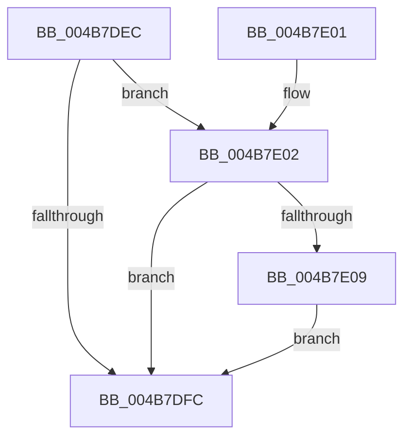

# HeadlessKernelAddLogEntry

- RVA: `0x004B7DEC`–`0x004B7E10` (길이 `36` bytes)
- VA: `0x00000001404B7DEC`
- 실행 섹션: `.text`
- PDB 이름 있음: `예`; PDB Function 태그: `아니요`
- unwind 정보 RVA: `0x00064C74`
- 디코드: `11`개 명령, `36/36` bytes 표시
- 미해석 바이트: `0` (있으면 어셈블리에 `.byte`로 보존)

> 이 문서는 커널 이미지의 기계어와 PDB 기호를 분석해 생성했습니다. 4번과 5번은 함수 원형과 자료형을 바이너리 사용 방식에서 추정한 C 해석이며 원본 소스 복구 결과는 아닙니다.

## 1. Dependencies

- 직접 호출 지점: **1**; 고유 호출 대상: **1**
- 직접 호출자로 확인된 함수: **8**
- RIP 상대 이미지 참조: **1**

### Outgoing calls
- `0x004B7E09` → [HdlspKernelAddLogEntry](../../pagehdls/BB/HdlspKernelAddLogEntry_function_00BBDD70.md) (function, `0x00BBDD70`)

### Direct callers
- [PnpBootDeviceWait](../5A/PnpBootDeviceWait_function_005A4D68.md) at `0x005A4E7C`
- [IopLoadDriver](../../page/99/IopLoadDriver_function_00997B54.md) at `0x00997D13`
- [IopLoadDriver](../../page/99/IopLoadDriver_function_00997B54.md) at `0x00997E89`
- [sub_00B2CB5C](../../page/B2/Unknown_function_00B2CB5C.md) at `0x00B2CC15`
- [IoInitSystem](../../init/C2/IoInitSystem_function_00C2ABB8.md) at `0x00C2ABEF`
- [IoInitSystemPreDrivers](../../init/C2/IoInitSystemPreDrivers_function_00C2AC3C.md) at `0x00C2B37C`
- [IoInitSystemPreDrivers](../../init/C2/IoInitSystemPreDrivers_function_00C2AC3C.md) at `0x00C2B464`
- [IoInitSystemPreDrivers](../../init/C2/IoInitSystemPreDrivers_function_00C2AC3C.md) at `0x00C2B4A5`
- [IoInitSystemPreDrivers](../../init/C2/IoInitSystemPreDrivers_function_00C2AC3C.md) at `0x00C2B826`
- [IoInitSystemPreDrivers](../../init/C2/IoInitSystemPreDrivers_function_00C2AC3C.md) at `0x00C2BB87`
- [IoInitSystemPreDrivers](../../init/C2/IoInitSystemPreDrivers_function_00C2AC3C.md) at `0x00C2BD48`
- [IoInitSystemPreDrivers](../../init/C2/IoInitSystemPreDrivers_function_00C2AC3C.md) at `0x00C2BD83`
- [IoInitSystemPreDrivers](../../init/C2/IoInitSystemPreDrivers_function_00C2AC3C.md) at `0x00C2BDA8`
- [IopInitializeBootDrivers](../../init/C2/IopInitializeBootDrivers_function_00C2E6F4.md) at `0x00C2E908`
- [IopInitializeBootDrivers](../../init/C2/IopInitializeBootDrivers_function_00C2E6F4.md) at `0x00C2E94A`
- [IopInitializeBootDrivers](../../init/C2/IopInitializeBootDrivers_function_00C2E6F4.md) at `0x00C2ED20`
- [IopInitializeBootDrivers](../../init/C2/IopInitializeBootDrivers_function_00C2E6F4.md) at `0x00C2ED81`
- [IopInitializeBootDrivers](../../init/C2/IopInitializeBootDrivers_function_00C2E6F4.md) at `0x00C2EDA9`
- [IopInitializeBootDrivers](../../init/C2/IopInitializeBootDrivers_function_00C2E6F4.md) at `0x00C2EDDD`
- [IopInitializeBootDrivers](../../init/C2/IopInitializeBootDrivers_function_00C2E6F4.md) at `0x00C2EE2D`
- [IopInitializeBootDrivers](../../init/C2/IopInitializeBootDrivers_function_00C2E6F4.md) at `0x00C2EE5E`
- [IopInitializeBootDrivers](../../init/C2/IopInitializeBootDrivers_function_00C2E6F4.md) at `0x00C2EED5`
- [PipInitializeCoreDriversByGroup](../../init/C7/PipInitializeCoreDriversByGroup_function_00C740DC.md) at `0x00C7422F`
- [IopInitializeBuiltinDriver](../../init/C7/IopInitializeBuiltinDriver_function_00C7625C.md) at `0x00C762BD`
- [IopInitializeBuiltinDriver](../../init/C7/IopInitializeBuiltinDriver_function_00C7625C.md) at `0x00C76320`
- [IopInitializeBuiltinDriver](../../init/C7/IopInitializeBuiltinDriver_function_00C7625C.md) at `0x00C766D1`
- [IopInitializeBuiltinDriver](../../init/C7/IopInitializeBuiltinDriver_function_00C7625C.md) at `0x00C766FB`

### Static image references
- `0x004B7DF0` → RVA `0x00E68578` (`.data`; read)

## 2. Other-region calls and transfers

- 다른 실행 섹션으로 향하는 call: **1**
  - `0x004B7E09` → [HdlspKernelAddLogEntry](../../pagehdls/BB/HdlspKernelAddLogEntry_function_00BBDD70.md) (`.text` → `PAGEHDLS`)
- 별도 외부 분기/꼬리 이동을 확인하지 못했습니다.

## 3. Assembly (complete function range)

```asm
004B7DEC  48 83 EC 28                     sub rsp, 0x28
004B7DF0  48 8B 05 81 07 9B 00            mov rax, qword ptr [rip + 0x9b0781]
004B7DF7  48 85 C0                        test rax, rax
004B7DFA  75 06                           jne 0x1404b7e02
004B7DFC  48 83 C4 28                     add rsp, 0x28
004B7E00  C3                              ret
004B7E01  CC                              int3
004B7E02  48 83 78 08 00                  cmp qword ptr [rax + 8], 0
004B7E07  74 F3                           je 0x1404b7dfc
004B7E09  E8 62 5F 70 00                  call 0x140bbdd70
004B7E0E  EB EC                           jmp 0x1404b7dfc
```

## 4. C-style interpretation (structured pseudocode)

```c
__int64 __fastcall HeadlessKernelAddLogEntry(void)
{
    __int64 result;
    __int64 v_rsp;

    v_rsp = (v_rsp) - (40);
    if (*(unsigned __int64 *)(v_rip + 10160001) != 0) goto loc_004B7E02;
loc_004B7DFC:
    v_rsp = (v_rsp) + (40);
    return *(unsigned __int64 *)(v_rip + 10160001);
loc_004B7E02:
    if ((*(unsigned __int64 *)(*(unsigned __int64 *)(v_rip + 10160001) + 8)) == 0) goto loc_004B7DFC;
    result = HdlspKernelAddLogEntry(a1, a2, a3, a4);
    goto loc_004B7DFC;
}
```

## 5. (Beta) C Style

```c
void HeadlessKernelAddLogEntry(void)
{
    int64_t result;
    int64_t local_rsp;

    local_rsp = (local_rsp) - (40);
    if (*(uint64_t *)(v_rip + 0x9B0781) != 0) goto loc_004B7E02;
loc_004B7DFC:
    local_rsp = (local_rsp) + (40);
    return *(uint64_t *)(v_rip + 0x9B0781);
loc_004B7E02:
    if ((*(uint64_t *)(*(uint64_t *)(v_rip + 0x9B0781) + 0x8)) == 0) goto loc_004B7DFC;
    result = HdlspKernelAddLogEntry(a1, a2, a3, a4);
    goto loc_004B7DFC;
}
```

## 6. Execution-region graph

[열기: 2D/3D 그래프와 함수 탐색 컨트롤 패널](../../../control-panel.html?section=text&rva=0x004B7DEC&view=graph)

- 2D 그래프는 위에서 아래로 흐르고, 3D 그래프는 빈 공간을 드래그해 회전합니다. Shift+드래그는 이동, 휠은 확대·축소, 함수 노드 선택은 대상 보고서 이동입니다.

### Static fallback


