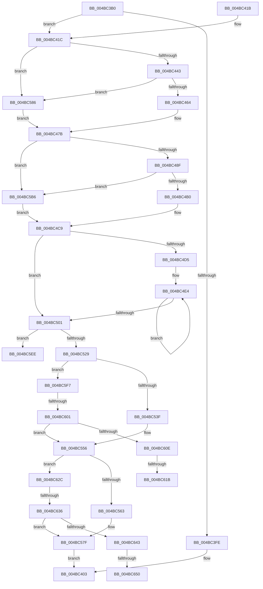

# HvlLpReadMultipleMsr

- RVA: `0x004BC3B0`–`0x004BC661` (길이 `689` bytes)
- VA: `0x00000001404BC3B0`
- 실행 섹션: `.text`
- PDB 이름 있음: `예`; PDB Function 태그: `예`
- unwind 정보 RVA: `0x000BB8FC`
- 디코드: `168`개 명령, `689/689` bytes 표시
- 미해석 바이트: `0` (있으면 어셈블리에 `.byte`로 보존)

> 이 문서는 커널 이미지의 기계어와 PDB 기호를 분석해 생성했습니다. 4번과 5번은 함수 원형과 자료형을 바이너리 사용 방식에서 추정한 C 해석이며 원본 소스 복구 결과는 아닙니다.

## 1. Dependencies

- 직접 호출 지점: **9**; 고유 호출 대상: **5**
- 직접 호출자로 확인된 함수: **0**
- RIP 상대 이미지 참조: **2**

### Outgoing calls
- `0x004BC453` → [ExpInterlockedPopEntrySList](../6B/ExpInterlockedPopEntrySList_function_006BA570.md) (function, `0x006BA570`)
- `0x004BC49F` → [ExpInterlockedPopEntrySList](../6B/ExpInterlockedPopEntrySList_function_006BA570.md) (function, `0x006BA570`)
- `0x004BC50C` → [HvcallInitiateHypercall](../31/HvcallInitiateHypercall_function_00313630.md) (function, `0x00313630`)
- `0x004BC551` → [ExpInterlockedPushEntrySList](../6B/ExpInterlockedPushEntrySList_function_006BA5B0.md) (function, `0x006BA5B0`)
- `0x004BC57A` → [ExpInterlockedPushEntrySList](../6B/ExpInterlockedPushEntrySList_function_006BA5B0.md) (function, `0x006BA5B0`)
- `0x004BC58A` → [KeDisableInterrupts](../21/KeDisableInterrupts_function_00217BE0.md) (function, `0x00217BE0`)
- `0x004BC5BA` → [KeDisableInterrupts](../21/KeDisableInterrupts_function_00217BE0.md) (function, `0x00217BE0`)
- `0x004BC621` → [KiLowerIrqlProcessIrqlFlags](../4F/KiLowerIrqlProcessIrqlFlags_function_004F5698.md) (function, `0x004F5698`)
- `0x004BC656` → [KiLowerIrqlProcessIrqlFlags](../4F/KiLowerIrqlProcessIrqlFlags_function_004F5698.md) (function, `0x004F5698`)

### Direct callers
- 이 함수 시작 RVA로 연결되는 직접 call은 확인되지 않았습니다. 간접 호출은 완전히 역산할 수 없습니다.

### Static image references
- `0x004BC435` → RVA `0x00FC6A90` (`ALMOSTRO`; read)
- `0x004BC60E` → RVA `0x00FC6D20` (`ALMOSTRO`; read)

## 2. Other-region calls and transfers

- 다른 실행 섹션으로 향하는 call: **0**
- call이 아닌 외부 분기/꼬리 이동: **7**
  - `0x004BC5F2` → [sub_006FC6A8](../6F/Unknown_function_006FC6A8.md) (`tail-transfer`)
  - `0x004BC5FB` → [sub_006FC6A8 + 0x22](../6F/Unknown_function_006FC6A8.md) (`tail-transfer`)
  - `0x004BC615` → [sub_006FC6A8 + 0x19](../6F/Unknown_function_006FC6A8.md) (`tail-transfer`)
  - `0x004BC627` → [sub_006FC6A8 + 0x19](../6F/Unknown_function_006FC6A8.md) (`tail-transfer`)
  - `0x004BC630` → [sub_006FC6A8 + 0xA2](../6F/Unknown_function_006FC6A8.md) (`tail-transfer`)
  - `0x004BC64A` → [sub_006FC6A8 + 0x99](../6F/Unknown_function_006FC6A8.md) (`tail-transfer`)
  - `0x004BC65C` → [sub_006FC6A8 + 0x99](../6F/Unknown_function_006FC6A8.md) (`tail-transfer`)

## 3. Assembly (complete function range)

```asm
004BC3B0  48 8B C4                        mov rax, rsp
004BC3B3  48 89 58 10                     mov qword ptr [rax + 0x10], rbx
004BC3B7  4C 89 48 20                     mov qword ptr [rax + 0x20], r9
004BC3BB  4C 89 40 18                     mov qword ptr [rax + 0x18], r8
004BC3BF  89 48 08                        mov dword ptr [rax + 8], ecx
004BC3C2  55                              push rbp
004BC3C3  56                              push rsi
004BC3C4  57                              push rdi
004BC3C5  41 54                           push r12
004BC3C7  41 55                           push r13
004BC3C9  41 56                           push r14
004BC3CB  41 57                           push r15
004BC3CD  48 8B EC                        mov rbp, rsp
004BC3D0  48 83 EC 70                     sub rsp, 0x70
004BC3D4  33 C0                           xor eax, eax
004BC3D6  44 8B EA                        mov r13d, edx
004BC3D9  48 89 45 C8                     mov qword ptr [rbp - 0x38], rax
004BC3DD  0F 57 C0                        xorps xmm0, xmm0
004BC3E0  89 45 D0                        mov dword ptr [rbp - 0x30], eax
004BC3E3  48 89 45 E8                     mov qword ptr [rbp - 0x18], rax
004BC3E7  89 45 F0                        mov dword ptr [rbp - 0x10], eax
004BC3EA  8B C2                           mov eax, edx
004BC3EC  C1 E0 04                        shl eax, 4
004BC3EF  0F 11 45 B8                     movups xmmword ptr [rbp - 0x48], xmm0
004BC3F3  0F 11 45 D8                     movups xmmword ptr [rbp - 0x28], xmm0
004BC3F7  3D 00 10 00 00                  cmp eax, 0x1000
004BC3FC  76 1E                           jbe 0x1404bc41c
004BC3FE  B8 0D 00 00 C0                  mov eax, 0xc000000d
004BC403  48 8B 9C 24 B8 00 00 00         mov rbx, qword ptr [rsp + 0xb8]
004BC40B  48 83 C4 70                     add rsp, 0x70
004BC40F  41 5F                           pop r15
004BC411  41 5E                           pop r14
004BC413  41 5D                           pop r13
004BC415  41 5C                           pop r12
004BC417  5F                              pop rdi
004BC418  5E                              pop rsi
004BC419  5D                              pop rbp
004BC41A  C3                              ret
004BC41B  CC                              int3
004BC41C  41 8B C5                        mov eax, r13d
004BC41F  48 C7 45 B0 88 00 00 00         mov qword ptr [rbp - 0x50], 0x88
004BC427  25 FF 0F 00 00                  and eax, 0xfff
004BC42C  41 BF 04 00 00 00               mov r15d, 4
004BC432  89 45 B4                        mov dword ptr [rbp - 0x4c], eax
004BC435  8B 05 55 A6 B0 00               mov eax, dword ptr [rip + 0xb0a655]
004BC43B  A8 08                           test al, 8
004BC43D  0F 84 43 01 00 00               je 0x1404bc586
004BC443  65 48 8B 1C 25 20 00 00 00      mov rbx, qword ptr gs:[0x20]
004BC44C  48 8D 8B C0 8B 00 00            lea rcx, [rbx + 0x8bc0]
004BC453  E8 18 E1 1F 00                  call 0x1406ba570
004BC458  48 8B F8                        mov rdi, rax
004BC45B  48 85 C0                        test rax, rax
004BC45E  0F 84 22 01 00 00               je 0x1404bc586
004BC464  48 8B 48 10                     mov rcx, qword ptr [rax + 0x10]
004BC468  48 89 4D D0                     mov qword ptr [rbp - 0x30], rcx
004BC46C  C7 45 B8 01 00 00 00            mov dword ptr [rbp - 0x48], 1
004BC473  48 89 5D C0                     mov qword ptr [rbp - 0x40], rbx
004BC477  48 89 45 C8                     mov qword ptr [rbp - 0x38], rax
004BC47B  8B 05 0F A6 B0 00               mov eax, dword ptr [rip + 0xb0a60f]
004BC481  41 BE 02 00 00 00               mov r14d, 2
004BC487  A8 08                           test al, 8
004BC489  0F 84 27 01 00 00               je 0x1404bc5b6
004BC48F  65 48 8B 34 25 20 00 00 00      mov rsi, qword ptr gs:[0x20]
004BC498  48 8D 8E C0 8B 00 00            lea rcx, [rsi + 0x8bc0]
004BC49F  E8 CC E0 1F 00                  call 0x1406ba570
004BC4A4  48 8B D8                        mov rbx, rax
004BC4A7  48 85 C0                        test rax, rax
004BC4AA  0F 84 06 01 00 00               je 0x1404bc5b6
004BC4B0  41 BE 01 00 00 00               mov r14d, 1
004BC4B6  48 89 75 E0                     mov qword ptr [rbp - 0x20], rsi
004BC4BA  48 8B 70 10                     mov rsi, qword ptr [rax + 0x10]
004BC4BE  4C 8B F8                        mov r15, rax
004BC4C1  44 89 75 D8                     mov dword ptr [rbp - 0x28], r14d
004BC4C5  48 89 45 E8                     mov qword ptr [rbp - 0x18], rax
004BC4C9  48 89 75 F0                     mov qword ptr [rbp - 0x10], rsi
004BC4CD  4D 8B E5                        mov r12, r13
004BC4D0  45 85 ED                        test r13d, r13d
004BC4D3  74 2C                           je 0x1404bc501
004BC4D5  48 8B 55 50                     mov rdx, qword ptr [rbp + 0x50]
004BC4D9  48 83 C7 08                     add rdi, 8
004BC4DD  44 8B 45 40                     mov r8d, dword ptr [rbp + 0x40]
004BC4E1  49 8B CD                        mov rcx, r13
004BC4E4  44 89 47 F8                     mov dword ptr [rdi - 8], r8d
004BC4E8  C7 47 FC 01 00 01 00            mov dword ptr [rdi - 4], 0x10001
004BC4EF  8B 02                           mov eax, dword ptr [rdx]
004BC4F1  48 8D 52 04                     lea rdx, [rdx + 4]
004BC4F5  89 07                           mov dword ptr [rdi], eax
004BC4F7  48 8D 7F 10                     lea rdi, [rdi + 0x10]
004BC4FB  48 83 E9 01                     sub rcx, 1
004BC4FF  75 E3                           jne 0x1404bc4e4
004BC501  48 8B 55 D0                     mov rdx, qword ptr [rbp - 0x30]
004BC505  4C 8B C6                        mov r8, rsi
004BC508  48 8B 4D B0                     mov rcx, qword ptr [rbp - 0x50]
004BC50C  E8 1F 71 E5 FF                  call 0x140313630
004BC511  33 D2                           xor edx, edx
004BC513  B9 01 00 00 C0                  mov ecx, 0xc0000001
004BC518  66 85 C0                        test ax, ax
004BC51B  8B FA                           mov edi, edx
004BC51D  0F 45 F9                        cmovne edi, ecx
004BC520  45 85 ED                        test r13d, r13d
004BC523  0F 85 C5 00 00 00               jne 0x1404bc5ee
004BC529  45 33 E4                        xor r12d, r12d
004BC52C  41 BD FF FF DF FF               mov r13d, 0xffdfffff
004BC532  41 8B CC                        mov ecx, r12d
004BC535  41 F6 C6 01                     test r14b, 1
004BC539  0F 84 B8 00 00 00               je 0x1404bc5f7
004BC53F  48 8B 4D E0                     mov rcx, qword ptr [rbp - 0x20]
004BC543  49 8B D7                        mov rdx, r15
004BC546  48 81 C1 C0 8B 00 00            add rcx, 0x8bc0
004BC54D  49 89 77 10                     mov qword ptr [r15 + 0x10], rsi
004BC551  E8 5A E0 1F 00                  call 0x1406ba5b0
004BC556  F6 45 B8 01                     test byte ptr [rbp - 0x48], 1
004BC55A  49 8B CC                        mov rcx, r12
004BC55D  0F 84 C9 00 00 00               je 0x1404bc62c
004BC563  48 8B 55 C8                     mov rdx, qword ptr [rbp - 0x38]
004BC567  48 8B 45 D0                     mov rax, qword ptr [rbp - 0x30]
004BC56B  48 8B 4D C0                     mov rcx, qword ptr [rbp - 0x40]
004BC56F  48 81 C1 C0 8B 00 00            add rcx, 0x8bc0
004BC576  48 89 42 10                     mov qword ptr [rdx + 0x10], rax
004BC57A  E8 31 E0 1F 00                  call 0x1406ba5b0
004BC57F  8B C7                           mov eax, edi
004BC581  E9 7D FE FF FF                  jmp 0x1404bc403
004BC586  44 89 7D B8                     mov dword ptr [rbp - 0x48], r15d
004BC58A  E8 51 B6 D5 FF                  call 0x140217be0
004BC58F  88 45 C0                        mov byte ptr [rbp - 0x40], al
004BC592  65 48 8B 04 25 20 00 00 00      mov rax, qword ptr gs:[0x20]
004BC59B  C7 45 C4 01 00 00 00            mov dword ptr [rbp - 0x3c], 1
004BC5A2  48 8B B8 00 8C 00 00            mov rdi, qword ptr [rax + 0x8c00]
004BC5A9  48 8B 47 10                     mov rax, qword ptr [rdi + 0x10]
004BC5AD  48 89 45 D0                     mov qword ptr [rbp - 0x30], rax
004BC5B1  E9 C5 FE FF FF                  jmp 0x1404bc47b
004BC5B6  44 89 7D D8                     mov dword ptr [rbp - 0x28], r15d
004BC5BA  E8 21 B6 D5 FF                  call 0x140217be0
004BC5BF  88 45 E0                        mov byte ptr [rbp - 0x20], al
004BC5C2  65 48 8B 04 25 20 00 00 00      mov rax, qword ptr gs:[0x20]
004BC5CB  4C 8B 7D E8                     mov r15, qword ptr [rbp - 0x18]
004BC5CF  44 89 75 E4                     mov dword ptr [rbp - 0x1c], r14d
004BC5D3  44 8B 75 D8                     mov r14d, dword ptr [rbp - 0x28]
004BC5D7  48 8B 98 00 8C 00 00            mov rbx, qword ptr [rax + 0x8c00]
004BC5DE  48 81 C3 00 10 00 00            add rbx, 0x1000
004BC5E5  48 8B 73 10                     mov rsi, qword ptr [rbx + 0x10]
004BC5E9  E9 DB FE FF FF                  jmp 0x1404bc4c9
004BC5EE  48 8B 4D 58                     mov rcx, qword ptr [rbp + 0x58]
004BC5F2  E9 B1 00 24 00                  jmp 0x1406fc6a8
004BC5F7  41 F6 C6 02                     test r14b, 2
004BC5FB  0F 84 C9 00 24 00               je 0x1406fc6ca
004BC601  0F B6 5D E0                     movzx ebx, byte ptr [rbp - 0x20]
004BC605  80 FB 02                        cmp bl, 2
004BC608  0F 83 48 FF FF FF               jae 0x1404bc556
004BC60E  44 39 25 0B A7 B0 00            cmp dword ptr [rip + 0xb0a70b], r12d
004BC615  0F 84 A6 00 24 00               je 0x1406fc6c1
004BC61B  44 0F 20 C1                     mov rcx, cr8
004BC61F  8A D3                           mov dl, bl
004BC621  E8 72 90 03 00                  call 0x1404f5698
004BC626  90                              nop
004BC627  E9 95 00 24 00                  jmp 0x1406fc6c1
004BC62C  F6 45 B8 02                     test byte ptr [rbp - 0x48], 2
004BC630  0F 84 14 01 24 00               je 0x1406fc74a
004BC636  0F B6 5D C0                     movzx ebx, byte ptr [rbp - 0x40]
004BC63A  80 FB 02                        cmp bl, 2
004BC63D  0F 83 3C FF FF FF               jae 0x1404bc57f
004BC643  44 39 25 D6 A6 B0 00            cmp dword ptr [rip + 0xb0a6d6], r12d
004BC64A  0F 84 F1 00 24 00               je 0x1406fc741
004BC650  44 0F 20 C1                     mov rcx, cr8
004BC654  8A D3                           mov dl, bl
004BC656  E8 3D 90 03 00                  call 0x1404f5698
004BC65B  90                              nop
004BC65C  E9 E0 00 24 00                  jmp 0x1406fc741
```

## 4. C-style interpretation (structured pseudocode)

```c
__int64 __fastcall HvlLpReadMultipleMsr(int a1, int a2, __int64 a3, __int64 a4)
{
    __int64 result;
    __int64 v_r12;
    __int64 v_rbx;
    __int64 v_rdi;
    __int64 v_rsp;
    unsigned int v_stack_m48;
    unsigned __int64 v_stack_m50;
    unsigned int v_stack_m54;
    unsigned __int64 v_stack_m58;
    unsigned __int64 v_stack_m60;
    unsigned int v_stack_m68;
    unsigned __int64 v_stack_m70;
    unsigned int v_stack_m74;
    unsigned __int64 v_stack_m78;
    unsigned __int64 v_stack_m80;
    unsigned int v_stack_m84;
    unsigned __int64 v_stack_m88;
    unsigned __int64 v_stack_p10;
    unsigned __int64 v_stack_p18;
    unsigned __int64 v_stack_p20;
    unsigned int v_stack_p8;

    *(unsigned __int64 *)(v_rsp + 16) = v_rbx;
    *(unsigned __int64 *)(v_rsp + 32) = a4;
    *(unsigned __int64 *)(v_rsp + 24) = a3;
    *(unsigned int *)(v_rsp + 8) = a1;
    v_rsp = (v_rsp) - (112);
    result = 0;
    v_stack_m70 = 0;
    v_stack_m68 = 0;
    v_stack_m50 = 0;
    v_stack_m48 = 0;
    result = (unsigned int)(((unsigned int)(a2)) << (4));
    v_stack_m80 = v_xmm0;
    v_stack_m60 = v_xmm0;
    if (((unsigned int)(result)) <= 0x1000ULL) goto loc_004BC41C;
loc_004BC403:
    v_rsp = (v_rsp) + (112);
    return (unsigned int)(0xC000000DULL);
loc_004BC41C:
    v_stack_m88 = 136;
    result = (unsigned int)(((unsigned int)((unsigned int)((unsigned int)(a2)))) & (0xFFFULL));
    v_stack_m84 = (unsigned int)(result);
    if ((((unsigned __int8)((unsigned int)(*(unsigned int *)(v_rip + 11576917)))) & (8)) == 0) goto loc_004BC586;
    result = ExpInterlockedPopEntrySList(*(unsigned __int64 *)(gs_base + (0 + 32)) + 35776, a2, a3, a4);
    if (result == 0) goto loc_004BC586;
    v_stack_m68 = *(unsigned __int64 *)(result + 16);
    v_stack_m80 = 1;
    v_stack_m78 = *(unsigned __int64 *)(gs_base + (0 + 32));
    v_stack_m70 = result;
loc_004BC47B:
    if ((((unsigned __int8)((unsigned int)(*(unsigned int *)(v_rip + 11576847)))) & (8)) == 0) goto loc_004BC5B6;
    result = ExpInterlockedPopEntrySList(*(unsigned __int64 *)(gs_base + (0 + 32)) + 35776, a2, a3, a4);
    if (result == 0) goto loc_004BC5B6;
    v_stack_m58 = *(unsigned __int64 *)(gs_base + (0 + 32));
    v_stack_m60 = 1;
    v_stack_m50 = result;
loc_004BC4C9:
    v_stack_m48 = *(unsigned __int64 *)(result + 16);
    if ((unsigned int)((unsigned int)(a2)) == 0) goto loc_004BC501;
    v_rdi = (result) + (8);
loc_004BC4E4:
    *(unsigned int *)(v_rdi - 8) = (unsigned int)((unsigned int)(v_stack_p8));
    *(unsigned int *)(v_rdi - 4) = 0x10001ULL;
    *(unsigned int *)(v_rdi) = (unsigned int)((unsigned int)(*(unsigned int *)(v_stack_p18)));
    a1 = ((unsigned int)(a2)) - (1);
    if (condition_is_not_equal) goto loc_004BC4E4;
loc_004BC501:
    result = HvcallInitiateHypercall(v_stack_m88, v_stack_m68, *(unsigned __int64 *)(result + 16), a4);
    a2 = 0;
    v_rdi = 0;
    if ((unsigned __int16)(result) != 0) { v_rdi = (unsigned int)((unsigned int)(0xC0000001ULL)); }
    if ((unsigned int)((unsigned int)(a2)) != 0) goto loc_004BC5EE;
    v_r12 = 0;
    if (1 == 0) goto loc_004BC5F7;
    a1 = (v_stack_m58) + (0x8BC0ULL);
    *(unsigned __int64 *)(result + 16) = *(unsigned __int64 *)(result + 16);
    result = ExpInterlockedPushEntrySList(a1, result, *(unsigned __int64 *)(result + 16), a4);
loc_004BC556:
    if (((v_stack_m80) & (1)) == 0) goto loc_004BC62C;
    a1 = (v_stack_m78) + (0x8BC0ULL);
    *(unsigned __int64 *)(v_stack_m70 + 16) = v_stack_m68;
    result = ExpInterlockedPushEntrySList(a1, v_stack_m70, *(unsigned __int64 *)(result + 16), a4);
loc_004BC57F:
    goto loc_004BC403;
loc_004BC586:
    v_stack_m80 = (unsigned int)(result);
    result = KeDisableInterrupts(a1, v_stack_m70, *(unsigned __int64 *)(result + 16), a4);
    v_stack_m78 = (unsigned __int8)(result);
    v_stack_m74 = 1;
    v_stack_m68 = *(unsigned __int64 *)(*(unsigned __int64 *)(*(unsigned __int64 *)(gs_base + (0 + 32)) + 35840) + 16);
    goto loc_004BC47B;
loc_004BC5B6:
    v_stack_m60 = (unsigned int)(result);
    result = KeDisableInterrupts(a1, v_stack_m70, *(unsigned __int64 *)(result + 16), a4);
    v_stack_m58 = (unsigned __int8)(result);
    v_stack_m54 = 1;
    v_rbx = (*(unsigned __int64 *)(*(unsigned __int64 *)(gs_base + (0 + 32)) + 35840)) + (0x1000ULL);
    goto loc_004BC4C9;
loc_004BC5EE:
loc_004BC5F7:
    if (((unsigned __int8)(v_stack_m58)) >= 2) goto loc_004BC556;
    result = KiLowerIrqlProcessIrqlFlags(v_cr8, (unsigned __int8)(v_stack_m58), *(unsigned __int64 *)(result + 16), a4);
loc_004BC62C:
    if (((unsigned __int8)(v_stack_m78)) >= 2) goto loc_004BC57F;
    result = KiLowerIrqlProcessIrqlFlags(v_cr8, (unsigned __int8)(v_stack_m78), *(unsigned __int64 *)(result + 16), a4);
}
```

## 5. (Beta) C Style

```c
int64_t HvlLpReadMultipleMsr(int32_t Arg1, int32_t Arg2, int64_t Arg3, int64_t Arg4)
{
    int64_t result;
    int64_t local_r12;
    int64_t local_rbx;
    int64_t local_rdi;
    int64_t local_rsp;
    uint32_t v_stack_m48;
    uint64_t v_stack_m50;
    uint32_t v_stack_m54;
    uint64_t v_stack_m58;
    uint64_t v_stack_m60;
    uint32_t v_stack_m68;
    uint64_t v_stack_m70;
    uint32_t v_stack_m74;
    uint64_t v_stack_m78;
    uint64_t v_stack_m80;
    uint32_t v_stack_m84;
    uint64_t v_stack_m88;
    uint64_t v_stack_p10;
    uint64_t v_stack_p18;
    uint64_t v_stack_p20;
    uint32_t v_stack_p8;

    *(uint64_t *)(local_rsp + 0x10) = local_rbx;
    *(uint64_t *)(local_rsp + 0x20) = Arg4;
    *(uint64_t *)(local_rsp + 0x18) = Arg3;
    *(uint32_t *)(local_rsp + 0x8) = Arg1;
    local_rsp = (local_rsp) - (112);
    result = 0;
    v_stack_m70 = 0;
    v_stack_m68 = 0;
    v_stack_m50 = 0;
    v_stack_m48 = 0;
    result = (uint32_t)(((uint32_t)(Arg2)) << (4));
    v_stack_m80 = v_xmm0;
    v_stack_m60 = v_xmm0;
    if (((uint32_t)(result)) <= 0x1000ULL) goto loc_004BC41C;
loc_004BC403:
    local_rsp = (local_rsp) + (112);
    return (uint32_t)(0xC000000DULL);
loc_004BC41C:
    v_stack_m88 = 136;
    result = (uint32_t)(((uint32_t)((uint32_t)((uint32_t)(Arg2)))) & (0xFFFULL));
    v_stack_m84 = (uint32_t)(result);
    if ((((uint8_t)((uint32_t)(*(uint32_t *)(v_rip + 0xB0A655)))) & (8)) == 0) goto loc_004BC586;
    result = ExpInterlockedPopEntrySList(*(uint64_t *)(gs_base + (0 + 0x20)) + 35776, Arg2, Arg3, Arg4);
    if (result == 0) goto loc_004BC586;
    v_stack_m68 = *(uint64_t *)(result + 0x10);
    v_stack_m80 = 1;
    v_stack_m78 = *(uint64_t *)(gs_base + (0 + 0x20));
    v_stack_m70 = result;
loc_004BC47B:
    if ((((uint8_t)((uint32_t)(*(uint32_t *)(v_rip + 0xB0A60F)))) & (8)) == 0) goto loc_004BC5B6;
    result = ExpInterlockedPopEntrySList(*(uint64_t *)(gs_base + (0 + 0x20)) + 35776, Arg2, Arg3, Arg4);
    if (result == 0) goto loc_004BC5B6;
    v_stack_m58 = *(uint64_t *)(gs_base + (0 + 0x20));
    v_stack_m60 = 1;
    v_stack_m50 = result;
loc_004BC4C9:
    v_stack_m48 = *(uint64_t *)(result + 0x10);
    if ((uint32_t)((uint32_t)(Arg2)) == 0) goto loc_004BC501;
    local_rdi = (result) + (8);
loc_004BC4E4:
    *(uint32_t *)(local_rdi - 0x8) = (uint32_t)((uint32_t)(v_stack_p8));
    *(uint32_t *)(local_rdi - 0x4) = 0x10001ULL;
    *(uint32_t *)(local_rdi) = (uint32_t)((uint32_t)(*(uint32_t *)(v_stack_p18)));
    Arg1 = ((uint32_t)(Arg2)) - (1);
    if (condition_is_not_equal) goto loc_004BC4E4;
loc_004BC501:
    result = HvcallInitiateHypercall(v_stack_m88, v_stack_m68, *(uint64_t *)(result + 0x10), Arg4);
    Arg2 = 0;
    local_rdi = 0;
    if ((uint16_t)(result) != 0) { local_rdi = (uint32_t)((uint32_t)(0xC0000001ULL)); }
    if ((uint32_t)((uint32_t)(Arg2)) != 0) goto loc_004BC5EE;
    local_r12 = 0;
    if (1 == 0) goto loc_004BC5F7;
    Arg1 = (v_stack_m58) + (0x8BC0ULL);
    *(uint64_t *)(result + 0x10) = *(uint64_t *)(result + 0x10);
    result = ExpInterlockedPushEntrySList(Arg1, result, *(uint64_t *)(result + 0x10), Arg4);
loc_004BC556:
    if (((v_stack_m80) & (1)) == 0) goto loc_004BC62C;
    Arg1 = (v_stack_m78) + (0x8BC0ULL);
    *(uint64_t *)(v_stack_m70 + 0x10) = v_stack_m68;
    result = ExpInterlockedPushEntrySList(Arg1, v_stack_m70, *(uint64_t *)(result + 0x10), Arg4);
loc_004BC57F:
    goto loc_004BC403;
loc_004BC586:
    v_stack_m80 = (uint32_t)(result);
    result = KeDisableInterrupts(Arg1, v_stack_m70, *(uint64_t *)(result + 0x10), Arg4);
    v_stack_m78 = (uint8_t)(result);
    v_stack_m74 = 1;
    v_stack_m68 = *(uint64_t *)(*(uint64_t *)(*(uint64_t *)(gs_base + (0 + 0x20)) + 0x8C00) + 0x10);
    goto loc_004BC47B;
loc_004BC5B6:
    v_stack_m60 = (uint32_t)(result);
    result = KeDisableInterrupts(Arg1, v_stack_m70, *(uint64_t *)(result + 0x10), Arg4);
    v_stack_m58 = (uint8_t)(result);
    v_stack_m54 = 1;
    local_rbx = (*(uint64_t *)(*(uint64_t *)(gs_base + (0 + 0x20)) + 0x8C00)) + (0x1000ULL);
    goto loc_004BC4C9;
loc_004BC5EE:
loc_004BC5F7:
    if (((uint8_t)(v_stack_m58)) >= 2) goto loc_004BC556;
    result = KiLowerIrqlProcessIrqlFlags(v_cr8, (uint8_t)(v_stack_m58), *(uint64_t *)(result + 0x10), Arg4);
loc_004BC62C:
    if (((uint8_t)(v_stack_m78)) >= 2) goto loc_004BC57F;
    result = KiLowerIrqlProcessIrqlFlags(v_cr8, (uint8_t)(v_stack_m78), *(uint64_t *)(result + 0x10), Arg4);
}
```

## 6. Execution-region graph

[열기: 2D/3D 그래프와 함수 탐색 컨트롤 패널](../../../control-panel.html?section=text&rva=0x004BC3B0&view=graph)

- 2D 그래프는 위에서 아래로 흐르고, 3D 그래프는 빈 공간을 드래그해 회전합니다. Shift+드래그는 이동, 휠은 확대·축소, 함수 노드 선택은 대상 보고서 이동입니다.

### Static fallback


