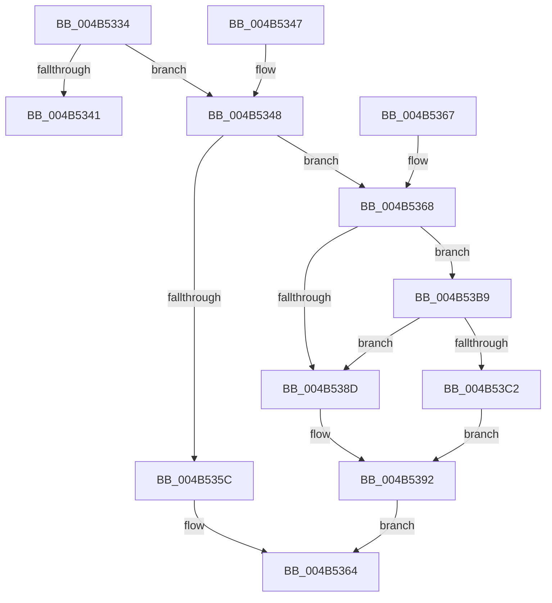

# HvlQueryL1tfMitigationInformation

- RVA: `0x004B5334`–`0x004B53C6` (길이 `146` bytes)
- VA: `0x00000001404B5334`
- 실행 섹션: `.text`
- PDB 이름 있음: `예`; PDB Function 태그: `아니요`
- unwind 정보 RVA: `0x000DB714`
- 디코드: `46`개 명령, `146/146` bytes 표시
- 미해석 바이트: `0` (있으면 어셈블리에 `.byte`로 보존)

> 이 문서는 커널 이미지의 기계어와 PDB 기호를 분석해 생성했습니다. 4번과 5번은 함수 원형과 자료형을 바이너리 사용 방식에서 추정한 C 해석이며 원본 소스 복구 결과는 아닙니다.

## 1. Dependencies

- 직접 호출 지점: **0**; 고유 호출 대상: **0**
- 직접 호출자로 확인된 함수: **1**
- RIP 상대 이미지 참조: **2**

### Outgoing calls
- 직접 디코드된 call 명령이 없습니다.

### Direct callers
- [KeQuerySpeculationControlInformation](../../page/74/KeQuerySpeculationControlInformation_function_007468A8.md) at `0x00746B76`

### Static image references
- `0x004B5334` → RVA `0x00FC6AD8` (`ALMOSTRO`; read)
- `0x004B5368` → RVA `0x00FC6B68` (`ALMOSTRO`; read)

## 2. Other-region calls and transfers

- 다른 실행 섹션으로 향하는 call: **0**
- 별도 외부 분기/꼬리 이동을 확인하지 못했습니다.

## 3. Assembly (complete function range)

```asm
004B5334  8B 05 9E 17 B1 00               mov eax, dword ptr [rip + 0xb1179e]
004B533A  4C 8B C9                        mov r9, rcx
004B533D  A8 01                           test al, 1
004B533F  75 07                           jne 0x1404b5348
004B5341  B8 BB 00 00 C0                  mov eax, 0xc00000bb
004B5346  C3                              ret
004B5347  CC                              int3
004B5348  65 48 8B 04 25 20 00 00 00      mov rax, qword ptr gs:[0x20]
004B5351  8B 11                           mov edx, dword ptr [rcx]
004B5353  80 B8 8D 00 00 00 02            cmp byte ptr [rax + 0x8d], 2
004B535A  74 0C                           je 0x1404b5368
004B535C  81 CA 00 00 06 00               or edx, 0x60000
004B5362  89 11                           mov dword ptr [rcx], edx
004B5364  33 C0                           xor eax, eax
004B5366  C3                              ret
004B5367  CC                              int3
004B5368  44 8B 05 F9 17 B1 00            mov r8d, dword ptr [rip + 0xb117f9]
004B536F  41 8B C0                        mov eax, r8d
004B5372  24 03                           and al, 3
004B5374  F6 D8                           neg al
004B5376  1B C9                           sbb ecx, ecx
004B5378  0F BA F2 12                     btr edx, 0x12
004B537C  81 E1 00 00 04 00               and ecx, 0x40000
004B5382  0B CA                           or ecx, edx
004B5384  0F BA E9 11                     bts ecx, 0x11
004B5388  45 84 C0                        test r8b, r8b
004B538B  79 2C                           jns 0x1404b53b9
004B538D  B8 00 00 08 00                  mov eax, 0x80000
004B5392  0F BA F1 13                     btr ecx, 0x13
004B5396  41 80 E0 14                     and r8b, 0x14
004B539A  0B C8                           or ecx, eax
004B539C  0F BA F1 14                     btr ecx, 0x14
004B53A0  41 F6 D8                        neg r8b
004B53A3  1B C0                           sbb eax, eax
004B53A5  F7 D0                           not eax
004B53A7  25 00 00 10 00                  and eax, 0x100000
004B53AC  0B C8                           or ecx, eax
004B53AE  81 E1 FF FF 9F FF               and ecx, 0xff9fffff
004B53B4  41 89 09                        mov dword ptr [r9], ecx
004B53B7  EB AB                           jmp 0x1404b5364
004B53B9  41 8B C0                        mov eax, r8d
004B53BC  24 38                           and al, 0x38
004B53BE  3C 10                           cmp al, 0x10
004B53C0  74 CB                           je 0x1404b538d
004B53C2  33 C0                           xor eax, eax
004B53C4  EB CC                           jmp 0x1404b5392
```

## 4. C-style interpretation (structured pseudocode)

```c
__int64 __fastcall HvlQueryL1tfMitigationInformation(__int64 a1)
{
    __int64 result;

    if ((((unsigned __int8)((unsigned int)(*(unsigned int *)(v_rip + 11605918)))) & (1)) != 0) goto loc_004B5348;
    return (unsigned int)(0xC00000BBULL);
loc_004B5348:
    if ((*(unsigned __int8 *)(*(unsigned __int64 *)(gs_base + (0 + 32)) + 141)) == 2) goto loc_004B5368;
    a2 = (unsigned int)(((unsigned int)(*(unsigned int *)(a1))) | (0x60000ULL));
    *(unsigned int *)(a1) = (unsigned int)(a2);
loc_004B5364:
    result = 0;
    return result;
loc_004B5368:
    result = (unsigned __int8)(((unsigned int)((unsigned int)((unsigned int)(*(unsigned int *)(v_rip + 11606009))))) & (3));
    result = (unsigned __int8)(-(result));
    a1 = (unsigned int)((a1) & (0x40000ULL));
    a1 = (unsigned int)((a1) | ((unsigned int)(a2)));
    if (!sign_flag) goto loc_004B53B9;
loc_004B538D:
loc_004B5392:
    a3 = (unsigned __int8)(((unsigned int)(*(unsigned int *)(v_rip + 11606009))) & (20));
    a1 = (unsigned int)((a1) | ((unsigned int)((unsigned int)(0x80000ULL))));
    a3 = (unsigned __int8)(-(a3));
    result = (unsigned int)(~((unsigned int)(0x80000ULL)));
    result = (unsigned int)((result) & (0x100000ULL));
    a1 = (unsigned int)((a1) | ((unsigned int)(result)));
    a1 = (unsigned int)((a1) & (0xFF9FFFFFULL));
    *(unsigned int *)(a1) = (unsigned int)(a1);
    goto loc_004B5364;
loc_004B53B9:
    result = (unsigned __int8)(((unsigned int)((unsigned int)(a3))) & (56));
    if (((unsigned __int8)(result)) == 16) goto loc_004B538D;
    result = 0;
    goto loc_004B5392;
}
```

## 5. (Beta) C Style

```c
int64_t HvlQueryL1tfMitigationInformation(void *Arg1)
{
    uint8_t *arg1 = (uint8_t *)Arg1;

    int64_t result;

    if ((((uint8_t)((uint32_t)(*(uint32_t *)(v_rip + 0xB1179E)))) & (1)) != 0) goto loc_004B5348;
    return (uint32_t)(0xC00000BBULL);
loc_004B5348:
    if ((*(uint8_t *)(*(uint64_t *)(gs_base + (0 + 0x20)) + 0x8D)) == 2) goto loc_004B5368;
    a2 = (uint32_t)(((uint32_t)(*(uint32_t *)(arg1))) | (0x60000ULL));
    *(uint32_t *)(arg1) = (uint32_t)(a2);
loc_004B5364:
    result = 0;
    return result;
loc_004B5368:
    result = (uint8_t)(((uint32_t)((uint32_t)((uint32_t)(*(uint32_t *)(v_rip + 0xB117F9))))) & (3));
    result = (uint8_t)(-(result));
    Arg1 = (uint32_t)((Arg1) & (0x40000ULL));
    Arg1 = (uint32_t)((Arg1) | ((uint32_t)(a2)));
    if (!sign_flag) goto loc_004B53B9;
loc_004B538D:
loc_004B5392:
    a3 = (uint8_t)(((uint32_t)(*(uint32_t *)(v_rip + 0xB117F9))) & (20));
    Arg1 = (uint32_t)((Arg1) | ((uint32_t)((uint32_t)(0x80000ULL))));
    a3 = (uint8_t)(-(a3));
    result = (uint32_t)(~((uint32_t)(0x80000ULL)));
    result = (uint32_t)((result) & (0x100000ULL));
    Arg1 = (uint32_t)((Arg1) | ((uint32_t)(result)));
    Arg1 = (uint32_t)((Arg1) & (0xFF9FFFFFULL));
    *(uint32_t *)(arg1) = (uint32_t)(Arg1);
    goto loc_004B5364;
loc_004B53B9:
    result = (uint8_t)(((uint32_t)((uint32_t)(a3))) & (56));
    if (((uint8_t)(result)) == 16) goto loc_004B538D;
    result = 0;
    goto loc_004B5392;
}
```

### 관측된 메모리 오프셋

구조체 형식이 확인되지 않은 접근은 인자 기준의 오프셋으로만 기록했습니다.

| 기준 인자 | 오프셋 표현 | 폭 (bit) | 접근 |
|---|---:|---:|---|
| `Arg1` | `+ 0x0` | `32` | `R` |
| `Arg1` | `+ 0x0` | `32` | `W` |

## 6. Execution-region graph

[열기: 2D/3D 그래프와 함수 탐색 컨트롤 패널](../../../control-panel.html?section=text&rva=0x004B5334&view=graph)

- 2D 그래프는 위에서 아래로 흐르고, 3D 그래프는 빈 공간을 드래그해 회전합니다. Shift+드래그는 이동, 휠은 확대·축소, 함수 노드 선택은 대상 보고서 이동입니다.

### Static fallback


