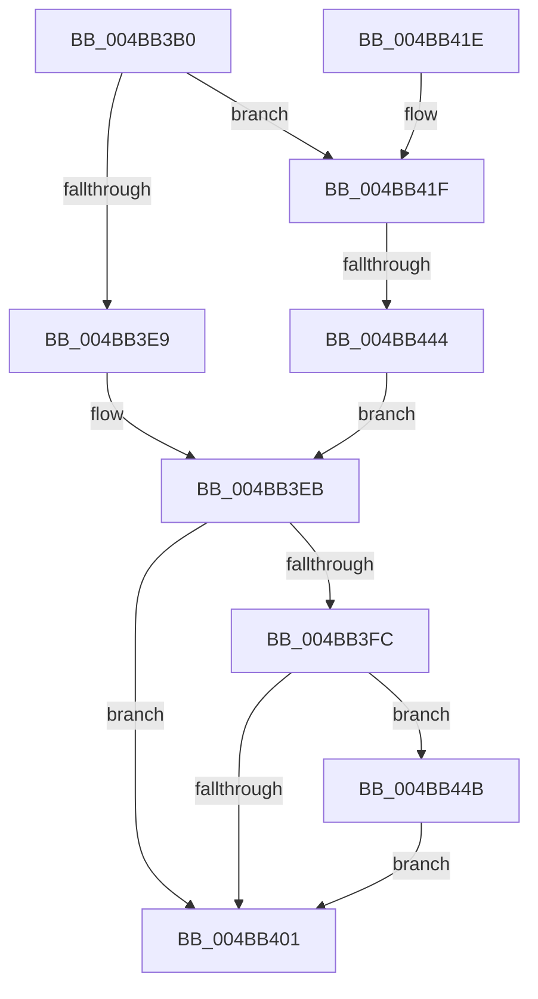

# IoAdjustStackSizeForRedirection

- RVA: `0x004BB3B0`–`0x004BB450` (길이 `160` bytes)
- VA: `0x00000001404BB3B0`
- 실행 섹션: `.text`
- PDB 이름 있음: `예`; PDB Function 태그: `예`
- unwind 정보 RVA: `0x000930AC`
- 디코드: `50`개 명령, `160/160` bytes 표시
- 미해석 바이트: `0` (있으면 어셈블리에 `.byte`로 보존)

> 이 문서는 커널 이미지의 기계어와 PDB 기호를 분석해 생성했습니다. 4번과 5번은 함수 원형과 자료형을 바이너리 사용 방식에서 추정한 C 해석이며 원본 소스 복구 결과는 아닙니다.

## 1. Dependencies

- 직접 호출 지점: **3**; 고유 호출 대상: **3**
- 직접 호출자로 확인된 함수: **0**
- RIP 상대 이미지 참조: **0**

### Outgoing calls
- `0x004BB3D7` → [KeAcquireQueuedSpinLock](../27/KeAcquireQueuedSpinLock_function_00273D80.md) (function, `0x00273D80`)
- `0x004BB3F3` → [KeReleaseQueuedSpinLock](../27/KeReleaseQueuedSpinLock_function_00272540.md) (function, `0x00272540`)
- `0x004BB424` → [IoGetAttachedDevice](../41/IoGetAttachedDevice_function_00410810.md) (function, `0x00410810`)

### Direct callers
- 이 함수 시작 RVA로 연결되는 직접 call은 확인되지 않았습니다. 간접 호출은 완전히 역산할 수 없습니다.

### Static image references
- 디코드된 RIP-relative 메모리 참조가 없습니다.

## 2. Other-region calls and transfers

- 다른 실행 섹션으로 향하는 call: **0**
- call이 아닌 외부 분기/꼬리 이동: **1**
  - `0x004BB43E` → [sub_006FC66A + 0xF](../6F/Unknown_function_006FC66A.md) (`tail-transfer`)

## 3. Assembly (complete function range)

```asm
004BB3B0  48 8B C4                        mov rax, rsp
004BB3B3  48 89 58 08                     mov qword ptr [rax + 8], rbx
004BB3B7  48 89 68 10                     mov qword ptr [rax + 0x10], rbp
004BB3BB  48 89 70 18                     mov qword ptr [rax + 0x18], rsi
004BB3BF  48 89 78 20                     mov qword ptr [rax + 0x20], rdi
004BB3C3  41 56                           push r14
004BB3C5  48 83 EC 20                     sub rsp, 0x20
004BB3C9  48 8B F9                        mov rdi, rcx
004BB3CC  33 F6                           xor esi, esi
004BB3CE  4D 8B F0                        mov r14, r8
004BB3D1  48 8B DA                        mov rbx, rdx
004BB3D4  8D 4E 0A                        lea ecx, [rsi + 0xa]
004BB3D7  E8 A4 89 DB FF                  call 0x140273d80
004BB3DC  8A 5B 4C                        mov bl, byte ptr [rbx + 0x4c]
004BB3DF  40 8A E8                        mov bpl, al
004BB3E2  8A 47 4C                        mov al, byte ptr [rdi + 0x4c]
004BB3E5  3A C3                           cmp al, bl
004BB3E7  7C 36                           jl 0x1404bb41f
004BB3E9  32 DB                           xor bl, bl
004BB3EB  40 8A D5                        mov dl, bpl
004BB3EE  B9 0A 00 00 00                  mov ecx, 0xa
004BB3F3  E8 48 71 DB FF                  call 0x140272540
004BB3F8  85 F6                           test esi, esi
004BB3FA  78 05                           js 0x1404bb401
004BB3FC  4D 85 F6                        test r14, r14
004BB3FF  75 4A                           jne 0x1404bb44b
004BB401  48 8B 5C 24 30                  mov rbx, qword ptr [rsp + 0x30]
004BB406  8B C6                           mov eax, esi
004BB408  48 8B 74 24 40                  mov rsi, qword ptr [rsp + 0x40]
004BB40D  48 8B 6C 24 38                  mov rbp, qword ptr [rsp + 0x38]
004BB412  48 8B 7C 24 48                  mov rdi, qword ptr [rsp + 0x48]
004BB417  48 83 C4 20                     add rsp, 0x20
004BB41B  41 5E                           pop r14
004BB41D  C3                              ret
004BB41E  CC                              int3
004BB41F  48 8B CF                        mov rcx, rdi
004BB422  2A D8                           sub bl, al
004BB424  E8 E7 53 F5 FF                  call 0x140410810
004BB429  4C 8B C0                        mov r8, rax
004BB42C  0F BE 40 4C                     movsx eax, byte ptr [rax + 0x4c]
004BB430  0F B7 D0                        movzx edx, ax
004BB433  0F BE C3                        movsx eax, bl
004BB436  0F B7 C8                        movzx ecx, ax
004BB439  03 D1                           add edx, ecx
004BB43B  83 FA 7D                        cmp edx, 0x7d
004BB43E  0F 82 35 12 24 00               jb 0x1406fc679
004BB444  BE 0D 00 00 C0                  mov esi, 0xc000000d
004BB449  EB A0                           jmp 0x1404bb3eb
004BB44B  41 88 1E                        mov byte ptr [r14], bl
004BB44E  EB B1                           jmp 0x1404bb401
```

## 4. C-style interpretation (structured pseudocode)

```c
__int64 __fastcall IoAdjustStackSizeForRedirection(__int64 a1, __int64 a2, __int64 a3)
{
    __int64 result;
    __int64 v_rbx;
    __int64 v_rsi;
    __int64 v_rsp;
    unsigned __int64 v_stack_p10;
    unsigned __int64 v_stack_p18;
    unsigned __int64 v_stack_p20;
    unsigned __int64 v_stack_p8;

    *(unsigned __int64 *)(v_rsp + 8) = v_rbx;
    *(unsigned __int64 *)(v_rsp + 16) = v_rbp;
    *(unsigned __int64 *)(v_rsp + 24) = v_rsi;
    *(unsigned __int64 *)(v_rsp + 32) = v_rdi;
    v_rsp = (v_rsp) - (32);
    v_rsi = 0;
    result = KeAcquireQueuedSpinLock(v_rsi + 10, a2, a3, a4);
    if (((unsigned __int8)(*(unsigned __int8 *)(a1 + 76))) < ((unsigned __int8)(*(unsigned __int8 *)(a2 + 76)))) goto loc_004BB41F;
    v_rbx = 0;
loc_004BB3EB:
    result = KeReleaseQueuedSpinLock(10, (unsigned __int8)((unsigned __int8)(result)), a3, a4);
    if (sign_flag) goto loc_004BB401;
    if (a3 != 0) goto loc_004BB44B;
loc_004BB401:
    v_rsp = (v_rsp) + (32);
    return 0;
loc_004BB41F:
    v_rbx = (unsigned __int8)((v_stack_p8) - (0));
    result = IoGetAttachedDevice(v_stack_p20, (unsigned __int8)((unsigned __int8)(result)), a3, a4);
    a2 = (unsigned int)(((unsigned __int16)((__int8)(*(unsigned __int8 *)(result + 76)))) + ((unsigned int)((unsigned __int16)((__int8)((unsigned __int8)(v_rbx))))));
    goto loc_004BB3EB;
loc_004BB44B:
    *(unsigned __int8 *)(a3) = (unsigned __int8)(v_rbx);
    goto loc_004BB401;
}
```

## 5. (Beta) C Style

```c
int64_t IoAdjustStackSizeForRedirection(void *Arg1, void *Arg2, int64_t Arg3)
{
    uint8_t *arg1 = (uint8_t *)Arg1;
    uint8_t *arg2 = (uint8_t *)Arg2;

    int64_t result;
    int64_t local_rbx;
    int64_t local_rsi;
    int64_t local_rsp;
    uint64_t v_stack_p10;
    uint64_t v_stack_p18;
    uint64_t v_stack_p20;
    uint64_t v_stack_p8;

    *(uint64_t *)(local_rsp + 0x8) = local_rbx;
    *(uint64_t *)(local_rsp + 0x10) = local_rbp;
    *(uint64_t *)(local_rsp + 0x18) = local_rsi;
    *(uint64_t *)(local_rsp + 0x20) = local_rdi;
    local_rsp = (local_rsp) - (32);
    local_rsi = 0;
    result = KeAcquireQueuedSpinLock(local_rsi + 10, Arg2, Arg3, a4);
    if (((uint8_t)(*(uint8_t *)(arg1 + 0x4C))) < ((uint8_t)(*(uint8_t *)(arg2 + 0x4C)))) goto loc_004BB41F;
    local_rbx = 0;
loc_004BB3EB:
    result = KeReleaseQueuedSpinLock(10, (uint8_t)((uint8_t)(result)), Arg3, a4);
    if (sign_flag) goto loc_004BB401;
    if (Arg3 != 0) goto loc_004BB44B;
loc_004BB401:
    local_rsp = (local_rsp) + (32);
    return 0;
loc_004BB41F:
    local_rbx = (uint8_t)((v_stack_p8) - (0));
    result = IoGetAttachedDevice(v_stack_p20, (uint8_t)((uint8_t)(result)), Arg3, a4);
    Arg2 = (uint32_t)(((uint16_t)((int8_t)(*(uint8_t *)(result + 0x4C)))) + ((uint32_t)((uint16_t)((int8_t)((uint8_t)(local_rbx))))));
    goto loc_004BB3EB;
loc_004BB44B:
    *(uint8_t *)(Arg3) = (uint8_t)(local_rbx);
    goto loc_004BB401;
}
```

### 관측된 메모리 오프셋

구조체 형식이 확인되지 않은 접근은 인자 기준의 오프셋으로만 기록했습니다.

| 기준 인자 | 오프셋 표현 | 폭 (bit) | 접근 |
|---|---:|---:|---|
| `Arg1` | `+ 0x4C` | `8` | `R` |
| `Arg2` | `+ 0x4C` | `8` | `R` |

## 6. Execution-region graph

[열기: 2D/3D 그래프와 함수 탐색 컨트롤 패널](../../../control-panel.html?section=text&rva=0x004BB3B0&view=graph)

- 2D 그래프는 위에서 아래로 흐르고, 3D 그래프는 빈 공간을 드래그해 회전합니다. Shift+드래그는 이동, 휠은 확대·축소, 함수 노드 선택은 대상 보고서 이동입니다.

### Static fallback


