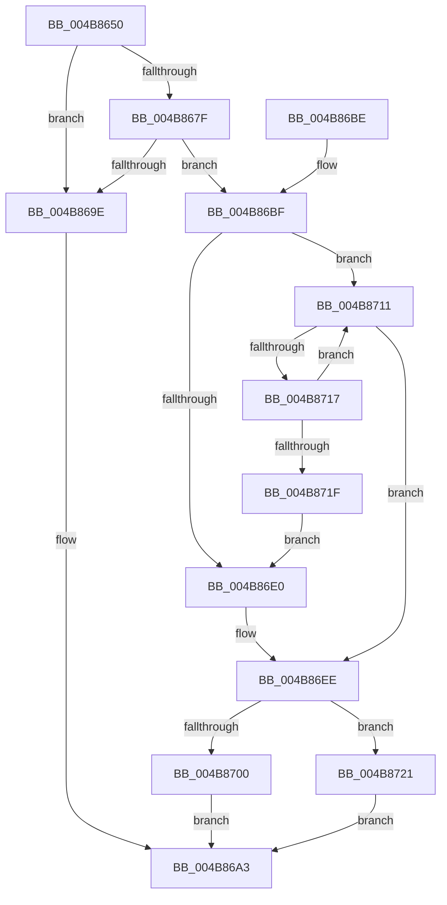

# IoAllocateDriverObjectExtension

- RVA: `0x004B8650`–`0x004B872F` (길이 `223` bytes)
- VA: `0x00000001404B8650`
- 실행 섹션: `.text`
- PDB 이름 있음: `예`; PDB Function 태그: `아니요`
- unwind 정보 RVA: `0x000BAE54`
- 디코드: `64`개 명령, `223/223` bytes 표시
- 미해석 바이트: `0` (있으면 어셈블리에 `.byte`로 보존)

> 이 문서는 커널 이미지의 기계어와 PDB 기호를 분석해 생성했습니다. 4번과 5번은 함수 원형과 자료형을 바이너리 사용 방식에서 추정한 C 해석이며 원본 소스 복구 결과는 아닙니다.

## 1. Dependencies

- 직접 호출 지점: **4**; 고유 호출 대상: **4**
- 직접 호출자로 확인된 함수: **1**
- RIP 상대 이미지 참조: **0**

### Outgoing calls
- `0x004B8691` → [ExAllocatePool2](../../poolcode/B8/ExAllocatePool2_function_00B820F0.md) (function, `0x00B820F0`)
- `0x004B86C8` → [KeAcquireQueuedSpinLock](../27/KeAcquireQueuedSpinLock_function_00273D80.md) (function, `0x00273D80`)
- `0x004B86F6` → [KeReleaseQueuedSpinLock](../27/KeReleaseQueuedSpinLock_function_00272540.md) (function, `0x00272540`)
- `0x004B8705` → [ExFreePoolWithTag](../../poolcode/B8/ExFreePoolWithTag_function_00B82870.md) (function, `0x00B82870`)

### Direct callers
- [DifIoAllocateDriverObjectExtensionWrapper](../62/DifIoAllocateDriverObjectExtensionWrapper_function_00627530.md) at `0x00627623`

### Static image references
- 디코드된 RIP-relative 메모리 참조가 없습니다.

## 2. Other-region calls and transfers

- 다른 실행 섹션으로 향하는 call: **2**
  - `0x004B8691` → [ExAllocatePool2](../../poolcode/B8/ExAllocatePool2_function_00B820F0.md) (`.text` → `POOLCODE`)
  - `0x004B8705` → [ExFreePoolWithTag](../../poolcode/B8/ExFreePoolWithTag_function_00B82870.md) (`.text` → `POOLCODE`)
- 별도 외부 분기/꼬리 이동을 확인하지 못했습니다.

## 3. Assembly (complete function range)

```asm
004B8650  48 8B C4                        mov rax, rsp
004B8653  48 89 58 08                     mov qword ptr [rax + 8], rbx
004B8657  48 89 68 10                     mov qword ptr [rax + 0x10], rbp
004B865B  48 89 70 18                     mov qword ptr [rax + 0x18], rsi
004B865F  48 89 78 20                     mov qword ptr [rax + 0x20], rdi
004B8663  41 56                           push r14
004B8665  48 83 EC 20                     sub rsp, 0x20
004B8669  49 83 21 00                     and qword ptr [r9], 0
004B866D  40 32 F6                        xor sil, sil
004B8670  49 8B F9                        mov rdi, r9
004B8673  48 8B EA                        mov rbp, rdx
004B8676  4C 8B F1                        mov r14, rcx
004B8679  41 83 F8 EF                     cmp r8d, -0x11
004B867D  77 1F                           ja 0x1404b869e
004B867F  41 8B D0                        mov edx, r8d
004B8682  B9 40 00 00 00                  mov ecx, 0x40
004B8687  48 83 C2 10                     add rdx, 0x10
004B868B  41 B8 44 72 69 76               mov r8d, 0x76697244
004B8691  E8 5A 9A 6C 00                  call 0x140b820f0
004B8696  48 8B D8                        mov rbx, rax
004B8699  48 85 C0                        test rax, rax
004B869C  75 21                           jne 0x1404b86bf
004B869E  B8 9A 00 00 C0                  mov eax, 0xc000009a
004B86A3  48 8B 5C 24 30                  mov rbx, qword ptr [rsp + 0x30]
004B86A8  48 8B 6C 24 38                  mov rbp, qword ptr [rsp + 0x38]
004B86AD  48 8B 74 24 40                  mov rsi, qword ptr [rsp + 0x40]
004B86B2  48 8B 7C 24 48                  mov rdi, qword ptr [rsp + 0x48]
004B86B7  48 83 C4 20                     add rsp, 0x20
004B86BB  41 5E                           pop r14
004B86BD  C3                              ret
004B86BE  CC                              int3
004B86BF  B9 0A 00 00 00                  mov ecx, 0xa
004B86C4  48 89 68 08                     mov qword ptr [rax + 8], rbp
004B86C8  E8 B3 B6 DB FF                  call 0x140273d80
004B86CD  49 8B 4E 30                     mov rcx, qword ptr [r14 + 0x30]
004B86D1  44 8A C8                        mov r9b, al
004B86D4  4C 8B 41 28                     mov r8, qword ptr [rcx + 0x28]
004B86D8  49 8B D0                        mov rdx, r8
004B86DB  4D 85 C0                        test r8, r8
004B86DE  75 31                           jne 0x1404b8711
004B86E0  4C 89 03                        mov qword ptr [rbx], r8
004B86E3  40 B6 01                        mov sil, 1
004B86E6  49 8B 46 30                     mov rax, qword ptr [r14 + 0x30]
004B86EA  48 89 58 28                     mov qword ptr [rax + 0x28], rbx
004B86EE  41 8A D1                        mov dl, r9b
004B86F1  B9 0A 00 00 00                  mov ecx, 0xa
004B86F6  E8 45 9E DB FF                  call 0x140272540
004B86FB  40 84 F6                        test sil, sil
004B86FE  75 21                           jne 0x1404b8721
004B8700  33 D2                           xor edx, edx
004B8702  48 8B CB                        mov rcx, rbx
004B8705  E8 66 A1 6C 00                  call 0x140b82870
004B870A  B8 35 00 00 C0                  mov eax, 0xc0000035
004B870F  EB 92                           jmp 0x1404b86a3
004B8711  48 39 6A 08                     cmp qword ptr [rdx + 8], rbp
004B8715  74 D7                           je 0x1404b86ee
004B8717  48 8B 12                        mov rdx, qword ptr [rdx]
004B871A  48 85 D2                        test rdx, rdx
004B871D  75 F2                           jne 0x1404b8711
004B871F  EB BF                           jmp 0x1404b86e0
004B8721  48 8D 43 10                     lea rax, [rbx + 0x10]
004B8725  48 89 07                        mov qword ptr [rdi], rax
004B8728  33 C0                           xor eax, eax
004B872A  E9 74 FF FF FF                  jmp 0x1404b86a3
```

## 4. C-style interpretation (structured pseudocode)

```c
__int64 __fastcall IoAllocateDriverObjectExtension(__int64 a1, __int64 a2, int a3, __int64 a4)
{
    __int64 result;
    __int64 v_rsi;
    __int64 v_rsp;
    unsigned __int64 v_stack_p10;
    unsigned __int64 v_stack_p18;
    unsigned __int64 v_stack_p20;
    unsigned __int64 v_stack_p8;

    *(unsigned __int64 *)(v_rsp + 8) = v_rbx;
    *(unsigned __int64 *)(v_rsp + 16) = v_rbp;
    *(unsigned __int64 *)(v_rsp + 24) = v_rsi;
    *(unsigned __int64 *)(v_rsp + 32) = v_rdi;
    v_rsp = (v_rsp) - (32);
    v_rsi = 0;
    if (a3 > -17) goto loc_004B869E;
    a2 = ((unsigned int)(a3)) + (16);
    result = ExAllocatePool2(64, a2, (unsigned int)(0x76697244ULL), a4);
    if (result != 0) goto loc_004B86BF;
loc_004B869E:
loc_004B86A3:
    v_rsp = (v_rsp) + (32);
    return (unsigned int)(0xC000009AULL);
loc_004B86BF:
    *(unsigned __int64 *)((unsigned int)(0xC000009AULL) + 8) = v_stack_p10;
    result = KeAcquireQueuedSpinLock(10, a2, (unsigned int)(0x76697244ULL), a4);
    if (*(unsigned __int64 *)(*(unsigned __int64 *)(a1 + 48) + 40) != 0) goto loc_004B8711;
loc_004B86E0:
    *(unsigned __int64 *)(v_stack_p8) = *(unsigned __int64 *)(*(unsigned __int64 *)(a1 + 48) + 40);
    *(unsigned __int64 *)(*(unsigned __int64 *)(a1 + 48) + 40) = v_stack_p8;
loc_004B86EE:
    result = KeReleaseQueuedSpinLock(10, (unsigned __int8)((unsigned __int8)(result)), *(unsigned __int64 *)(*(unsigned __int64 *)(a1 + 48) + 40), (unsigned __int8)(result));
    if (1 != 0) goto loc_004B8721;
    a2 = 0;
    result = ExFreePoolWithTag(v_stack_p8, a2, *(unsigned __int64 *)(*(unsigned __int64 *)(a1 + 48) + 40), (unsigned __int8)(result));
    goto loc_004B86A3;
loc_004B8711:
    if ((*(unsigned __int64 *)(a2 + 8)) == v_stack_p10) goto loc_004B86EE;
    if (*(unsigned __int64 *)(a2) != 0) goto loc_004B8711;
    goto loc_004B86E0;
loc_004B8721:
    *(unsigned __int64 *)(v_stack_p20) = v_stack_p8 + 16;
    result = 0;
    goto loc_004B86A3;
}
```

## 5. (Beta) C Style

```c
int64_t IoAllocateDriverObjectExtension(void *Arg1, int64_t Arg2, int32_t Arg3, void *Arg4)
{
    uint8_t *arg1 = (uint8_t *)Arg1;
    uint8_t *arg4 = (uint8_t *)Arg4;

    int64_t result;
    int64_t local_rsi;
    int64_t local_rsp;
    uint64_t v_stack_p10;
    uint64_t v_stack_p18;
    uint64_t v_stack_p20;
    uint64_t v_stack_p8;

    *(uint64_t *)(local_rsp + 0x8) = local_rbx;
    *(uint64_t *)(local_rsp + 0x10) = local_rbp;
    *(uint64_t *)(local_rsp + 0x18) = local_rsi;
    *(uint64_t *)(local_rsp + 0x20) = local_rdi;
    local_rsp = (local_rsp) - (32);
    local_rsi = 0;
    if (Arg3 > -17) goto loc_004B869E;
    Arg2 = ((uint32_t)(Arg3)) + (16);
    result = ExAllocatePool2(64, Arg2, (uint32_t)(0x76697244ULL), Arg4);
    if (result != 0) goto loc_004B86BF;
loc_004B869E:
loc_004B86A3:
    local_rsp = (local_rsp) + (32);
    return (uint32_t)(0xC000009AULL);
loc_004B86BF:
    *(uint64_t *)((uint32_t)(0xC000009AULL) + 0x8) = v_stack_p10;
    result = KeAcquireQueuedSpinLock(10, Arg2, (uint32_t)(0x76697244ULL), Arg4);
    if (*(uint64_t *)(*(uint64_t *)(arg1 + 0x30) + 0x28) != 0) goto loc_004B8711;
loc_004B86E0:
    *(uint64_t *)(v_stack_p8) = *(uint64_t *)(*(uint64_t *)(arg1 + 0x30) + 0x28);
    *(uint64_t *)(*(uint64_t *)(arg1 + 0x30) + 0x28) = v_stack_p8;
loc_004B86EE:
    result = KeReleaseQueuedSpinLock(10, (uint8_t)((uint8_t)(result)), *(uint64_t *)(*(uint64_t *)(arg1 + 0x30) + 0x28), (uint8_t)(result));
    if (1 != 0) goto loc_004B8721;
    Arg2 = 0;
    result = ExFreePoolWithTag(v_stack_p8, Arg2, *(uint64_t *)(*(uint64_t *)(arg1 + 0x30) + 0x28), (uint8_t)(result));
    goto loc_004B86A3;
loc_004B8711:
    if ((*(uint64_t *)(Arg2 + 0x8)) == v_stack_p10) goto loc_004B86EE;
    if (*(uint64_t *)(Arg2) != 0) goto loc_004B8711;
    goto loc_004B86E0;
loc_004B8721:
    *(uint64_t *)(v_stack_p20) = v_stack_p8 + 16;
    result = 0;
    goto loc_004B86A3;
}
```

### 관측된 메모리 오프셋

구조체 형식이 확인되지 않은 접근은 인자 기준의 오프셋으로만 기록했습니다.

| 기준 인자 | 오프셋 표현 | 폭 (bit) | 접근 |
|---|---:|---:|---|
| `Arg1` | `+ 0x30` | `64` | `R` |
| `Arg4` | `+ 0x0` | `64` | `R/W` |
| `Arg4` | `+ 0x0` | `64` | `W` |

## 6. Execution-region graph

[열기: 2D/3D 그래프와 함수 탐색 컨트롤 패널](../../../control-panel.html?section=text&rva=0x004B8650&view=graph)

- 2D 그래프는 위에서 아래로 흐르고, 3D 그래프는 빈 공간을 드래그해 회전합니다. Shift+드래그는 이동, 휠은 확대·축소, 함수 노드 선택은 대상 보고서 이동입니다.

### Static fallback


