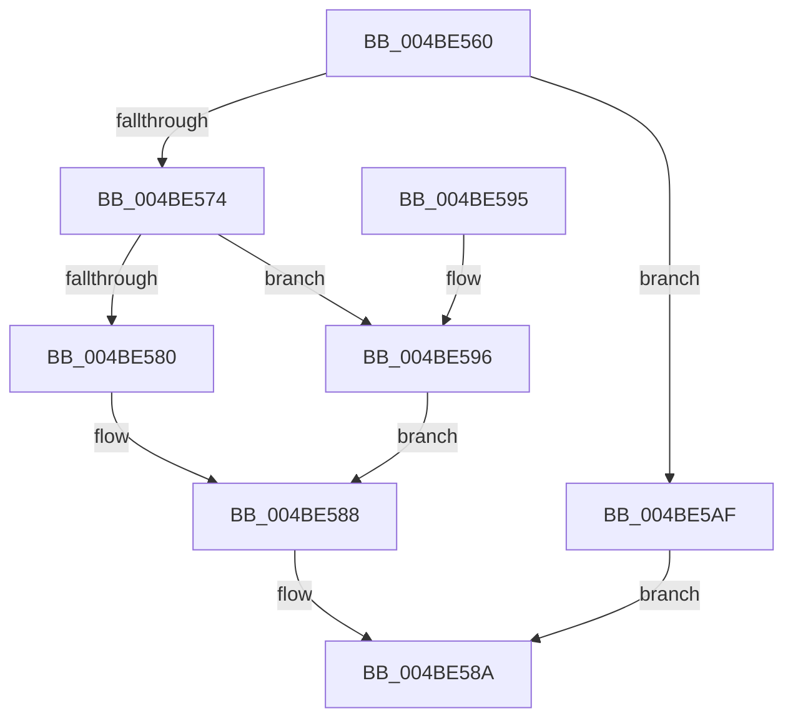

# IoBoostThreadIo

- RVA: `0x004BE560`–`0x004BE5B6` (길이 `86` bytes)
- VA: `0x00000001404BE560`
- 실행 섹션: `.text`
- PDB 이름 있음: `예`; PDB Function 태그: `아니요`
- unwind 정보 RVA: `0x0005D368`
- 디코드: `28`개 명령, `86/86` bytes 표시
- 미해석 바이트: `0` (있으면 어셈블리에 `.byte`로 보존)

> 이 문서는 커널 이미지의 기계어와 PDB 기호를 분석해 생성했습니다. 4번과 5번은 함수 원형과 자료형을 바이너리 사용 방식에서 추정한 C 해석이며 원본 소스 복구 결과는 아닙니다.

## 1. Dependencies

- 직접 호출 지점: **3**; 고유 호출 대상: **2**
- 직접 호출자로 확인된 함수: **0**
- RIP 상대 이미지 참조: **0**

### Outgoing calls
- `0x004BE583` → [PsBoostThreadIoEx](../39/PsBoostThreadIoEx_function_00392C00.md) (function, `0x00392C00`)
- `0x004BE598` → [PsBoostThreadIoEx](../39/PsBoostThreadIoEx_function_00392C00.md) (function, `0x00392C00`)
- `0x004BE5A8` → [IoBoostThreadIoPriority](../21/IoBoostThreadIoPriority_function_00216110.md) (function, `0x00216110`)

### Direct callers
- 이 함수 시작 RVA로 연결되는 직접 call은 확인되지 않았습니다. 간접 호출은 완전히 역산할 수 없습니다.

### Static image references
- 디코드된 RIP-relative 메모리 참조가 없습니다.

## 2. Other-region calls and transfers

- 다른 실행 섹션으로 향하는 call: **0**
- 별도 외부 분기/꼬리 이동을 확인하지 못했습니다.

## 3. Assembly (complete function range)

```asm
004BE560  48 89 5C 24 08                  mov qword ptr [rsp + 8], rbx
004BE565  57                              push rdi
004BE566  48 83 EC 20                     sub rsp, 0x20
004BE56A  8B FA                           mov edi, edx
004BE56C  48 8B D9                        mov rbx, rcx
004BE56F  45 85 C9                        test r9d, r9d
004BE572  75 3B                           jne 0x1404be5af
004BE574  45 33 C9                        xor r9d, r9d
004BE577  41 80 F8 01                     cmp r8b, 1
004BE57B  41 B0 01                        mov r8b, 1
004BE57E  75 16                           jne 0x1404be596
004BE580  41 8A D0                        mov dl, r8b
004BE583  E8 78 46 ED FF                  call 0x140392c00
004BE588  33 C0                           xor eax, eax
004BE58A  48 8B 5C 24 30                  mov rbx, qword ptr [rsp + 0x30]
004BE58F  48 83 C4 20                     add rsp, 0x20
004BE593  5F                              pop rdi
004BE594  C3                              ret
004BE595  CC                              int3
004BE596  33 D2                           xor edx, edx
004BE598  E8 63 46 ED FF                  call 0x140392c00
004BE59D  41 B8 00 00 00 80               mov r8d, 0x80000000
004BE5A3  8B D7                           mov edx, edi
004BE5A5  48 8B CB                        mov rcx, rbx
004BE5A8  E8 63 7B D5 FF                  call 0x140216110
004BE5AD  EB D9                           jmp 0x1404be588
004BE5AF  B8 0D 00 00 C0                  mov eax, 0xc000000d
004BE5B4  EB D4                           jmp 0x1404be58a
```

## 4. C-style interpretation (structured pseudocode)

```c
__int64 __fastcall IoBoostThreadIo(__int64 a1, int a2, unsigned __int8 a3, int a4)
{
    __int64 result;
    __int64 v_rsp;
    unsigned __int64 v_stack_p8;

    v_stack_p8 = v_rbx;
    v_rsp = (v_rsp) - (32);
    if (a4 != 0) goto loc_004BE5AF;
    a4 = 0;
    if (a3 != 1) goto loc_004BE596;
    result = PsBoostThreadIoEx(a1, 1, 1, a4);
loc_004BE588:
    result = 0;
loc_004BE58A:
    v_rsp = (v_rsp) + (32);
    return result;
loc_004BE596:
    a2 = 0;
    result = PsBoostThreadIoEx(a1, a2, 1, a4);
    result = IoBoostThreadIoPriority(v_stack_p8, (unsigned int)((unsigned int)((unsigned int)(a2))), (unsigned int)(0x80000000ULL), a4);
    goto loc_004BE588;
loc_004BE5AF:
    goto loc_004BE58A;
}
```

## 5. (Beta) C Style

```c
int64_t IoBoostThreadIo(int64_t Arg1, int32_t Arg2, uint8_t Arg3, int32_t Arg4)
{
    int64_t result;
    int64_t local_rsp;
    uint64_t v_stack_p8;

    v_stack_p8 = local_rbx;
    local_rsp = (local_rsp) - (32);
    if (Arg4 != 0) goto loc_004BE5AF;
    Arg4 = 0;
    if (Arg3 != 1) goto loc_004BE596;
    result = PsBoostThreadIoEx(Arg1, 1, 1, Arg4);
loc_004BE588:
    result = 0;
loc_004BE58A:
    local_rsp = (local_rsp) + (32);
    return result;
loc_004BE596:
    Arg2 = 0;
    result = PsBoostThreadIoEx(Arg1, Arg2, 1, Arg4);
    result = IoBoostThreadIoPriority(v_stack_p8, (uint32_t)((uint32_t)((uint32_t)(Arg2))), (uint32_t)(0x80000000ULL), Arg4);
    goto loc_004BE588;
loc_004BE5AF:
    goto loc_004BE58A;
}
```

## 6. Execution-region graph

[열기: 2D/3D 그래프와 함수 탐색 컨트롤 패널](../../../control-panel.html?section=text&rva=0x004BE560&view=graph)

- 2D 그래프는 위에서 아래로 흐르고, 3D 그래프는 빈 공간을 드래그해 회전합니다. Shift+드래그는 이동, 휠은 확대·축소, 함수 노드 선택은 대상 보고서 이동입니다.

### Static fallback


