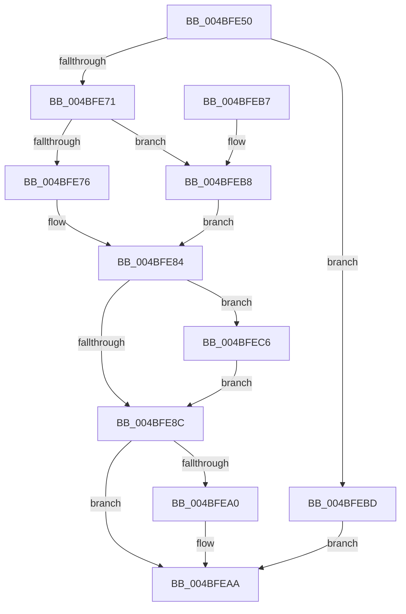

# IoComputeRedirectionTrustLevel

- RVA: `0x004BFE50`–`0x004BFECC` (길이 `124` bytes)
- VA: `0x00000001404BFE50`
- 실행 섹션: `.text`
- PDB 이름 있음: `예`; PDB Function 태그: `아니요`
- unwind 정보 RVA: `0x000BC630`
- 디코드: `41`개 명령, `124/124` bytes 표시
- 미해석 바이트: `0` (있으면 어셈블리에 `.byte`로 보존)

> 이 문서는 커널 이미지의 기계어와 PDB 기호를 분석해 생성했습니다. 4번과 5번은 함수 원형과 자료형을 바이너리 사용 방식에서 추정한 C 해석이며 원본 소스 복구 결과는 아닙니다.

## 1. Dependencies

- 직접 호출 지점: **3**; 고유 호출 대상: **3**
- 직접 호출자로 확인된 함수: **0**
- RIP 상대 이미지 참조: **0**

### Outgoing calls
- `0x004BFE7A` → [SeCaptureSubjectContext](../../page/86/SeCaptureSubjectContext_function_0086B820.md) (function, `0x0086B820`)
- `0x004BFE8C` → [SeTokenIsAdmin](../../page/9F/SeTokenIsAdmin_function_009FE650.md) (function, `0x009FE650`)
- `0x004BFEA5` → [SeReleaseSubjectContext](../../page/86/SeReleaseSubjectContext_function_0086B710.md) (function, `0x0086B710`)

### Direct callers
- 이 함수 시작 RVA로 연결되는 직접 call은 확인되지 않았습니다. 간접 호출은 완전히 역산할 수 없습니다.

### Static image references
- 디코드된 RIP-relative 메모리 참조가 없습니다.

## 2. Other-region calls and transfers

- 다른 실행 섹션으로 향하는 call: **3**
  - `0x004BFE7A` → [SeCaptureSubjectContext](../../page/86/SeCaptureSubjectContext_function_0086B820.md) (`.text` → `PAGE`)
  - `0x004BFE8C` → [SeTokenIsAdmin](../../page/9F/SeTokenIsAdmin_function_009FE650.md) (`.text` → `PAGE`)
  - `0x004BFEA5` → [SeReleaseSubjectContext](../../page/86/SeReleaseSubjectContext_function_0086B710.md) (`.text` → `PAGE`)
- 별도 외부 분기/꼬리 이동을 확인하지 못했습니다.

## 3. Assembly (complete function range)

```asm
004BFE50  48 8B C4                        mov rax, rsp
004BFE53  48 89 58 08                     mov qword ptr [rax + 8], rbx
004BFE57  57                              push rdi
004BFE58  48 83 EC 40                     sub rsp, 0x40
004BFE5C  0F 57 C0                        xorps xmm0, xmm0
004BFE5F  49 8B F9                        mov rdi, r9
004BFE62  49 8B D8                        mov rbx, r8
004BFE65  0F 11 40 D8                     movups xmmword ptr [rax - 0x28], xmm0
004BFE69  0F 11 40 E8                     movups xmmword ptr [rax - 0x18], xmm0
004BFE6D  84 D2                           test dl, dl
004BFE6F  74 4C                           je 0x1404bfebd
004BFE71  48 85 DB                        test rbx, rbx
004BFE74  75 42                           jne 0x1404bfeb8
004BFE76  48 8D 48 D8                     lea rcx, [rax - 0x28]
004BFE7A  E8 A1 B9 3A 00                  call 0x14086b820
004BFE7F  48 8D 44 24 20                  lea rax, [rsp + 0x20]
004BFE84  48 8B 08                        mov rcx, qword ptr [rax]
004BFE87  48 85 C9                        test rcx, rcx
004BFE8A  74 3A                           je 0x1404bfec6
004BFE8C  E8 BF E7 53 00                  call 0x1409fe650
004BFE91  F6 D8                           neg al
004BFE93  1B C9                           sbb ecx, ecx
004BFE95  F7 D9                           neg ecx
004BFE97  FF C1                           inc ecx
004BFE99  89 0F                           mov dword ptr [rdi], ecx
004BFE9B  48 85 DB                        test rbx, rbx
004BFE9E  75 0A                           jne 0x1404bfeaa
004BFEA0  48 8D 4C 24 20                  lea rcx, [rsp + 0x20]
004BFEA5  E8 66 B8 3A 00                  call 0x14086b710
004BFEAA  48 8B 5C 24 50                  mov rbx, qword ptr [rsp + 0x50]
004BFEAF  33 C0                           xor eax, eax
004BFEB1  48 83 C4 40                     add rsp, 0x40
004BFEB5  5F                              pop rdi
004BFEB6  C3                              ret
004BFEB7  CC                              int3
004BFEB8  48 8B C3                        mov rax, rbx
004BFEBB  EB C7                           jmp 0x1404bfe84
004BFEBD  41 C7 01 02 00 00 00            mov dword ptr [r9], 2
004BFEC4  EB E4                           jmp 0x1404bfeaa
004BFEC6  48 8B 48 10                     mov rcx, qword ptr [rax + 0x10]
004BFECA  EB C0                           jmp 0x1404bfe8c
```

## 4. C-style interpretation (structured pseudocode)

```c
__int64 __fastcall IoComputeRedirectionTrustLevel(__int64 a1, unsigned __int8 a2, __int64 a3, __int64 a4)
{
    __int64 result;
    __int64 v_rsp;
    unsigned __int64 v_stack_m28;
    unsigned __int64 v_stack_p8;

    *(unsigned __int64 *)(v_rsp + 8) = v_rbx;
    v_rsp = (v_rsp) - (64);
    *(unsigned __int64 *)(v_rsp - 40) = v_xmm0;
    *(unsigned __int64 *)(v_rsp - 24) = v_xmm0;
    if (a2 == 0) goto loc_004BFEBD;
    if (a3 != 0) goto loc_004BFEB8;
    result = SeCaptureSubjectContext(v_rsp - 40, a2, a3, a4);
loc_004BFE84:
    if (*(unsigned __int64 *)(v_stack_m28) == 0) goto loc_004BFEC6;
loc_004BFE8C:
    result = SeTokenIsAdmin(*(unsigned __int64 *)(v_stack_m28), a2, a3, a4);
    result = (unsigned __int8)(-(result));
    a1 = (unsigned int)(-(*(unsigned __int64 *)(v_stack_m28)));
    a1 = (unsigned int)((a1) + 1);
    *(unsigned int *)(a4) = (unsigned int)(a1);
    if (a3 == 0) {
        a1 = v_stack_m28;
        result = SeReleaseSubjectContext(a1, a2, a3, a4);
    }
    result = 0;
    v_rsp = (v_rsp) + (64);
    return result;
loc_004BFEB8:
    goto loc_004BFE84;
loc_004BFEBD:
    *(unsigned int *)(a4) = 2;
    goto loc_004BFEAA;
loc_004BFEC6:
    goto loc_004BFE8C;
}
```

## 5. (Beta) C Style

```c
int64_t IoComputeRedirectionTrustLevel(int64_t Arg1, uint8_t Arg2, int64_t Arg3, void *Arg4)
{
    uint8_t *arg4 = (uint8_t *)Arg4;

    int64_t result;
    int64_t local_rsp;
    uint64_t v_stack_m28;
    uint64_t v_stack_p8;

    *(uint64_t *)(local_rsp + 0x8) = local_rbx;
    local_rsp = (local_rsp) - (64);
    *(uint64_t *)(local_rsp - 0x28) = v_xmm0;
    *(uint64_t *)(local_rsp - 0x18) = v_xmm0;
    if (Arg2 == 0) goto loc_004BFEBD;
    if (Arg3 != 0) goto loc_004BFEB8;
    result = SeCaptureSubjectContext(local_rsp - 40, Arg2, Arg3, Arg4);
loc_004BFE84:
    if (*(uint64_t *)(v_stack_m28) == 0) goto loc_004BFEC6;
loc_004BFE8C:
    result = SeTokenIsAdmin(*(uint64_t *)(v_stack_m28), Arg2, Arg3, Arg4);
    result = (uint8_t)(-(result));
    Arg1 = (uint32_t)(-(*(uint64_t *)(v_stack_m28)));
    Arg1 = (uint32_t)((Arg1) + 1);
    *(uint32_t *)(arg4) = (uint32_t)(Arg1);
    if (Arg3 == 0) {
        Arg1 = v_stack_m28;
        result = SeReleaseSubjectContext(Arg1, Arg2, Arg3, Arg4);
    }
    result = 0;
    local_rsp = (local_rsp) + (64);
    return result;
loc_004BFEB8:
    goto loc_004BFE84;
loc_004BFEBD:
    *(uint32_t *)(arg4) = 2;
    goto loc_004BFEAA;
loc_004BFEC6:
    goto loc_004BFE8C;
}
```

### 관측된 메모리 오프셋

구조체 형식이 확인되지 않은 접근은 인자 기준의 오프셋으로만 기록했습니다.

| 기준 인자 | 오프셋 표현 | 폭 (bit) | 접근 |
|---|---:|---:|---|
| `Arg4` | `+ 0x0` | `32` | `W` |

## 6. Execution-region graph

[열기: 2D/3D 그래프와 함수 탐색 컨트롤 패널](../../../control-panel.html?section=text&rva=0x004BFE50&view=graph)

- 2D 그래프는 위에서 아래로 흐르고, 3D 그래프는 빈 공간을 드래그해 회전합니다. Shift+드래그는 이동, 휠은 확대·축소, 함수 노드 선택은 대상 보고서 이동입니다.

### Static fallback


