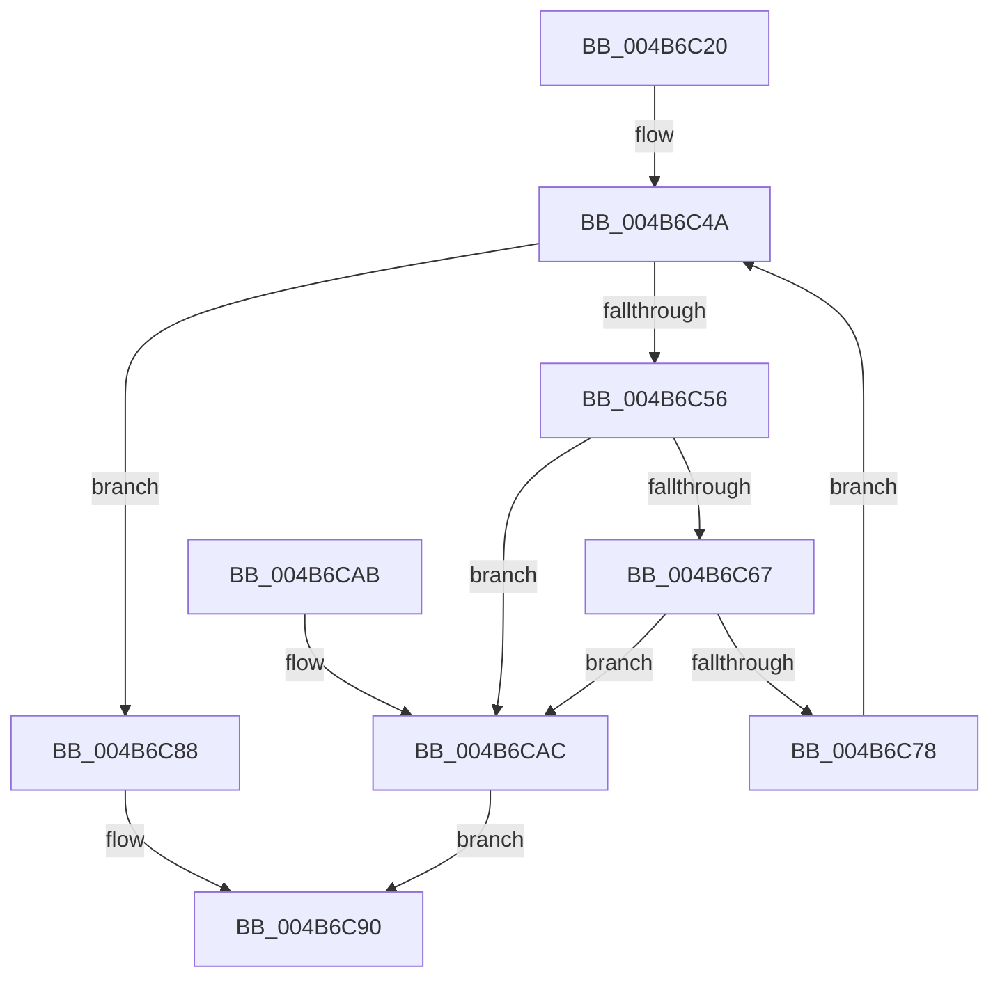

# IoGetLoadedDriverInfo

- RVA: `0x004B6C20`–`0x004B6CB3` (길이 `147` bytes)
- VA: `0x00000001404B6C20`
- 실행 섹션: `.text`
- PDB 이름 있음: `예`; PDB Function 태그: `아니요`
- unwind 정보 RVA: `0x000BA784`
- 디코드: `44`개 명령, `147/147` bytes 표시
- 미해석 바이트: `0` (있으면 어셈블리에 `.byte`로 보존)

> 이 문서는 커널 이미지의 기계어와 PDB 기호를 분석해 생성했습니다. 4번과 5번은 함수 원형과 자료형을 바이너리 사용 방식에서 추정한 C 해석이며 원본 소스 복구 결과는 아닙니다.

## 1. Dependencies

- 직접 호출 지점: **2**; 고유 호출 대상: **1**
- 직접 호출자로 확인된 함수: **2**
- RIP 상대 이미지 참조: **1**

### Outgoing calls
- `0x004B6C5E` → [IopIsAddressRangeValid](IopIsAddressRangeValid_function_004B6CBC.md) (function, `0x004B6CBC`)
- `0x004B6C6F` → [IopIsAddressRangeValid](IopIsAddressRangeValid_function_004B6CBC.md) (function, `0x004B6CBC`)

### Direct callers
- [IoFillTriageDumpBuffer](../59/IoFillTriageDumpBuffer_function_005921CC.md) at `0x005924BC`
- [sub_006EEE7E](../6E/Unknown_function_006EEE7E.md) at `0x006EEEF0`

### Static image references
- `0x004B6C39` → RVA `0x00EF54C0` (`.data`; read)

## 2. Other-region calls and transfers

- 다른 실행 섹션으로 향하는 call: **0**
- 별도 외부 분기/꼬리 이동을 확인하지 못했습니다.

## 3. Assembly (complete function range)

```asm
004B6C20  48 8B C4                        mov rax, rsp
004B6C23  48 89 58 08                     mov qword ptr [rax + 8], rbx
004B6C27  48 89 70 10                     mov qword ptr [rax + 0x10], rsi
004B6C2B  48 89 78 18                     mov qword ptr [rax + 0x18], rdi
004B6C2F  4C 89 70 20                     mov qword ptr [rax + 0x20], r14
004B6C33  41 57                           push r15
004B6C35  48 83 EC 20                     sub rsp, 0x20
004B6C39  48 8B 1D 80 E8 A3 00            mov rbx, qword ptr [rip + 0xa3e880]
004B6C40  33 FF                           xor edi, edi
004B6C42  33 F6                           xor esi, esi
004B6C44  4D 8B F0                        mov r14, r8
004B6C47  4C 8B FA                        mov r15, rdx
004B6C4A  48 8D 05 6F E8 A3 00            lea rax, [rip + 0xa3e86f]
004B6C51  48 3B D8                        cmp rbx, rax
004B6C54  74 32                           je 0x1404b6c88
004B6C56  BA A0 00 00 00                  mov edx, 0xa0
004B6C5B  48 8B CB                        mov rcx, rbx
004B6C5E  E8 59 00 00 00                  call 0x1404b6cbc
004B6C63  84 C0                           test al, al
004B6C65  74 45                           je 0x1404b6cac
004B6C67  0F B7 53 58                     movzx edx, word ptr [rbx + 0x58]
004B6C6B  48 8B 4B 60                     mov rcx, qword ptr [rbx + 0x60]
004B6C6F  E8 48 00 00 00                  call 0x1404b6cbc
004B6C74  84 C0                           test al, al
004B6C76  74 34                           je 0x1404b6cac
004B6C78  0F B7 43 58                     movzx eax, word ptr [rbx + 0x58]
004B6C7C  FF C7                           inc edi
004B6C7E  48 8B 1B                        mov rbx, qword ptr [rbx]
004B6C81  83 C6 09                        add esi, 9
004B6C84  03 F0                           add esi, eax
004B6C86  EB C2                           jmp 0x1404b6c4a
004B6C88  41 89 3F                        mov dword ptr [r15], edi
004B6C8B  33 C0                           xor eax, eax
004B6C8D  41 89 36                        mov dword ptr [r14], esi
004B6C90  48 8B 5C 24 30                  mov rbx, qword ptr [rsp + 0x30]
004B6C95  48 8B 74 24 38                  mov rsi, qword ptr [rsp + 0x38]
004B6C9A  48 8B 7C 24 40                  mov rdi, qword ptr [rsp + 0x40]
004B6C9F  4C 8B 74 24 48                  mov r14, qword ptr [rsp + 0x48]
004B6CA4  48 83 C4 20                     add rsp, 0x20
004B6CA8  41 5F                           pop r15
004B6CAA  C3                              ret
004B6CAB  CC                              int3
004B6CAC  B8 01 00 00 C0                  mov eax, 0xc0000001
004B6CB1  EB DD                           jmp 0x1404b6c90
```

## 4. C-style interpretation (structured pseudocode)

```c
__int64 __fastcall IoGetLoadedDriverInfo(__int64 a1, __int64 a2, __int64 a3)
{
    __int64 result;
    __int64 v_rdi;
    __int64 v_rsi;
    __int64 v_rsp;
    unsigned __int64 v_stack_p10;
    unsigned __int64 v_stack_p18;
    unsigned __int64 v_stack_p20;
    unsigned __int64 v_stack_p8;

    *(unsigned __int64 *)(v_rsp + 8) = v_rbx;
    *(unsigned __int64 *)(v_rsp + 16) = v_rsi;
    *(unsigned __int64 *)(v_rsp + 24) = v_rdi;
    *(unsigned __int64 *)(v_rsp + 32) = v_r14;
    v_rsp = (v_rsp) - (32);
    v_rdi = 0;
    v_rsi = 0;
loc_004B6C4A:
    if ((*(unsigned __int64 *)(v_rip + 10741888)) == (v_rip + 10741871)) goto loc_004B6C88;
    result = IopIsAddressRangeValid(*(unsigned __int64 *)(v_rip + 10741888), 160, a3, a4);
    if ((unsigned __int8)(result) == 0) goto loc_004B6CAC;
    result = IopIsAddressRangeValid(*(unsigned __int64 *)(*(unsigned __int64 *)(v_rip + 10741888) + 96), *(unsigned __int16 *)(*(unsigned __int64 *)(v_rip + 10741888) + 88), a3, a4);
    if ((unsigned __int8)(result) == 0) goto loc_004B6CAC;
    v_rdi = (unsigned int)((v_rdi) + 1);
    v_rsi = (unsigned int)((v_rsi) + (9));
    v_rsi = (unsigned int)((v_rsi) + ((unsigned int)(*(unsigned __int16 *)(*(unsigned __int64 *)(v_rip + 10741888) + 88))));
    goto loc_004B6C4A;
loc_004B6C88:
    *(unsigned int *)(a2) = (unsigned int)(v_rdi);
    result = 0;
    *(unsigned int *)(a3) = (unsigned int)(v_rsi);
loc_004B6C90:
    v_rsp = (v_rsp) + (32);
    return result;
loc_004B6CAC:
    goto loc_004B6C90;
}
```

## 5. (Beta) C Style

```c
int64_t IoGetLoadedDriverInfo(int64_t Arg1, void *Arg2, void *Arg3)
{
    uint8_t *arg2 = (uint8_t *)Arg2;
    uint8_t *arg3 = (uint8_t *)Arg3;

    int64_t result;
    int64_t local_rdi;
    int64_t local_rsi;
    int64_t local_rsp;
    uint64_t v_stack_p10;
    uint64_t v_stack_p18;
    uint64_t v_stack_p20;
    uint64_t v_stack_p8;

    *(uint64_t *)(local_rsp + 0x8) = local_rbx;
    *(uint64_t *)(local_rsp + 0x10) = local_rsi;
    *(uint64_t *)(local_rsp + 0x18) = local_rdi;
    *(uint64_t *)(local_rsp + 0x20) = local_r14;
    local_rsp = (local_rsp) - (32);
    local_rdi = 0;
    local_rsi = 0;
loc_004B6C4A:
    if ((*(uint64_t *)(v_rip + 0xA3E880)) == (v_rip + 10741871)) goto loc_004B6C88;
    result = IopIsAddressRangeValid(*(uint64_t *)(v_rip + 0xA3E880), 160, Arg3, a4);
    if ((uint8_t)(result) == 0) goto loc_004B6CAC;
    result = IopIsAddressRangeValid(*(uint64_t *)(*(uint64_t *)(v_rip + 0xA3E880) + 0x60), *(uint16_t *)(*(uint64_t *)(v_rip + 0xA3E880) + 0x58), Arg3, a4);
    if ((uint8_t)(result) == 0) goto loc_004B6CAC;
    local_rdi = (uint32_t)((local_rdi) + 1);
    local_rsi = (uint32_t)((local_rsi) + (9));
    local_rsi = (uint32_t)((local_rsi) + ((uint32_t)(*(uint16_t *)(*(uint64_t *)(v_rip + 0xA3E880) + 0x58))));
    goto loc_004B6C4A;
loc_004B6C88:
    *(uint32_t *)(arg2) = (uint32_t)(local_rdi);
    result = 0;
    *(uint32_t *)(arg3) = (uint32_t)(local_rsi);
loc_004B6C90:
    local_rsp = (local_rsp) + (32);
    return result;
loc_004B6CAC:
    goto loc_004B6C90;
}
```

### 관측된 메모리 오프셋

구조체 형식이 확인되지 않은 접근은 인자 기준의 오프셋으로만 기록했습니다.

| 기준 인자 | 오프셋 표현 | 폭 (bit) | 접근 |
|---|---:|---:|---|
| `Arg2` | `+ 0x0` | `32` | `W` |
| `Arg3` | `+ 0x0` | `32` | `W` |

## 6. Execution-region graph

[열기: 2D/3D 그래프와 함수 탐색 컨트롤 패널](../../../control-panel.html?section=text&rva=0x004B6C20&view=graph)

- 2D 그래프는 위에서 아래로 흐르고, 3D 그래프는 빈 공간을 드래그해 회전합니다. Shift+드래그는 이동, 휠은 확대·축소, 함수 노드 선택은 대상 보고서 이동입니다.

### Static fallback


