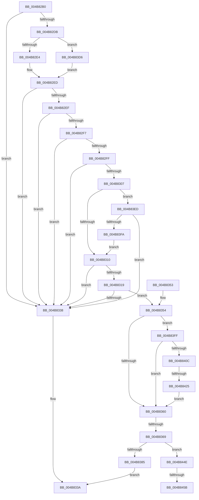

# IoRaiseInformationalHardError

- RVA: `0x004B82B0`–`0x004B8468` (길이 `440` bytes)
- VA: `0x00000001404B82B0`
- 실행 섹션: `.text`
- PDB 이름 있음: `예`; PDB Function 태그: `예`
- unwind 정보 RVA: `0x000BADE4`
- 디코드: `109`개 명령, `440/440` bytes 표시
- 미해석 바이트: `0` (있으면 어셈블리에 `.byte`로 보존)

> 이 문서는 커널 이미지의 기계어와 PDB 기호를 분석해 생성했습니다. 4번과 5번은 함수 원형과 자료형을 바이너리 사용 방식에서 추정한 C 해석이며 원본 소스 복구 결과는 아닙니다.

## 1. Dependencies

- 직접 호출 지점: **6**; 고유 호출 대상: **4**
- 직접 호출자로 확인된 함수: **4**
- RIP 상대 이미지 참조: **6**

### Outgoing calls
- `0x004B832B` → [ExAllocatePool2](../../poolcode/B8/ExAllocatePool2_function_00B820F0.md) (function, `0x00B820F0`)
- `0x004B8377` → [ExAllocatePool2](../../poolcode/B8/ExAllocatePool2_function_00B820F0.md) (function, `0x00B820F0`)
- `0x004B83CA` → [KeInsertQueueApc](../20/KeInsertQueueApc_function_00203F10.md) (function, `0x00203F10`)
- `0x004B8417` → [ExAllocatePool2](../../poolcode/B8/ExAllocatePool2_function_00B820F0.md) (function, `0x00B820F0`)
- `0x004B8444` → [memcpy](../6C/memcpy_function_006C6840.md) (function, `0x006C6840`)
- `0x004B845D` → [ExFreePoolWithTag](../../poolcode/B8/ExFreePoolWithTag_function_00B82870.md) (function, `0x00B82870`)

### Direct callers
- [MiCauseOverCommitPopup](../48/MiCauseOverCommitPopup_function_0048B2C4.md) at `0x0048B323`
- [DifIoRaiseInformationalHardErrorWrapper](../62/DifIoRaiseInformationalHardErrorWrapper_function_0062BF00.md) at `0x0062BFE4`
- [FsRtlLogCcFlushError](../../page/AC/FsRtlLogCcFlushError_function_00ACA170.md) at `0x00ACA2B9`
- [PopTransitionSystemPowerStateEx](../../pagelk/B7/PopTransitionSystemPowerStateEx_function_00B7E8C0.md) at `0x00B7F800`

### Static image references
- `0x004B82CD` → RVA `0x00E66101` (`.data`; read)
- `0x004B8310` → RVA `0x00F8D7DC` (`.data`; read)
- `0x004B8385` → RVA `0x00F8D7DC` (`.data`; read/write)
- `0x004B838C` → RVA `0x009071C0` (`AlpcpFreeBuffer`; read)
- `0x004B839F` → RVA `0x00A64190` (`IopRaiseInformationalHardError`; read)
- `0x004B83ED` → RVA `0x00F8D7BC` (`.data`; read)

## 2. Other-region calls and transfers

- 다른 실행 섹션으로 향하는 call: **4**
  - `0x004B832B` → [ExAllocatePool2](../../poolcode/B8/ExAllocatePool2_function_00B820F0.md) (`.text` → `POOLCODE`)
  - `0x004B8377` → [ExAllocatePool2](../../poolcode/B8/ExAllocatePool2_function_00B820F0.md) (`.text` → `POOLCODE`)
  - `0x004B8417` → [ExAllocatePool2](../../poolcode/B8/ExAllocatePool2_function_00B820F0.md) (`.text` → `POOLCODE`)
  - `0x004B845D` → [ExFreePoolWithTag](../../poolcode/B8/ExFreePoolWithTag_function_00B82870.md) (`.text` → `POOLCODE`)
- call이 아닌 외부 분기/꼬리 이동: **4**
  - `0x004B8363` → [sub_006FBF78](../6F/Unknown_function_006FBF78.md) (`tail-transfer`)
  - `0x004B841F` → [sub_006FBF78 + 0xB6](../6F/Unknown_function_006FBF78.md) (`tail-transfer`)
  - `0x004B8455` → [sub_006FBF78 + 0xB6](../6F/Unknown_function_006FBF78.md) (`tail-transfer`)
  - `0x004B8463` → [sub_006FBF78 + 0xB6](../6F/Unknown_function_006FBF78.md) (`tail-transfer`)

## 3. Assembly (complete function range)

```asm
004B82B0  48 89 5C 24 08                  mov qword ptr [rsp + 8], rbx
004B82B5  48 89 6C 24 10                  mov qword ptr [rsp + 0x10], rbp
004B82BA  48 89 74 24 18                  mov qword ptr [rsp + 0x18], rsi
004B82BF  57                              push rdi
004B82C0  41 56                           push r14
004B82C2  41 57                           push r15
004B82C4  48 83 EC 20                     sub rsp, 0x20
004B82C8  33 ED                           xor ebp, ebp
004B82CA  49 8B F8                        mov rdi, r8
004B82CD  40 38 2D 2D DE 9A 00            cmp byte ptr [rip + 0x9ade2d], bpl
004B82D4  4C 8B F2                        mov r14, rdx
004B82D7  8B F1                           mov esi, ecx
004B82D9  74 5D                           je 0x1404b8338
004B82DB  4D 85 C0                        test r8, r8
004B82DE  0F 84 F2 00 00 00               je 0x1404b83d6
004B82E4  41 8B 80 A0 05 00 00            mov eax, dword ptr [r8 + 0x5a0]
004B82EB  A8 10                           test al, 0x10
004B82ED  75 49                           jne 0x1404b8338
004B82EF  81 FE 1D 02 00 C0               cmp esi, 0xc000021d
004B82F5  74 41                           je 0x1404b8338
004B82F7  81 FE 44 01 00 C0               cmp esi, 0xc0000144
004B82FD  74 39                           je 0x1404b8338
004B82FF  81 FE 18 00 00 40               cmp esi, 0x40000018
004B8305  74 31                           je 0x1404b8338
004B8307  48 85 FF                        test rdi, rdi
004B830A  0F 84 DD 00 00 00               je 0x1404b83ed
004B8310  83 3D C5 54 AD 00 19            cmp dword ptr [rip + 0xad54c5], 0x19
004B8317  7F 1F                           jg 0x1404b8338
004B8319  BA 28 00 00 00                  mov edx, 0x28
004B831E  41 B8 49 6F 45 72               mov r8d, 0x72456f49
004B8324  44 8D 7A 18                     lea r15d, [rdx + 0x18]
004B8328  41 8B CF                        mov ecx, r15d
004B832B  E8 C0 9D 6C 00                  call 0x140b820f0
004B8330  48 8B D8                        mov rbx, rax
004B8333  48 85 C0                        test rax, rax
004B8336  75 1C                           jne 0x1404b8354
004B8338  32 C0                           xor al, al
004B833A  48 8B 5C 24 40                  mov rbx, qword ptr [rsp + 0x40]
004B833F  48 8B 6C 24 48                  mov rbp, qword ptr [rsp + 0x48]
004B8344  48 8B 74 24 50                  mov rsi, qword ptr [rsp + 0x50]
004B8349  48 83 C4 20                     add rsp, 0x20
004B834D  41 5F                           pop r15
004B834F  41 5E                           pop r14
004B8351  5F                              pop rdi
004B8352  C3                              ret
004B8353  CC                              int3
004B8354  89 70 10                        mov dword ptr [rax + 0x10], esi
004B8357  4D 85 F6                        test r14, r14
004B835A  0F 85 9F 00 00 00               jne 0x1404b83ff
004B8360  48 85 FF                        test rdi, rdi
004B8363  0F 84 0F 3C 24 00               je 0x1406fbf78
004B8369  BA 58 00 00 00                  mov edx, 0x58
004B836E  41 B8 4B 41 50 43               mov r8d, 0x4350414b
004B8374  49 8B CF                        mov rcx, r15
004B8377  E8 74 9D 6C 00                  call 0x140b820f0
004B837C  48 85 C0                        test rax, rax
004B837F  0F 84 C9 00 00 00               je 0x1404b844e
004B8385  F0 FF 05 50 54 AD 00            lock inc dword ptr [rip + 0xad5450]
004B838C  48 8D 0D 2D EE 44 00            lea rcx, [rip + 0x44ee2d]
004B8393  66 C7 00 12 00                  mov word ptr [rax], 0x12
004B8398  48 89 48 20                     mov qword ptr [rax + 0x20], rcx
004B839C  45 33 C9                        xor r9d, r9d
004B839F  48 8D 0D EA BD 5A 00            lea rcx, [rip + 0x5abdea]
004B83A6  C6 40 02 58                     mov byte ptr [rax + 2], 0x58
004B83AA  48 89 48 30                     mov qword ptr [rax + 0x30], rcx
004B83AE  45 33 C0                        xor r8d, r8d
004B83B1  66 89 68 50                     mov word ptr [rax + 0x50], bp
004B83B5  48 8B C8                        mov rcx, rax
004B83B8  48 89 78 08                     mov qword ptr [rax + 8], rdi
004B83BC  33 D2                           xor edx, edx
004B83BE  48 89 68 28                     mov qword ptr [rax + 0x28], rbp
004B83C2  48 89 58 38                     mov qword ptr [rax + 0x38], rbx
004B83C6  40 88 68 52                     mov byte ptr [rax + 0x52], bpl
004B83CA  E8 41 BB D4 FF                  call 0x140203f10
004B83CF  B0 01                           mov al, 1
004B83D1  E9 64 FF FF FF                  jmp 0x1404b833a
004B83D6  65 48 8B 04 25 88 01 00 00      mov rax, qword ptr gs:[0x188]
004B83DF  8B 88 A0 05 00 00               mov ecx, dword ptr [rax + 0x5a0]
004B83E5  F6 C1 10                        test cl, 0x10
004B83E8  E9 00 FF FF FF                  jmp 0x1404b82ed
004B83ED  83 3D C8 53 AD 00 19            cmp dword ptr [rip + 0xad53c8], 0x19
004B83F4  0F 8D 3E FF FF FF               jge 0x1404b8338
004B83FA  E9 11 FF FF FF                  jmp 0x1404b8310
004B83FF  41 0F B7 06                     movzx eax, word ptr [r14]
004B8403  66 85 C0                        test ax, ax
004B8406  0F 84 54 FF FF FF               je 0x1404b8360
004B840C  8B D0                           mov edx, eax
004B840E  41 B8 49 6F 45 72               mov r8d, 0x72456f49
004B8414  49 8B CF                        mov rcx, r15
004B8417  E8 D4 9C 6C 00                  call 0x140b820f0
004B841C  48 85 C0                        test rax, rax
004B841F  0F 84 09 3C 24 00               je 0x1406fc02e
004B8425  41 0F B7 0E                     movzx ecx, word ptr [r14]
004B8429  66 89 4B 18                     mov word ptr [rbx + 0x18], cx
004B842D  41 0F B7 0E                     movzx ecx, word ptr [r14]
004B8431  66 89 4B 1A                     mov word ptr [rbx + 0x1a], cx
004B8435  48 8B C8                        mov rcx, rax
004B8438  48 89 43 20                     mov qword ptr [rbx + 0x20], rax
004B843C  45 0F B7 06                     movzx r8d, word ptr [r14]
004B8440  49 8B 56 08                     mov rdx, qword ptr [r14 + 8]
004B8444  E8 F7 E3 20 00                  call 0x1406c6840
004B8449  E9 12 FF FF FF                  jmp 0x1404b8360
004B844E  48 8B 4B 20                     mov rcx, qword ptr [rbx + 0x20]
004B8452  48 85 C9                        test rcx, rcx
004B8455  0F 84 D3 3B 24 00               je 0x1406fc02e
004B845B  33 D2                           xor edx, edx
004B845D  E8 0E A4 6C 00                  call 0x140b82870
004B8462  90                              nop
004B8463  E9 C6 3B 24 00                  jmp 0x1406fc02e
```

## 4. C-style interpretation (structured pseudocode)

```c
__int64 __fastcall IoRaiseInformationalHardError(int a1, __int64 a2, __int64 a3, int a4)
{
    __int64 result;
    __int64 v_rbp;
    __int64 v_rsp;
    unsigned __int64 v_stack_p10;
    unsigned __int64 v_stack_p18;
    unsigned __int64 v_stack_p8;

    v_stack_p8 = v_rbx;
    v_stack_p10 = v_rbp;
    v_stack_p18 = v_rsi;
    v_rsp = (v_rsp) - (32);
    v_rbp = 0;
    if ((*(unsigned __int8 *)(v_rip + 10149421)) == 0) goto loc_004B8338;
    if (a3 == 0) goto loc_004B83D6;
loc_004B82ED:
    if ((((unsigned __int8)((unsigned int)(*(unsigned int *)(a3 + 1440)))) & (16)) != 0) goto loc_004B8338;
    if (((unsigned int)((unsigned int)(a1))) == 0xC000021DULL) goto loc_004B8338;
    if (((unsigned int)((unsigned int)(a1))) == 0xC0000144ULL) goto loc_004B8338;
    if (((unsigned int)((unsigned int)(a1))) == 0x40000018ULL) goto loc_004B8338;
    if (a3 == 0) goto loc_004B83ED;
loc_004B8310:
    if ((*(unsigned int *)(v_rip + 11359429)) > 25) goto loc_004B8338;
    result = ExAllocatePool2((unsigned int)((unsigned int)(40 + 24)), 40, (unsigned int)(0x72456F49ULL), a4);
    if (result != 0) goto loc_004B8354;
loc_004B8338:
    result = 0;
loc_004B833A:
    v_rsp = (v_rsp) + (32);
    return result;
loc_004B8354:
    *(unsigned int *)(result + 16) = (unsigned int)(v_stack_p18);
    if (a2 != 0) goto loc_004B83FF;
loc_004B8360:
    result = ExAllocatePool2(40 + 24, 88, (unsigned int)(0x4350414BULL), a4);
    if (result == 0) goto loc_004B844E;
    *(unsigned __int16 *)(result) = 18;
    *(unsigned __int64 *)(result + 32) = v_rip + 4517421;
    a4 = 0;
    *(unsigned __int8 *)(result + 2) = 88;
    *(unsigned __int64 *)(result + 48) = v_rip + 5946858;
    a3 = 0;
    *(unsigned __int16 *)(result + 80) = (unsigned __int16)(v_stack_p10);
    *(unsigned __int64 *)(result + 8) = 0;
    a2 = 0;
    *(unsigned __int64 *)(result + 40) = v_stack_p10;
    *(unsigned __int64 *)(result + 56) = v_stack_p8;
    *(unsigned __int8 *)(result + 82) = (unsigned __int8)(v_stack_p10);
    result = KeInsertQueueApc(result, a2, a3, a4);
    goto loc_004B833A;
loc_004B83D6:
    goto loc_004B82ED;
loc_004B83ED:
    if ((*(unsigned int *)(v_rip + 11359176)) >= 25) goto loc_004B8338;
    goto loc_004B8310;
loc_004B83FF:
    if ((unsigned __int16)(*(unsigned __int16 *)(a2)) == 0) goto loc_004B8360;
    result = ExAllocatePool2(40 + 24, (unsigned int)((unsigned int)(*(unsigned __int16 *)(a2))), (unsigned int)(0x72456F49ULL), a4);
    *(unsigned __int16 *)(v_stack_p8 + 24) = (unsigned __int16)(*(unsigned __int16 *)(a2));
    *(unsigned __int16 *)(v_stack_p8 + 26) = (unsigned __int16)(*(unsigned __int16 *)(a2));
    *(unsigned __int64 *)(v_stack_p8 + 32) = result;
    result = memcpy(result, *(unsigned __int64 *)(a2 + 8), *(unsigned __int16 *)(a2), a4);
    goto loc_004B8360;
loc_004B844E:
    a2 = 0;
    result = ExFreePoolWithTag(*(unsigned __int64 *)(v_stack_p8 + 32), a2, *(unsigned __int16 *)(a2), a4);
}
```

## 5. (Beta) C Style

```c
int64_t IoRaiseInformationalHardError(int32_t Arg1, int64_t Arg2, int64_t Arg3, int32_t Arg4)
{
    int64_t result;
    int64_t local_rbp;
    int64_t local_rsp;
    uint64_t v_stack_p10;
    uint64_t v_stack_p18;
    uint64_t v_stack_p8;

    v_stack_p8 = local_rbx;
    v_stack_p10 = local_rbp;
    v_stack_p18 = local_rsi;
    local_rsp = (local_rsp) - (32);
    local_rbp = 0;
    if ((*(uint8_t *)(v_rip + 0x9ADE2D)) == 0) goto loc_004B8338;
    if (Arg3 == 0) goto loc_004B83D6;
loc_004B82ED:
    if ((((uint8_t)((uint32_t)(*(uint32_t *)(Arg3 + 0x5A0)))) & (16)) != 0) goto loc_004B8338;
    if (((uint32_t)((uint32_t)(Arg1))) == 0xC000021DULL) goto loc_004B8338;
    if (((uint32_t)((uint32_t)(Arg1))) == 0xC0000144ULL) goto loc_004B8338;
    if (((uint32_t)((uint32_t)(Arg1))) == 0x40000018ULL) goto loc_004B8338;
    if (Arg3 == 0) goto loc_004B83ED;
loc_004B8310:
    if ((*(uint32_t *)(v_rip + 0xAD54C5)) > 25) goto loc_004B8338;
    result = ExAllocatePool2((uint32_t)((uint32_t)(40 + 24)), 40, (uint32_t)(0x72456F49ULL), Arg4);
    if (result != 0) goto loc_004B8354;
loc_004B8338:
    result = 0;
loc_004B833A:
    local_rsp = (local_rsp) + (32);
    return result;
loc_004B8354:
    *(uint32_t *)(result + 0x10) = (uint32_t)(v_stack_p18);
    if (Arg2 != 0) goto loc_004B83FF;
loc_004B8360:
    result = ExAllocatePool2(40 + 24, 88, (uint32_t)(0x4350414BULL), Arg4);
    if (result == 0) goto loc_004B844E;
    *(uint16_t *)(result) = 18;
    *(uint64_t *)(result + 0x20) = v_rip + 4517421;
    Arg4 = 0;
    *(uint8_t *)(result + 0x2) = 88;
    *(uint64_t *)(result + 0x30) = v_rip + 5946858;
    Arg3 = 0;
    *(uint16_t *)(result + 0x50) = (uint16_t)(v_stack_p10);
    *(uint64_t *)(result + 0x8) = 0;
    Arg2 = 0;
    *(uint64_t *)(result + 0x28) = v_stack_p10;
    *(uint64_t *)(result + 0x38) = v_stack_p8;
    *(uint8_t *)(result + 0x52) = (uint8_t)(v_stack_p10);
    result = KeInsertQueueApc(result, Arg2, Arg3, Arg4);
    goto loc_004B833A;
loc_004B83D6:
    goto loc_004B82ED;
loc_004B83ED:
    if ((*(uint32_t *)(v_rip + 0xAD53C8)) >= 25) goto loc_004B8338;
    goto loc_004B8310;
loc_004B83FF:
    if ((uint16_t)(*(uint16_t *)(Arg2)) == 0) goto loc_004B8360;
    result = ExAllocatePool2(40 + 24, (uint32_t)((uint32_t)(*(uint16_t *)(Arg2))), (uint32_t)(0x72456F49ULL), Arg4);
    *(uint16_t *)(v_stack_p8 + 0x18) = (uint16_t)(*(uint16_t *)(Arg2));
    *(uint16_t *)(v_stack_p8 + 0x1A) = (uint16_t)(*(uint16_t *)(Arg2));
    *(uint64_t *)(v_stack_p8 + 0x20) = result;
    result = memcpy(result, *(uint64_t *)(Arg2 + 0x8), *(uint16_t *)(Arg2), Arg4);
    goto loc_004B8360;
loc_004B844E:
    Arg2 = 0;
    result = ExFreePoolWithTag(*(uint64_t *)(v_stack_p8 + 0x20), Arg2, *(uint16_t *)(Arg2), Arg4);
}
```

## 6. Execution-region graph

[열기: 2D/3D 그래프와 함수 탐색 컨트롤 패널](../../../control-panel.html?section=text&rva=0x004B82B0&view=graph)

- 2D 그래프는 위에서 아래로 흐르고, 3D 그래프는 빈 공간을 드래그해 회전합니다. Shift+드래그는 이동, 휠은 확대·축소, 함수 노드 선택은 대상 보고서 이동입니다.

### Static fallback


