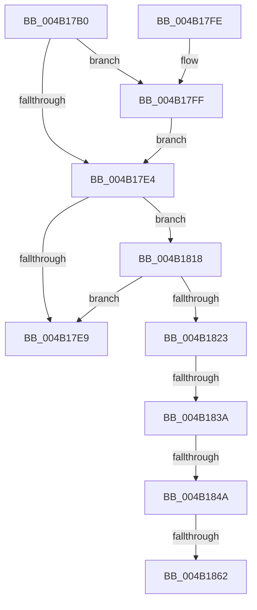

# IoReleaseRemoveLockAndWaitEx

- RVA: `0x004B17B0`–`0x004B186B` (길이 `187` bytes)
- VA: `0x00000001404B17B0`
- 실행 섹션: `.text`
- PDB 이름 있음: `예`; PDB Function 태그: `예`
- unwind 정보 RVA: `0x000B8F40`
- 디코드: `52`개 명령, `187/187` bytes 표시
- 미해석 바이트: `0` (있으면 어셈블리에 `.byte`로 보존)

> 이 문서는 커널 이미지의 기계어와 PDB 기호를 분석해 생성했습니다. 4번과 5번은 함수 원형과 자료형을 바이너리 사용 방식에서 추정한 C 해석이며 원본 소스 복구 결과는 아닙니다.

## 1. Dependencies

- 직접 호출 지점: **2**; 고유 호출 대상: **2**
- 직접 호출자로 확인된 함수: **4**
- RIP 상대 이미지 참조: **1**

### Outgoing calls
- `0x004B1811` → [KeWaitForSingleObject](../20/KeWaitForSingleObject_function_0020E6B0.md) (function, `0x0020E6B0`)
- `0x004B1855` → [VfRemLockReportBadReleaseAndWaitTag](../../pagevrfy/BA/VfRemLockReportBadReleaseAndWaitTag_function_00BA287C.md) (function, `0x00BA287C`)

### Direct callers
- [PopFxAcpiUnregisterDevice](../5D/PopFxAcpiUnregisterDevice_function_005DD830.md) at `0x005DD896`
- [DifIoReleaseRemoveLockAndWaitExWrapper](../62/DifIoReleaseRemoveLockAndWaitExWrapper_function_0062C690.md) at `0x0062C774`
- [PopFxUnregisterDevice](../../page/A8/PopFxUnregisterDevice_function_00A8AE84.md) at `0x00A8AF9D`
- [sub_00BAD17D](../../pagevrfy/BA/Unknown_function_00BAD17D.md) at `0x00BAD1F0`

### Static image references
- `0x004B183A` → RVA `0x00F04A20` (`.data`; read)

## 2. Other-region calls and transfers

- 다른 실행 섹션으로 향하는 call: **1**
  - `0x004B1855` → [VfRemLockReportBadReleaseAndWaitTag](../../pagevrfy/BA/VfRemLockReportBadReleaseAndWaitTag_function_00BA287C.md) (`.text` → `PAGEVRFY`)
- call이 아닌 외부 분기/꼬리 이동: **4**
  - `0x004B1834` → [sub_006FB340 + 0x4](../6F/Unknown_function_006FB340.md) (`tail-transfer`)
  - `0x004B1844` → [sub_006FB340](../6F/Unknown_function_006FB340.md) (`tail-transfer`)
  - `0x004B185C` → [sub_006FB340 + 0x4](../6F/Unknown_function_006FB340.md) (`tail-transfer`)
  - `0x004B1866` → [sub_006FB340](../6F/Unknown_function_006FB340.md) (`tail-transfer`)

## 3. Assembly (complete function range)

```asm
004B17B0  48 89 5C 24 08                  mov qword ptr [rsp + 8], rbx
004B17B5  48 89 6C 24 10                  mov qword ptr [rsp + 0x10], rbp
004B17BA  48 89 74 24 18                  mov qword ptr [rsp + 0x18], rsi
004B17BF  57                              push rdi
004B17C0  48 83 EC 30                     sub rsp, 0x30
004B17C4  41 8B F8                        mov edi, r8d
004B17C7  C6 01 01                        mov byte ptr [rcx], 1
004B17CA  48 8B EA                        mov rbp, rdx
004B17CD  48 8B D9                        mov rbx, rcx
004B17D0  83 CE FF                        or esi, 0xffffffff
004B17D3  F0 01 71 04                     lock add dword ptr [rcx + 4], esi
004B17D7  8B C6                           mov eax, esi
004B17D9  F0 0F C1 41 04                  lock xadd dword ptr [rcx + 4], eax
004B17DE  03 C6                           add eax, esi
004B17E0  85 C0                           test eax, eax
004B17E2  7F 1B                           jg 0x1404b17ff
004B17E4  83 FF 78                        cmp edi, 0x78
004B17E7  74 2F                           je 0x1404b1818
004B17E9  48 8B 5C 24 40                  mov rbx, qword ptr [rsp + 0x40]
004B17EE  48 8B 6C 24 48                  mov rbp, qword ptr [rsp + 0x48]
004B17F3  48 8B 74 24 50                  mov rsi, qword ptr [rsp + 0x50]
004B17F8  48 83 C4 30                     add rsp, 0x30
004B17FC  5F                              pop rdi
004B17FD  C3                              ret
004B17FE  CC                              int3
004B17FF  48 83 64 24 20 00               and qword ptr [rsp + 0x20], 0
004B1805  48 83 C1 08                     add rcx, 8
004B1809  45 33 C9                        xor r9d, r9d
004B180C  45 33 C0                        xor r8d, r8d
004B180F  33 D2                           xor edx, edx
004B1811  E8 9A CE D5 FF                  call 0x14020e6b0
004B1816  EB CC                           jmp 0x1404b17e4
004B1818  8B C6                           mov eax, esi
004B181A  F0 0F C1 43 50                  lock xadd dword ptr [rbx + 0x50], eax
004B181F  03 C6                           add eax, esi
004B1821  79 C6                           jns 0x1404b17e9
004B1823  48 8D 73 70                     lea rsi, [rbx + 0x70]
004B1827  48 8B 06                        mov rax, qword ptr [rsi]
004B182A  48 8B FE                        mov rdi, rsi
004B182D  4C 8B 40 08                     mov r8, qword ptr [rax + 8]
004B1831  49 3B E8                        cmp rbp, r8
004B1834  0F 84 0A 9B 24 00               je 0x1406fb344
004B183A  F7 05 DC 31 A5 00 00 08 00 00   test dword ptr [rip + 0xa531dc], 0x800
004B1844  0F 84 F6 9A 24 00               je 0x1406fb340
004B184A  4C 8B 4C 24 38                  mov r9, qword ptr [rsp + 0x38]
004B184F  48 8B D5                        mov rdx, rbp
004B1852  48 8B CB                        mov rcx, rbx
004B1855  E8 22 10 6F 00                  call 0x140ba287c
004B185A  85 C0                           test eax, eax
004B185C  0F 85 E2 9A 24 00               jne 0x1406fb344
004B1862  48 8D 7B 70                     lea rdi, [rbx + 0x70]
004B1866  E9 D5 9A 24 00                  jmp 0x1406fb340
```

## 4. C-style interpretation (structured pseudocode)

```c
__int64 __fastcall IoReleaseRemoveLockAndWaitEx(__int64 a1, __int64 a2, int a3, int a4)
{
    __int64 result;
    __int64 v_rsi;
    __int64 v_rsp;
    unsigned __int64 v_stack_p10;
    unsigned __int64 v_stack_p18;
    unsigned __int64 v_stack_p20;
    unsigned __int64 v_stack_p38;
    unsigned __int64 v_stack_p8;

    v_stack_p8 = v_rbx;
    v_stack_p10 = v_rbp;
    v_stack_p18 = v_rsi;
    v_rsp = (v_rsp) - (48);
    *(unsigned __int8 *)(a1) = 1;
    v_rsi = (unsigned int)((v_rsi) | (0xFFFFFFFFULL));
    result = (unsigned int)(((unsigned int)((unsigned int)(v_rsi))) + ((unsigned int)(v_rsi)));
    if (condition_is_greater) goto loc_004B17FF;
loc_004B17E4:
    if (((unsigned int)((unsigned int)(a3))) == 120) goto loc_004B1818;
loc_004B17E9:
    v_rsp = (v_rsp) + (48);
    return result;
loc_004B17FF:
    a1 = (a1) + (8);
    a4 = 0;
    a3 = 0;
    a2 = 0;
    result = KeWaitForSingleObject(a1, a2, a3, a4);
    goto loc_004B17E4;
loc_004B1818:
    result = (unsigned int)(((unsigned int)((unsigned int)(v_stack_p18))) + ((unsigned int)(v_stack_p18)));
    if (!sign_flag) goto loc_004B17E9;
    result = VfRemLockReportBadReleaseAndWaitTag(v_stack_p8, v_stack_p10, *(unsigned __int64 *)(*(unsigned __int64 *)(v_stack_p8 + 112) + 8), v_stack_p38);
}
```

## 5. (Beta) C Style

```c
int64_t IoReleaseRemoveLockAndWaitEx(void *Arg1, int64_t Arg2, int32_t Arg3, int32_t Arg4)
{
    uint8_t *arg1 = (uint8_t *)Arg1;

    int64_t result;
    int64_t local_rsi;
    int64_t local_rsp;
    uint64_t v_stack_p10;
    uint64_t v_stack_p18;
    uint64_t v_stack_p20;
    uint64_t v_stack_p38;
    uint64_t v_stack_p8;

    v_stack_p8 = local_rbx;
    v_stack_p10 = local_rbp;
    v_stack_p18 = local_rsi;
    local_rsp = (local_rsp) - (48);
    *(uint8_t *)(arg1) = 1;
    local_rsi = (uint32_t)((local_rsi) | (0xFFFFFFFFULL));
    result = (uint32_t)(((uint32_t)((uint32_t)(local_rsi))) + ((uint32_t)(local_rsi)));
    if (condition_is_greater) goto loc_004B17FF;
loc_004B17E4:
    if (((uint32_t)((uint32_t)(Arg3))) == 120) goto loc_004B1818;
loc_004B17E9:
    local_rsp = (local_rsp) + (48);
    return result;
loc_004B17FF:
    Arg1 = (Arg1) + (8);
    Arg4 = 0;
    Arg3 = 0;
    Arg2 = 0;
    result = KeWaitForSingleObject(Arg1, Arg2, Arg3, Arg4);
    goto loc_004B17E4;
loc_004B1818:
    result = (uint32_t)(((uint32_t)((uint32_t)(v_stack_p18))) + ((uint32_t)(v_stack_p18)));
    if (!sign_flag) goto loc_004B17E9;
    result = VfRemLockReportBadReleaseAndWaitTag(v_stack_p8, v_stack_p10, *(uint64_t *)(*(uint64_t *)(v_stack_p8 + 0x70) + 0x8), v_stack_p38);
}
```

### 관측된 메모리 오프셋

구조체 형식이 확인되지 않은 접근은 인자 기준의 오프셋으로만 기록했습니다.

| 기준 인자 | 오프셋 표현 | 폭 (bit) | 접근 |
|---|---:|---:|---|
| `Arg1` | `+ 0x0` | `8` | `W` |
| `Arg1` | `+ 0x0` | `64` | `R` |
| `Arg1` | `+ 0x4` | `32` | `R/W` |
| `Arg1` | `+ 0x50` | `32` | `R/W` |
| `Arg1` | `+ 0x70` | `64` | `R` |

## 6. Execution-region graph

[열기: 2D/3D 그래프와 함수 탐색 컨트롤 패널](../../../control-panel.html?section=text&rva=0x004B17B0&view=graph)

- 2D 그래프는 위에서 아래로 흐르고, 3D 그래프는 빈 공간을 드래그해 회전합니다. Shift+드래그는 이동, 휠은 확대·축소, 함수 노드 선택은 대상 보고서 이동입니다.

### Static fallback


