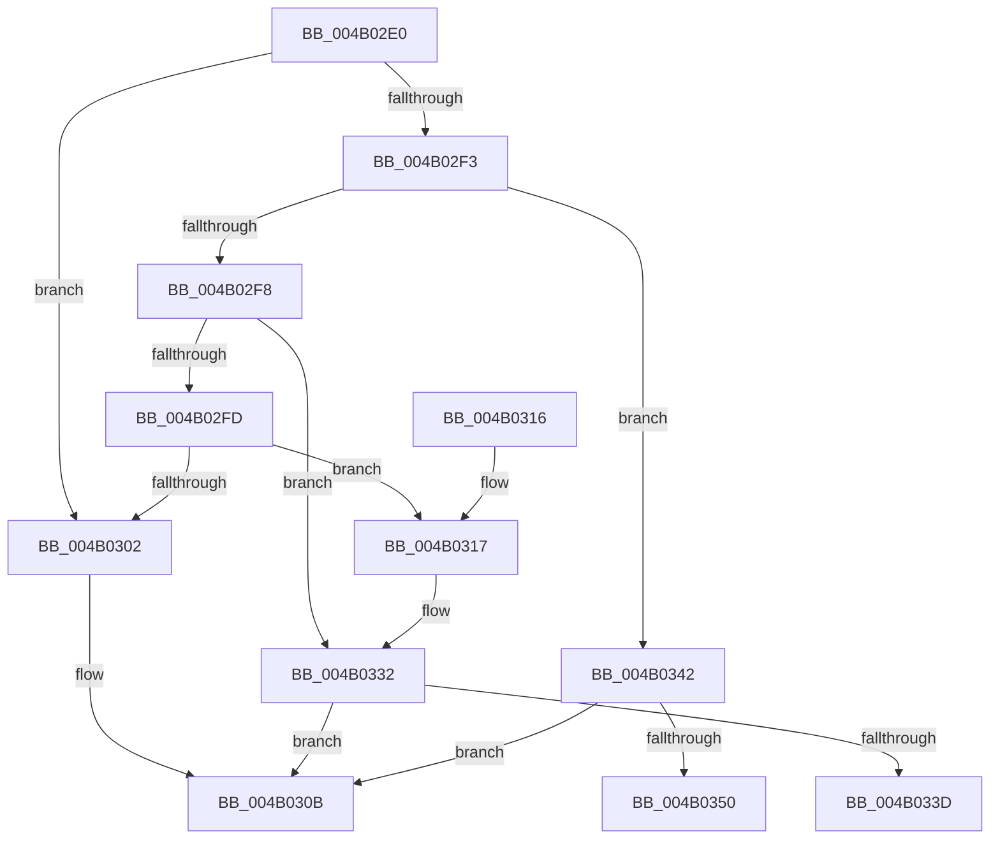

# IoReportInterruptInactive

- RVA: `0x004B02E0`–`0x004B0355` (길이 `117` bytes)
- VA: `0x00000001404B02E0`
- 실행 섹션: `.text`
- PDB 이름 있음: `예`; PDB Function 태그: `예`
- unwind 정보 RVA: `0x00087E24`
- 디코드: `38`개 명령, `117/117` bytes 표시
- 미해석 바이트: `0` (있으면 어셈블리에 `.byte`로 보존)

> 이 문서는 커널 이미지의 기계어와 PDB 기호를 분석해 생성했습니다. 4번과 5번은 함수 원형과 자료형을 바이너리 사용 방식에서 추정한 C 해석이며 원본 소스 복구 결과는 아닙니다.

## 1. Dependencies

- 직접 호출 지점: **2**; 고유 호출 대상: **2**
- 직접 호출자로 확인된 함수: **0**
- RIP 상대 이미지 참조: **0**

### Outgoing calls
- `0x004B0306` → [IopMaskInterrupt](../2D/IopMaskInterrupt_function_002D3D2C.md) (function, `0x002D3D2C`)
- `0x004B032C` → [KeBugCheckEx](../4F/KeBugCheckEx_function_004FD660.md) (function, `0x004FD660`)

### Direct callers
- 이 함수 시작 RVA로 연결되는 직접 call은 확인되지 않았습니다. 간접 호출은 완전히 역산할 수 없습니다.

### Static image references
- 디코드된 RIP-relative 메모리 참조가 없습니다.

## 2. Other-region calls and transfers

- 다른 실행 섹션으로 향하는 call: **0**
- call이 아닌 외부 분기/꼬리 이동: **2**
  - `0x004B033D` → [sub_006FB1D2](../6F/Unknown_function_006FB1D2.md) (`tail-transfer`)
  - `0x004B0350` → [sub_006FB1D2 + 0x1F](../6F/Unknown_function_006FB1D2.md) (`tail-transfer`)

## 3. Assembly (complete function range)

```asm
004B02E0  48 89 5C 24 08                  mov qword ptr [rsp + 8], rbx
004B02E5  57                              push rdi
004B02E6  48 83 EC 30                     sub rsp, 0x30
004B02EA  8B 11                           mov edx, dword ptr [rcx]
004B02EC  8B C2                           mov eax, edx
004B02EE  83 E8 01                        sub eax, 1
004B02F1  74 0F                           je 0x1404b0302
004B02F3  83 E8 01                        sub eax, 1
004B02F6  74 4A                           je 0x1404b0342
004B02F8  83 E8 01                        sub eax, 1
004B02FB  74 35                           je 0x1404b0332
004B02FD  83 F8 01                        cmp eax, 1
004B0300  75 15                           jne 0x1404b0317
004B0302  48 8B 49 08                     mov rcx, qword ptr [rcx + 8]
004B0306  E8 21 3A E2 FF                  call 0x1402d3d2c
004B030B  48 8B 5C 24 40                  mov rbx, qword ptr [rsp + 0x40]
004B0310  48 83 C4 30                     add rsp, 0x30
004B0314  5F                              pop rdi
004B0315  C3                              ret
004B0316  CC                              int3
004B0317  33 DB                           xor ebx, ebx
004B0319  4C 8B C2                        mov r8, rdx
004B031C  45 33 C9                        xor r9d, r9d
004B031F  48 89 5C 24 20                  mov qword ptr [rsp + 0x20], rbx
004B0324  B9 CA 00 00 00                  mov ecx, 0xca
004B0329  8D 53 0C                        lea edx, [rbx + 0xc]
004B032C  E8 2F D3 04 00                  call 0x1404fd660
004B0331  CC                              int3
004B0332  48 8B 79 08                     mov rdi, qword ptr [rcx + 8]
004B0336  33 DB                           xor ebx, ebx
004B0338  39 5F 04                        cmp dword ptr [rdi + 4], ebx
004B033B  76 CE                           jbe 0x1404b030b
004B033D  E9 90 AE 24 00                  jmp 0x1406fb1d2
004B0342  48 8B 79 08                     mov rdi, qword ptr [rcx + 8]
004B0346  33 DB                           xor ebx, ebx
004B0348  39 9F 24 01 00 00               cmp dword ptr [rdi + 0x124], ebx
004B034E  76 BB                           jbe 0x1404b030b
004B0350  E9 9C AE 24 00                  jmp 0x1406fb1f1
```

## 4. C-style interpretation (structured pseudocode)

```c
__int64 __fastcall IoReportInterruptInactive(__int64 a1, __int64 a2, __int64 a3, int a4)
{
    __int64 result;
    __int64 v_rbx;
    __int64 v_rsp;
    unsigned __int64 v_stack_p20;
    unsigned __int64 v_stack_p8;

    v_stack_p8 = v_rbx;
    v_rsp = (v_rsp) - (48);
    result = (unsigned int)(((unsigned int)((unsigned int)((unsigned int)(*(unsigned int *)(a1))))) - (1));
    if (condition_is_equal) goto loc_004B0302;
    result = (unsigned int)((result) - (1));
    if (condition_is_equal) goto loc_004B0342;
    result = (unsigned int)((result) - (1));
    if (condition_is_equal) goto loc_004B0332;
    if (((unsigned int)(result)) != 1) goto loc_004B0317;
loc_004B0302:
    result = IopMaskInterrupt(*(unsigned __int64 *)(a1 + 8), (unsigned int)(*(unsigned int *)(a1)), a3, a4);
loc_004B030B:
    v_rsp = (v_rsp) + (48);
    return result;
loc_004B0317:
    v_rbx = 0;
    a4 = 0;
    v_stack_p20 = 0;
    result = KeBugCheckEx(202, v_rbx + 12, (unsigned int)(*(unsigned int *)(a1)), a4);
loc_004B0332:
    v_rbx = 0;
    if ((*(unsigned int *)(*(unsigned __int64 *)(202 + 8) + 4)) <= 0) goto loc_004B030B;
loc_004B0342:
    v_rbx = 0;
    if ((*(unsigned int *)(*(unsigned __int64 *)(202 + 8) + 292)) <= 0) goto loc_004B030B;
}
```

## 5. (Beta) C Style

```c
int64_t IoReportInterruptInactive(void *Arg1, int64_t Arg2, int64_t Arg3, int32_t Arg4)
{
    uint8_t *arg1 = (uint8_t *)Arg1;

    int64_t result;
    int64_t local_rbx;
    int64_t local_rsp;
    uint64_t v_stack_p20;
    uint64_t v_stack_p8;

    v_stack_p8 = local_rbx;
    local_rsp = (local_rsp) - (48);
    result = (uint32_t)(((uint32_t)((uint32_t)((uint32_t)(*(uint32_t *)(arg1))))) - (1));
    if (condition_is_equal) goto loc_004B0302;
    result = (uint32_t)((result) - (1));
    if (condition_is_equal) goto loc_004B0342;
    result = (uint32_t)((result) - (1));
    if (condition_is_equal) goto loc_004B0332;
    if (((uint32_t)(result)) != 1) goto loc_004B0317;
loc_004B0302:
    result = IopMaskInterrupt(*(uint64_t *)(arg1 + 0x8), (uint32_t)(*(uint32_t *)(arg1)), Arg3, Arg4);
loc_004B030B:
    local_rsp = (local_rsp) + (48);
    return result;
loc_004B0317:
    local_rbx = 0;
    Arg4 = 0;
    v_stack_p20 = 0;
    result = KeBugCheckEx(202, local_rbx + 12, (uint32_t)(*(uint32_t *)(arg1)), Arg4);
loc_004B0332:
    local_rbx = 0;
    if ((*(uint32_t *)(*(uint64_t *)(202 + 0x8) + 0x4)) <= 0) goto loc_004B030B;
loc_004B0342:
    local_rbx = 0;
    if ((*(uint32_t *)(*(uint64_t *)(202 + 0x8) + 0x124)) <= 0) goto loc_004B030B;
}
```

### 관측된 메모리 오프셋

구조체 형식이 확인되지 않은 접근은 인자 기준의 오프셋으로만 기록했습니다.

| 기준 인자 | 오프셋 표현 | 폭 (bit) | 접근 |
|---|---:|---:|---|
| `Arg1` | `+ 0x0` | `32` | `R` |
| `Arg1` | `+ 0x8` | `64` | `R` |

## 6. Execution-region graph

[열기: 2D/3D 그래프와 함수 탐색 컨트롤 패널](../../../control-panel.html?section=text&rva=0x004B02E0&view=graph)

- 2D 그래프는 위에서 아래로 흐르고, 3D 그래프는 빈 공간을 드래그해 회전합니다. Shift+드래그는 이동, 휠은 확대·축소, 함수 노드 선택은 대상 보고서 이동입니다.

### Static fallback


