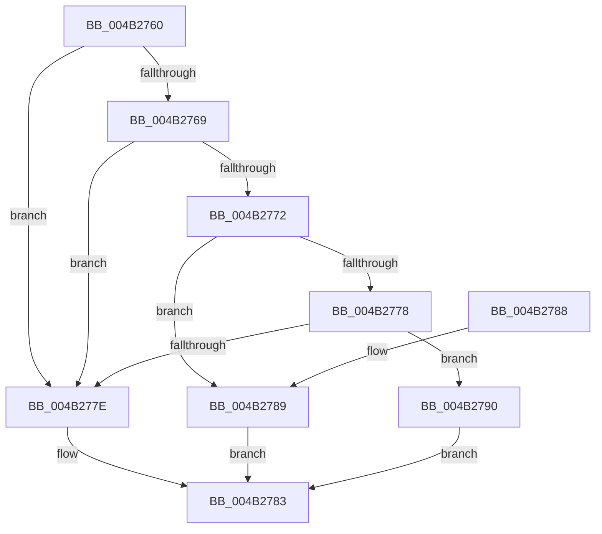

# IoSetIoAttributionIrp

- RVA: `0x004B2760`–`0x004B2797` (길이 `55` bytes)
- VA: `0x00000001404B2760`
- 실행 섹션: `.text`
- PDB 이름 있음: `예`; PDB Function 태그: `아니요`
- unwind 정보 RVA: `0x00064C74`
- 디코드: `17`개 명령, `55/55` bytes 표시
- 미해석 바이트: `0` (있으면 어셈블리에 `.byte`로 보존)

> 이 문서는 커널 이미지의 기계어와 PDB 기호를 분석해 생성했습니다. 4번과 5번은 함수 원형과 자료형을 바이너리 사용 방식에서 추정한 C 해석이며 원본 소스 복구 결과는 아닙니다.

## 1. Dependencies

- 직접 호출 지점: **2**; 고유 호출 대상: **2**
- 직접 호출자로 확인된 함수: **0**
- RIP 상대 이미지 참조: **0**

### Outgoing calls
- `0x004B2789` → [IopSetDiskIoAttributionFromProcess](../29/IopSetDiskIoAttributionFromProcess_function_0029C520.md) (function, `0x0029C520`)
- `0x004B2790` → [IoSetDiskIoAttributionFromThread](../29/IoSetDiskIoAttributionFromThread_function_0029BF20.md) (function, `0x0029BF20`)

### Direct callers
- 이 함수 시작 RVA로 연결되는 직접 call은 확인되지 않았습니다. 간접 호출은 완전히 역산할 수 없습니다.

### Static image references
- 디코드된 RIP-relative 메모리 참조가 없습니다.

## 2. Other-region calls and transfers

- 다른 실행 섹션으로 향하는 call: **0**
- 별도 외부 분기/꼬리 이동을 확인하지 못했습니다.

## 3. Assembly (complete function range)

```asm
004B2760  48 83 EC 28                     sub rsp, 0x28
004B2764  45 85 C0                        test r8d, r8d
004B2767  74 15                           je 0x1404b277e
004B2769  41 F7 C0 FC FF FF FF            test r8d, 0xfffffffc
004B2770  75 0C                           jne 0x1404b277e
004B2772  41 F6 C0 01                     test r8b, 1
004B2776  74 11                           je 0x1404b2789
004B2778  41 F6 C0 02                     test r8b, 2
004B277C  74 12                           je 0x1404b2790
004B277E  B8 0D 00 00 C0                  mov eax, 0xc000000d
004B2783  48 83 C4 28                     add rsp, 0x28
004B2787  C3                              ret
004B2788  CC                              int3
004B2789  E8 92 9D DE FF                  call 0x14029c520
004B278E  EB F3                           jmp 0x1404b2783
004B2790  E8 8B 97 DE FF                  call 0x14029bf20
004B2795  EB EC                           jmp 0x1404b2783
```

## 4. C-style interpretation (structured pseudocode)

```c
__int64 __fastcall IoSetIoAttributionIrp(__int64 a1, __int64 a2, int a3)
{
    __int64 result;
    __int64 v_rsp;

    v_rsp = (v_rsp) - (40);
    if (a3 == 0) goto loc_004B277E;
    if (((a3) & (0xFFFFFFFCULL)) != 0) goto loc_004B277E;
    if ((((unsigned __int8)(a3)) & (1)) == 0) goto loc_004B2789;
    if ((((unsigned __int8)(a3)) & (2)) == 0) goto loc_004B2790;
loc_004B277E:
loc_004B2783:
    v_rsp = (v_rsp) + (40);
    return (unsigned int)(0xC000000DULL);
loc_004B2789:
    result = IopSetDiskIoAttributionFromProcess(a1, a2, a3, a4);
    goto loc_004B2783;
loc_004B2790:
    result = IoSetDiskIoAttributionFromThread(a1, a2, a3, a4);
    goto loc_004B2783;
}
```

## 5. (Beta) C Style

```c
int64_t IoSetIoAttributionIrp(int64_t Arg1, int64_t Arg2, int32_t Arg3)
{
    int64_t result;
    int64_t local_rsp;

    local_rsp = (local_rsp) - (40);
    if (Arg3 == 0) goto loc_004B277E;
    if (((Arg3) & (0xFFFFFFFCULL)) != 0) goto loc_004B277E;
    if ((((uint8_t)(Arg3)) & (1)) == 0) goto loc_004B2789;
    if ((((uint8_t)(Arg3)) & (2)) == 0) goto loc_004B2790;
loc_004B277E:
loc_004B2783:
    local_rsp = (local_rsp) + (40);
    return (uint32_t)(0xC000000DULL);
loc_004B2789:
    result = IopSetDiskIoAttributionFromProcess(Arg1, Arg2, Arg3, a4);
    goto loc_004B2783;
loc_004B2790:
    result = IoSetDiskIoAttributionFromThread(Arg1, Arg2, Arg3, a4);
    goto loc_004B2783;
}
```

## 6. Execution-region graph

[열기: 2D/3D 그래프와 함수 탐색 컨트롤 패널](../../../control-panel.html?section=text&rva=0x004B2760&view=graph)

- 2D 그래프는 위에서 아래로 흐르고, 3D 그래프는 빈 공간을 드래그해 회전합니다. Shift+드래그는 이동, 휠은 확대·축소, 함수 노드 선택은 대상 보고서 이동입니다.

### Static fallback


