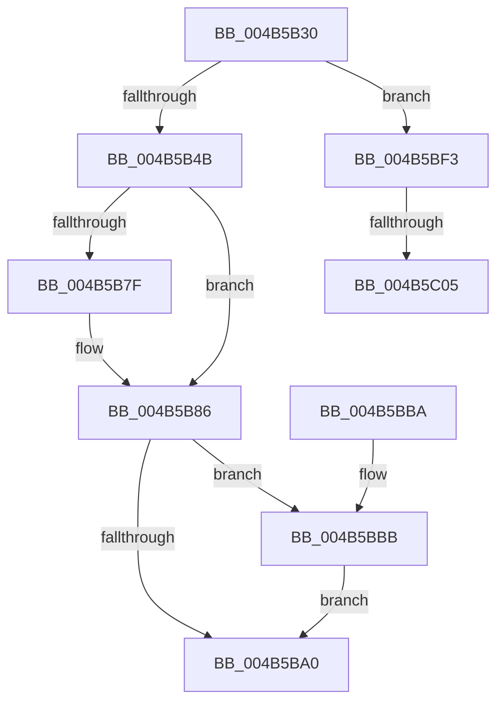

# IoWriteErrorLogEntry

- RVA: `0x004B5B30`–`0x004B5C12` (길이 `226` bytes)
- VA: `0x00000001404B5B30`
- 실행 섹션: `.text`
- PDB 이름 있음: `예`; PDB Function 태그: `예`
- unwind 정보 RVA: `0x000BA3D0`
- 디코드: `49`개 명령, `226/226` bytes 표시
- 미해석 바이트: `0` (있으면 어셈블리에 `.byte`로 보존)

> 이 문서는 커널 이미지의 기계어와 PDB 기호를 분석해 생성했습니다. 4번과 5번은 함수 원형과 자료형을 바이너리 사용 방식에서 추정한 C 해석이며 원본 소스 복구 결과는 아닙니다.

## 1. Dependencies

- 직접 호출 지점: **4**; 고유 호출 대상: **4**
- 직접 호출자로 확인된 함수: **7**
- RIP 상대 이미지 참조: **12**

### Outgoing calls
- `0x004B5B60` → [KeAcquireSpinLockRaiseToDpc](../20/KeAcquireSpinLockRaiseToDpc_function_00208470.md) (function, `0x00208470`)
- `0x004B5BAA` → [KeReleaseSpinLock](../39/KeReleaseSpinLock_function_00392BA0.md) (function, `0x00392BA0`)
- `0x004B5BEC` → [ExQueueWorkItem](../2F/ExQueueWorkItem_function_002F9520.md) (function, `0x002F9520`)
- `0x004B5C07` → [ObfDereferenceObjectWithTag](../2F/ObfDereferenceObjectWithTag_function_002F78E0.md) (function, `0x002F78E0`)

### Direct callers
- [IopDisassociateThreadIrp](../59/IopDisassociateThreadIrp_function_0059708C.md) at `0x0059721A`
- [DifIoWriteErrorLogEntryWrapper](../62/DifIoWriteErrorLogEntryWrapper_function_0062D9F0.md) at `0x0062DAB6`
- [MiBadMemoryLogger](../67/MiBadMemoryLogger_function_00679460.md) at `0x0067949D`
- [IopLogBlockedDriverEvent](../../page/71/IopLogBlockedDriverEvent_function_0071BBFC.md) at `0x0071BC4C`
- [PnpLogEvent](../../page/72/PnpLogEvent_function_0072C8FC.md) at `0x0072C9F7`
- [MiLogFailedDriverLoad](../../page/A2/MiLogFailedDriverLoad_function_00A24ACC.md) at `0x00A24C96`
- [FsRtlLogCcFlushError](../../page/AC/FsRtlLogCcFlushError_function_00ACA170.md) at `0x00ACA3A1`

### Static image references
- `0x004B5B3A` → RVA `0x00F8D05A` (`.data`; read)
- `0x004B5B55` → RVA `0x00FCF1C0` (`CACHEALI`; read)
- `0x004B5B65` → RVA `0x00F8D678` (`.data`; read)
- `0x004B5B73` → RVA `0x00F8D670` (`.data`; read)
- `0x004B5B86` → RVA `0x00F8D05B` (`.data`; read)
- `0x004B5B97` → RVA `0x00F8D678` (`.data`; write)
- `0x004B5BBB` → RVA `0x00F8D078` (`.data`; read/write)
- `0x004B5BC3` → RVA `0x00A5DC80` (`IopErrorLogThread`; read)
- `0x004B5BCA` → RVA `0x00F8D060` (`.data`; read/write)
- `0x004B5BD2` → RVA `0x00F8D060` (`.data`; read)
- `0x004B5BDE` → RVA `0x00F8D070` (`.data`; write)
- `0x004B5BE5` → RVA `0x00F8D05B` (`.data`; write)

## 2. Other-region calls and transfers

- 다른 실행 섹션으로 향하는 call: **0**
- call이 아닌 외부 분기/꼬리 이동: **2**
  - `0x004B5BFF` → [sub_006FBBFE](../6F/Unknown_function_006FBBFE.md) (`tail-transfer`)
  - `0x004B5C0D` → [sub_006FBBFE](../6F/Unknown_function_006FBBFE.md) (`tail-transfer`)

## 3. Assembly (complete function range)

```asm
004B5B30  48 89 5C 24 08                  mov qword ptr [rsp + 8], rbx
004B5B35  57                              push rdi
004B5B36  48 83 EC 20                     sub rsp, 0x20
004B5B3A  80 3D 19 75 AD 00 00            cmp byte ptr [rip + 0xad7519], 0
004B5B41  48 8D 59 D0                     lea rbx, [rcx - 0x30]
004B5B45  0F 85 A8 00 00 00               jne 0x1404b5bf3
004B5B4B  48 A1 14 00 00 00 80 F7 FF FF   movabs rax, qword ptr [0xfffff78000000014]
004B5B55  48 8D 0D 64 96 B1 00            lea rcx, [rip + 0xb19664]
004B5B5C  48 89 43 28                     mov qword ptr [rbx + 0x28], rax
004B5B60  E8 0B 29 D5 FF                  call 0x140208470
004B5B65  48 8B 0D 0C 7B AD 00            mov rcx, qword ptr [rip + 0xad7b0c]
004B5B6C  40 8A F8                        mov dil, al
004B5B6F  48 83 C3 08                     add rbx, 8
004B5B73  48 8D 05 F6 7A AD 00            lea rax, [rip + 0xad7af6]
004B5B7A  48 39 01                        cmp qword ptr [rcx], rax
004B5B7D  74 07                           je 0x1404b5b86
004B5B7F  B9 03 00 00 00                  mov ecx, 3
004B5B84  CD 29                           int 0x29
004B5B86  80 3D CE 74 AD 00 00            cmp byte ptr [rip + 0xad74ce], 0
004B5B8D  48 89 03                        mov qword ptr [rbx], rax
004B5B90  48 89 4B 08                     mov qword ptr [rbx + 8], rcx
004B5B94  48 89 19                        mov qword ptr [rcx], rbx
004B5B97  48 89 1D DA 7A AD 00            mov qword ptr [rip + 0xad7ada], rbx
004B5B9E  74 1B                           je 0x1404b5bbb
004B5BA0  40 8A D7                        mov dl, dil
004B5BA3  48 8D 0D 16 96 B1 00            lea rcx, [rip + 0xb19616]
004B5BAA  E8 F1 CF ED FF                  call 0x140392ba0
004B5BAF  48 8B 5C 24 30                  mov rbx, qword ptr [rsp + 0x30]
004B5BB4  48 83 C4 20                     add rsp, 0x20
004B5BB8  5F                              pop rdi
004B5BB9  C3                              ret
004B5BBA  CC                              int3
004B5BBB  48 83 25 B5 74 AD 00 00         and qword ptr [rip + 0xad74b5], 0
004B5BC3  48 8D 05 B6 80 5A 00            lea rax, [rip + 0x5a80b6]
004B5BCA  48 83 25 8E 74 AD 00 00         and qword ptr [rip + 0xad748e], 0
004B5BD2  48 8D 0D 87 74 AD 00            lea rcx, [rip + 0xad7487]
004B5BD9  BA 01 00 00 00                  mov edx, 1
004B5BDE  48 89 05 8B 74 AD 00            mov qword ptr [rip + 0xad748b], rax
004B5BE5  C6 05 6F 74 AD 00 01            mov byte ptr [rip + 0xad746f], 1
004B5BEC  E8 2F 39 E4 FF                  call 0x1402f9520
004B5BF1  EB AD                           jmp 0x1404b5ba0
004B5BF3  48 8B 4B 18                     mov rcx, qword ptr [rbx + 0x18]
004B5BF7  BF 44 66 6C 74                  mov edi, 0x746c6644
004B5BFC  48 85 C9                        test rcx, rcx
004B5BFF  0F 84 F9 5F 24 00               je 0x1406fbbfe
004B5C05  8B D7                           mov edx, edi
004B5C07  E8 D4 1C E4 FF                  call 0x1402f78e0
004B5C0C  90                              nop
004B5C0D  E9 EC 5F 24 00                  jmp 0x1406fbbfe
```

## 4. C-style interpretation (structured pseudocode)

```c
__int64 __fastcall IoWriteErrorLogEntry(__int64 a1)
{
    __int64 result;
    __int64 v_rbx;
    __int64 v_rsp;
    unsigned __int64 v_stack_p8;

    v_stack_p8 = v_rbx;
    v_rsp = (v_rsp) - (32);
    if ((*(unsigned __int8 *)(v_rip + 11367705)) != 0) goto loc_004B5BF3;
    *(unsigned __int64 *)(a1 - 48 + 40) = result;
    result = KeAcquireSpinLockRaiseToDpc(v_rip + 11638372, a2, a3, a4);
    v_rbx = (a1 - 48) + (8);
    if ((*(unsigned __int64 *)(*(unsigned __int64 *)(v_rip + 11369228))) != (v_rip + 11369206)) {
        a1 = 3;
    }
    *(unsigned __int64 *)(v_rbx) = v_rip + 11369206;
    *(unsigned __int64 *)(v_rbx + 8) = a1;
    *(unsigned __int64 *)(a1) = v_rbx;
    *(unsigned __int64 *)(v_rip + 11369178) = v_rbx;
    if ((*(unsigned __int8 *)(v_rip + 11367630)) == 0) goto loc_004B5BBB;
loc_004B5BA0:
    result = KeReleaseSpinLock(v_rip + 11638294, (unsigned __int8)((unsigned __int8)(result)), a3, a4);
    v_rsp = (v_rsp) + (32);
    return result;
loc_004B5BBB:
    *(unsigned __int64 *)(v_rip + 11367563) = v_rip + 5931190;
    *(unsigned __int8 *)(v_rip + 11367535) = 1;
    result = ExQueueWorkItem(v_rip + 11367559, 1, a3, a4);
    goto loc_004B5BA0;
loc_004B5BF3:
    result = ObfDereferenceObjectWithTag(*(unsigned __int64 *)(v_stack_p8 + 24), (unsigned int)((unsigned int)((unsigned int)(0x746C6644ULL))), a3, a4);
}
```

## 5. (Beta) C Style

```c
int64_t IoWriteErrorLogEntry(void *Arg1)
{
    uint8_t *arg1 = (uint8_t *)Arg1;

    int64_t result;
    int64_t local_rbx;
    int64_t local_rsp;
    uint64_t v_stack_p8;

    v_stack_p8 = local_rbx;
    local_rsp = (local_rsp) - (32);
    if ((*(uint8_t *)(v_rip + 0xAD7519)) != 0) goto loc_004B5BF3;
    *(uint64_t *)(arg1 - 0x30 + 0x28) = result;
    result = KeAcquireSpinLockRaiseToDpc(v_rip + 11638372, a2, a3, a4);
    local_rbx = (Arg1 - 48) + (8);
    if ((*(uint64_t *)(*(uint64_t *)(v_rip + 0xAD7B0C))) != (v_rip + 11369206)) {
        Arg1 = 3;
    }
    *(uint64_t *)(local_rbx) = v_rip + 11369206;
    *(void **)(local_rbx + 0x8) = Arg1;
    *(uint64_t *)(arg1) = local_rbx;
    *(uint64_t *)(v_rip + 0xAD7ADA) = local_rbx;
    if ((*(uint8_t *)(v_rip + 0xAD74CE)) == 0) goto loc_004B5BBB;
loc_004B5BA0:
    result = KeReleaseSpinLock(v_rip + 11638294, (uint8_t)((uint8_t)(result)), a3, a4);
    local_rsp = (local_rsp) + (32);
    return result;
loc_004B5BBB:
    *(uint64_t *)(v_rip + 0xAD748B) = v_rip + 5931190;
    *(uint8_t *)(v_rip + 0xAD746F) = 1;
    result = ExQueueWorkItem(v_rip + 11367559, 1, a3, a4);
    goto loc_004B5BA0;
loc_004B5BF3:
    result = ObfDereferenceObjectWithTag(*(uint64_t *)(v_stack_p8 + 0x18), (uint32_t)((uint32_t)((uint32_t)(0x746C6644ULL))), a3, a4);
}
```

### 관측된 메모리 오프셋

구조체 형식이 확인되지 않은 접근은 인자 기준의 오프셋으로만 기록했습니다.

| 기준 인자 | 오프셋 표현 | 폭 (bit) | 접근 |
|---|---:|---:|---|
| `Arg1` | `- 0x30` | `64` | `R` |
| `Arg1` | `+ 0x0` | `64` | `W` |
| `Arg1` | `+ 0x8` | `64` | `W` |
| `Arg1` | `+ 0x18` | `64` | `R` |
| `Arg1` | `+ 0x28` | `64` | `W` |

## 6. Execution-region graph

[열기: 2D/3D 그래프와 함수 탐색 컨트롤 패널](../../../control-panel.html?section=text&rva=0x004B5B30&view=graph)

- 2D 그래프는 위에서 아래로 흐르고, 3D 그래프는 빈 공간을 드래그해 회전합니다. Shift+드래그는 이동, 휠은 확대·축소, 함수 노드 선택은 대상 보고서 이동입니다.

### Static fallback


