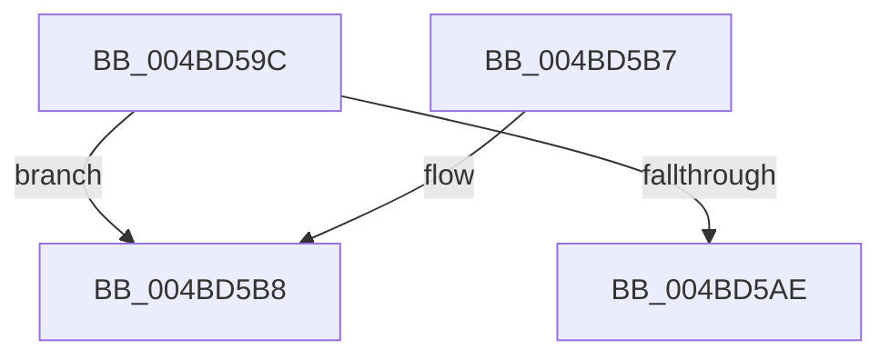

# IopCheckStackForTransactionSupport

- RVA: `0x004BD59C`–`0x004BD5C9` (길이 `45` bytes)
- VA: `0x00000001404BD59C`
- 실행 섹션: `.text`
- PDB 이름 있음: `예`; PDB Function 태그: `예`
- unwind 정보 RVA: `0x0008B9A4`
- 디코드: `14`개 명령, `45/45` bytes 표시
- 미해석 바이트: `0` (있으면 어셈블리에 `.byte`로 보존)

> 이 문서는 커널 이미지의 기계어와 PDB 기호를 분석해 생성했습니다. 4번과 5번은 함수 원형과 자료형을 바이너리 사용 방식에서 추정한 C 해석이며 원본 소스 복구 결과는 아닙니다.

## 1. Dependencies

- 직접 호출 지점: **1**; 고유 호출 대상: **1**
- 직접 호출자로 확인된 함수: **2**
- RIP 상대 이미지 참조: **0**

### Outgoing calls
- `0x004BD5BD` → [KeAcquireQueuedSpinLock](../27/KeAcquireQueuedSpinLock_function_00273D80.md) (function, `0x00273D80`)

### Direct callers
- [IopRetrieveTransactionParameters](../../page/89/IopRetrieveTransactionParameters_function_00898520.md) at `0x0089862B`
- [IopRetrieveTransactionParametersFromOpenPacket](../../page/A2/IopRetrieveTransactionParametersFromOpenPacket_function_00A2027C.md) at `0x00A202C2`

### Static image references
- 디코드된 RIP-relative 메모리 참조가 없습니다.

## 2. Other-region calls and transfers

- 다른 실행 섹션으로 향하는 call: **0**
- call이 아닌 외부 분기/꼬리 이동: **1**
  - `0x004BD5C4` → [sub_006FC8F4](../6F/Unknown_function_006FC8F4.md) (`tail-transfer`)

## 3. Assembly (complete function range)

```asm
004BD59C  40 53                           push rbx
004BD59E  48 83 EC 20                     sub rsp, 0x20
004BD5A2  F7 41 30 00 00 04 00            test dword ptr [rcx + 0x30], 0x40000
004BD5A9  48 8B D9                        mov rbx, rcx
004BD5AC  74 0A                           je 0x1404bd5b8
004BD5AE  48 8B C3                        mov rax, rbx
004BD5B1  48 83 C4 20                     add rsp, 0x20
004BD5B5  5B                              pop rbx
004BD5B6  C3                              ret
004BD5B7  CC                              int3
004BD5B8  B9 0A 00 00 00                  mov ecx, 0xa
004BD5BD  E8 BE 67 DB FF                  call 0x140273d80
004BD5C2  8A D0                           mov dl, al
004BD5C4  E9 2B F3 23 00                  jmp 0x1406fc8f4
```

## 4. C-style interpretation (structured pseudocode)

```c
__int64 __fastcall IopCheckStackForTransactionSupport(__int64 a1)
{
    __int64 result;
    __int64 v_rsp;

    v_rsp = (v_rsp) - (32);
    if (((*(unsigned int *)(a1 + 48)) & (0x40000ULL)) == 0) goto loc_004BD5B8;
    v_rsp = (v_rsp) + (32);
    return a1;
loc_004BD5B8:
    result = KeAcquireQueuedSpinLock(10, a2, a3, a4);
}
```

## 5. (Beta) C Style

```c
void *IopCheckStackForTransactionSupport(void *Arg1)
{
    uint8_t *arg1 = (uint8_t *)Arg1;

    int64_t result;
    int64_t local_rsp;

    local_rsp = (local_rsp) - (32);
    if (((*(uint32_t *)(arg1 + 0x30)) & (0x40000ULL)) == 0) goto loc_004BD5B8;
    local_rsp = (local_rsp) + (32);
    return Arg1;
loc_004BD5B8:
    result = KeAcquireQueuedSpinLock(10, a2, a3, a4);
}
```

### 관측된 메모리 오프셋

구조체 형식이 확인되지 않은 접근은 인자 기준의 오프셋으로만 기록했습니다.

| 기준 인자 | 오프셋 표현 | 폭 (bit) | 접근 |
|---|---:|---:|---|
| `Arg1` | `+ 0x30` | `32` | `R` |

## 6. Execution-region graph

[열기: 2D/3D 그래프와 함수 탐색 컨트롤 패널](../../../control-panel.html?section=text&rva=0x004BD59C&view=graph)

- 2D 그래프는 위에서 아래로 흐르고, 3D 그래프는 빈 공간을 드래그해 회전합니다. Shift+드래그는 이동, 휠은 확대·축소, 함수 노드 선택은 대상 보고서 이동입니다.

### Static fallback


