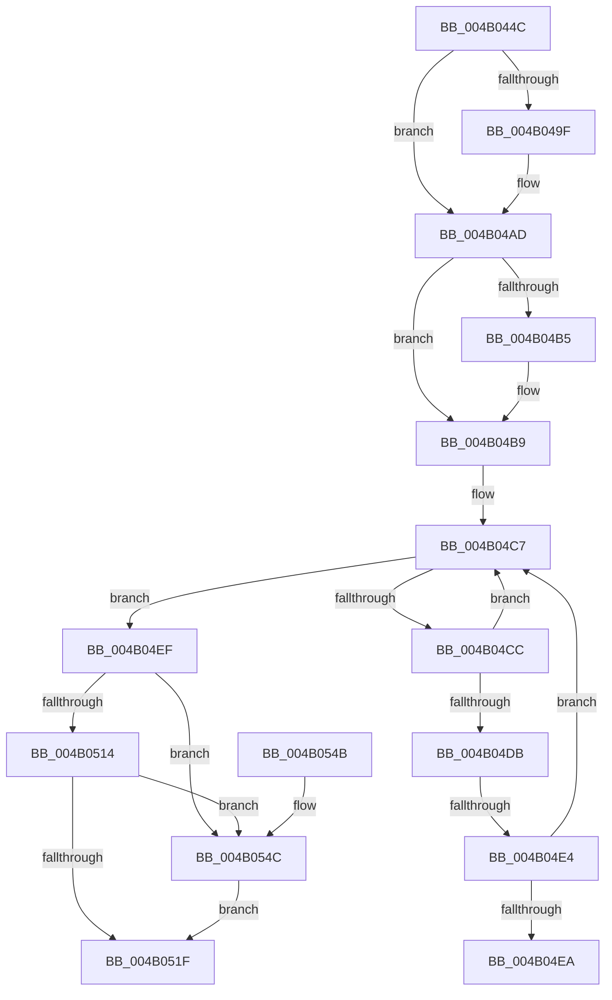

# IopCleanupNotifications

- RVA: `0x004B044C`–`0x004B0556` (길이 `266` bytes)
- VA: `0x00000001404B044C`
- 실행 섹션: `.text`
- PDB 이름 있음: `예`; PDB Function 태그: `예`
- unwind 정보 RVA: `0x000B8938`
- 디코드: `71`개 명령, `266/266` bytes 표시
- 미해석 바이트: `0` (있으면 어셈블리에 `.byte`로 보존)

> 이 문서는 커널 이미지의 기계어와 PDB 기호를 분석해 생성했습니다. 4번과 5번은 함수 원형과 자료형을 바이너리 사용 방식에서 추정한 C 해석이며 원본 소스 복구 결과는 아닙니다.

## 1. Dependencies

- 직접 호출 지점: **5**; 고유 호출 대상: **5**
- 직접 호출자로 확인된 함수: **3**
- RIP 상대 이미지 참조: **2**

### Outgoing calls
- `0x004B048F` → [KeAbPreAcquire](../21/KeAbPreAcquire_function_00210230.md) (function, `0x00210230`)
- `0x004B04A8` → [ExfAcquirePushLockExclusiveEx](../20/ExfAcquirePushLockExclusiveEx_function_0020FC90.md) (function, `0x0020FC90`)
- `0x004B0522` → [KeAbPostRelease](../2E/KeAbPostRelease_function_002E1600.md) (function, `0x002E1600`)
- `0x004B0527` → [KeLeaveCriticalRegion](../25/KeLeaveCriticalRegion_function_0025D8B0.md) (function, `0x0025D8B0`)
- `0x004B054F` → [ExfReleasePushLock](../26/ExfReleasePushLock_function_002638D0.md) (function, `0x002638D0`)

### Direct callers
- [sub_0038C58B](../38/Unknown_function_0038C58B.md) at `0x0038C8CC`
- [IopDeleteDevice](../../page/A0/IopDeleteDevice_function_00A066B0.md) at `0x00A0670E`
- [IopUnloadDriver](../../page/AB/IopUnloadDriver_function_00ABF868.md) at `0x00ABFC5D`

### Static image references
- `0x004B0472` → RVA `0x00F8D160` (`.data`; read)
- `0x004B04B9` → RVA `0x00F8D150` (`.data`; read)

## 2. Other-region calls and transfers

- 다른 실행 섹션으로 향하는 call: **0**
- call이 아닌 외부 분기/꼬리 이동: **2**
  - `0x004B04DE` → [sub_006FB21E](../6F/Unknown_function_006FB21E.md) (`tail-transfer`)
  - `0x004B04EA` → [sub_006FB21E](../6F/Unknown_function_006FB21E.md) (`tail-transfer`)

## 3. Assembly (complete function range)

```asm
004B044C  48 8B C4                        mov rax, rsp
004B044F  48 89 58 08                     mov qword ptr [rax + 8], rbx
004B0453  48 89 68 10                     mov qword ptr [rax + 0x10], rbp
004B0457  48 89 70 18                     mov qword ptr [rax + 0x18], rsi
004B045B  48 89 78 20                     mov qword ptr [rax + 0x20], rdi
004B045F  41 54                           push r12
004B0461  41 56                           push r14
004B0463  41 57                           push r15
004B0465  48 83 EC 20                     sub rsp, 0x20
004B0469  65 48 8B 04 25 88 01 00 00      mov rax, qword ptr gs:[0x188]
004B0472  4C 8D 35 E7 CC AD 00            lea r14, [rip + 0xadcce7]
004B0479  48 8B F2                        mov rsi, rdx
004B047C  48 8B E9                        mov rbp, rcx
004B047F  45 33 C0                        xor r8d, r8d
004B0482  33 D2                           xor edx, edx
004B0484  49 8B CE                        mov rcx, r14
004B0487  66 FF 88 E4 01 00 00            dec word ptr [rax + 0x1e4]
004B048E  90                              nop
004B048F  E8 9C FD D5 FF                  call 0x140210230
004B0494  F0 49 0F BA 2E 00               lock bts qword ptr [r14], 0
004B049A  48 8B D8                        mov rbx, rax
004B049D  73 0E                           jae 0x1404b04ad
004B049F  4D 8B C6                        mov r8, r14
004B04A2  48 8B D0                        mov rdx, rax
004B04A5  49 8B CE                        mov rcx, r14
004B04A8  E8 E3 F7 D5 FF                  call 0x14020fc90
004B04AD  45 33 FF                        xor r15d, r15d
004B04B0  48 85 DB                        test rbx, rbx
004B04B3  74 04                           je 0x1404b04b9
004B04B5  C6 43 0A 01                     mov byte ptr [rbx + 0xa], 1
004B04B9  48 8B 3D 90 CC AD 00            mov rdi, qword ptr [rip + 0xadcc90]
004B04C0  4C 8D 25 89 CC AD 00            lea r12, [rip + 0xadcc89]
004B04C7  49 3B FC                        cmp rdi, r12
004B04CA  74 23                           je 0x1404b04ef
004B04CC  48 8B DF                        mov rbx, rdi
004B04CF  48 8B 3F                        mov rdi, qword ptr [rdi]
004B04D2  48 8B 4B 10                     mov rcx, qword ptr [rbx + 0x10]
004B04D6  48 3B CD                        cmp rcx, rbp
004B04D9  75 EC                           jne 0x1404b04c7
004B04DB  48 85 F6                        test rsi, rsi
004B04DE  0F 84 3A AD 24 00               je 0x1406fb21e
004B04E4  48 39 73 28                     cmp qword ptr [rbx + 0x28], rsi
004B04E8  75 DD                           jne 0x1404b04c7
004B04EA  E9 2F AD 24 00                  jmp 0x1406fb21e
004B04EF  0F 0D 0D 6A CC AD 00            prefetchw byte ptr [rip + 0xadcc6a]
004B04F6  48 8B 05 63 CC AD 00            mov rax, qword ptr [rip + 0xadcc63]
004B04FD  48 8B C8                        mov rcx, rax
004B0500  48 83 E1 F0                     and rcx, 0xfffffffffffffff0
004B0504  48 83 F9 10                     cmp rcx, 0x10
004B0508  48 8D 50 F0                     lea rdx, [rax - 0x10]
004B050C  49 0F 46 D7                     cmovbe rdx, r15
004B0510  A8 02                           test al, 2
004B0512  75 38                           jne 0x1404b054c
004B0514  F0 48 0F B1 15 43 CC AD 00      lock cmpxchg qword ptr [rip + 0xadcc43], rdx
004B051D  75 2D                           jne 0x1404b054c
004B051F  49 8B CE                        mov rcx, r14
004B0522  E8 D9 10 E3 FF                  call 0x1402e1600
004B0527  E8 84 D3 DA FF                  call 0x14025d8b0
004B052C  48 8B 5C 24 40                  mov rbx, qword ptr [rsp + 0x40]
004B0531  48 8B 6C 24 48                  mov rbp, qword ptr [rsp + 0x48]
004B0536  48 8B 74 24 50                  mov rsi, qword ptr [rsp + 0x50]
004B053B  48 8B 7C 24 58                  mov rdi, qword ptr [rsp + 0x58]
004B0540  48 83 C4 20                     add rsp, 0x20
004B0544  41 5F                           pop r15
004B0546  41 5E                           pop r14
004B0548  41 5C                           pop r12
004B054A  C3                              ret
004B054B  CC                              int3
004B054C  49 8B CE                        mov rcx, r14
004B054F  E8 7C 33 DB FF                  call 0x1402638d0
004B0554  EB C9                           jmp 0x1404b051f
```

## 4. C-style interpretation (structured pseudocode)

```c
__int64 __fastcall IopCleanupNotifications(__int64 a1, __int64 a2, int a3)
{
    __int64 result;
    __int64 v_r15;
    __int64 v_rsp;
    unsigned __int64 v_stack_p10;
    unsigned __int64 v_stack_p18;
    unsigned __int64 v_stack_p20;
    unsigned __int64 v_stack_p8;

    *(unsigned __int64 *)(v_rsp + 8) = v_rbx;
    *(unsigned __int64 *)(v_rsp + 16) = v_rbp;
    *(unsigned __int64 *)(v_rsp + 24) = v_rsi;
    *(unsigned __int64 *)(v_rsp + 32) = v_rdi;
    v_rsp = (v_rsp) - (32);
    a3 = 0;
    a2 = 0;
    result = KeAbPreAcquire(v_rip + 11390183, a2, a3, a4);
    if (!(condition_is_above_or_equal)) {
        a3 = v_rip + 11390183;
        a2 = result;
        a1 = v_rip + 11390183;
        result = ExfAcquirePushLockExclusiveEx(a1, a2, a3, a4);
    }
    v_r15 = 0;
    if (result != 0) {
        *(unsigned __int8 *)(result + 10) = 1;
    }
loc_004B04C7:
    if ((*(unsigned __int64 *)(v_rip + 11390096)) == (v_rip + 11390089)) goto loc_004B04EF;
    if ((*(unsigned __int64 *)(*(unsigned __int64 *)(v_rip + 11390096) + 16)) != a1) goto loc_004B04C7;
    if ((*(unsigned __int64 *)(*(unsigned __int64 *)(v_rip + 11390096) + 40)) != a2) goto loc_004B04C7;
loc_004B04EF:
    a1 = (*(unsigned __int64 *)(v_rip + 11390051)) & (-16);
    a2 = *(unsigned __int64 *)(v_rip + 11390051) - 16;
    if (a1 <= 16) { a2 = 0; }
    if ((((unsigned __int8)(*(unsigned __int64 *)(v_rip + 11390051))) & (2)) != 0) goto loc_004B054C;
    if ((((unsigned __int8)(*(unsigned __int64 *)(v_rip + 11390051))) & (2)) != 0) goto loc_004B054C;
loc_004B051F:
    result = KeAbPostRelease(v_rip + 11390183, a2, a3, a4);
    result = KeLeaveCriticalRegion(v_rip + 11390183, a2, a3, a4);
    v_rsp = (v_rsp) + (32);
    return result;
loc_004B054C:
    result = ExfReleasePushLock(v_rip + 11390183, a2, a3, a4);
    goto loc_004B051F;
}
```

## 5. (Beta) C Style

```c
int64_t IopCleanupNotifications(int64_t Arg1, int64_t Arg2, int32_t Arg3)
{
    int64_t result;
    int64_t local_r15;
    int64_t local_rsp;
    uint64_t v_stack_p10;
    uint64_t v_stack_p18;
    uint64_t v_stack_p20;
    uint64_t v_stack_p8;

    *(uint64_t *)(local_rsp + 0x8) = local_rbx;
    *(uint64_t *)(local_rsp + 0x10) = local_rbp;
    *(uint64_t *)(local_rsp + 0x18) = local_rsi;
    *(uint64_t *)(local_rsp + 0x20) = local_rdi;
    local_rsp = (local_rsp) - (32);
    Arg3 = 0;
    Arg2 = 0;
    result = KeAbPreAcquire(v_rip + 11390183, Arg2, Arg3, a4);
    if (!(condition_is_above_or_equal)) {
        Arg3 = v_rip + 11390183;
        Arg2 = result;
        Arg1 = v_rip + 11390183;
        result = ExfAcquirePushLockExclusiveEx(Arg1, Arg2, Arg3, a4);
    }
    local_r15 = 0;
    if (result != 0) {
        *(uint8_t *)(result + 0xA) = 1;
    }
loc_004B04C7:
    if ((*(uint64_t *)(v_rip + 0xADCC90)) == (v_rip + 11390089)) goto loc_004B04EF;
    if ((*(uint64_t *)(*(uint64_t *)(v_rip + 0xADCC90) + 0x10)) != Arg1) goto loc_004B04C7;
    if ((*(uint64_t *)(*(uint64_t *)(v_rip + 0xADCC90) + 0x28)) != Arg2) goto loc_004B04C7;
loc_004B04EF:
    Arg1 = (*(uint64_t *)(v_rip + 0xADCC63)) & (-16);
    Arg2 = *(uint64_t *)(v_rip + 0xADCC63) - 16;
    if (Arg1 <= 16) { Arg2 = 0; }
    if ((((uint8_t)(*(uint64_t *)(v_rip + 0xADCC63))) & (2)) != 0) goto loc_004B054C;
    if ((((uint8_t)(*(uint64_t *)(v_rip + 0xADCC63))) & (2)) != 0) goto loc_004B054C;
loc_004B051F:
    result = KeAbPostRelease(v_rip + 11390183, Arg2, Arg3, a4);
    result = KeLeaveCriticalRegion(v_rip + 11390183, Arg2, Arg3, a4);
    local_rsp = (local_rsp) + (32);
    return result;
loc_004B054C:
    result = ExfReleasePushLock(v_rip + 11390183, Arg2, Arg3, a4);
    goto loc_004B051F;
}
```

## 6. Execution-region graph

[열기: 2D/3D 그래프와 함수 탐색 컨트롤 패널](../../../control-panel.html?section=text&rva=0x004B044C&view=graph)

- 2D 그래프는 위에서 아래로 흐르고, 3D 그래프는 빈 공간을 드래그해 회전합니다. Shift+드래그는 이동, 휠은 확대·축소, 함수 노드 선택은 대상 보고서 이동입니다.

### Static fallback


