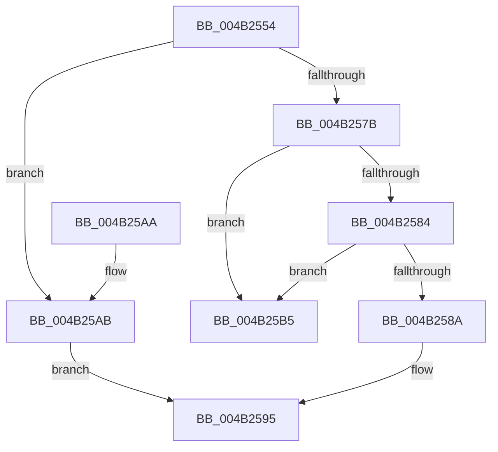

# IopErrorLogGetEntry

- RVA: `0x004B2554`–`0x004B25BC` (길이 `104` bytes)
- VA: `0x00000001404B2554`
- 실행 섹션: `.text`
- PDB 이름 있음: `예`; PDB Function 태그: `아니요`
- unwind 정보 RVA: `0x0008B9A4`
- 디코드: `28`개 명령, `104/104` bytes 표시
- 미해석 바이트: `0` (있으면 어셈블리에 `.byte`로 보존)

> 이 문서는 커널 이미지의 기계어와 PDB 기호를 분석해 생성했습니다. 4번과 5번은 함수 원형과 자료형을 바이너리 사용 방식에서 추정한 C 해석이며 원본 소스 복구 결과는 아닙니다.

## 1. Dependencies

- 직접 호출 지점: **2**; 고유 호출 대상: **2**
- 직접 호출자로 확인된 함수: **1**
- RIP 상대 이미지 참조: **4**

### Outgoing calls
- `0x004B2561` → [KeAcquireSpinLockRaiseToDpc](../20/KeAcquireSpinLockRaiseToDpc_function_00208470.md) (function, `0x00208470`)
- `0x004B259C` → [KeReleaseSpinLock](../39/KeReleaseSpinLock_function_00392BA0.md) (function, `0x00392BA0`)

### Direct callers
- [IopErrorLogThread](../../page/A5/IopErrorLogThread_function_00A5DC80.md) at `0x00A5DCE4`

### Static image references
- `0x004B255A` → RVA `0x00FCF1C0` (`CACHEALI`; read)
- `0x004B2566` → RVA `0x00F8D670` (`.data`; read)
- `0x004B258A` → RVA `0x00F8D670` (`.data`; write)
- `0x004B25AD` → RVA `0x00F8D05B` (`.data`; write)

## 2. Other-region calls and transfers

- 다른 실행 섹션으로 향하는 call: **0**
- 별도 외부 분기/꼬리 이동을 확인하지 못했습니다.

## 3. Assembly (complete function range)

```asm
004B2554  40 53                           push rbx
004B2556  48 83 EC 20                     sub rsp, 0x20
004B255A  48 8D 0D 5F CC B1 00            lea rcx, [rip + 0xb1cc5f]
004B2561  E8 0A 5F D5 FF                  call 0x140208470
004B2566  48 8B 1D 03 B1 AD 00            mov rbx, qword ptr [rip + 0xadb103]
004B256D  48 8D 0D FC B0 AD 00            lea rcx, [rip + 0xadb0fc]
004B2574  8A D0                           mov dl, al
004B2576  48 3B D9                        cmp rbx, rcx
004B2579  74 30                           je 0x1404b25ab
004B257B  48 8B 03                        mov rax, qword ptr [rbx]
004B257E  48 39 4B 08                     cmp qword ptr [rbx + 8], rcx
004B2582  75 31                           jne 0x1404b25b5
004B2584  48 39 58 08                     cmp qword ptr [rax + 8], rbx
004B2588  75 2B                           jne 0x1404b25b5
004B258A  48 89 05 DF B0 AD 00            mov qword ptr [rip + 0xadb0df], rax
004B2591  48 89 48 08                     mov qword ptr [rax + 8], rcx
004B2595  48 8D 0D 24 CC B1 00            lea rcx, [rip + 0xb1cc24]
004B259C  E8 FF 05 EE FF                  call 0x140392ba0
004B25A1  48 8B C3                        mov rax, rbx
004B25A4  48 83 C4 20                     add rsp, 0x20
004B25A8  5B                              pop rbx
004B25A9  C3                              ret
004B25AA  CC                              int3
004B25AB  33 DB                           xor ebx, ebx
004B25AD  88 1D A8 AA AD 00               mov byte ptr [rip + 0xadaaa8], bl
004B25B3  EB E0                           jmp 0x1404b2595
004B25B5  B9 03 00 00 00                  mov ecx, 3
004B25BA  CD 29                           int 0x29
```

## 4. C-style interpretation (structured pseudocode)

```c
__int64 __fastcall IopErrorLogGetEntry(void)
{
    __int64 result;
    __int64 v_rbx;
    __int64 v_rsp;

    v_rsp = (v_rsp) - (32);
    result = KeAcquireSpinLockRaiseToDpc(v_rip + 11652191, a2, a3, a4);
    if ((*(unsigned __int64 *)(v_rip + 11383043)) == (v_rip + 11383036)) goto loc_004B25AB;
    if ((*(unsigned __int64 *)(*(unsigned __int64 *)(v_rip + 11383043) + 8)) != (v_rip + 11383036)) goto loc_004B25B5;
    if ((*(unsigned __int64 *)(*(unsigned __int64 *)(*(unsigned __int64 *)(v_rip + 11383043)) + 8)) != (*(unsigned __int64 *)(v_rip + 11383043))) goto loc_004B25B5;
    *(unsigned __int64 *)(v_rip + 11383007) = *(unsigned __int64 *)(*(unsigned __int64 *)(v_rip + 11383043));
    *(unsigned __int64 *)(*(unsigned __int64 *)(*(unsigned __int64 *)(v_rip + 11383043)) + 8) = v_rip + 11383036;
loc_004B2595:
    result = KeReleaseSpinLock(v_rip + 11652132, (unsigned __int8)(result), a3, a4);
    v_rsp = (v_rsp) + (32);
    return *(unsigned __int64 *)(v_rip + 11383043);
loc_004B25AB:
    v_rbx = 0;
    *(unsigned __int8 *)(v_rip + 11381416) = 0;
    goto loc_004B2595;
loc_004B25B5:
    return *(unsigned __int64 *)(v_rip + 11383043);
}
```

## 5. (Beta) C Style

```c
void IopErrorLogGetEntry(void)
{
    int64_t result;
    int64_t local_rbx;
    int64_t local_rsp;

    local_rsp = (local_rsp) - (32);
    result = KeAcquireSpinLockRaiseToDpc(v_rip + 11652191, a2, a3, a4);
    if ((*(uint64_t *)(v_rip + 0xADB103)) == (v_rip + 11383036)) goto loc_004B25AB;
    if ((*(uint64_t *)(*(uint64_t *)(v_rip + 0xADB103) + 0x8)) != (v_rip + 11383036)) goto loc_004B25B5;
    if ((*(uint64_t *)(*(uint64_t *)(*(uint64_t *)(v_rip + 0xADB103)) + 0x8)) != (*(uint64_t *)(v_rip + 0xADB103))) goto loc_004B25B5;
    *(uint64_t *)(v_rip + 0xADB0DF) = *(uint64_t *)(*(uint64_t *)(v_rip + 0xADB103));
    *(uint64_t *)(*(uint64_t *)(*(uint64_t *)(v_rip + 0xADB103)) + 0x8) = v_rip + 11383036;
loc_004B2595:
    result = KeReleaseSpinLock(v_rip + 11652132, (uint8_t)(result), a3, a4);
    local_rsp = (local_rsp) + (32);
    return *(uint64_t *)(v_rip + 0xADB103);
loc_004B25AB:
    local_rbx = 0;
    *(uint8_t *)(v_rip + 0xADAAA8) = 0;
    goto loc_004B2595;
loc_004B25B5:
    return *(uint64_t *)(v_rip + 0xADB103);
}
```

## 6. Execution-region graph

[열기: 2D/3D 그래프와 함수 탐색 컨트롤 패널](../../../control-panel.html?section=text&rva=0x004B2554&view=graph)

- 2D 그래프는 위에서 아래로 흐르고, 3D 그래프는 빈 공간을 드래그해 회전합니다. Shift+드래그는 이동, 휠은 확대·축소, 함수 노드 선택은 대상 보고서 이동입니다.

### Static fallback


