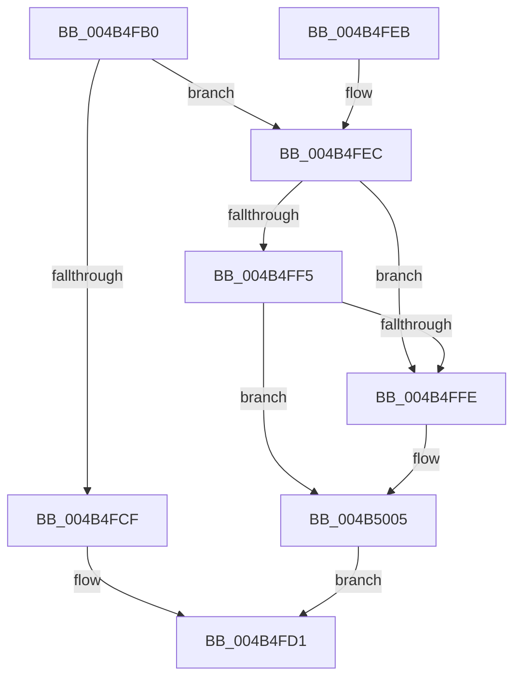

# IopInterlockedRemoveHeadList

- RVA: `0x004B4FB0`–`0x004B500E` (길이 `94` bytes)
- VA: `0x00000001404B4FB0`
- 실행 섹션: `.text`
- PDB 이름 있음: `예`; PDB Function 태그: `아니요`
- unwind 정보 RVA: `0x000687A0`
- 디코드: `30`개 명령, `94/94` bytes 표시
- 미해석 바이트: `0` (있으면 어셈블리에 `.byte`로 보존)

> 이 문서는 커널 이미지의 기계어와 PDB 기호를 분석해 생성했습니다. 4번과 5번은 함수 원형과 자료형을 바이너리 사용 방식에서 추정한 C 해석이며 원본 소스 복구 결과는 아닙니다.

## 1. Dependencies

- 직접 호출 지점: **2**; 고유 호출 대상: **2**
- 직접 호출자로 확인된 함수: **5**
- RIP 상대 이미지 참조: **0**

### Outgoing calls
- `0x004B4FC2` → [KeAcquireQueuedSpinLock](../27/KeAcquireQueuedSpinLock_function_00273D80.md) (function, `0x00273D80`)
- `0x004B4FD8` → [KeReleaseQueuedSpinLock](../27/KeReleaseQueuedSpinLock_function_00272540.md) (function, `0x00272540`)

### Direct callers
- [IopLoadUnloadDriver](../../page/99/IopLoadUnloadDriver_function_00996B80.md) at `0x00996C88`
- [IopCallDriverReinitializationRoutines](../../page/A8/IopCallDriverReinitializationRoutines_function_00A8E39C.md) at `0x00A8E3D7`
- [sub_00B4657A](../../page/B4/Unknown_function_00B4657A.md) at `0x00B465C0`
- [IoShutdownSystem](../../pagelk/B6/IoShutdownSystem_function_00B63B8C.md) at `0x00B63CB8`
- [IoShutdownSystem](../../pagelk/B6/IoShutdownSystem_function_00B63B8C.md) at `0x00B63DE3`
- [IopCallBootDriverReinitializationRoutines](../../init/C2/IopCallBootDriverReinitializationRoutines_function_00C2D9F0.md) at `0x00C2DA15`
- [IopCallBootDriverReinitializationRoutines](../../init/C2/IopCallBootDriverReinitializationRoutines_function_00C2D9F0.md) at `0x00C2DA70`

### Static image references
- 디코드된 RIP-relative 메모리 참조가 없습니다.

## 2. Other-region calls and transfers

- 다른 실행 섹션으로 향하는 call: **0**
- 별도 외부 분기/꼬리 이동을 확인하지 못했습니다.

## 3. Assembly (complete function range)

```asm
004B4FB0  48 89 5C 24 08                  mov qword ptr [rsp + 8], rbx
004B4FB5  57                              push rdi
004B4FB6  48 83 EC 20                     sub rsp, 0x20
004B4FBA  48 8B D9                        mov rbx, rcx
004B4FBD  B9 0A 00 00 00                  mov ecx, 0xa
004B4FC2  E8 B9 ED DB FF                  call 0x140273d80
004B4FC7  48 8B 3B                        mov rdi, qword ptr [rbx]
004B4FCA  48 3B FB                        cmp rdi, rbx
004B4FCD  75 1D                           jne 0x1404b4fec
004B4FCF  33 FF                           xor edi, edi
004B4FD1  8A D0                           mov dl, al
004B4FD3  B9 0A 00 00 00                  mov ecx, 0xa
004B4FD8  E8 63 D5 DB FF                  call 0x140272540
004B4FDD  48 8B 5C 24 30                  mov rbx, qword ptr [rsp + 0x30]
004B4FE2  48 8B C7                        mov rax, rdi
004B4FE5  48 83 C4 20                     add rsp, 0x20
004B4FE9  5F                              pop rdi
004B4FEA  C3                              ret
004B4FEB  CC                              int3
004B4FEC  48 8B 17                        mov rdx, qword ptr [rdi]
004B4FEF  48 39 7A 08                     cmp qword ptr [rdx + 8], rdi
004B4FF3  75 09                           jne 0x1404b4ffe
004B4FF5  48 8B 4F 08                     mov rcx, qword ptr [rdi + 8]
004B4FF9  48 39 39                        cmp qword ptr [rcx], rdi
004B4FFC  74 07                           je 0x1404b5005
004B4FFE  B9 03 00 00 00                  mov ecx, 3
004B5003  CD 29                           int 0x29
004B5005  48 89 11                        mov qword ptr [rcx], rdx
004B5008  48 89 4A 08                     mov qword ptr [rdx + 8], rcx
004B500C  EB C3                           jmp 0x1404b4fd1
```

## 4. C-style interpretation (structured pseudocode)

```c
__int64 __fastcall IopInterlockedRemoveHeadList(__int64 a1)
{
    __int64 result;
    __int64 v_rdi;
    __int64 v_rsp;
    unsigned __int64 v_stack_p8;

    v_stack_p8 = v_rbx;
    v_rsp = (v_rsp) - (32);
    result = KeAcquireQueuedSpinLock(10, a2, a3, a4);
    if ((*(unsigned __int64 *)(a1)) != a1) goto loc_004B4FEC;
    v_rdi = 0;
loc_004B4FD1:
    result = KeReleaseQueuedSpinLock(10, (unsigned __int8)(result), a3, a4);
    v_rsp = (v_rsp) + (32);
    return 0;
loc_004B4FEC:
    if ((*(unsigned __int64 *)(*(unsigned __int64 *)(v_rdi) + 8)) != 0) goto loc_004B4FFE;
    if ((*(unsigned __int64 *)(*(unsigned __int64 *)(v_rdi + 8))) != 0) {
        a1 = 3;
    }
    *(unsigned __int64 *)(a1) = *(unsigned __int64 *)(v_rdi);
    *(unsigned __int64 *)(*(unsigned __int64 *)(v_rdi) + 8) = a1;
    goto loc_004B4FD1;
}
```

## 5. (Beta) C Style

```c
int64_t IopInterlockedRemoveHeadList(void *Arg1)
{
    uint8_t *arg1 = (uint8_t *)Arg1;

    int64_t result;
    int64_t local_rdi;
    int64_t local_rsp;
    uint64_t v_stack_p8;

    v_stack_p8 = local_rbx;
    local_rsp = (local_rsp) - (32);
    result = KeAcquireQueuedSpinLock(10, a2, a3, a4);
    if ((*(uint64_t *)(arg1)) != Arg1) goto loc_004B4FEC;
    local_rdi = 0;
loc_004B4FD1:
    result = KeReleaseQueuedSpinLock(10, (uint8_t)(result), a3, a4);
    local_rsp = (local_rsp) + (32);
    return 0;
loc_004B4FEC:
    if ((*(uint64_t *)(*(uint64_t *)(local_rdi) + 0x8)) != 0) goto loc_004B4FFE;
    if ((*(uint64_t *)(*(uint64_t *)(local_rdi + 0x8))) != 0) {
        Arg1 = 3;
    }
    *(uint64_t *)(arg1) = *(uint64_t *)(local_rdi);
    *(void **)(*(uint64_t *)(local_rdi) + 0x8) = Arg1;
    goto loc_004B4FD1;
}
```

### 관측된 메모리 오프셋

구조체 형식이 확인되지 않은 접근은 인자 기준의 오프셋으로만 기록했습니다.

| 기준 인자 | 오프셋 표현 | 폭 (bit) | 접근 |
|---|---:|---:|---|
| `Arg1` | `+ 0x0` | `64` | `R` |

## 6. Execution-region graph

[열기: 2D/3D 그래프와 함수 탐색 컨트롤 패널](../../../control-panel.html?section=text&rva=0x004B4FB0&view=graph)

- 2D 그래프는 위에서 아래로 흐르고, 3D 그래프는 빈 공간을 드래그해 회전합니다. Shift+드래그는 이동, 휠은 확대·축소, 함수 노드 선택은 대상 보고서 이동입니다.

### Static fallback


