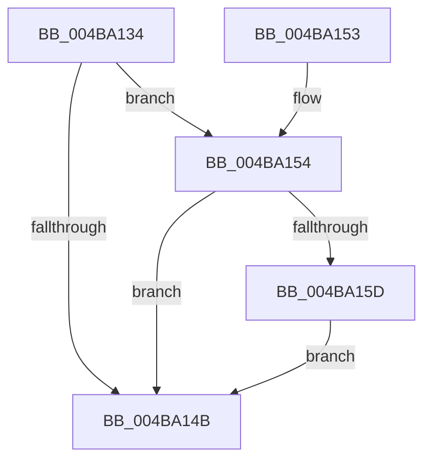

# IopIsActivityTracingEventEnabled

- RVA: `0x004BA134`–`0x004BA161` (길이 `45` bytes)
- VA: `0x00000001404BA134`
- 실행 섹션: `.text`
- PDB 이름 있음: `예`; PDB Function 태그: `아니요`
- unwind 정보 RVA: `0x0006AD84`
- 디코드: `17`개 명령, `45/45` bytes 표시
- 미해석 바이트: `0` (있으면 어셈블리에 `.byte`로 보존)

> 이 문서는 커널 이미지의 기계어와 PDB 기호를 분석해 생성했습니다. 4번과 5번은 함수 원형과 자료형을 바이너리 사용 방식에서 추정한 C 해석이며 원본 소스 복구 결과는 아닙니다.

## 1. Dependencies

- 직접 호출 지점: **1**; 고유 호출 대상: **1**
- 직접 호출자로 확인된 함수: **4**
- RIP 상대 이미지 참조: **1**

### Outgoing calls
- `0x004BA154` → [EtwEventEnabled](../39/EtwEventEnabled_function_00392450.md) (function, `0x00392450`)

### Direct callers
- [IoReuseIrp](../24/IoReuseIrp_function_0024DD70.md) at `0x0024DF01`
- [IopInitActivityIdIrp](../45/IopInitActivityIdIrp_function_0045B014.md) at `0x0045B09A`
- [IopInitActivityIdIrp](../45/IopInitActivityIdIrp_function_0045B014.md) at `0x0045B155`
- [IoTransferActivityId](IoTransferActivityId_function_004BA0D0.md) at `0x004BA0E7`
- [sub_006D81E4](../6D/Unknown_function_006D81E4.md) at `0x006D8202`

### Static image references
- `0x004BA13F` → RVA `0x00F8D7E0` (`.data`; read)

## 2. Other-region calls and transfers

- 다른 실행 섹션으로 향하는 call: **0**
- 별도 외부 분기/꼬리 이동을 확인하지 못했습니다.

## 3. Assembly (complete function range)

```asm
004BA134  40 53                           push rbx
004BA136  48 83 EC 20                     sub rsp, 0x20
004BA13A  48 8B D1                        mov rdx, rcx
004BA13D  33 DB                           xor ebx, ebx
004BA13F  48 8B 0D 9A 36 AD 00            mov rcx, qword ptr [rip + 0xad369a]
004BA146  48 85 C9                        test rcx, rcx
004BA149  75 09                           jne 0x1404ba154
004BA14B  8A C3                           mov al, bl
004BA14D  48 83 C4 20                     add rsp, 0x20
004BA151  5B                              pop rbx
004BA152  C3                              ret
004BA153  CC                              int3
004BA154  E8 F7 82 ED FF                  call 0x140392450
004BA159  84 C0                           test al, al
004BA15B  74 EE                           je 0x1404ba14b
004BA15D  B3 01                           mov bl, 1
004BA15F  EB EA                           jmp 0x1404ba14b
```

## 4. C-style interpretation (structured pseudocode)

```c
__int64 __fastcall IopIsActivityTracingEventEnabled(__int64 a1)
{
    __int64 result;
    __int64 v_rbx;
    __int64 v_rsp;

    v_rsp = (v_rsp) - (32);
    v_rbx = 0;
    if (*(unsigned __int64 *)(v_rip + 11351706) != 0) goto loc_004BA154;
loc_004BA14B:
    v_rsp = (v_rsp) + (32);
    return 0;
loc_004BA154:
    result = EtwEventEnabled(*(unsigned __int64 *)(v_rip + 11351706), a1, a3, a4);
    if ((unsigned __int8)(result) == 0) goto loc_004BA14B;
    goto loc_004BA14B;
}
```

## 5. (Beta) C Style

```c
int64_t IopIsActivityTracingEventEnabled(int64_t Arg1)
{
    int64_t result;
    int64_t local_rbx;
    int64_t local_rsp;

    local_rsp = (local_rsp) - (32);
    local_rbx = 0;
    if (*(uint64_t *)(v_rip + 0xAD369A) != 0) goto loc_004BA154;
loc_004BA14B:
    local_rsp = (local_rsp) + (32);
    return 0;
loc_004BA154:
    result = EtwEventEnabled(*(uint64_t *)(v_rip + 0xAD369A), Arg1, a3, a4);
    if ((uint8_t)(result) == 0) goto loc_004BA14B;
    goto loc_004BA14B;
}
```

## 6. Execution-region graph

[열기: 2D/3D 그래프와 함수 탐색 컨트롤 패널](../../../control-panel.html?section=text&rva=0x004BA134&view=graph)

- 2D 그래프는 위에서 아래로 흐르고, 3D 그래프는 빈 공간을 드래그해 회전합니다. Shift+드래그는 이동, 휠은 확대·축소, 함수 노드 선택은 대상 보고서 이동입니다.

### Static fallback


