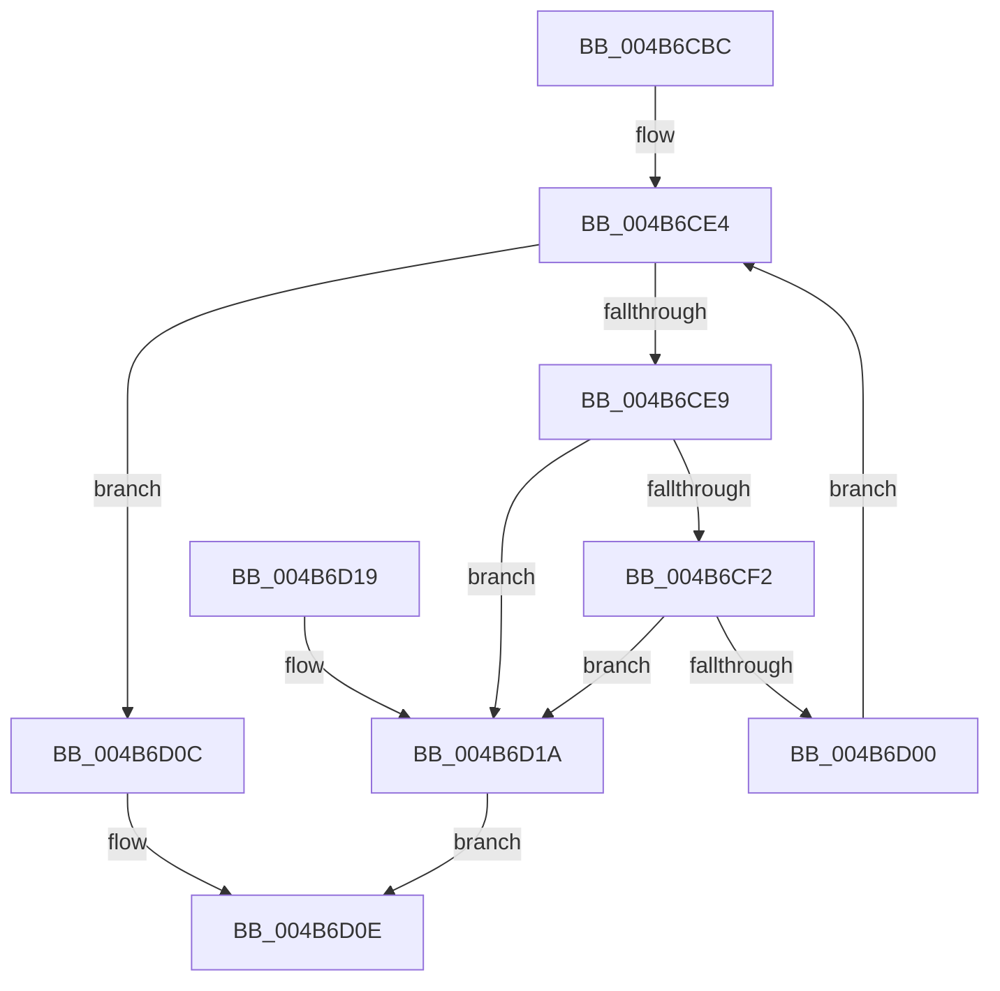

# IopIsAddressRangeValid

- RVA: `0x004B6CBC`–`0x004B6D1E` (길이 `98` bytes)
- VA: `0x00000001404B6CBC`
- 실행 섹션: `.text`
- PDB 이름 있음: `예`; PDB Function 태그: `아니요`
- unwind 정보 RVA: `0x00065BB8`
- 디코드: `29`개 명령, `98/98` bytes 표시
- 미해석 바이트: `0` (있으면 어셈블리에 `.byte`로 보존)

> 이 문서는 커널 이미지의 기계어와 PDB 기호를 분석해 생성했습니다. 4번과 5번은 함수 원형과 자료형을 바이너리 사용 방식에서 추정한 C 해석이며 원본 소스 복구 결과는 아닙니다.

## 1. Dependencies

- 직접 호출 지점: **1**; 고유 호출 대상: **1**
- 직접 호출자로 확인된 함수: **19**
- RIP 상대 이미지 참조: **0**

### Outgoing calls
- `0x004B6CF7` → [MmIsAddressValidEx](../27/MmIsAddressValidEx_function_0027FDD0.md) (function, `0x0027FDD0`)

### Direct callers
- [IopAddTriageDumpDataBlock](../42/IopAddTriageDumpDataBlock_function_004283FC.md) at `0x0042843E`
- [IopWriteDriverList](IopWriteDriverList_function_004B6AD0.md) at `0x004B6B1C`
- [IopWriteDriverList](IopWriteDriverList_function_004B6AD0.md) at `0x004B6B31`
- [IoGetLoadedDriverInfo](IoGetLoadedDriverInfo_function_004B6C20.md) at `0x004B6C5E`
- [IoGetLoadedDriverInfo](IoGetLoadedDriverInfo_function_004B6C20.md) at `0x004B6C6F`
- [IoFillTriageDumpBuffer](../59/IoFillTriageDumpBuffer_function_005921CC.md) at `0x00592397`
- [IopAddBugcheckTriageDataFromParameters](../59/IopAddBugcheckTriageDataFromParameters_function_00593E54.md) at `0x00593F0F`
- [IopAddBugcheckTriageDataFromParameters](../59/IopAddBugcheckTriageDataFromParameters_function_00593E54.md) at `0x00593F90`
- [IopAddBugcheckTriageDataFromParameters](../59/IopAddBugcheckTriageDataFromParameters_function_00593E54.md) at `0x005940D6`
- [IopAddBugcheckTriageDataFromParameters](../59/IopAddBugcheckTriageDataFromParameters_function_00593E54.md) at `0x0059410A`
- [IopAddBugcheckTriageDataFromParameters](../59/IopAddBugcheckTriageDataFromParameters_function_00593E54.md) at `0x00594164`
- [IopUpdateMinidumpContext](../59/IopUpdateMinidumpContext_function_00596360.md) at `0x0059650D`
- [IopUpdateMinidumpContext](../59/IopUpdateMinidumpContext_function_00596360.md) at `0x00596522`
- [IopAddBugcheckDirectedTransitionTriageData](../5A/IopAddBugcheckDirectedTransitionTriageData_function_005A0518.md) at `0x005A059B`
- [IopAddBugcheckPnpWatchdogTriageData](../5A/IopAddBugcheckPnpWatchdogTriageData_function_005A0608.md) at `0x005A0634`
- [IopAddBugcheckPowerTriageData](../5A/IopAddBugcheckPowerTriageData_function_005A06C8.md) at `0x005A06F6`
- [IopAddBugcheckTriageCompletionQueue](../5A/IopAddBugcheckTriageCompletionQueue_function_005A0758.md) at `0x005A077E`
- [IopAddBugcheckTriageCompletionQueue](../5A/IopAddBugcheckTriageCompletionQueue_function_005A0758.md) at `0x005A07BC`
- [IopAddBugcheckTriageDevice](../5A/IopAddBugcheckTriageDevice_function_005A0814.md) at `0x005A0842`
- [IopAddBugcheckTriageDevice](../5A/IopAddBugcheckTriageDevice_function_005A0814.md) at `0x005A086B`
- [IopAddBugcheckTriageDevice](../5A/IopAddBugcheckTriageDevice_function_005A0814.md) at `0x005A0895`
- [IopAddBugcheckTriageDevice](../5A/IopAddBugcheckTriageDevice_function_005A0814.md) at `0x005A08B5`
- [IopAddBugcheckTriageDeviceNode](../5A/IopAddBugcheckTriageDeviceNode_function_005A091C.md) at `0x005A0941`
- [IopAddBugcheckTriageDeviceNode](../5A/IopAddBugcheckTriageDeviceNode_function_005A091C.md) at `0x005A09A4`
- [IopAddBugcheckTriageIrp](../5A/IopAddBugcheckTriageIrp_function_005A0A0C.md) at `0x005A0A36`
- [IopAddBugcheckTriageIrp](../5A/IopAddBugcheckTriageIrp_function_005A0A0C.md) at `0x005A0A7E`
- [IopAddBugcheckTriageIrp](../5A/IopAddBugcheckTriageIrp_function_005A0A0C.md) at `0x005A0AF8`
- [IopAddBugcheckTriageIrp](../5A/IopAddBugcheckTriageIrp_function_005A0A0C.md) at `0x005A0B10`
- [IopAddBugcheckTriagePowerIrpWorkers](../5A/IopAddBugcheckTriagePowerIrpWorkers_function_005A0B84.md) at `0x005A0BB1`
- [IopAddBugcheckTriagePowerIrpWorkers](../5A/IopAddBugcheckTriagePowerIrpWorkers_function_005A0B84.md) at `0x005A0BE3`
- [IopAddBugcheckTriagePowerIrps](../5A/IopAddBugcheckTriagePowerIrps_function_005A0C38.md) at `0x005A0C65`
- [IopAddBugcheckTriagePowerIrps](../5A/IopAddBugcheckTriagePowerIrps_function_005A0C38.md) at `0x005A0C97`
- [IopAddBugcheckTriageThread](../5A/IopAddBugcheckTriageThread_function_005A0CF8.md) at `0x005A0D1F`
- [IopAddBugcheckTriageThread](../5A/IopAddBugcheckTriageThread_function_005A0CF8.md) at `0x005A0DAA`
- [IopAddBugcheckTriageUnicodeString](../5A/IopAddBugcheckTriageUnicodeString_function_005A0DF4.md) at `0x005A0E2F`
- [IopAddBugcheckTriageUnicodeString](../5A/IopAddBugcheckTriageUnicodeString_function_005A0DF4.md) at `0x005A0E54`
- [IopAddBugcheckTriageWorkQueue](../5A/IopAddBugcheckTriageWorkQueue_function_005A0E88.md) at `0x005A0EB0`
- [IopAddBugcheckTriageWorkQueue](../5A/IopAddBugcheckTriageWorkQueue_function_005A0E88.md) at `0x005A0EF0`
- [IopCalculateStackInformation](../5A/IopCalculateStackInformation_function_005A1954.md) at `0x005A19DB`

### Static image references
- 디코드된 RIP-relative 메모리 참조가 없습니다.

## 2. Other-region calls and transfers

- 다른 실행 섹션으로 향하는 call: **0**
- 별도 외부 분기/꼬리 이동을 확인하지 못했습니다.

## 3. Assembly (complete function range)

```asm
004B6CBC  48 89 5C 24 08                  mov qword ptr [rsp + 8], rbx
004B6CC1  57                              push rdi
004B6CC2  48 83 EC 20                     sub rsp, 0x20
004B6CC6  48 8B D9                        mov rbx, rcx
004B6CC9  48 8D BA FF 0F 00 00            lea rdi, [rdx + 0xfff]
004B6CD0  81 E1 FF 0F 00 00               and ecx, 0xfff
004B6CD6  48 81 E3 00 F0 FF FF            and rbx, 0xfffffffffffff000
004B6CDD  48 03 F9                        add rdi, rcx
004B6CE0  48 C1 EF 0C                     shr rdi, 0xc
004B6CE4  48 85 FF                        test rdi, rdi
004B6CE7  74 23                           je 0x1404b6d0c
004B6CE9  48 81 FB 00 00 01 00            cmp rbx, 0x10000
004B6CF0  72 28                           jb 0x1404b6d1a
004B6CF2  33 D2                           xor edx, edx
004B6CF4  48 8B CB                        mov rcx, rbx
004B6CF7  E8 D4 90 DC FF                  call 0x14027fdd0
004B6CFC  84 C0                           test al, al
004B6CFE  74 1A                           je 0x1404b6d1a
004B6D00  48 81 C3 00 10 00 00            add rbx, 0x1000
004B6D07  48 FF CF                        dec rdi
004B6D0A  EB D8                           jmp 0x1404b6ce4
004B6D0C  B0 01                           mov al, 1
004B6D0E  48 8B 5C 24 30                  mov rbx, qword ptr [rsp + 0x30]
004B6D13  48 83 C4 20                     add rsp, 0x20
004B6D17  5F                              pop rdi
004B6D18  C3                              ret
004B6D19  CC                              int3
004B6D1A  32 C0                           xor al, al
004B6D1C  EB F0                           jmp 0x1404b6d0e
```

## 4. C-style interpretation (structured pseudocode)

```c
__int64 __fastcall IopIsAddressRangeValid(__int64 a1, __int64 a2)
{
    __int64 result;
    __int64 v_rbx;
    __int64 v_rdi;
    __int64 v_rsp;
    unsigned __int64 v_stack_p8;

    v_stack_p8 = v_rbx;
    v_rsp = (v_rsp) - (32);
    a1 = (unsigned int)((a1) & (0xFFFULL));
    v_rbx = (a1) & (0xFFFFFFFFFFFFF000ULL);
    v_rdi = (a2 + 4095) + (a1);
    v_rdi = (v_rdi) >> (12);
loc_004B6CE4:
    if (v_rdi == 0) goto loc_004B6D0C;
    if (v_rbx < 0x10000ULL) goto loc_004B6D1A;
    a2 = 0;
    result = MmIsAddressValidEx(v_rbx, a2, a3, a4);
    if ((unsigned __int8)(result) == 0) goto loc_004B6D1A;
    v_rbx = (v_rbx) + (0x1000ULL);
    v_rdi = (v_rdi) - 1;
    goto loc_004B6CE4;
loc_004B6D0C:
loc_004B6D0E:
    v_rsp = (v_rsp) + (32);
    return 1;
loc_004B6D1A:
    result = 0;
    goto loc_004B6D0E;
}
```

## 5. (Beta) C Style

```c
int64_t IopIsAddressRangeValid(int64_t Arg1, void *Arg2)
{
    uint8_t *arg2 = (uint8_t *)Arg2;

    int64_t result;
    int64_t local_rbx;
    int64_t local_rdi;
    int64_t local_rsp;
    uint64_t v_stack_p8;

    v_stack_p8 = local_rbx;
    local_rsp = (local_rsp) - (32);
    Arg1 = (uint32_t)((Arg1) & (0xFFFULL));
    local_rbx = (Arg1) & (0xFFFFFFFFFFFFF000ULL);
    local_rdi = (Arg2 + 4095) + (Arg1);
    local_rdi = (local_rdi) >> (12);
loc_004B6CE4:
    if (local_rdi == 0) goto loc_004B6D0C;
    if (local_rbx < 0x10000ULL) goto loc_004B6D1A;
    Arg2 = 0;
    result = MmIsAddressValidEx(local_rbx, Arg2, a3, a4);
    if ((uint8_t)(result) == 0) goto loc_004B6D1A;
    local_rbx = (local_rbx) + (0x1000ULL);
    local_rdi = (local_rdi) - 1;
    goto loc_004B6CE4;
loc_004B6D0C:
loc_004B6D0E:
    local_rsp = (local_rsp) + (32);
    return 1;
loc_004B6D1A:
    result = 0;
    goto loc_004B6D0E;
}
```

### 관측된 메모리 오프셋

구조체 형식이 확인되지 않은 접근은 인자 기준의 오프셋으로만 기록했습니다.

| 기준 인자 | 오프셋 표현 | 폭 (bit) | 접근 |
|---|---:|---:|---|
| `Arg2` | `+ 0xFFF` | `64` | `R` |

## 6. Execution-region graph

[열기: 2D/3D 그래프와 함수 탐색 컨트롤 패널](../../../control-panel.html?section=text&rva=0x004B6CBC&view=graph)

- 2D 그래프는 위에서 아래로 흐르고, 3D 그래프는 빈 공간을 드래그해 회전합니다. Shift+드래그는 이동, 휠은 확대·축소, 함수 노드 선택은 대상 보고서 이동입니다.

### Static fallback


