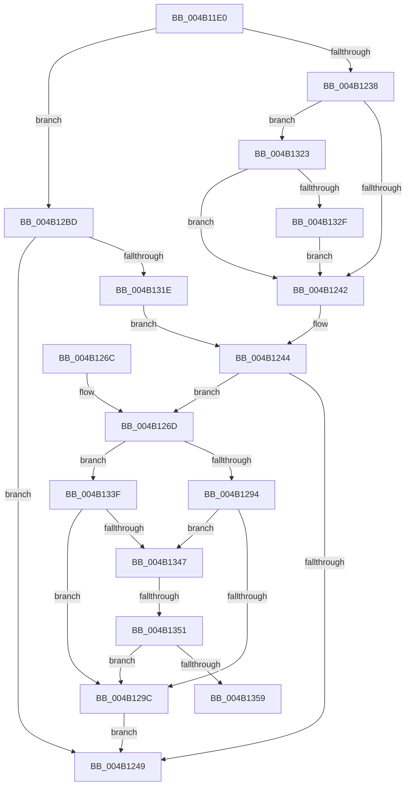

# IopPerfCompletionRoutine

- RVA: `0x004B11E0`–`0x004B135E` (길이 `382` bytes)
- VA: `0x00000001404B11E0`
- 실행 섹션: `.text`
- PDB 이름 있음: `예`; PDB Function 태그: `예`
- unwind 정보 RVA: `0x000B8E28`
- 디코드: `97`개 명령, `382/382` bytes 표시
- 미해석 바이트: `0` (있으면 어셈블리에 `.byte`로 보존)

> 이 문서는 커널 이미지의 기계어와 PDB 기호를 분석해 생성했습니다. 4번과 5번은 함수 원형과 자료형을 바이너리 사용 방식에서 추정한 C 해석이며 원본 소스 복구 결과는 아닙니다.

## 1. Dependencies

- 직접 호출 지점: **3**; 고유 호출 대상: **3**
- 직접 호출자로 확인된 함수: **0**
- RIP 상대 이미지 참조: **2**

### Outgoing calls
- `0x004B1253` → [_security_check_cookie](../6A/_security_check_cookie_function_006AC640.md) (function, `0x006AC640`)
- `0x004B12D1` → [guard_dispatch_icall](../6B/guard_dispatch_icall_function_006BAAD0.md) (function, `0x006BAAD0`)
- `0x004B130D` → [EtwTraceKernelEvent](../23/EtwTraceKernelEvent_function_00235350.md) (function, `0x00235350`)

### Direct callers
- 이 함수 시작 RVA로 연결되는 직접 call은 확인되지 않았습니다. 간접 호출은 완전히 역산할 수 없습니다.

### Static image references
- `0x004B11F0` → RVA `0x00E0A740` (`.data`; read)
- `0x004B12AC` → RVA `0x004B11E0` (`IopPerfCompletionRoutine`; read)

## 2. Other-region calls and transfers

- 다른 실행 섹션으로 향하는 call: **0**
- call이 아닌 외부 분기/꼬리 이동: **2**
  - `0x004B134B` → [sub_006FB324](../6F/Unknown_function_006FB324.md) (`tail-transfer`)
  - `0x004B1359` → [sub_006FB324](../6F/Unknown_function_006FB324.md) (`tail-transfer`)

## 3. Assembly (complete function range)

```asm
004B11E0  48 89 5C 24 20                  mov qword ptr [rsp + 0x20], rbx
004B11E5  55                              push rbp
004B11E6  56                              push rsi
004B11E7  57                              push rdi
004B11E8  41 56                           push r14
004B11EA  41 57                           push r15
004B11EC  48 83 EC 60                     sub rsp, 0x60
004B11F0  48 8B 05 49 95 95 00            mov rax, qword ptr [rip + 0x959549]
004B11F7  48 33 C4                        xor rax, rsp
004B11FA  48 89 44 24 58                  mov qword ptr [rsp + 0x58], rax
004B11FF  49 8B 18                        mov rbx, qword ptr [r8]
004B1202  49 8B F8                        mov rdi, r8
004B1205  44 8A 72 42                     mov r14b, byte ptr [rdx + 0x42]
004B1209  48 8B F2                        mov rsi, rdx
004B120C  44 8A 7A 43                     mov r15b, byte ptr [rdx + 0x43]
004B1210  41 FE C6                        inc r14b
004B1213  8A 43 03                        mov al, byte ptr [rbx + 3]
004B1216  24 02                           and al, 2
004B1218  41 0A 40 1C                     or al, byte ptr [r8 + 0x1c]
004B121C  88 43 03                        mov byte ptr [rbx + 3], al
004B121F  4D 8B 48 10                     mov r9, qword ptr [r8 + 0x10]
004B1223  4C 89 4B 38                     mov qword ptr [rbx + 0x38], r9
004B1227  4D 8B 40 08                     mov r8, qword ptr [r8 + 8]
004B122B  4C 89 43 40                     mov qword ptr [rbx + 0x40], r8
004B122F  4D 85 C9                        test r9, r9
004B1232  0F 85 85 00 00 00               jne 0x1404b12bd
004B1238  44 38 4A 41                     cmp byte ptr [rdx + 0x41], r9b
004B123C  0F 85 E1 00 00 00               jne 0x1404b1323
004B1242  33 ED                           xor ebp, ebp
004B1244  45 3A FE                        cmp r15b, r14b
004B1247  75 24                           jne 0x1404b126d
004B1249  8B C5                           mov eax, ebp
004B124B  48 8B 4C 24 58                  mov rcx, qword ptr [rsp + 0x58]
004B1250  48 33 CC                        xor rcx, rsp
004B1253  E8 E8 B3 1F 00                  call 0x1406ac640
004B1258  48 8B 9C 24 A8 00 00 00         mov rbx, qword ptr [rsp + 0xa8]
004B1260  48 83 C4 60                     add rsp, 0x60
004B1264  41 5F                           pop r15
004B1266  41 5E                           pop r14
004B1268  5F                              pop rdi
004B1269  5E                              pop rsi
004B126A  5D                              pop rbp
004B126B  C3                              ret
004B126C  CC                              int3
004B126D  48 83 67 10 00                  and qword ptr [rdi + 0x10], 0
004B1272  48 83 C3 48                     add rbx, 0x48
004B1276  48 8B 43 40                     mov rax, qword ptr [rbx + 0x40]
004B127A  48 89 47 08                     mov qword ptr [rdi + 8], rax
004B127E  48 89 1F                        mov qword ptr [rdi], rbx
004B1281  8A 43 03                        mov al, byte ptr [rbx + 3]
004B1284  88 47 1C                        mov byte ptr [rdi + 0x1c], al
004B1287  83 7E 30 00                     cmp dword ptr [rsi + 0x30], 0
004B128B  8A 43 03                        mov al, byte ptr [rbx + 3]
004B128E  0F 8C AB 00 00 00               jl 0x1404b133f
004B1294  A8 40                           test al, 0x40
004B1296  0F 84 AB 00 00 00               je 0x1404b1347
004B129C  48 8B 43 38                     mov rax, qword ptr [rbx + 0x38]
004B12A0  48 89 47 10                     mov qword ptr [rdi + 0x10], rax
004B12A4  48 8B 43 40                     mov rax, qword ptr [rbx + 0x40]
004B12A8  48 89 47 08                     mov qword ptr [rdi + 8], rax
004B12AC  48 8D 05 2D FF FF FF            lea rax, [rip - 0xd3]
004B12B3  48 89 7B 40                     mov qword ptr [rbx + 0x40], rdi
004B12B7  48 89 43 38                     mov qword ptr [rbx + 0x38], rax
004B12BB  EB 8C                           jmp 0x1404b1249
004B12BD  8B 47 18                        mov eax, dword ptr [rdi + 0x18]
004B12C0  89 44 24 40                     mov dword ptr [rsp + 0x40], eax
004B12C4  49 8B C1                        mov rax, r9
004B12C7  4C 89 4C 24 30                  mov qword ptr [rsp + 0x30], r9
004B12CC  48 89 74 24 38                  mov qword ptr [rsp + 0x38], rsi
004B12D1  E8 FA 97 20 00                  call 0x1406baad0
004B12D6  83 64 24 54 00                  and dword ptr [rsp + 0x54], 0
004B12DB  48 8D 4C 24 48                  lea rcx, [rsp + 0x48]
004B12E0  8B E8                           mov ebp, eax
004B12E2  C7 44 24 50 14 00 00 00         mov dword ptr [rsp + 0x50], 0x14
004B12EA  48 8D 44 24 30                  lea rax, [rsp + 0x30]
004B12EF  C7 44 24 20 02 18 50 00         mov dword ptr [rsp + 0x20], 0x501802
004B12F7  41 B9 25 01 00 00               mov r9d, 0x125
004B12FD  48 89 44 24 48                  mov qword ptr [rsp + 0x48], rax
004B1302  BA 01 00 00 00                  mov edx, 1
004B1307  41 B8 10 00 00 20               mov r8d, 0x20000010
004B130D  E8 3E 40 D8 FF                  call 0x140235350
004B1312  81 FD 16 00 00 C0               cmp ebp, 0xc0000016
004B1318  0F 84 2B FF FF FF               je 0x1404b1249
004B131E  E9 21 FF FF FF                  jmp 0x1404b1244
004B1323  8A 42 42                        mov al, byte ptr [rdx + 0x42]
004B1326  38 42 43                        cmp byte ptr [rdx + 0x43], al
004B1329  0F 8F 13 FF FF FF               jg 0x1404b1242
004B132F  48 8B 82 B8 00 00 00            mov rax, qword ptr [rdx + 0xb8]
004B1336  80 48 03 01                     or byte ptr [rax + 3], 1
004B133A  E9 03 FF FF FF                  jmp 0x1404b1242
004B133F  84 C0                           test al, al
004B1341  0F 88 55 FF FF FF               js 0x1404b129c
004B1347  80 7E 44 00                     cmp byte ptr [rsi + 0x44], 0
004B134B  0F 84 D3 9F 24 00               je 0x1406fb324
004B1351  A8 20                           test al, 0x20
004B1353  0F 85 43 FF FF FF               jne 0x1404b129c
004B1359  E9 C6 9F 24 00                  jmp 0x1406fb324
```

## 4. C-style interpretation (structured pseudocode)

```c
__int64 __fastcall IopPerfCompletionRoutine(__int64 a1, __int64 a2, __int64 a3)
{
    __int64 result;
    __int64 v_r14;
    __int64 v_rbp;
    __int64 v_rbx;
    __int64 v_rsp;
    unsigned __int64 v_stack_m30;
    unsigned __int64 v_stack_p20;
    unsigned __int64 v_stack_p30;
    unsigned __int64 v_stack_p38;
    unsigned int v_stack_p40;
    unsigned __int64 v_stack_p48;
    unsigned int v_stack_p50;
    unsigned int v_stack_p54;

    v_stack_p20 = v_rbx;
    v_rsp = (v_rsp) - (96);
    result = (*(unsigned __int64 *)(v_rip + 9803081)) ^ (v_rsp);
    v_stack_m30 = result;
    v_r14 = (unsigned __int8)((*(unsigned __int8 *)(a2 + 66)) + 1);
    result = (unsigned __int8)((*(unsigned __int8 *)(*(unsigned __int64 *)(a3) + 3)) & (2));
    result = (unsigned __int8)((result) | (*(unsigned __int8 *)(a3 + 28)));
    *(unsigned __int8 *)(*(unsigned __int64 *)(a3) + 3) = (unsigned __int8)(result);
    *(unsigned __int64 *)(*(unsigned __int64 *)(a3) + 56) = *(unsigned __int64 *)(a3 + 16);
    *(unsigned __int64 *)(*(unsigned __int64 *)(a3) + 64) = *(unsigned __int64 *)(a3 + 8);
    if (*(unsigned __int64 *)(a3 + 16) != 0) goto loc_004B12BD;
    if ((*(unsigned __int8 *)(a2 + 65)) != ((unsigned __int8)(*(unsigned __int64 *)(a3 + 16)))) goto loc_004B1323;
loc_004B1242:
    v_rbp = 0;
loc_004B1244:
    if (((unsigned __int8)(*(unsigned __int8 *)(a2 + 67))) != ((unsigned __int8)(v_r14))) goto loc_004B126D;
loc_004B1249:
    a1 = (v_stack_m30) ^ (v_rsp);
    result = _security_check_cookie(a1, a2, *(unsigned __int64 *)(a3 + 8), *(unsigned __int64 *)(a3 + 16));
    v_rsp = (v_rsp) + (96);
    return result;
loc_004B126D:
    v_rbx = (v_stack_p20) + (72);
    *(unsigned __int64 *)(a3 + 8) = *(unsigned __int64 *)(v_rbx + 64);
    *(unsigned __int64 *)(a3) = v_rbx;
    *(unsigned __int8 *)(a3 + 28) = (unsigned __int8)(*(unsigned __int8 *)(v_rbx + 3));
    if ((*(unsigned int *)(a2 + 48)) < 0) goto loc_004B133F;
    if ((((unsigned __int8)(*(unsigned __int8 *)(v_rbx + 3))) & (64)) == 0) goto loc_004B1347;
loc_004B129C:
    *(unsigned __int64 *)(a3 + 16) = *(unsigned __int64 *)(v_rbx + 56);
    *(unsigned __int64 *)(a3 + 8) = *(unsigned __int64 *)(v_rbx + 64);
    *(unsigned __int64 *)(v_rbx + 64) = a3;
    *(unsigned __int64 *)(v_rbx + 56) = v_rip - 211;
    goto loc_004B1249;
loc_004B12BD:
    v_stack_p40 = (unsigned int)((unsigned int)(*(unsigned int *)(a3 + 24)));
    v_stack_p30 = *(unsigned __int64 *)(a3 + 16);
    v_stack_p38 = a2;
    result = guard_dispatch_icall(a1, a2, *(unsigned __int64 *)(a3 + 8), *(unsigned __int64 *)(a3 + 16));
    v_stack_p50 = 20;
    v_stack_p20 = 0x501802ULL;
    v_stack_p48 = v_stack_p30;
    result = EtwTraceKernelEvent(v_stack_p48, 1, (unsigned int)(0x20000010ULL), 293);
    if (((unsigned int)((unsigned int)((unsigned int)(result)))) == 0xC0000016ULL) goto loc_004B1249;
    goto loc_004B1244;
loc_004B1323:
    if ((*(unsigned __int8 *)(1 + 67)) > ((unsigned __int8)(*(unsigned __int8 *)(1 + 66)))) goto loc_004B1242;
    goto loc_004B1242;
loc_004B133F:
    if (sign_flag) goto loc_004B129C;
loc_004B1347:
    if ((((unsigned __int8)(*(unsigned __int64 *)(1 + 184))) & (32)) != 0) goto loc_004B129C;
}
```

## 5. (Beta) C Style

```c
int64_t IopPerfCompletionRoutine(int64_t Arg1, void *Arg2, void *Arg3)
{
    uint8_t *arg2 = (uint8_t *)Arg2;
    uint8_t *arg3 = (uint8_t *)Arg3;

    int64_t result;
    int64_t local_r14;
    int64_t local_rbp;
    int64_t local_rbx;
    int64_t local_rsp;
    uint64_t v_stack_m30;
    uint64_t v_stack_p20;
    uint64_t v_stack_p30;
    uint64_t v_stack_p38;
    uint32_t v_stack_p40;
    uint64_t v_stack_p48;
    uint32_t v_stack_p50;
    uint32_t v_stack_p54;

    v_stack_p20 = local_rbx;
    local_rsp = (local_rsp) - (96);
    result = (*(uint64_t *)(v_rip + 0x959549)) ^ (local_rsp);
    v_stack_m30 = result;
    local_r14 = (uint8_t)((*(uint8_t *)(arg2 + 0x42)) + 1);
    result = (uint8_t)((*(uint8_t *)(*(uint64_t *)(arg3) + 0x3)) & (2));
    result = (uint8_t)((result) | (*(uint8_t *)(arg3 + 0x1C)));
    *(uint8_t *)(*(uint64_t *)(arg3) + 0x3) = (uint8_t)(result);
    *(uint64_t *)(*(uint64_t *)(arg3) + 0x38) = *(uint64_t *)(arg3 + 0x10);
    *(uint64_t *)(*(uint64_t *)(arg3) + 0x40) = *(uint64_t *)(arg3 + 0x8);
    if (*(uint64_t *)(arg3 + 0x10) != 0) goto loc_004B12BD;
    if ((*(uint8_t *)(arg2 + 0x41)) != ((uint8_t)(*(uint64_t *)(arg3 + 0x10)))) goto loc_004B1323;
loc_004B1242:
    local_rbp = 0;
loc_004B1244:
    if (((uint8_t)(*(uint8_t *)(arg2 + 0x43))) != ((uint8_t)(local_r14))) goto loc_004B126D;
loc_004B1249:
    Arg1 = (v_stack_m30) ^ (local_rsp);
    result = _security_check_cookie(Arg1, Arg2, *(uint64_t *)(arg3 + 0x8), *(uint64_t *)(arg3 + 0x10));
    local_rsp = (local_rsp) + (96);
    return result;
loc_004B126D:
    local_rbx = (v_stack_p20) + (72);
    *(uint64_t *)(arg3 + 0x8) = *(uint64_t *)(local_rbx + 0x40);
    *(uint64_t *)(arg3) = local_rbx;
    *(uint8_t *)(arg3 + 0x1C) = (uint8_t)(*(uint8_t *)(local_rbx + 0x3));
    if ((*(uint32_t *)(arg2 + 0x30)) < 0) goto loc_004B133F;
    if ((((uint8_t)(*(uint8_t *)(local_rbx + 0x3))) & (64)) == 0) goto loc_004B1347;
loc_004B129C:
    *(uint64_t *)(arg3 + 0x10) = *(uint64_t *)(local_rbx + 0x38);
    *(uint64_t *)(arg3 + 0x8) = *(uint64_t *)(local_rbx + 0x40);
    *(void **)(local_rbx + 0x40) = Arg3;
    *(uint64_t *)(local_rbx + 0x38) = v_rip - 211;
    goto loc_004B1249;
loc_004B12BD:
    v_stack_p40 = (uint32_t)((uint32_t)(*(uint32_t *)(arg3 + 0x18)));
    v_stack_p30 = *(uint64_t *)(arg3 + 0x10);
    v_stack_p38 = Arg2;
    result = guard_dispatch_icall(Arg1, Arg2, *(uint64_t *)(arg3 + 0x8), *(uint64_t *)(arg3 + 0x10));
    v_stack_p50 = 20;
    v_stack_p20 = 0x501802ULL;
    v_stack_p48 = v_stack_p30;
    result = EtwTraceKernelEvent(v_stack_p48, 1, (uint32_t)(0x20000010ULL), 293);
    if (((uint32_t)((uint32_t)((uint32_t)(result)))) == 0xC0000016ULL) goto loc_004B1249;
    goto loc_004B1244;
loc_004B1323:
    if ((*(uint8_t *)(1 + 0x43)) > ((uint8_t)(*(uint8_t *)(1 + 0x42)))) goto loc_004B1242;
    goto loc_004B1242;
loc_004B133F:
    if (sign_flag) goto loc_004B129C;
loc_004B1347:
    if ((((uint8_t)(*(uint64_t *)(1 + 0xB8))) & (32)) != 0) goto loc_004B129C;
}
```

### 관측된 메모리 오프셋

구조체 형식이 확인되지 않은 접근은 인자 기준의 오프셋으로만 기록했습니다.

| 기준 인자 | 오프셋 표현 | 폭 (bit) | 접근 |
|---|---:|---:|---|
| `Arg2` | `+ 0x30` | `32` | `R` |
| `Arg2` | `+ 0x41` | `8` | `R` |
| `Arg2` | `+ 0x42` | `8` | `R` |
| `Arg2` | `+ 0x43` | `8` | `R` |
| `Arg2` | `+ 0x44` | `8` | `R` |
| `Arg2` | `+ 0xB8` | `64` | `R` |
| `Arg3` | `+ 0x0` | `64` | `R` |
| `Arg3` | `+ 0x0` | `64` | `W` |
| `Arg3` | `+ 0x8` | `64` | `R` |
| `Arg3` | `+ 0x8` | `64` | `W` |
| `Arg3` | `+ 0x10` | `64` | `R` |
| `Arg3` | `+ 0x10` | `64` | `R/W` |
| `Arg3` | `+ 0x10` | `64` | `W` |
| `Arg3` | `+ 0x18` | `32` | `R` |
| `Arg3` | `+ 0x1C` | `8` | `R` |
| `Arg3` | `+ 0x1C` | `8` | `W` |

## 6. Execution-region graph

[열기: 2D/3D 그래프와 함수 탐색 컨트롤 패널](../../../control-panel.html?section=text&rva=0x004B11E0&view=graph)

- 2D 그래프는 위에서 아래로 흐르고, 3D 그래프는 빈 공간을 드래그해 회전합니다. Shift+드래그는 이동, 휠은 확대·축소, 함수 노드 선택은 대상 보고서 이동입니다.

### Static fallback


