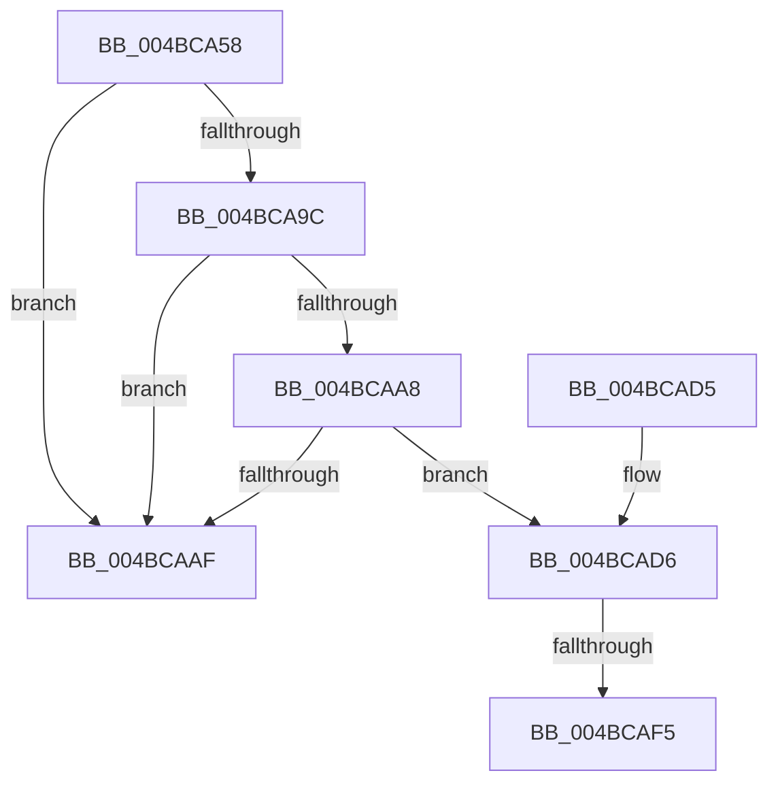

# IopReplaceCompletionPort

- RVA: `0x004BCA58`–`0x004BCB19` (길이 `193` bytes)
- VA: `0x00000001404BCA58`
- 실행 섹션: `.text`
- PDB 이름 있음: `예`; PDB Function 태그: `예`
- unwind 정보 RVA: `0x000B9D80`
- 디코드: `51`개 명령, `193/193` bytes 표시
- 미해석 바이트: `0` (있으면 어셈블리에 `.byte`로 보존)

> 이 문서는 커널 이미지의 기계어와 PDB 기호를 분석해 생성했습니다. 4번과 5번은 함수 원형과 자료형을 바이너리 사용 방식에서 추정한 C 해석이며 원본 소스 복구 결과는 아닙니다.

## 1. Dependencies

- 직접 호출 지점: **4**; 고유 호출 대상: **4**
- 직접 호출자로 확인된 함수: **1**
- RIP 상대 이미지 참조: **0**

### Outgoing calls
- `0x004BCA88` → [KeAcquireSpinLockRaiseToDpc](../20/KeAcquireSpinLockRaiseToDpc_function_00208470.md) (function, `0x00208470`)
- `0x004BCAB5` → [KeReleaseSpinLock](../39/KeReleaseSpinLock_function_00392BA0.md) (function, `0x00392BA0`)
- `0x004BCAE0` → [ObfDereferenceObjectWithTag](../2F/ObfDereferenceObjectWithTag_function_002F78E0.md) (function, `0x002F78E0`)
- `0x004BCAFA` → [ObfReferenceObjectWithTag](../21/ObfReferenceObjectWithTag_function_00210710.md) (function, `0x00210710`)

### Direct callers
- [sub_006DA8DA](../6D/Unknown_function_006DA8DA.md) at `0x006DA976`

### Static image references
- 디코드된 RIP-relative 메모리 참조가 없습니다.

## 2. Other-region calls and transfers

- 다른 실행 섹션으로 향하는 call: **0**
- call이 아닌 외부 분기/꼬리 이동: **2**
  - `0x004BCAEF` → [sub_006FC882](../6F/Unknown_function_006FC882.md) (`tail-transfer`)
  - `0x004BCB14` → [sub_006FC882 + 0x16](../6F/Unknown_function_006FC882.md) (`tail-transfer`)

## 3. Assembly (complete function range)

```asm
004BCA58  48 89 5C 24 08                  mov qword ptr [rsp + 8], rbx
004BCA5D  48 89 6C 24 10                  mov qword ptr [rsp + 0x10], rbp
004BCA62  48 89 74 24 18                  mov qword ptr [rsp + 0x18], rsi
004BCA67  57                              push rdi
004BCA68  41 56                           push r14
004BCA6A  41 57                           push r15
004BCA6C  48 83 EC 20                     sub rsp, 0x20
004BCA70  48 8D A9 B8 00 00 00            lea rbp, [rcx + 0xb8]
004BCA77  48 8B D9                        mov rbx, rcx
004BCA7A  48 8B CD                        mov rcx, rbp
004BCA7D  4D 8B F8                        mov r15, r8
004BCA80  48 8B F2                        mov rsi, rdx
004BCA83  BF 01 00 00 C0                  mov edi, 0xc0000001
004BCA88  E8 E3 B9 D4 FF                  call 0x140208470
004BCA8D  48 8B 8B B0 00 00 00            mov rcx, qword ptr [rbx + 0xb0]
004BCA94  44 8A F0                        mov r14b, al
004BCA97  48 85 C9                        test rcx, rcx
004BCA9A  74 13                           je 0x1404bcaaf
004BCA9C  48 8D 83 C0 00 00 00            lea rax, [rbx + 0xc0]
004BCAA3  48 39 00                        cmp qword ptr [rax], rax
004BCAA6  75 07                           jne 0x1404bcaaf
004BCAA8  48 83 79 10 00                  cmp qword ptr [rcx + 0x10], 0
004BCAAD  74 27                           je 0x1404bcad6
004BCAAF  41 8A D6                        mov dl, r14b
004BCAB2  48 8B CD                        mov rcx, rbp
004BCAB5  E8 E6 60 ED FF                  call 0x140392ba0
004BCABA  48 8B 5C 24 40                  mov rbx, qword ptr [rsp + 0x40]
004BCABF  8B C7                           mov eax, edi
004BCAC1  48 8B 6C 24 48                  mov rbp, qword ptr [rsp + 0x48]
004BCAC6  48 8B 74 24 50                  mov rsi, qword ptr [rsp + 0x50]
004BCACB  48 83 C4 20                     add rsp, 0x20
004BCACF  41 5F                           pop r15
004BCAD1  41 5E                           pop r14
004BCAD3  5F                              pop rdi
004BCAD4  C3                              ret
004BCAD5  CC                              int3
004BCAD6  48 8B 09                        mov rcx, qword ptr [rcx]
004BCAD9  BF 44 66 6C 74                  mov edi, 0x746c6644
004BCADE  8B D7                           mov edx, edi
004BCAE0  E8 FB AD E3 FF                  call 0x1402f78e0
004BCAE5  81 63 50 FF FF FF F1            and dword ptr [rbx + 0x50], 0xf1ffffff
004BCAEC  48 85 F6                        test rsi, rsi
004BCAEF  0F 84 8D FD 23 00               je 0x1406fc882
004BCAF5  8B D7                           mov edx, edi
004BCAF7  48 8B CE                        mov rcx, rsi
004BCAFA  E8 11 3C D5 FF                  call 0x140210710
004BCAFF  48 8B 83 B0 00 00 00            mov rax, qword ptr [rbx + 0xb0]
004BCB06  48 89 30                        mov qword ptr [rax], rsi
004BCB09  48 8B 83 B0 00 00 00            mov rax, qword ptr [rbx + 0xb0]
004BCB10  4C 89 78 08                     mov qword ptr [rax + 8], r15
004BCB14  E9 7F FD 23 00                  jmp 0x1406fc898
```

## 4. C-style interpretation (structured pseudocode)

```c
__int64 __fastcall IopReplaceCompletionPort(__int64 a1, __int64 a2, __int64 a3)
{
    __int64 result;
    __int64 v_rsp;
    unsigned __int64 v_stack_p10;
    unsigned __int64 v_stack_p18;
    unsigned __int64 v_stack_p8;

    v_stack_p8 = v_rbx;
    v_stack_p10 = v_rbp;
    v_stack_p18 = v_rsi;
    v_rsp = (v_rsp) - (32);
    result = KeAcquireSpinLockRaiseToDpc(a1 + 184, a2, a3, a4);
    if (*(unsigned __int64 *)(a1 + 176) == 0) goto loc_004BCAAF;
    if ((*(unsigned __int64 *)(a1 + 192)) != (a1 + 192)) goto loc_004BCAAF;
    if ((*(unsigned __int64 *)(*(unsigned __int64 *)(a1 + 176) + 16)) == 0) goto loc_004BCAD6;
loc_004BCAAF:
    result = KeReleaseSpinLock(a1 + 184, (unsigned __int8)((unsigned __int8)(result)), a3, a4);
    v_rsp = (v_rsp) + (32);
    return (unsigned int)((unsigned int)((unsigned int)(0xC0000001ULL)));
loc_004BCAD6:
    result = ObfDereferenceObjectWithTag(*(unsigned __int64 *)(a1 + 184), (unsigned int)((unsigned int)((unsigned int)(0x746C6644ULL))), a3, a4);
    result = ObfReferenceObjectWithTag(v_stack_p18, (unsigned int)((unsigned int)((unsigned int)(0x746C6644ULL))), a3, a4);
    *(unsigned __int64 *)(*(unsigned __int64 *)(v_stack_p8 + 176)) = v_stack_p18;
    *(unsigned __int64 *)(*(unsigned __int64 *)(v_stack_p8 + 176) + 8) = a3;
}
```

## 5. (Beta) C Style

```c
int64_t IopReplaceCompletionPort(void *Arg1, int64_t Arg2, int64_t Arg3)
{
    uint8_t *arg1 = (uint8_t *)Arg1;

    int64_t result;
    int64_t local_rsp;
    uint64_t v_stack_p10;
    uint64_t v_stack_p18;
    uint64_t v_stack_p8;

    v_stack_p8 = local_rbx;
    v_stack_p10 = local_rbp;
    v_stack_p18 = local_rsi;
    local_rsp = (local_rsp) - (32);
    result = KeAcquireSpinLockRaiseToDpc(Arg1 + 184, Arg2, Arg3, a4);
    if (*(uint64_t *)(arg1 + 0xB0) == 0) goto loc_004BCAAF;
    if ((*(uint64_t *)(arg1 + 0xC0)) != (Arg1 + 192)) goto loc_004BCAAF;
    if ((*(uint64_t *)(*(uint64_t *)(arg1 + 0xB0) + 0x10)) == 0) goto loc_004BCAD6;
loc_004BCAAF:
    result = KeReleaseSpinLock(Arg1 + 184, (uint8_t)((uint8_t)(result)), Arg3, a4);
    local_rsp = (local_rsp) + (32);
    return (uint32_t)((uint32_t)((uint32_t)(0xC0000001ULL)));
loc_004BCAD6:
    result = ObfDereferenceObjectWithTag(*(uint64_t *)(arg1 + 0xB8), (uint32_t)((uint32_t)((uint32_t)(0x746C6644ULL))), Arg3, a4);
    result = ObfReferenceObjectWithTag(v_stack_p18, (uint32_t)((uint32_t)((uint32_t)(0x746C6644ULL))), Arg3, a4);
    *(uint64_t *)(*(uint64_t *)(v_stack_p8 + 0xB0)) = v_stack_p18;
    *(uint64_t *)(*(uint64_t *)(v_stack_p8 + 0xB0) + 0x8) = Arg3;
}
```

### 관측된 메모리 오프셋

구조체 형식이 확인되지 않은 접근은 인자 기준의 오프셋으로만 기록했습니다.

| 기준 인자 | 오프셋 표현 | 폭 (bit) | 접근 |
|---|---:|---:|---|
| `Arg1` | `+ 0x0` | `64` | `R` |
| `Arg1` | `+ 0x50` | `32` | `R/W` |
| `Arg1` | `+ 0xB0` | `64` | `R` |
| `Arg1` | `+ 0xB8` | `64` | `R` |
| `Arg1` | `+ 0xC0` | `64` | `R` |

## 6. Execution-region graph

[열기: 2D/3D 그래프와 함수 탐색 컨트롤 패널](../../../control-panel.html?section=text&rva=0x004BCA58&view=graph)

- 2D 그래프는 위에서 아래로 흐르고, 3D 그래프는 빈 공간을 드래그해 회전합니다. Shift+드래그는 이동, 휠은 확대·축소, 함수 노드 선택은 대상 보고서 이동입니다.

### Static fallback


