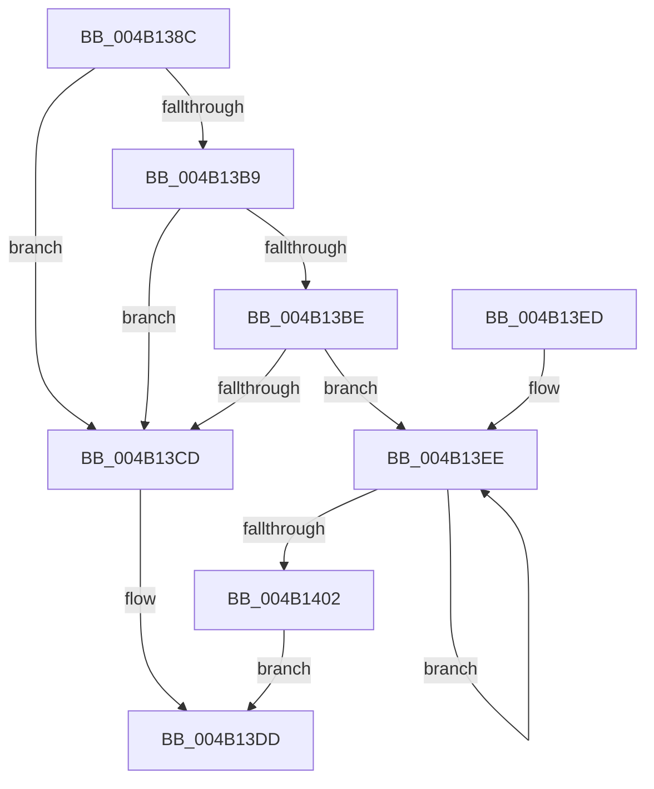

# IopResurrectDriver

- RVA: `0x004B138C`–`0x004B1411` (길이 `133` bytes)
- VA: `0x00000001404B138C`
- 실행 섹션: `.text`
- PDB 이름 있음: `예`; PDB Function 태그: `아니요`
- unwind 정보 RVA: `0x000B544C`
- 디코드: `39`개 명령, `133/133` bytes 표시
- 미해석 바이트: `0` (있으면 어셈블리에 `.byte`로 보존)

> 이 문서는 커널 이미지의 기계어와 PDB 기호를 분석해 생성했습니다. 4번과 5번은 함수 원형과 자료형을 바이너리 사용 방식에서 추정한 C 해석이며 원본 소스 복구 결과는 아닙니다.

## 1. Dependencies

- 직접 호출 지점: **3**; 고유 호출 대상: **2**
- 직접 호출자로 확인된 함수: **1**
- RIP 상대 이미지 참조: **0**

### Outgoing calls
- `0x004B13A9` → [KeAcquireQueuedSpinLock](../27/KeAcquireQueuedSpinLock_function_00273D80.md) (function, `0x00273D80`)
- `0x004B13D3` → [KeReleaseQueuedSpinLock](../27/KeReleaseQueuedSpinLock_function_00272540.md) (function, `0x00272540`)
- `0x004B1408` → [KeReleaseQueuedSpinLock](../27/KeReleaseQueuedSpinLock_function_00272540.md) (function, `0x00272540`)

### Direct callers
- [IopLoadDriver](../../page/99/IopLoadDriver_function_00997B54.md) at `0x00997E4C`

### Static image references
- 디코드된 RIP-relative 메모리 참조가 없습니다.

## 2. Other-region calls and transfers

- 다른 실행 섹션으로 향하는 call: **0**
- 별도 외부 분기/꼬리 이동을 확인하지 못했습니다.

## 3. Assembly (complete function range)

```asm
004B138C  48 89 5C 24 08                  mov qword ptr [rsp + 8], rbx
004B1391  48 89 74 24 10                  mov qword ptr [rsp + 0x10], rsi
004B1396  57                              push rdi
004B1397  48 83 EC 20                     sub rsp, 0x20
004B139B  48 8B 79 08                     mov rdi, qword ptr [rcx + 8]
004B139F  48 8B D9                        mov rbx, rcx
004B13A2  BE 0A 00 00 00                  mov esi, 0xa
004B13A7  8B CE                           mov ecx, esi
004B13A9  E8 D2 29 DC FF                  call 0x140273d80
004B13AE  8B 4B 10                        mov ecx, dword ptr [rbx + 0x10]
004B13B1  44 8A C0                        mov r8b, al
004B13B4  F6 C1 01                        test cl, 1
004B13B7  75 14                           jne 0x1404b13cd
004B13B9  48 85 FF                        test rdi, rdi
004B13BC  74 0F                           je 0x1404b13cd
004B13BE  48 8B 8F 38 01 00 00            mov rcx, qword ptr [rdi + 0x138]
004B13C5  8B 51 20                        mov edx, dword ptr [rcx + 0x20]
004B13C8  F6 C2 01                        test dl, 1
004B13CB  75 21                           jne 0x1404b13ee
004B13CD  41 8A D0                        mov dl, r8b
004B13D0  48 8B CE                        mov rcx, rsi
004B13D3  E8 68 11 DC FF                  call 0x140272540
004B13D8  B8 0E 01 00 C0                  mov eax, 0xc000010e
004B13DD  48 8B 5C 24 30                  mov rbx, qword ptr [rsp + 0x30]
004B13E2  48 8B 74 24 38                  mov rsi, qword ptr [rsp + 0x38]
004B13E7  48 83 C4 20                     add rsp, 0x20
004B13EB  5F                              pop rdi
004B13EC  C3                              ret
004B13ED  CC                              int3
004B13EE  48 8B 87 38 01 00 00            mov rax, qword ptr [rdi + 0x138]
004B13F5  83 60 20 FE                     and dword ptr [rax + 0x20], 0xfffffffe
004B13F9  48 8B 7F 10                     mov rdi, qword ptr [rdi + 0x10]
004B13FD  48 85 FF                        test rdi, rdi
004B1400  75 EC                           jne 0x1404b13ee
004B1402  41 8A D0                        mov dl, r8b
004B1405  48 8B CE                        mov rcx, rsi
004B1408  E8 33 11 DC FF                  call 0x140272540
004B140D  33 C0                           xor eax, eax
004B140F  EB CC                           jmp 0x1404b13dd
```

## 4. C-style interpretation (structured pseudocode)

```c
__int64 __fastcall IopResurrectDriver(__int64 a1)
{
    __int64 result;
    __int64 v_rsp;
    unsigned __int64 v_stack_p10;
    unsigned __int64 v_stack_p8;

    v_stack_p8 = v_rbx;
    v_stack_p10 = v_rsi;
    v_rsp = (v_rsp) - (32);
    result = KeAcquireQueuedSpinLock(10, a2, a3, a4);
    if ((((unsigned __int8)((unsigned int)(*(unsigned int *)(a1 + 16)))) & (1)) != 0) goto loc_004B13CD;
    if (*(unsigned __int64 *)(a1 + 8) == 0) goto loc_004B13CD;
    if ((((unsigned __int8)((unsigned int)(*(unsigned int *)(*(unsigned __int64 *)(*(unsigned __int64 *)(a1 + 8) + 312) + 32)))) & (1)) != 0) goto loc_004B13EE;
loc_004B13CD:
    result = KeReleaseQueuedSpinLock(10, (unsigned __int8)((unsigned __int8)(result)), (unsigned __int8)(result), a4);
loc_004B13DD:
    v_rsp = (v_rsp) + (32);
    return (unsigned int)(0xC000010EULL);
loc_004B13EE:
    if (*(unsigned __int64 *)(*(unsigned __int64 *)(a1 + 8) + 16) != 0) goto loc_004B13EE;
    result = KeReleaseQueuedSpinLock(v_stack_p10, (unsigned __int8)((unsigned __int8)(result)), (unsigned __int8)(result), a4);
    result = 0;
    goto loc_004B13DD;
}
```

## 5. (Beta) C Style

```c
int64_t IopResurrectDriver(void *Arg1)
{
    uint8_t *arg1 = (uint8_t *)Arg1;

    int64_t result;
    int64_t local_rsp;
    uint64_t v_stack_p10;
    uint64_t v_stack_p8;

    v_stack_p8 = local_rbx;
    v_stack_p10 = local_rsi;
    local_rsp = (local_rsp) - (32);
    result = KeAcquireQueuedSpinLock(10, a2, a3, a4);
    if ((((uint8_t)((uint32_t)(*(uint32_t *)(arg1 + 0x10)))) & (1)) != 0) goto loc_004B13CD;
    if (*(uint64_t *)(arg1 + 0x8) == 0) goto loc_004B13CD;
    if ((((uint8_t)((uint32_t)(*(uint32_t *)(*(uint64_t *)(*(uint64_t *)(arg1 + 0x8) + 0x138) + 0x20)))) & (1)) != 0) goto loc_004B13EE;
loc_004B13CD:
    result = KeReleaseQueuedSpinLock(10, (uint8_t)((uint8_t)(result)), (uint8_t)(result), a4);
loc_004B13DD:
    local_rsp = (local_rsp) + (32);
    return (uint32_t)(0xC000010EULL);
loc_004B13EE:
    if (*(uint64_t *)(*(uint64_t *)(arg1 + 0x8) + 0x10) != 0) goto loc_004B13EE;
    result = KeReleaseQueuedSpinLock(v_stack_p10, (uint8_t)((uint8_t)(result)), (uint8_t)(result), a4);
    result = 0;
    goto loc_004B13DD;
}
```

### 관측된 메모리 오프셋

구조체 형식이 확인되지 않은 접근은 인자 기준의 오프셋으로만 기록했습니다.

| 기준 인자 | 오프셋 표현 | 폭 (bit) | 접근 |
|---|---:|---:|---|
| `Arg1` | `+ 0x8` | `64` | `R` |
| `Arg1` | `+ 0x10` | `32` | `R` |

## 6. Execution-region graph

[열기: 2D/3D 그래프와 함수 탐색 컨트롤 패널](../../../control-panel.html?section=text&rva=0x004B138C&view=graph)

- 2D 그래프는 위에서 아래로 흐르고, 3D 그래프는 빈 공간을 드래그해 회전합니다. Shift+드래그는 이동, 휠은 확대·축소, 함수 노드 선택은 대상 보고서 이동입니다.

### Static fallback


