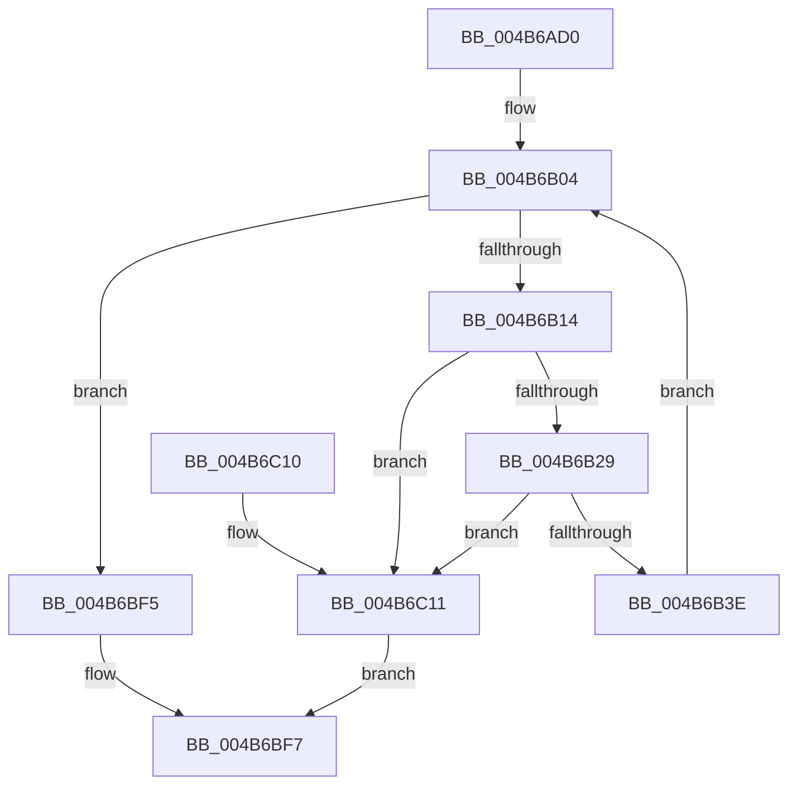

# IopWriteDriverList

- RVA: `0x004B6AD0`–`0x004B6C18` (길이 `328` bytes)
- VA: `0x00000001404B6AD0`
- 실행 섹션: `.text`
- PDB 이름 있음: `예`; PDB Function 태그: `아니요`
- unwind 정보 RVA: `0x00075210`
- 디코드: `86`개 명령, `328/328` bytes 표시
- 미해석 바이트: `0` (있으면 어셈블리에 `.byte`로 보존)

> 이 문서는 커널 이미지의 기계어와 PDB 기호를 분석해 생성했습니다. 4번과 5번은 함수 원형과 자료형을 바이너리 사용 방식에서 추정한 C 해석이며 원본 소스 복구 결과는 아닙니다.

## 1. Dependencies

- 직접 호출 지점: **3**; 고유 호출 대상: **2**
- 직접 호출자로 확인된 함수: **2**
- RIP 상대 이미지 참조: **1**

### Outgoing calls
- `0x004B6B1C` → [IopIsAddressRangeValid](IopIsAddressRangeValid_function_004B6CBC.md) (function, `0x004B6CBC`)
- `0x004B6B31` → [IopIsAddressRangeValid](IopIsAddressRangeValid_function_004B6CBC.md) (function, `0x004B6CBC`)
- `0x004B6B54` → [memcpy](../6C/memcpy_function_006C6840.md) (function, `0x006C6840`)

### Direct callers
- [IoFillTriageDumpBuffer](../59/IoFillTriageDumpBuffer_function_005921CC.md) at `0x00592546`
- [sub_006EEE7E](../6E/Unknown_function_006EEE7E.md) at `0x006EEF50`

### Static image references
- `0x004B6AE8` → RVA `0x00EF54C0` (`.data`; read)

## 2. Other-region calls and transfers

- 다른 실행 섹션으로 향하는 call: **0**
- 별도 외부 분기/꼬리 이동을 확인하지 못했습니다.

## 3. Assembly (complete function range)

```asm
004B6AD0  48 89 5C 24 08                  mov qword ptr [rsp + 8], rbx
004B6AD5  48 89 6C 24 10                  mov qword ptr [rsp + 0x10], rbp
004B6ADA  48 89 74 24 18                  mov qword ptr [rsp + 0x18], rsi
004B6ADF  57                              push rdi
004B6AE0  41 56                           push r14
004B6AE2  41 57                           push r15
004B6AE4  48 83 EC 20                     sub rsp, 0x20
004B6AE8  48 8B 1D D1 E9 A3 00            mov rbx, qword ptr [rip + 0xa3e9d1]
004B6AEF  45 33 FF                        xor r15d, r15d
004B6AF2  41 8B F0                        mov esi, r8d
004B6AF5  48 8B E9                        mov rbp, rcx
004B6AF8  48 03 F1                        add rsi, rcx
004B6AFB  41 8B F9                        mov edi, r9d
004B6AFE  48 03 F9                        add rdi, rcx
004B6B01  45 8B F7                        mov r14d, r15d
004B6B04  48 8D 05 B5 E9 A3 00            lea rax, [rip + 0xa3e9b5]
004B6B0B  48 3B D8                        cmp rbx, rax
004B6B0E  0F 84 E1 00 00 00               je 0x1404b6bf5
004B6B14  BA A0 00 00 00                  mov edx, 0xa0
004B6B19  48 8B CB                        mov rcx, rbx
004B6B1C  E8 9B 01 00 00                  call 0x1404b6cbc
004B6B21  84 C0                           test al, al
004B6B23  0F 84 E8 00 00 00               je 0x1404b6c11
004B6B29  0F B7 53 58                     movzx edx, word ptr [rbx + 0x58]
004B6B2D  48 8B 4B 60                     mov rcx, qword ptr [rbx + 0x60]
004B6B31  E8 86 01 00 00                  call 0x1404b6cbc
004B6B36  84 C0                           test al, al
004B6B38  0F 84 D3 00 00 00               je 0x1404b6c11
004B6B3E  44 0F B7 43 58                  movzx r8d, word ptr [rbx + 0x58]
004B6B43  48 8D 4F 04                     lea rcx, [rdi + 4]
004B6B47  41 D1 E8                        shr r8d, 1
004B6B4A  44 89 07                        mov dword ptr [rdi], r8d
004B6B4D  4D 03 C0                        add r8, r8
004B6B50  48 8B 53 60                     mov rdx, qword ptr [rbx + 0x60]
004B6B54  E8 E7 FC 20 00                  call 0x1406c6840
004B6B59  8B 07                           mov eax, dword ptr [rdi]
004B6B5B  66 44 89 7C 47 04               mov word ptr [rdi + rax*2 + 4], r15w
004B6B61  0F 10 03                        movups xmm0, xmmword ptr [rbx]
004B6B64  41 8B C6                        mov eax, r14d
004B6B67  41 FF C6                        inc r14d
004B6B6A  48 8D 14 C0                     lea rdx, [rax + rax*8]
004B6B6E  48 03 D2                        add rdx, rdx
004B6B71  48 8D 0C D6                     lea rcx, [rsi + rdx*8]
004B6B75  0F 11 41 08                     movups xmmword ptr [rcx + 8], xmm0
004B6B79  0F 10 4B 10                     movups xmm1, xmmword ptr [rbx + 0x10]
004B6B7D  0F 11 49 18                     movups xmmword ptr [rcx + 0x18], xmm1
004B6B81  0F 10 43 20                     movups xmm0, xmmword ptr [rbx + 0x20]
004B6B85  0F 11 41 28                     movups xmmword ptr [rcx + 0x28], xmm0
004B6B89  0F 10 4B 30                     movups xmm1, xmmword ptr [rbx + 0x30]
004B6B8D  0F 11 49 38                     movups xmmword ptr [rcx + 0x38], xmm1
004B6B91  0F 10 43 40                     movups xmm0, xmmword ptr [rbx + 0x40]
004B6B95  0F 11 41 48                     movups xmmword ptr [rcx + 0x48], xmm0
004B6B99  0F 10 4B 50                     movups xmm1, xmmword ptr [rbx + 0x50]
004B6B9D  0F 11 49 58                     movups xmmword ptr [rcx + 0x58], xmm1
004B6BA1  0F 10 43 60                     movups xmm0, xmmword ptr [rbx + 0x60]
004B6BA5  0F 11 41 68                     movups xmmword ptr [rcx + 0x68], xmm0
004B6BA9  0F 10 4B 70                     movups xmm1, xmmword ptr [rbx + 0x70]
004B6BAD  0F 11 49 78                     movups xmmword ptr [rcx + 0x78], xmm1
004B6BB1  48 8B 83 80 00 00 00            mov rax, qword ptr [rbx + 0x80]
004B6BB8  48 89 81 88 00 00 00            mov qword ptr [rcx + 0x88], rax
004B6BBF  8B 83 9C 00 00 00               mov eax, dword ptr [rbx + 0x9c]
004B6BC5  89 84 D6 88 00 00 00            mov dword ptr [rsi + rdx*8 + 0x88], eax
004B6BCC  8B 83 98 00 00 00               mov eax, dword ptr [rbx + 0x98]
004B6BD2  89 44 D6 48                     mov dword ptr [rsi + rdx*8 + 0x48], eax
004B6BD6  8B C7                           mov eax, edi
004B6BD8  2B C5                           sub eax, ebp
004B6BDA  89 04 D6                        mov dword ptr [rsi + rdx*8], eax
004B6BDD  8B 07                           mov eax, dword ptr [rdi]
004B6BDF  48 8B 1B                        mov rbx, qword ptr [rbx]
004B6BE2  FF C0                           inc eax
004B6BE4  48 8D 3C 47                     lea rdi, [rdi + rax*2]
004B6BE8  48 83 C7 0B                     add rdi, 0xb
004B6BEC  48 83 E7 F8                     and rdi, 0xfffffffffffffff8
004B6BF0  E9 0F FF FF FF                  jmp 0x1404b6b04
004B6BF5  33 C0                           xor eax, eax
004B6BF7  48 8B 5C 24 40                  mov rbx, qword ptr [rsp + 0x40]
004B6BFC  48 8B 6C 24 48                  mov rbp, qword ptr [rsp + 0x48]
004B6C01  48 8B 74 24 50                  mov rsi, qword ptr [rsp + 0x50]
004B6C06  48 83 C4 20                     add rsp, 0x20
004B6C0A  41 5F                           pop r15
004B6C0C  41 5E                           pop r14
004B6C0E  5F                              pop rdi
004B6C0F  C3                              ret
004B6C10  CC                              int3
004B6C11  B8 01 00 00 C0                  mov eax, 0xc0000001
004B6C16  EB DF                           jmp 0x1404b6bf7
```

## 4. C-style interpretation (structured pseudocode)

```c
__int64 __fastcall IopWriteDriverList(__int64 a1, __int64 a2, int a3, int a4)
{
    __int64 result;
    __int64 v_r14;
    __int64 v_r15;
    __int64 v_rdi;
    __int64 v_rsi;
    __int64 v_rsp;
    unsigned __int64 v_stack_p10;
    unsigned __int64 v_stack_p18;
    unsigned __int64 v_stack_p8;

    v_stack_p8 = v_rbx;
    v_stack_p10 = v_rbp;
    v_stack_p18 = v_rsi;
    v_rsp = (v_rsp) - (32);
    v_r15 = 0;
    v_rsi = ((unsigned int)(a3)) + (a1);
    v_rdi = ((unsigned int)(a4)) + (a1);
loc_004B6B04:
    if ((*(unsigned __int64 *)(v_rip + 10742225)) == (v_rip + 10742197)) goto loc_004B6BF5;
    result = IopIsAddressRangeValid(*(unsigned __int64 *)(v_rip + 10742225), 160, a3, a4);
    if ((unsigned __int8)(result) == 0) goto loc_004B6C11;
    result = IopIsAddressRangeValid(*(unsigned __int64 *)(*(unsigned __int64 *)(v_rip + 10742225) + 96), *(unsigned __int16 *)(*(unsigned __int64 *)(v_rip + 10742225) + 88), a3, a4);
    if ((unsigned __int8)(result) == 0) goto loc_004B6C11;
    a3 = (unsigned int)((*(unsigned __int16 *)(*(unsigned __int64 *)(v_rip + 10742225) + 88)) >> (1));
    *(unsigned int *)(v_rdi) = a3;
    a3 = (a3) + (a3);
    result = memcpy(v_rdi + 4, *(unsigned __int64 *)(*(unsigned __int64 *)(v_rip + 10742225) + 96), a3, a4);
    *(unsigned __int16 *)(v_rdi + (unsigned int)(*(unsigned int *)(v_rdi)) * 2 + 4) = 0;
    v_r14 = (unsigned int)((0) + 1);
    a2 = (0 + 0 * 8) + (0 + 0 * 8);
    *(unsigned __int64 *)(v_rsi + a2 * 8 + 8) = v_xmm0;
    *(unsigned __int64 *)(v_rsi + a2 * 8 + 24) = v_xmm1;
    *(unsigned __int64 *)(v_rsi + a2 * 8 + 40) = v_xmm0;
    *(unsigned __int64 *)(v_rsi + a2 * 8 + 56) = v_xmm1;
    *(unsigned __int64 *)(v_rsi + a2 * 8 + 72) = v_xmm0;
    *(unsigned __int64 *)(v_rsi + a2 * 8 + 88) = v_xmm1;
    *(unsigned __int64 *)(v_rsi + a2 * 8 + 104) = v_xmm0;
    *(unsigned __int64 *)(v_rsi + a2 * 8 + 120) = v_xmm1;
    *(unsigned __int64 *)(v_rsi + a2 * 8 + 136) = *(unsigned __int64 *)(*(unsigned __int64 *)(v_rip + 10742225) + 128);
    *(unsigned int *)(v_rsi + a2 * 8 + 136) = (unsigned int)((unsigned int)(*(unsigned int *)(*(unsigned __int64 *)(v_rip + 10742225) + 156)));
    *(unsigned int *)(v_rsi + a2 * 8 + 72) = (unsigned int)((unsigned int)(*(unsigned int *)(*(unsigned __int64 *)(v_rip + 10742225) + 152)));
    result = (unsigned int)(((unsigned int)((unsigned int)(v_rdi))) - ((unsigned int)(a1)));
    *(unsigned int *)(v_rsi + a2 * 8) = (unsigned int)(result);
    result = (unsigned int)(((unsigned int)(*(unsigned int *)(v_rdi))) + 1);
    v_rdi = (v_rdi + result * 2) + (11);
    v_rdi = (v_rdi) & (-8);
    goto loc_004B6B04;
loc_004B6BF5:
    result = 0;
loc_004B6BF7:
    v_rsp = (v_rsp) + (32);
    return result;
loc_004B6C11:
    goto loc_004B6BF7;
}
```

## 5. (Beta) C Style

```c
int64_t IopWriteDriverList(int64_t Arg1, int64_t Arg2, void *Arg3, void *Arg4)
{
    uint8_t *arg3 = (uint8_t *)Arg3;
    uint8_t *arg4 = (uint8_t *)Arg4;

    int64_t result;
    int64_t local_r14;
    int64_t local_r15;
    int64_t local_rdi;
    int64_t local_rsi;
    int64_t local_rsp;
    uint64_t v_stack_p10;
    uint64_t v_stack_p18;
    uint64_t v_stack_p8;

    v_stack_p8 = local_rbx;
    v_stack_p10 = local_rbp;
    v_stack_p18 = local_rsi;
    local_rsp = (local_rsp) - (32);
    local_r15 = 0;
    local_rsi = ((uint32_t)(Arg3)) + (Arg1);
    local_rdi = ((uint32_t)(Arg4)) + (Arg1);
loc_004B6B04:
    if ((*(uint64_t *)(v_rip + 0xA3E9D1)) == (v_rip + 10742197)) goto loc_004B6BF5;
    result = IopIsAddressRangeValid(*(uint64_t *)(v_rip + 0xA3E9D1), 160, Arg3, Arg4);
    if ((uint8_t)(result) == 0) goto loc_004B6C11;
    result = IopIsAddressRangeValid(*(uint64_t *)(*(uint64_t *)(v_rip + 0xA3E9D1) + 0x60), *(uint16_t *)(*(uint64_t *)(v_rip + 0xA3E9D1) + 0x58), Arg3, Arg4);
    if ((uint8_t)(result) == 0) goto loc_004B6C11;
    Arg3 = (uint32_t)((*(uint16_t *)(*(uint64_t *)(v_rip + 0xA3E9D1) + 0x58)) >> (1));
    *(uint32_t *)(local_rdi) = Arg3;
    Arg3 = (Arg3) + (Arg3);
    result = memcpy(local_rdi + 4, *(uint64_t *)(*(uint64_t *)(v_rip + 0xA3E9D1) + 0x60), Arg3, Arg4);
    *(uint16_t *)(local_rdi + (uint32_t)(*(uint32_t *)(local_rdi)) * 2 + 0x4) = 0;
    local_r14 = (uint32_t)((0) + 1);
    Arg2 = (0 + 0 * 8) + (0 + 0 * 8);
    *(uint64_t *)(local_rsi + Arg2 * 8 + 0x8) = v_xmm0;
    *(uint64_t *)(local_rsi + Arg2 * 8 + 0x18) = v_xmm1;
    *(uint64_t *)(local_rsi + Arg2 * 8 + 0x28) = v_xmm0;
    *(uint64_t *)(local_rsi + Arg2 * 8 + 0x38) = v_xmm1;
    *(uint64_t *)(local_rsi + Arg2 * 8 + 0x48) = v_xmm0;
    *(uint64_t *)(local_rsi + Arg2 * 8 + 0x58) = v_xmm1;
    *(uint64_t *)(local_rsi + Arg2 * 8 + 0x68) = v_xmm0;
    *(uint64_t *)(local_rsi + Arg2 * 8 + 0x78) = v_xmm1;
    *(uint64_t *)(local_rsi + Arg2 * 8 + 0x88) = *(uint64_t *)(*(uint64_t *)(v_rip + 0xA3E9D1) + 0x80);
    *(uint32_t *)(local_rsi + Arg2 * 8 + 0x88) = (uint32_t)((uint32_t)(*(uint32_t *)(*(uint64_t *)(v_rip + 0xA3E9D1) + 0x9C)));
    *(uint32_t *)(local_rsi + Arg2 * 8 + 0x48) = (uint32_t)((uint32_t)(*(uint32_t *)(*(uint64_t *)(v_rip + 0xA3E9D1) + 0x98)));
    result = (uint32_t)(((uint32_t)((uint32_t)(local_rdi))) - ((uint32_t)(Arg1)));
    *(uint32_t *)(local_rsi + Arg2 * 8) = (uint32_t)(result);
    result = (uint32_t)(((uint32_t)(*(uint32_t *)(local_rdi))) + 1);
    local_rdi = (local_rdi + result * 2) + (11);
    local_rdi = (local_rdi) & (-8);
    goto loc_004B6B04;
loc_004B6BF5:
    result = 0;
loc_004B6BF7:
    local_rsp = (local_rsp) + (32);
    return result;
loc_004B6C11:
    goto loc_004B6BF7;
}
```

### 관측된 메모리 오프셋

구조체 형식이 확인되지 않은 접근은 인자 기준의 오프셋으로만 기록했습니다.

| 기준 인자 | 오프셋 표현 | 폭 (bit) | 접근 |
|---|---:|---:|---|
| `Arg3` | `+ 0x0 + rdx*8` | `32` | `W` |
| `Arg3` | `+ 0x0 + rdx*8` | `64` | `R` |
| `Arg3` | `+ 0x8` | `128` | `R` |
| `Arg3` | `+ 0x18` | `128` | `R` |
| `Arg3` | `+ 0x28` | `128` | `R` |
| `Arg3` | `+ 0x38` | `128` | `R` |
| `Arg3` | `+ 0x48` | `128` | `R` |
| `Arg3` | `+ 0x48 + rdx*8` | `32` | `W` |
| `Arg3` | `+ 0x58` | `128` | `R` |
| `Arg3` | `+ 0x68` | `128` | `R` |
| `Arg3` | `+ 0x78` | `128` | `R` |
| `Arg3` | `+ 0x88` | `64` | `W` |
| `Arg3` | `+ 0x88 + rdx*8` | `32` | `W` |
| `Arg4` | `+ 0x0` | `32` | `R` |
| `Arg4` | `+ 0x0` | `32` | `W` |
| `Arg4` | `+ 0x0 + rax*2` | `64` | `R` |
| `Arg4` | `+ 0x4` | `64` | `R` |
| `Arg4` | `+ 0x4 + rax*2` | `16` | `W` |

## 6. Execution-region graph

[열기: 2D/3D 그래프와 함수 탐색 컨트롤 패널](../../../control-panel.html?section=text&rva=0x004B6AD0&view=graph)

- 2D 그래프는 위에서 아래로 흐르고, 3D 그래프는 빈 공간을 드래그해 회전합니다. Shift+드래그는 이동, 휠은 확대·축소, 함수 노드 선택은 대상 보고서 이동입니다.

### Static fallback


