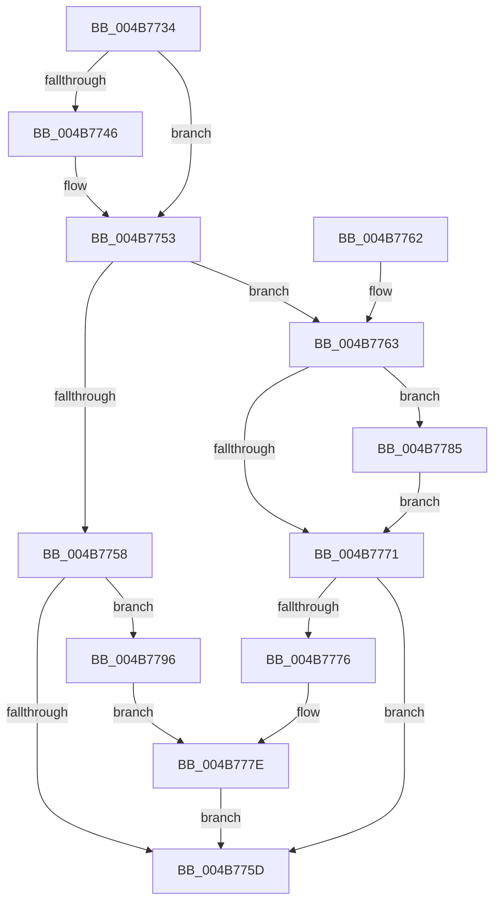

# IovUtilMarkStack

- RVA: `0x004B7734`–`0x004B77AA` (길이 `118` bytes)
- VA: `0x00000001404B7734`
- 실행 섹션: `.text`
- PDB 이름 있음: `예`; PDB Function 태그: `아니요`
- unwind 정보 RVA: `0x0006B378`
- 디코드: `34`개 명령, `118/118` bytes 표시
- 미해석 바이트: `0` (있으면 어셈블리에 `.byte`로 보존)

> 이 문서는 커널 이미지의 기계어와 PDB 기호를 분석해 생성했습니다. 4번과 5번은 함수 원형과 자료형을 바이너리 사용 방식에서 추정한 C 해석이며 원본 소스 복구 결과는 아닙니다.

## 1. Dependencies

- 직접 호출 지점: **4**; 고유 호출 대상: **2**
- 직접 호출자로 확인된 함수: **1**
- RIP 상대 이미지 참조: **1**

### Outgoing calls
- `0x004B774E` → [IovUtilMarkDeviceObject](IovUtilMarkDeviceObject_function_004B77B0.md) (function, `0x004B77B0`)
- `0x004B777E` → [IovUtilMarkDeviceObject](IovUtilMarkDeviceObject_function_004B77B0.md) (function, `0x004B77B0`)
- `0x004B778A` → [VfDevObjAdjustFdoForVerifierFilters](../../pagevrfy/BA/VfDevObjAdjustFdoForVerifierFilters_function_00BA21F4.md) (function, `0x00BA21F4`)
- `0x004B779E` → [IovUtilMarkDeviceObject](IovUtilMarkDeviceObject_function_004B77B0.md) (function, `0x004B77B0`)

### Direct callers
- [PipCallDriverAddDevice](../../page/A2/PipCallDriverAddDevice_function_00A272E0.md) at `0x00A276B2`
- [PipCallDriverAddDevice](../../page/A2/PipCallDriverAddDevice_function_00A272E0.md) at `0x00A27AF7`

### Static image references
- `0x004B7763` → RVA `0x00F048E0` (`.data`; read)

## 2. Other-region calls and transfers

- 다른 실행 섹션으로 향하는 call: **1**
  - `0x004B778A` → [VfDevObjAdjustFdoForVerifierFilters](../../pagevrfy/BA/VfDevObjAdjustFdoForVerifierFilters_function_00BA21F4.md) (`.text` → `PAGEVRFY`)
- 별도 외부 분기/꼬리 이동을 확인하지 못했습니다.

## 3. Assembly (complete function range)

```asm
004B7734  48 83 EC 28                     sub rsp, 0x28
004B7738  49 8B C0                        mov rax, r8
004B773B  4C 8B C2                        mov r8, rdx
004B773E  4C 8B D1                        mov r10, rcx
004B7741  48 85 D2                        test rdx, rdx
004B7744  74 0D                           je 0x1404b7753
004B7746  BA 01 00 00 00                  mov edx, 1
004B774B  49 8B C8                        mov rcx, r8
004B774E  E8 5D 00 00 00                  call 0x1404b77b0
004B7753  48 85 C0                        test rax, rax
004B7756  75 0B                           jne 0x1404b7763
004B7758  45 85 C9                        test r9d, r9d
004B775B  75 39                           jne 0x1404b7796
004B775D  48 83 C4 28                     add rsp, 0x28
004B7761  C3                              ret
004B7762  CC                              int3
004B7763  83 3D 76 D1 A4 00 00            cmp dword ptr [rip + 0xa4d176], 0
004B776A  48 89 44 24 38                  mov qword ptr [rsp + 0x38], rax
004B776F  75 14                           jne 0x1404b7785
004B7771  48 85 C0                        test rax, rax
004B7774  74 E7                           je 0x1404b775d
004B7776  BA 02 00 00 00                  mov edx, 2
004B777B  48 8B C8                        mov rcx, rax
004B777E  E8 2D 00 00 00                  call 0x1404b77b0
004B7783  EB D8                           jmp 0x1404b775d
004B7785  48 8D 4C 24 38                  lea rcx, [rsp + 0x38]
004B778A  E8 65 AA 6E 00                  call 0x140ba21f4
004B778F  48 8B 44 24 38                  mov rax, qword ptr [rsp + 0x38]
004B7794  EB DB                           jmp 0x1404b7771
004B7796  BA 02 00 00 00                  mov edx, 2
004B779B  49 8B CA                        mov rcx, r10
004B779E  E8 0D 00 00 00                  call 0x1404b77b0
004B77A3  BA 03 00 00 00                  mov edx, 3
004B77A8  EB D4                           jmp 0x1404b777e
```

## 4. C-style interpretation (structured pseudocode)

```c
__int64 __fastcall IovUtilMarkStack(__int64 a1, __int64 a2, __int64 a3, int a4)
{
    __int64 result;
    __int64 v_rsp;
    unsigned __int64 v_stack_p38;

    v_rsp = (v_rsp) - (40);
    result = a3;
    if (a2 != 0) {
        a2 = 1;
        a1 = a2;
        result = IovUtilMarkDeviceObject(a1, a2, a2, a4);
    }
    if (result != 0) goto loc_004B7763;
    if (a4 != 0) goto loc_004B7796;
loc_004B775D:
    v_rsp = (v_rsp) + (40);
    return result;
loc_004B7763:
    v_stack_p38 = result;
    if ((*(unsigned int *)(v_rip + 10801526)) != 0) goto loc_004B7785;
loc_004B7771:
    if (result == 0) goto loc_004B775D;
loc_004B777E:
    result = IovUtilMarkDeviceObject(result, 2, a2, a4);
    goto loc_004B775D;
loc_004B7785:
    result = VfDevObjAdjustFdoForVerifierFilters(v_stack_p38, 2, a2, a4);
    goto loc_004B7771;
loc_004B7796:
    result = IovUtilMarkDeviceObject(a1, 2, a2, a4);
    goto loc_004B777E;
}
```

## 5. (Beta) C Style

```c
int64_t IovUtilMarkStack(int64_t Arg1, int64_t Arg2, int64_t Arg3, int32_t Arg4)
{
    int64_t result;
    int64_t local_rsp;
    uint64_t v_stack_p38;

    local_rsp = (local_rsp) - (40);
    result = Arg3;
    if (Arg2 != 0) {
        Arg2 = 1;
        Arg1 = Arg2;
        result = IovUtilMarkDeviceObject(Arg1, Arg2, Arg2, Arg4);
    }
    if (result != 0) goto loc_004B7763;
    if (Arg4 != 0) goto loc_004B7796;
loc_004B775D:
    local_rsp = (local_rsp) + (40);
    return result;
loc_004B7763:
    v_stack_p38 = result;
    if ((*(uint32_t *)(v_rip + 0xA4D176)) != 0) goto loc_004B7785;
loc_004B7771:
    if (result == 0) goto loc_004B775D;
loc_004B777E:
    result = IovUtilMarkDeviceObject(result, 2, Arg2, Arg4);
    goto loc_004B775D;
loc_004B7785:
    result = VfDevObjAdjustFdoForVerifierFilters(v_stack_p38, 2, Arg2, Arg4);
    goto loc_004B7771;
loc_004B7796:
    result = IovUtilMarkDeviceObject(Arg1, 2, Arg2, Arg4);
    goto loc_004B777E;
}
```

## 6. Execution-region graph

[열기: 2D/3D 그래프와 함수 탐색 컨트롤 패널](../../../control-panel.html?section=text&rva=0x004B7734&view=graph)

- 2D 그래프는 위에서 아래로 흐르고, 3D 그래프는 빈 공간을 드래그해 회전합니다. Shift+드래그는 이동, 휠은 확대·축소, 함수 노드 선택은 대상 보고서 이동입니다.

### Static fallback


