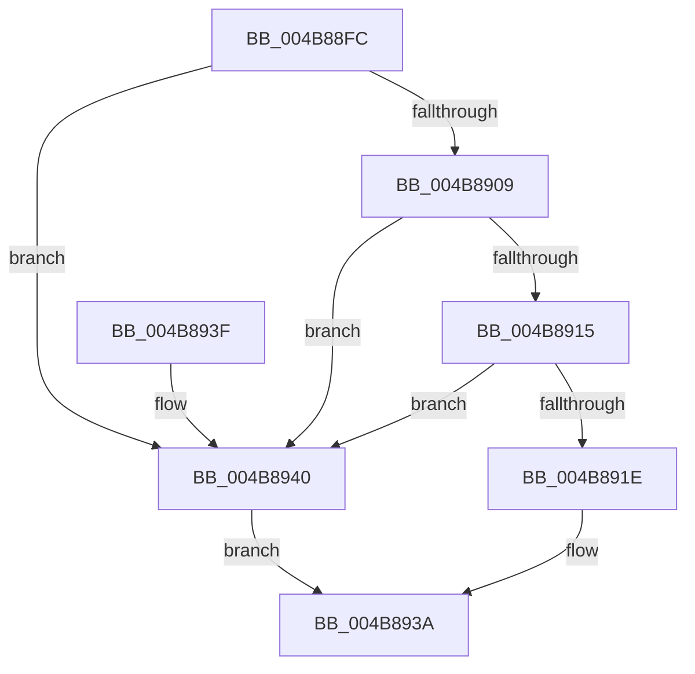

# KCBNeedsVirtualImage

- RVA: `0x004B88FC`–`0x004B8944` (길이 `72` bytes)
- VA: `0x00000001404B88FC`
- 실행 섹션: `.text`
- PDB 이름 있음: `예`; PDB Function 태그: `예`
- unwind 정보 RVA: `0x00069B1C`
- 디코드: `19`개 명령, `72/72` bytes 표시
- 미해석 바이트: `0` (있으면 어셈블리에 `.byte`로 보존)

> 이 문서는 커널 이미지의 기계어와 PDB 기호를 분석해 생성했습니다. 4번과 5번은 함수 원형과 자료형을 바이너리 사용 방식에서 추정한 C 해석이며 원본 소스 복구 결과는 아닙니다.

## 1. Dependencies

- 직접 호출 지점: **2**; 고유 호출 대상: **2**
- 직접 호출자로 확인된 함수: **1**
- RIP 상대 이미지 참조: **1**

### Outgoing calls
- `0x004B8915` → [CmpIsKcbInsideVirtualizedHive](../../page/8B/CmpIsKcbInsideVirtualizedHive_function_008B4E70.md) (function, `0x008B4E70`)
- `0x004B8930` → [CmpIsSystemEntity](../../page/8B/CmpIsSystemEntity_function_008B4E90.md) (function, `0x008B4E90`)

### Direct callers
- [sub_006F2FA4](../6F/Unknown_function_006F2FA4.md) at `0x006F2FCF`
- [sub_006F2FA4](../6F/Unknown_function_006F2FA4.md) at `0x006F2FE5`

### Static image references
- `0x004B8900` → RVA `0x00E0ECA0` (`.data`; read)

## 2. Other-region calls and transfers

- 다른 실행 섹션으로 향하는 call: **2**
  - `0x004B8915` → [CmpIsKcbInsideVirtualizedHive](../../page/8B/CmpIsKcbInsideVirtualizedHive_function_008B4E70.md) (`.text` → `PAGE`)
  - `0x004B8930` → [CmpIsSystemEntity](../../page/8B/CmpIsSystemEntity_function_008B4E90.md) (`.text` → `PAGE`)
- 별도 외부 분기/꼬리 이동을 확인하지 못했습니다.

## 3. Assembly (complete function range)

```asm
004B88FC  48 83 EC 28                     sub rsp, 0x28
004B8900  80 3D 99 63 95 00 00            cmp byte ptr [rip + 0x956399], 0
004B8907  74 37                           je 0x1404b8940
004B8909  F7 81 B8 00 00 00 00 00 00 02   test dword ptr [rcx + 0xb8], 0x2000000
004B8913  75 2B                           jne 0x1404b8940
004B8915  E8 56 C5 3F 00                  call 0x1408b4e70
004B891A  84 C0                           test al, al
004B891C  74 22                           je 0x1404b8940
004B891E  65 48 8B 0C 25 88 01 00 00      mov rcx, qword ptr gs:[0x188]
004B8927  45 33 C0                        xor r8d, r8d
004B892A  8A 89 32 02 00 00               mov cl, byte ptr [rcx + 0x232]
004B8930  E8 5B C5 3F 00                  call 0x1408b4e90
004B8935  84 C0                           test al, al
004B8937  0F 94 C0                        sete al
004B893A  48 83 C4 28                     add rsp, 0x28
004B893E  C3                              ret
004B893F  CC                              int3
004B8940  32 C0                           xor al, al
004B8942  EB F6                           jmp 0x1404b893a
```

## 4. C-style interpretation (structured pseudocode)

```c
__int64 __fastcall KCBNeedsVirtualImage(__int64 a1, __int64 a2, int a3)
{
    __int64 result;
    __int64 v_rsp;

    v_rsp = (v_rsp) - (40);
    if ((*(unsigned __int8 *)(v_rip + 9790361)) == 0) goto loc_004B8940;
    if (((*(unsigned int *)(a1 + 184)) & (0x2000000ULL)) != 0) goto loc_004B8940;
    result = CmpIsKcbInsideVirtualizedHive(a1, a2, a3, a4);
    if ((unsigned __int8)(result) == 0) goto loc_004B8940;
    a3 = 0;
    result = CmpIsSystemEntity(*(unsigned __int8 *)(*(unsigned __int64 *)(gs_base + (0 + 392)) + 562), a2, a3, a4);
    result = ((unsigned __int8)(result) == 0) ? 1 : 0;
loc_004B893A:
    v_rsp = (v_rsp) + (40);
    return result;
loc_004B8940:
    result = 0;
    goto loc_004B893A;
}
```

## 5. (Beta) C Style

```c
int64_t KCBNeedsVirtualImage(void *Arg1, int64_t Arg2, int32_t Arg3)
{
    uint8_t *arg1 = (uint8_t *)Arg1;

    int64_t result;
    int64_t local_rsp;

    local_rsp = (local_rsp) - (40);
    if ((*(uint8_t *)(v_rip + 0x956399)) == 0) goto loc_004B8940;
    if (((*(uint32_t *)(arg1 + 0xB8)) & (0x2000000ULL)) != 0) goto loc_004B8940;
    result = CmpIsKcbInsideVirtualizedHive(Arg1, Arg2, Arg3, a4);
    if ((uint8_t)(result) == 0) goto loc_004B8940;
    Arg3 = 0;
    result = CmpIsSystemEntity(*(uint8_t *)(*(uint64_t *)(gs_base + (0 + 0x188)) + 0x232), Arg2, Arg3, a4);
    result = ((uint8_t)(result) == 0) ? 1 : 0;
loc_004B893A:
    local_rsp = (local_rsp) + (40);
    return result;
loc_004B8940:
    result = 0;
    goto loc_004B893A;
}
```

### 관측된 메모리 오프셋

구조체 형식이 확인되지 않은 접근은 인자 기준의 오프셋으로만 기록했습니다.

| 기준 인자 | 오프셋 표현 | 폭 (bit) | 접근 |
|---|---:|---:|---|
| `Arg1` | `+ 0xB8` | `32` | `R` |

## 6. Execution-region graph

[열기: 2D/3D 그래프와 함수 탐색 컨트롤 패널](../../../control-panel.html?section=text&rva=0x004B88FC&view=graph)

- 2D 그래프는 위에서 아래로 흐르고, 3D 그래프는 빈 공간을 드래그해 회전합니다. Shift+드래그는 이동, 휠은 확대·축소, 함수 노드 선택은 대상 보고서 이동입니다.

### Static fallback


