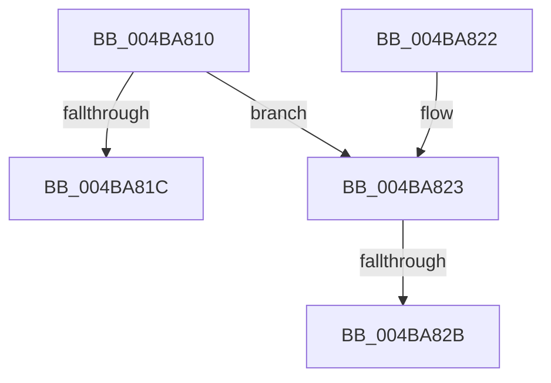

# KdChangeOption

- RVA: `0x004BA810`–`0x004BA835` (길이 `37` bytes)
- VA: `0x00000001404BA810`
- 실행 섹션: `.text`
- PDB 이름 있음: `예`; PDB Function 태그: `예`
- unwind 정보 RVA: `0x000DB714`
- 디코드: `10`개 명령, `37/37` bytes 표시
- 미해석 바이트: `0` (있으면 어셈블리에 `.byte`로 보존)

> 이 문서는 커널 이미지의 기계어와 PDB 기호를 분석해 생성했습니다. 4번과 5번은 함수 원형과 자료형을 바이너리 사용 방식에서 추정한 C 해석이며 원본 소스 복구 결과는 아닙니다.

## 1. Dependencies

- 직접 호출 지점: **0**; 고유 호출 대상: **0**
- 직접 호출자로 확인된 함수: **0**
- RIP 상대 이미지 참조: **1**

### Outgoing calls
- 직접 디코드된 call 명령이 없습니다.

### Direct callers
- 이 함수 시작 RVA로 연결되는 직접 call은 확인되지 않았습니다. 간접 호출은 완전히 역산할 수 없습니다.

### Static image references
- `0x004BA813` → RVA `0x00E0AA1C` (`.data`; read)

## 2. Other-region calls and transfers

- 다른 실행 섹션으로 향하는 call: **0**
- call이 아닌 외부 분기/꼬리 이동: **2**
  - `0x004BA825` → `0x006FC550` (`tail-transfer`)
  - `0x004BA830` → `0x006FC57E` (`tail-transfer`)

## 3. Assembly (complete function range)

```asm
004BA810  45 33 D2                        xor r10d, r10d
004BA813  44 38 15 02 02 95 00            cmp byte ptr [rip + 0x950202], r10b
004BA81A  74 07                           je 0x1404ba823
004BA81C  B8 54 03 00 C0                  mov eax, 0xc0000354
004BA821  C3                              ret
004BA822  CC                              int3
004BA823  85 C9                           test ecx, ecx
004BA825  0F 84 25 1D 24 00               je 0x1406fc550
004BA82B  B8 03 00 00 C0                  mov eax, 0xc0000003
004BA830  E9 49 1D 24 00                  jmp 0x1406fc57e
```

## 4. C-style interpretation (structured pseudocode)

```c
__int64 __fastcall KdChangeOption(int a1)
{
    __int64 v_r10;

    v_r10 = 0;
    if ((*(unsigned __int8 *)(v_rip + 9765378)) == 0) goto loc_004BA823;
    return (unsigned int)(0xC0000354ULL);
loc_004BA823:
}
```

## 5. (Beta) C Style

```c
int64_t KdChangeOption(int32_t Arg1)
{
    int64_t local_r10;

    local_r10 = 0;
    if ((*(uint8_t *)(v_rip + 0x950202)) == 0) goto loc_004BA823;
    return (uint32_t)(0xC0000354ULL);
loc_004BA823:
}
```

## 6. Execution-region graph

[열기: 2D/3D 그래프와 함수 탐색 컨트롤 패널](../../../control-panel.html?section=text&rva=0x004BA810&view=graph)

- 2D 그래프는 위에서 아래로 흐르고, 3D 그래프는 빈 공간을 드래그해 회전합니다. Shift+드래그는 이동, 휠은 확대·축소, 함수 노드 선택은 대상 보고서 이동입니다.

### Static fallback


