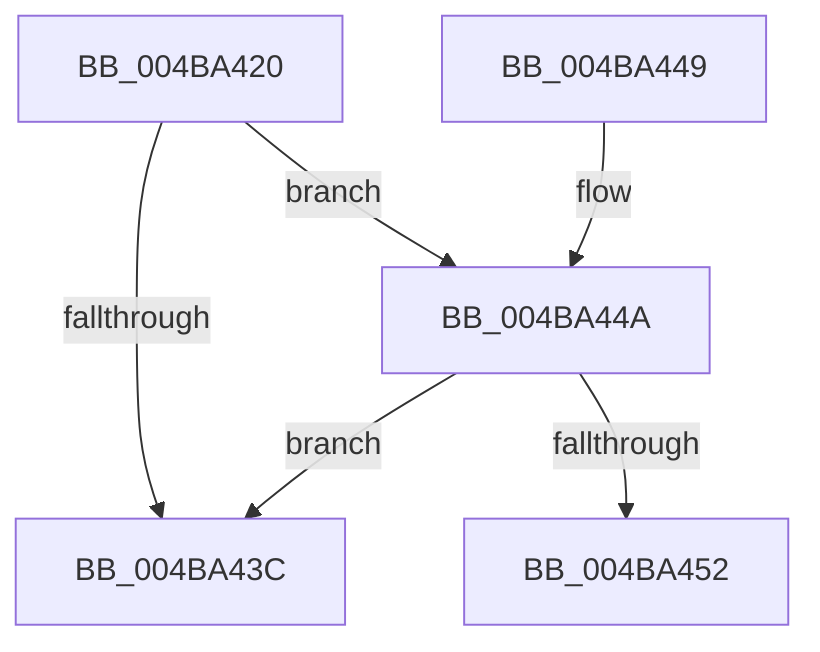

# KdRefreshDebuggerNotPresent

- RVA: `0x004BA420`–`0x004BA467` (길이 `71` bytes)
- VA: `0x00000001404BA420`
- 실행 섹션: `.text`
- PDB 이름 있음: `예`; PDB Function 태그: `예`
- unwind 정보 RVA: `0x000BB438`
- 디코드: `20`개 명령, `71/71` bytes 표시
- 미해석 바이트: `0` (있으면 어셈블리에 `.byte`로 보존)

> 이 문서는 커널 이미지의 기계어와 PDB 기호를 분석해 생성했습니다. 4번과 5번은 함수 원형과 자료형을 바이너리 사용 방식에서 추정한 C 해석이며 원본 소스 복구 결과는 아닙니다.

## 1. Dependencies

- 직접 호출 지점: **0**; 고유 호출 대상: **0**
- 직접 호출자로 확인된 함수: **1**
- RIP 상대 이미지 참조: **3**

### Outgoing calls
- 직접 디코드된 call 명령이 없습니다.

### Direct callers
- [KiBugCheckShouldEnterPostBugCheckDebugger](../5B/KiBugCheckShouldEnterPostBugCheckDebugger_function_005B40A0.md) at `0x005B40CA`

### Static image references
- `0x004BA42F` → RVA `0x00F475F8` (`.data`; read)
- `0x004BA44A` → RVA `0x00E0AA1C` (`.data`; read)
- `0x004BA452` → RVA `0x006CB4A0` (` ?? ::FNODOBFM::`string'`; read)

## 2. Other-region calls and transfers

- 다른 실행 섹션으로 향하는 call: **0**
- call이 아닌 외부 분기/꼬리 이동: **1**
  - `0x004BA462` → [sub_006FC51A](../6F/Unknown_function_006FC51A.md) (`tail-transfer`)

## 3. Assembly (complete function range)

```asm
004BA420  48 89 5C 24 08                  mov qword ptr [rsp + 8], rbx
004BA425  57                              push rdi
004BA426  48 83 EC 30                     sub rsp, 0x30
004BA42A  33 C9                           xor ecx, ecx
004BA42C  0F 57 C0                        xorps xmm0, xmm0
004BA42F  38 0D C3 D1 A8 00               cmp byte ptr [rip + 0xa8d1c3], cl
004BA435  0F 11 44 24 20                  movups xmmword ptr [rsp + 0x20], xmm0
004BA43A  75 0E                           jne 0x1404ba44a
004BA43C  B0 01                           mov al, 1
004BA43E  48 8B 5C 24 40                  mov rbx, qword ptr [rsp + 0x40]
004BA443  48 83 C4 30                     add rsp, 0x30
004BA447  5F                              pop rdi
004BA448  C3                              ret
004BA449  CC                              int3
004BA44A  38 0D CC 05 95 00               cmp byte ptr [rip + 0x9505cc], cl
004BA450  75 EA                           jne 0x1404ba43c
004BA452  48 8D 15 47 10 21 00            lea rdx, [rip + 0x211047]
004BA459  48 83 C8 FF                     or rax, 0xffffffffffffffff
004BA45D  48 89 54 24 28                  mov qword ptr [rsp + 0x28], rdx
004BA462  E9 B3 20 24 00                  jmp 0x1406fc51a
```

## 4. C-style interpretation (structured pseudocode)

```c
__int64 __fastcall KdRefreshDebuggerNotPresent(int a1)
{
    __int64 result;
    __int64 v_rsp;
    unsigned __int64 v_stack_m18;
    unsigned __int64 v_stack_p28;
    unsigned __int64 v_stack_p8;

    v_stack_p8 = v_rbx;
    v_rsp = (v_rsp) - (48);
    a1 = 0;
    v_stack_m18 = v_xmm0;
    if ((*(unsigned __int8 *)(v_rip + 11063747)) != 0) goto loc_004BA44A;
loc_004BA43C:
    v_rsp = (v_rsp) + (48);
    return 1;
loc_004BA44A:
    if ((*(unsigned __int8 *)(v_rip + 9766348)) != 0) goto loc_004BA43C;
    result = (1) | (-1);
    v_stack_p28 = v_rip + 2166855;
}
```

## 5. (Beta) C Style

```c
int64_t KdRefreshDebuggerNotPresent(int32_t Arg1)
{
    int64_t result;
    int64_t local_rsp;
    uint64_t v_stack_m18;
    uint64_t v_stack_p28;
    uint64_t v_stack_p8;

    v_stack_p8 = local_rbx;
    local_rsp = (local_rsp) - (48);
    Arg1 = 0;
    v_stack_m18 = v_xmm0;
    if ((*(uint8_t *)(v_rip + 0xA8D1C3)) != 0) goto loc_004BA44A;
loc_004BA43C:
    local_rsp = (local_rsp) + (48);
    return 1;
loc_004BA44A:
    if ((*(uint8_t *)(v_rip + 0x9505CC)) != 0) goto loc_004BA43C;
    result = (1) | (-1);
    v_stack_p28 = v_rip + 2166855;
}
```

## 6. Execution-region graph

[열기: 2D/3D 그래프와 함수 탐색 컨트롤 패널](../../../control-panel.html?section=text&rva=0x004BA420&view=graph)

- 2D 그래프는 위에서 아래로 흐르고, 3D 그래프는 빈 공간을 드래그해 회전합니다. Shift+드래그는 이동, 휠은 확대·축소, 함수 노드 선택은 대상 보고서 이동입니다.

### Static fallback


