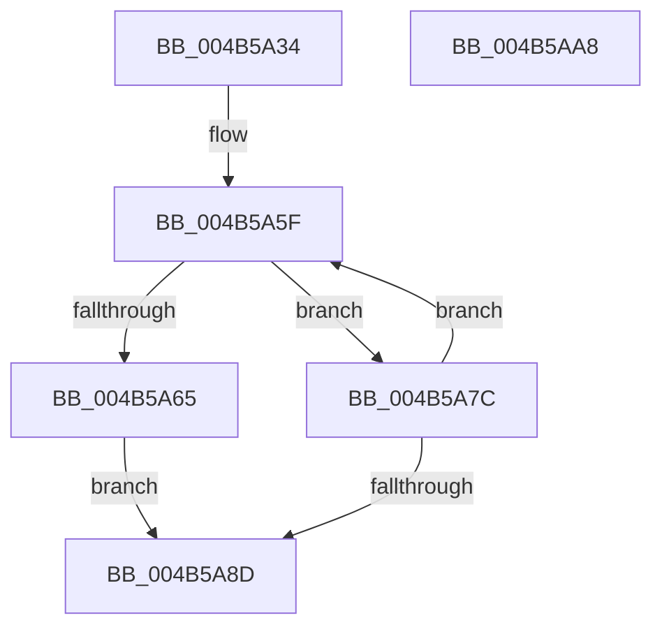

# KeAndGroupMasks

- RVA: `0x004B5A34`–`0x004B5AA9` (길이 `117` bytes)
- VA: `0x00000001404B5A34`
- 실행 섹션: `.text`
- PDB 이름 있음: `예`; PDB Function 태그: `아니요`
- unwind 정보 RVA: `0x000BA354`
- 디코드: `32`개 명령, `117/117` bytes 표시
- 미해석 바이트: `0` (있으면 어셈블리에 `.byte`로 보존)

> 이 문서는 커널 이미지의 기계어와 PDB 기호를 분석해 생성했습니다. 4번과 5번은 함수 원형과 자료형을 바이너리 사용 방식에서 추정한 C 해석이며 원본 소스 복구 결과는 아닙니다.

## 1. Dependencies

- 직접 호출 지점: **1**; 고유 호출 대상: **1**
- 직접 호출자로 확인된 함수: **1**
- RIP 상대 이미지 참조: **1**

### Outgoing calls
- `0x004B5A9E` → [_security_check_cookie](../6A/_security_check_cookie_function_006AC640.md) (function, `0x006AC640`)

### Direct callers
- [KeInitializeProcess](../../page/A6/KeInitializeProcess_function_00A63CF4.md) at `0x00A63F06`

### Static image references
- `0x004B5A38` → RVA `0x00E0A740` (`.data`; read)

## 2. Other-region calls and transfers

- 다른 실행 섹션으로 향하는 call: **0**
- 별도 외부 분기/꼬리 이동을 확인하지 못했습니다.

## 3. Assembly (complete function range)

```asm
004B5A34  48 83 EC 28                     sub rsp, 0x28
004B5A38  48 8B 05 01 4D 95 00            mov rax, qword ptr [rip + 0x954d01]
004B5A3F  48 33 C4                        xor rax, rsp
004B5A42  48 89 44 24 10                  mov qword ptr [rsp + 0x10], rax
004B5A47  0F 10 01                        movups xmm0, xmmword ptr [rcx]
004B5A4A  48 8D 04 24                     lea rax, [rsp]
004B5A4E  B9 20 00 00 00                  mov ecx, 0x20
004B5A53  4C 8D 0C 24                     lea r9, [rsp]
004B5A57  48 2B D0                        sub rdx, rax
004B5A5A  F3 0F 7F 04 24                  movdqu xmmword ptr [rsp], xmm0
004B5A5F  48 83 F9 40                     cmp rcx, 0x40
004B5A63  73 17                           jae 0x1404b5a7c
004B5A65  B8 01 00 00 00                  mov eax, 1
004B5A6A  48 D3 E0                        shl rax, cl
004B5A6D  48 FF C8                        dec rax
004B5A70  48 F7 D0                        not rax
004B5A73  49 0B 04 11                     or rax, qword ptr [r9 + rdx]
004B5A77  49 21 01                        and qword ptr [r9], rax
004B5A7A  EB 11                           jmp 0x1404b5a8d
004B5A7C  49 8B 04 11                     mov rax, qword ptr [r9 + rdx]
004B5A80  49 21 01                        and qword ptr [r9], rax
004B5A83  49 83 C1 08                     add r9, 8
004B5A87  48 83 E9 40                     sub rcx, 0x40
004B5A8B  75 D2                           jne 0x1404b5a5f
004B5A8D  0F 10 04 24                     movups xmm0, xmmword ptr [rsp]
004B5A91  F3 41 0F 7F 00                  movdqu xmmword ptr [r8], xmm0
004B5A96  48 8B 4C 24 10                  mov rcx, qword ptr [rsp + 0x10]
004B5A9B  48 33 CC                        xor rcx, rsp
004B5A9E  E8 9D 6B 1F 00                  call 0x1406ac640
004B5AA3  48 83 C4 28                     add rsp, 0x28
004B5AA7  C3                              ret
004B5AA8  CC                              int3
```

## 4. C-style interpretation (structured pseudocode)

```c
__int64 __fastcall KeAndGroupMasks(__int64 a1, __int64 a2, __int64 a3)
{
    __int64 result;
    __int64 v_rsp;
    unsigned __int64 v_stack_m18;
    unsigned __int64 v_stack_m28;

    v_rsp = (v_rsp) - (40);
    result = (*(unsigned __int64 *)(v_rip + 9784577)) ^ (v_rsp);
    v_stack_m18 = result;
    a2 = (a2) - (v_stack_m28);
    v_stack_m28 = v_xmm0;
loc_004B5A5F:
    if (32 >= 64) goto loc_004B5A7C;
    result = (1) << (32);
    result = (result) - 1;
    result = ~(result);
    result = (result) | (*(unsigned __int64 *)(v_stack_m28 + a2 * 1));
    goto loc_004B5A8D;
loc_004B5A7C:
    a4 = (v_stack_m28) + (8);
    a1 = (32) - (64);
    if (condition_is_not_equal) goto loc_004B5A5F;
loc_004B5A8D:
    *(unsigned __int64 *)(a3) = v_xmm0;
    a1 = (v_stack_m18) ^ (v_rsp);
    result = _security_check_cookie(a1, a2, a3, a4);
    v_rsp = (v_rsp) + (40);
    return result;
}
```

## 5. (Beta) C Style

```c
int64_t KeAndGroupMasks(void *Arg1, int64_t Arg2, void *Arg3)
{
    uint8_t *arg1 = (uint8_t *)Arg1;
    uint8_t *arg3 = (uint8_t *)Arg3;

    int64_t result;
    int64_t local_rsp;
    uint64_t v_stack_m18;
    uint64_t v_stack_m28;

    local_rsp = (local_rsp) - (40);
    result = (*(uint64_t *)(v_rip + 0x954D01)) ^ (local_rsp);
    v_stack_m18 = result;
    Arg2 = (Arg2) - (v_stack_m28);
    v_stack_m28 = v_xmm0;
loc_004B5A5F:
    if (32 >= 64) goto loc_004B5A7C;
    result = (1) << (32);
    result = (result) - 1;
    result = ~(result);
    result = (result) | (*(uint64_t *)(v_stack_m28 + Arg2 * 1));
    goto loc_004B5A8D;
loc_004B5A7C:
    a4 = (v_stack_m28) + (8);
    Arg1 = (32) - (64);
    if (condition_is_not_equal) goto loc_004B5A5F;
loc_004B5A8D:
    *(uint64_t *)(arg3) = v_xmm0;
    Arg1 = (v_stack_m18) ^ (local_rsp);
    result = _security_check_cookie(Arg1, Arg2, Arg3, a4);
    local_rsp = (local_rsp) + (40);
    return result;
}
```

### 관측된 메모리 오프셋

구조체 형식이 확인되지 않은 접근은 인자 기준의 오프셋으로만 기록했습니다.

| 기준 인자 | 오프셋 표현 | 폭 (bit) | 접근 |
|---|---:|---:|---|
| `Arg1` | `+ 0x0` | `128` | `R` |
| `Arg3` | `+ 0x0` | `128` | `W` |

## 6. Execution-region graph

[열기: 2D/3D 그래프와 함수 탐색 컨트롤 패널](../../../control-panel.html?section=text&rva=0x004B5A34&view=graph)

- 2D 그래프는 위에서 아래로 흐르고, 3D 그래프는 빈 공간을 드래그해 회전합니다. Shift+드래그는 이동, 휠은 확대·축소, 함수 노드 선택은 대상 보고서 이동입니다.

### Static fallback


