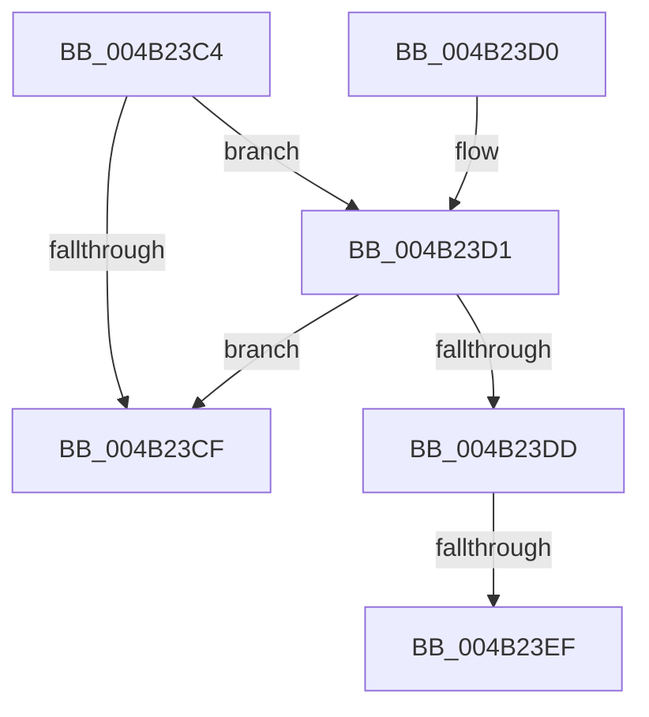

# KeCopyXfdMaskToPeb

- RVA: `0x004B23C4`–`0x004B23F7` (길이 `51` bytes)
- VA: `0x00000001404B23C4`
- 실행 섹션: `.text`
- PDB 이름 있음: `예`; PDB Function 태그: `예`
- unwind 정보 RVA: `0x000B9308`
- 디코드: `13`개 명령, `51/51` bytes 표시
- 미해석 바이트: `0` (있으면 어셈블리에 `.byte`로 보존)

> 이 문서는 커널 이미지의 기계어와 PDB 기호를 분석해 생성했습니다. 4번과 5번은 함수 원형과 자료형을 바이너리 사용 방식에서 추정한 C 해석이며 원본 소스 복구 결과는 아닙니다.

## 1. Dependencies

- 직접 호출 지점: **0**; 고유 호출 대상: **0**
- 직접 호출자로 확인된 함수: **3**
- RIP 상대 이미지 참조: **1**

### Outgoing calls
- 직접 디코드된 call 명령이 없습니다.

### Direct callers
- [PspEnableProcessOptionalXStateFeatures](../../page/78/PspEnableProcessOptionalXStateFeatures_function_00781EF0.md) at `0x007822CD`
- [PspAllocateProcess](../../page/A1/PspAllocateProcess_function_00A13B3C.md) at `0x00A160E5`
- [PspSetupUserProcessAddressSpace](../../page/AE/PspSetupUserProcessAddressSpace_function_00AEBDC8.md) at `0x00AEBFEA`

### Static image references
- `0x004B23C4` → RVA `0x00FC6B30` (`ALMOSTRO`; read)

## 2. Other-region calls and transfers

- 다른 실행 섹션으로 향하는 call: **0**
- call이 아닌 외부 분기/꼬리 이동: **2**
  - `0x004B23E9` → [sub_006FB37C](../6F/Unknown_function_006FB37C.md) (`tail-transfer`)
  - `0x004B23F2` → [sub_006FB37C](../6F/Unknown_function_006FB37C.md) (`tail-transfer`)

## 3. Assembly (complete function range)

```asm
004B23C4  48 0F BA 25 63 47 B1 00 37      bt qword ptr [rip + 0xb14763], 0x37
004B23CD  72 02                           jb 0x1404b23d1
004B23CF  C3                              ret
004B23D0  CC                              int3
004B23D1  4C 8B 81 E0 02 00 00            mov r8, qword ptr [rcx + 0x2e0]
004B23D8  4D 85 C0                        test r8, r8
004B23DB  74 F2                           je 0x1404b23cf
004B23DD  33 D2                           xor edx, edx
004B23DF  48 8B 81 10 03 00 00            mov rax, qword ptr [rcx + 0x310]
004B23E6  48 85 C0                        test rax, rax
004B23E9  0F 84 8D 8F 24 00               je 0x1406fb37c
004B23EF  48 8B 10                        mov rdx, qword ptr [rax]
004B23F2  E9 85 8F 24 00                  jmp 0x1406fb37c
```

## 4. C-style interpretation (structured pseudocode)

```c
__int64 __fastcall KeCopyXfdMaskToPeb(__int64 a1, int a2)
{
    if (condition_is_below) goto loc_004B23D1;
loc_004B23CF:
    return result;
loc_004B23D1:
    if (*(unsigned __int64 *)(a1 + 736) == 0) goto loc_004B23CF;
    a2 = 0;
}
```

## 5. (Beta) C Style

```c
int64_t KeCopyXfdMaskToPeb(void *Arg1, int32_t Arg2)
{
    uint8_t *arg1 = (uint8_t *)Arg1;

    if (condition_is_below) goto loc_004B23D1;
loc_004B23CF:
    return result;
loc_004B23D1:
    if (*(uint64_t *)(arg1 + 0x2E0) == 0) goto loc_004B23CF;
    Arg2 = 0;
}
```

### 관측된 메모리 오프셋

구조체 형식이 확인되지 않은 접근은 인자 기준의 오프셋으로만 기록했습니다.

| 기준 인자 | 오프셋 표현 | 폭 (bit) | 접근 |
|---|---:|---:|---|
| `Arg1` | `+ 0x2E0` | `64` | `R` |
| `Arg1` | `+ 0x310` | `64` | `R` |

## 6. Execution-region graph

[열기: 2D/3D 그래프와 함수 탐색 컨트롤 패널](../../../control-panel.html?section=text&rva=0x004B23C4&view=graph)

- 2D 그래프는 위에서 아래로 흐르고, 3D 그래프는 빈 공간을 드래그해 회전합니다. Shift+드래그는 이동, 휠은 확대·축소, 함수 노드 선택은 대상 보고서 이동입니다.

### Static fallback


