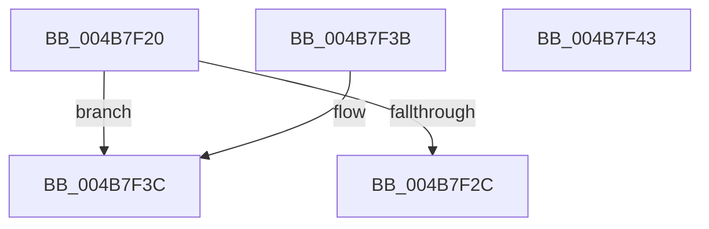

# KeFlushCurrentTbImmediately

- RVA: `0x004B7F20`–`0x004B7F44` (길이 `36` bytes)
- VA: `0x00000001404B7F20`
- 실행 섹션: `.text`
- PDB 이름 있음: `예`; PDB Function 태그: `아니요`
- unwind 정보 RVA: `0x000DB714`
- 디코드: `13`개 명령, `36/36` bytes 표시
- 미해석 바이트: `0` (있으면 어셈블리에 `.byte`로 보존)

> 이 문서는 커널 이미지의 기계어와 PDB 기호를 분석해 생성했습니다. 4번과 5번은 함수 원형과 자료형을 바이너리 사용 방식에서 추정한 C 해석이며 원본 소스 복구 결과는 아닙니다.

## 1. Dependencies

- 직접 호출 지점: **0**; 고유 호출 대상: **0**
- 직접 호출자로 확인된 함수: **3**
- RIP 상대 이미지 참조: **0**

### Outgoing calls
- 직접 디코드된 call 명령이 없습니다.

### Direct callers
- [PopHandleNextState](../../pagelk/B7/PopHandleNextState_function_00B77350.md) at `0x00B77652`
- [KiSetPageAttributesTable](../../pagelk/B7/KiSetPageAttributesTable_function_00B7D7FC.md) at `0x00B7D883`
- [KiSetPageAttributesTable](../../pagelk/B7/KiSetPageAttributesTable_function_00B7D7FC.md) at `0x00B7D8A0`
- [KeLoadMTRR](../../pagelk/B7/KeLoadMTRR_function_00B7DDA0.md) at `0x00B7DE73`
- [KeLoadMTRR](../../pagelk/B7/KeLoadMTRR_function_00B7DDA0.md) at `0x00B7DF15`

### Static image references
- 디코드된 RIP-relative 메모리 참조가 없습니다.

## 2. Other-region calls and transfers

- 다른 실행 섹션으로 향하는 call: **0**
- 별도 외부 분기/꼬리 이동을 확인하지 못했습니다.

## 3. Assembly (complete function range)

```asm
004B7F20  0F 20 E1                        mov rcx, cr4
004B7F23  48 F7 C1 80 00 02 00            test rcx, 0x20080
004B7F2A  74 10                           je 0x1404b7f3c
004B7F2C  48 8B C1                        mov rax, rcx
004B7F2F  48 0F BA F8 07                  btc rax, 7
004B7F34  0F 22 E0                        mov cr4, rax
004B7F37  0F 22 E1                        mov cr4, rcx
004B7F3A  C3                              ret
004B7F3B  CC                              int3
004B7F3C  0F 20 D8                        mov rax, cr3
004B7F3F  0F 22 D8                        mov cr3, rax
004B7F42  C3                              ret
004B7F43  CC                              int3
```

## 4. C-style interpretation (structured pseudocode)

```c
__int64 __fastcall KeFlushCurrentTbImmediately(void)
{
    if (((v_cr4) & (0x20080ULL)) == 0) goto loc_004B7F3C;
    return v_cr4;
loc_004B7F3C:
    return v_cr3;
}
```

## 5. (Beta) C Style

```c
void KeFlushCurrentTbImmediately(void)
{
    if (((v_cr4) & (0x20080ULL)) == 0) goto loc_004B7F3C;
    return v_cr4;
loc_004B7F3C:
    return v_cr3;
}
```

## 6. Execution-region graph

[열기: 2D/3D 그래프와 함수 탐색 컨트롤 패널](../../../control-panel.html?section=text&rva=0x004B7F20&view=graph)

- 2D 그래프는 위에서 아래로 흐르고, 3D 그래프는 빈 공간을 드래그해 회전합니다. Shift+드래그는 이동, 휠은 확대·축소, 함수 노드 선택은 대상 보고서 이동입니다.

### Static fallback


