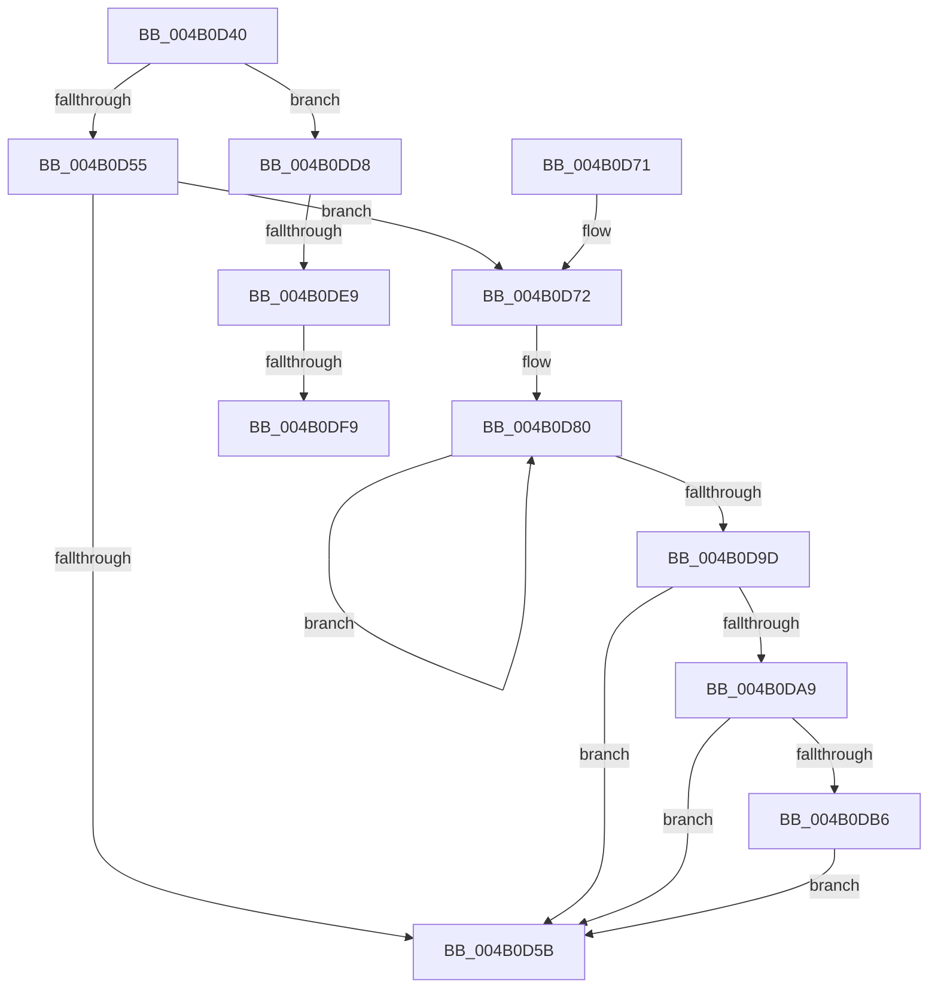

# KeIdleSpecCtrl

- RVA: `0x004B0D40`–`0x004B0E0A` (길이 `202` bytes)
- VA: `0x00000001404B0D40`
- 실행 섹션: `.text`
- PDB 이름 있음: `예`; PDB Function 태그: `예`
- unwind 정보 RVA: `0x000A8EFC`
- 디코드: `46`개 명령, `202/202` bytes 표시
- 미해석 바이트: `0` (있으면 어셈블리에 `.byte`로 보존)

> 이 문서는 커널 이미지의 기계어와 PDB 기호를 분석해 생성했습니다. 4번과 5번은 함수 원형과 자료형을 바이너리 사용 방식에서 추정한 C 해석이며 원본 소스 복구 결과는 아닙니다.

## 1. Dependencies

- 직접 호출 지점: **0**; 고유 호출 대상: **0**
- 직접 호출자로 확인된 함수: **3**
- RIP 상대 이미지 참조: **0**

### Outgoing calls
- 직접 디코드된 call 명령이 없습니다.

### Direct callers
- [PoIdle](../2C/PoIdle_function_002CFB40.md) at `0x002CFCF7`
- [KiExecuteSmtIsolationThread](../5C/KiExecuteSmtIsolationThread_function_005C4070.md) at `0x005C41BD`
- [KiExecuteSmtIsolationThread](../5C/KiExecuteSmtIsolationThread_function_005C4070.md) at `0x005C4213`
- [sub_006DCDC2](../6D/Unknown_function_006DCDC2.md) at `0x006DCEE2`

### Static image references
- 디코드된 RIP-relative 메모리 참조가 없습니다.

## 2. Other-region calls and transfers

- 다른 실행 섹션으로 향하는 call: **0**
- call이 아닌 외부 분기/꼬리 이동: **3**
  - `0x004B0DE3` → [sub_006FB274](../6F/Unknown_function_006FB274.md) (`tail-transfer`)
  - `0x004B0DF3` → [sub_006FB274](../6F/Unknown_function_006FB274.md) (`tail-transfer`)
  - `0x004B0E05` → [sub_006FB274](../6F/Unknown_function_006FB274.md) (`tail-transfer`)

## 3. Assembly (complete function range)

```asm
004B0D40  48 89 5C 24 08                  mov qword ptr [rsp + 8], rbx
004B0D45  33 DB                           xor ebx, ebx
004B0D47  4D 8B D8                        mov r11, r8
004B0D4A  4C 8B D1                        mov r10, rcx
004B0D4D  85 D2                           test edx, edx
004B0D4F  0F 85 83 00 00 00               jne 0x1404b0dd8
004B0D55  41 F6 C1 04                     test r9b, 4
004B0D59  75 17                           jne 0x1404b0d72
004B0D5B  B9 FE FF 00 00                  mov ecx, 0xfffe
004B0D60  0F B7 C3                        movzx eax, bx
004B0D63  66 41 21 8A D8 06 00 00         and word ptr [r10 + 0x6d8], cx
004B0D6B  48 8B 5C 24 08                  mov rbx, qword ptr [rsp + 8]
004B0D70  C3                              ret
004B0D71  CC                              int3
004B0D72  48 8B 91 B0 2D 00 00            mov rdx, qword ptr [rcx + 0x2db0]
004B0D79  0F 0D 8A E0 06 00 00            prefetchw byte ptr [rdx + 0x6e0]
004B0D80  0F B7 82 E0 06 00 00            movzx eax, word ptr [rdx + 0x6e0]
004B0D87  0F B7 C8                        movzx ecx, ax
004B0D8A  66 83 E1 F7                     and cx, 0xfff7
004B0D8E  66 83 C9 02                     or cx, 2
004B0D92  66 F0 0F B1 8A E0 06 00 00      lock cmpxchg word ptr [rdx + 0x6e0], cx
004B0D9B  75 E3                           jne 0x1404b0d80
004B0D9D  41 0F B7 82 E0 06 00 00         movzx eax, word ptr [r10 + 0x6e0]
004B0DA5  A8 10                           test al, 0x10
004B0DA7  75 B2                           jne 0x1404b0d5b
004B0DA9  41 0F B7 8A E6 06 00 00         movzx ecx, word ptr [r10 + 0x6e6]
004B0DB1  F6 C1 02                        test cl, 2
004B0DB4  74 A5                           je 0x1404b0d5b
004B0DB6  B8 FD FF 00 00                  mov eax, 0xfffd
004B0DBB  66 23 C8                        and cx, ax
004B0DBE  0F B7 D1                        movzx edx, cx
004B0DC1  B9 48 00 00 00                  mov ecx, 0x48
004B0DC6  66 41 89 92 E6 06 00 00         mov word ptr [r10 + 0x6e6], dx
004B0DCE  8B C2                           mov eax, edx
004B0DD0  48 C1 EA 20                     shr rdx, 0x20
004B0DD4  0F 30                           wrmsr
004B0DD6  EB 83                           jmp 0x1404b0d5b
004B0DD8  F6 81 DC 06 00 00 01            test byte ptr [rcx + 0x6dc], 1
004B0DDF  44 0F B7 CB                     movzx r9d, bx
004B0DE3  0F 84 8B A4 24 00               je 0x1406fb274
004B0DE9  0F B7 81 E6 06 00 00            movzx eax, word ptr [rcx + 0x6e6]
004B0DF0  66 85 C0                        test ax, ax
004B0DF3  0F 84 7B A4 24 00               je 0x1406fb274
004B0DF9  66 83 89 D8 06 00 00 01         or word ptr [rcx + 0x6d8], 1
004B0E01  44 0F B7 C8                     movzx r9d, ax
004B0E05  E9 6A A4 24 00                  jmp 0x1406fb274
```

## 4. C-style interpretation (structured pseudocode)

```c
__int64 __fastcall KeIdleSpecCtrl(__int64 a1, int a2, __int64 a3, unsigned __int8 a4)
{
    __int64 v_rbx;
    unsigned __int64 v_stack_p8;

    v_stack_p8 = v_rbx;
    v_rbx = 0;
    if (a2 != 0) goto loc_004B0DD8;
    if (((a4) & (4)) != 0) goto loc_004B0D72;
loc_004B0D5B:
    return 0;
loc_004B0D72:
loc_004B0D80:
    a1 = (unsigned __int16)(((unsigned __int16)(*(unsigned __int16 *)(*(unsigned __int64 *)((unsigned int)(0xFFFEULL) + 11696) + 1760))) & (0xFFF7ULL));
    a1 = (unsigned __int16)((a1) | (2));
    if (condition_is_not_equal) goto loc_004B0D80;
    if ((((unsigned __int8)(*(unsigned __int16 *)(a1 + 1760))) & (16)) != 0) goto loc_004B0D5B;
    if ((((unsigned __int8)(*(unsigned __int16 *)(a1 + 1766))) & (2)) == 0) goto loc_004B0D5B;
    a1 = (unsigned __int16)((*(unsigned __int16 *)(a1 + 1766)) & ((unsigned __int16)((unsigned int)(0xFFFDULL))));
    *(unsigned __int16 *)(a1 + 1766) = (unsigned __int16)((unsigned __int16)(a1));
    a2 = ((unsigned __int16)(a1)) >> (32);
    goto loc_004B0D5B;
loc_004B0DD8:
}
```

## 5. (Beta) C Style

```c
int64_t KeIdleSpecCtrl(void *Arg1, int32_t Arg2, int64_t Arg3, uint8_t Arg4)
{
    uint8_t *arg1 = (uint8_t *)Arg1;

    int64_t local_rbx;
    uint64_t v_stack_p8;

    v_stack_p8 = local_rbx;
    local_rbx = 0;
    if (Arg2 != 0) goto loc_004B0DD8;
    if (((Arg4) & (4)) != 0) goto loc_004B0D72;
loc_004B0D5B:
    return 0;
loc_004B0D72:
loc_004B0D80:
    Arg1 = (uint16_t)(((uint16_t)(*(uint16_t *)(*(uint64_t *)((uint32_t)(0xFFFEULL) + 0x2DB0) + 0x6E0))) & (0xFFF7ULL));
    Arg1 = (uint16_t)((Arg1) | (2));
    if (condition_is_not_equal) goto loc_004B0D80;
    if ((((uint8_t)(*(uint16_t *)(arg1 + 0x6E0))) & (16)) != 0) goto loc_004B0D5B;
    if ((((uint8_t)(*(uint16_t *)(arg1 + 0x6E6))) & (2)) == 0) goto loc_004B0D5B;
    Arg1 = (uint16_t)((*(uint16_t *)(arg1 + 0x6E6)) & ((uint16_t)((uint32_t)(0xFFFDULL))));
    *(uint16_t *)(arg1 + 0x6E6) = (uint16_t)((uint16_t)(Arg1));
    Arg2 = ((uint16_t)(Arg1)) >> (32);
    goto loc_004B0D5B;
loc_004B0DD8:
}
```

### 관측된 메모리 오프셋

구조체 형식이 확인되지 않은 접근은 인자 기준의 오프셋으로만 기록했습니다.

| 기준 인자 | 오프셋 표현 | 폭 (bit) | 접근 |
|---|---:|---:|---|
| `Arg1` | `+ 0x6D8` | `16` | `R/W` |
| `Arg1` | `+ 0x6DC` | `8` | `R` |
| `Arg1` | `+ 0x6E0` | `16` | `R` |
| `Arg1` | `+ 0x6E6` | `16` | `R` |
| `Arg1` | `+ 0x6E6` | `16` | `W` |
| `Arg1` | `+ 0x2DB0` | `64` | `R` |

## 6. Execution-region graph

[열기: 2D/3D 그래프와 함수 탐색 컨트롤 패널](../../../control-panel.html?section=text&rva=0x004B0D40&view=graph)

- 2D 그래프는 위에서 아래로 흐르고, 3D 그래프는 빈 공간을 드래그해 회전합니다. Shift+드래그는 이동, 휠은 확대·축소, 함수 노드 선택은 대상 보고서 이동입니다.

### Static fallback


