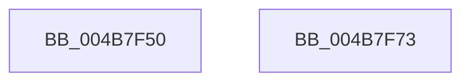

# KeInitializeDeviceQueue

- RVA: `0x004B7F50`–`0x004B7F74` (길이 `36` bytes)
- VA: `0x00000001404B7F50`
- 실행 섹션: `.text`
- PDB 이름 있음: `예`; PDB Function 태그: `아니요`
- unwind 정보 RVA: `0x000DB714`
- 디코드: `9`개 명령, `36/36` bytes 표시
- 미해석 바이트: `0` (있으면 어셈블리에 `.byte`로 보존)

> 이 문서는 커널 이미지의 기계어와 PDB 기호를 분석해 생성했습니다. 4번과 5번은 함수 원형과 자료형을 바이너리 사용 방식에서 추정한 C 해석이며 원본 소스 복구 결과는 아닙니다.

## 1. Dependencies

- 직접 호출 지점: **0**; 고유 호출 대상: **0**
- 직접 호출자로 확인된 함수: **3**
- RIP 상대 이미지 참조: **0**

### Outgoing calls
- 직접 디코드된 call 명령이 없습니다.

### Direct callers
- [HalpDmaAllocateChildAdapterV2](../../page/70/HalpDmaAllocateChildAdapterV2_function_0070A200.md) at `0x0070A354`
- [IoCreateController](../../page/71/IoCreateController_function_0071D190.md) at `0x0071D28B`
- [IoCreateDevice](../../page/9A/IoCreateDevice_function_009A4B00.md) at `0x009A4F26`

### Static image references
- 디코드된 RIP-relative 메모리 참조가 없습니다.

## 2. Other-region calls and transfers

- 다른 실행 섹션으로 향하는 call: **0**
- 별도 외부 분기/꼬리 이동을 확인하지 못했습니다.

## 3. Assembly (complete function range)

```asm
004B7F50  48 8D 41 08                     lea rax, [rcx + 8]
004B7F54  C7 01 14 00 28 00               mov dword ptr [rcx], 0x280014
004B7F5A  48 89 40 08                     mov qword ptr [rax + 8], rax
004B7F5E  48 89 00                        mov qword ptr [rax], rax
004B7F61  48 83 61 18 00                  and qword ptr [rcx + 0x18], 0
004B7F66  C6 41 20 00                     mov byte ptr [rcx + 0x20], 0
004B7F6A  48 81 61 20 FF 00 00 00         and qword ptr [rcx + 0x20], 0xff
004B7F72  C3                              ret
004B7F73  CC                              int3
```

## 4. C-style interpretation (structured pseudocode)

```c
__int64 __fastcall KeInitializeDeviceQueue(__int64 a1)
{
    *(unsigned int *)(a1) = 0x280014ULL;
    *(unsigned __int64 *)(a1 + 8 + 8) = a1 + 8;
    *(unsigned __int64 *)(a1 + 8) = a1 + 8;
    *(unsigned __int8 *)(a1 + 32) = 0;
    return a1 + 8;
}
```

## 5. (Beta) C Style

```c
void *KeInitializeDeviceQueue(void *DeviceQueue)
{
    uint8_t *deviceQueue = (uint8_t *)DeviceQueue;

    *(uint32_t *)(deviceQueue) = 0x280014ULL;
    *(void **)(deviceQueue + 0x8 + 0x8) = DeviceQueue + 8;
    *(void **)(deviceQueue + 0x8) = DeviceQueue + 8;
    *(uint8_t *)(deviceQueue + 0x20) = 0;
    return DeviceQueue + 8;
}
```

### 관측된 메모리 오프셋

구조체 형식이 확인되지 않은 접근은 인자 기준의 오프셋으로만 기록했습니다.

| 기준 인자 | 오프셋 표현 | 폭 (bit) | 접근 |
|---|---:|---:|---|
| `DeviceQueue` | `+ 0x0` | `32` | `W` |
| `DeviceQueue` | `+ 0x0` | `64` | `W` |
| `DeviceQueue` | `+ 0x8` | `64` | `R` |
| `DeviceQueue` | `+ 0x8` | `64` | `W` |
| `DeviceQueue` | `+ 0x18` | `64` | `R/W` |
| `DeviceQueue` | `+ 0x20` | `8` | `W` |
| `DeviceQueue` | `+ 0x20` | `64` | `R/W` |

## 6. Execution-region graph

[열기: 2D/3D 그래프와 함수 탐색 컨트롤 패널](../../../control-panel.html?section=text&rva=0x004B7F50&view=graph)

- 2D 그래프는 위에서 아래로 흐르고, 3D 그래프는 빈 공간을 드래그해 회전합니다. Shift+드래그는 이동, 휠은 확대·축소, 함수 노드 선택은 대상 보고서 이동입니다.

### Static fallback


