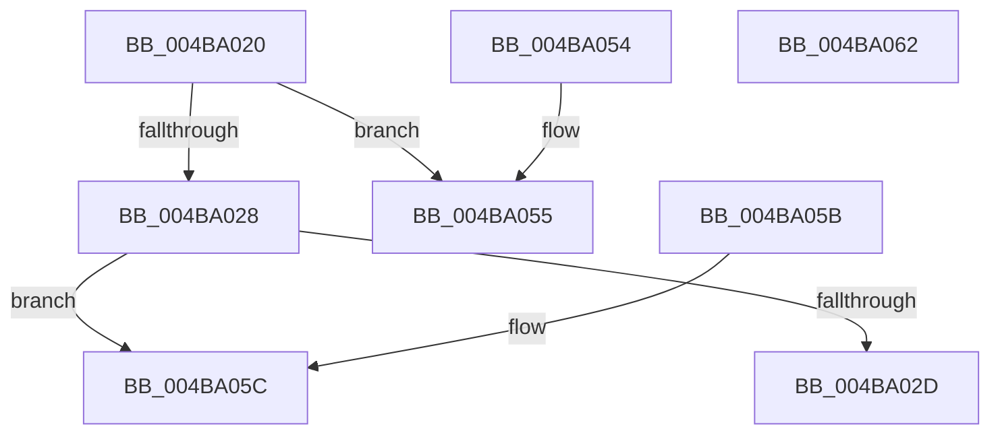

# KeInitializeTriageDumpDataArray

- RVA: `0x004BA020`–`0x004BA063` (길이 `67` bytes)
- VA: `0x00000001404BA020`
- 실행 섹션: `.text`
- PDB 이름 있음: `예`; PDB Function 태그: `아니요`
- unwind 정보 RVA: `0x000DB714`
- 디코드: `23`개 명령, `67/67` bytes 표시
- 미해석 바이트: `0` (있으면 어셈블리에 `.byte`로 보존)

> 이 문서는 커널 이미지의 기계어와 PDB 기호를 분석해 생성했습니다. 4번과 5번은 함수 원형과 자료형을 바이너리 사용 방식에서 추정한 C 해석이며 원본 소스 복구 결과는 아닙니다.

## 1. Dependencies

- 직접 호출 지점: **0**; 고유 호출 대상: **0**
- 직접 호출자로 확인된 함수: **3**
- RIP 상대 이미지 참조: **0**

### Outgoing calls
- 직접 디코드된 call 명령이 없습니다.

### Direct callers
- [PopWatchdogDumpControlRoutine](../5D/PopWatchdogDumpControlRoutine_function_005DFAA0.md) at `0x005DFB50`
- [IopInitializeTriageDumpData](../../page/71/IopInitializeTriageDumpData_function_0071A740.md) at `0x0071A77C`
- [PopWatchdogInit](../../init/C4/PopWatchdogInit_function_00C43330.md) at `0x00C433E7`

### Static image references
- 디코드된 RIP-relative 메모리 참조가 없습니다.

## 2. Other-region calls and transfers

- 다른 실행 섹션으로 향하는 call: **0**
- 별도 외부 분기/꼬리 이동을 확인하지 못했습니다.

## 3. Assembly (complete function range)

```asm
004BA020  45 33 C0                        xor r8d, r8d
004BA023  48 85 C9                        test rcx, rcx
004BA026  74 2D                           je 0x1404ba055
004BA028  83 FA 40                        cmp edx, 0x40
004BA02B  72 2F                           jb 0x1404ba05c
004BA02D  48 89 49 08                     mov qword ptr [rcx + 8], rcx
004BA031  8D 42 D0                        lea eax, [rdx - 0x30]
004BA034  48 89 09                        mov qword ptr [rcx], rcx
004BA037  C1 E8 04                        shr eax, 4
004BA03A  89 41 14                        mov dword ptr [rcx + 0x14], eax
004BA03D  33 C0                           xor eax, eax
004BA03F  44 89 41 10                     mov dword ptr [rcx + 0x10], r8d
004BA043  44 89 41 18                     mov dword ptr [rcx + 0x18], r8d
004BA047  48 C7 41 1C 00 00 00 02         mov qword ptr [rcx + 0x1c], 0x2000000
004BA04F  4C 89 41 28                     mov qword ptr [rcx + 0x28], r8
004BA053  C3                              ret
004BA054  CC                              int3
004BA055  B8 0D 00 00 C0                  mov eax, 0xc000000d
004BA05A  C3                              ret
004BA05B  CC                              int3
004BA05C  B8 23 00 00 C0                  mov eax, 0xc0000023
004BA061  C3                              ret
004BA062  CC                              int3
```

## 4. C-style interpretation (structured pseudocode)

```c
__int64 __fastcall KeInitializeTriageDumpDataArray(__int64 a1, __int64 a2, int a3)
{
    __int64 result;

    a3 = 0;
    if (a1 == 0) goto loc_004BA055;
    if (((unsigned int)(a2)) < 64) goto loc_004BA05C;
    *(unsigned __int64 *)(a1 + 8) = a1;
    *(unsigned __int64 *)(a1) = a1;
    result = (unsigned int)((a2 - 48) >> (4));
    *(unsigned int *)(a1 + 20) = (unsigned int)(result);
    result = 0;
    *(unsigned int *)(a1 + 16) = 0;
    *(unsigned int *)(a1 + 24) = 0;
    *(unsigned __int64 *)(a1 + 28) = 0x2000000ULL;
    *(unsigned __int64 *)(a1 + 40) = 0;
    return result;
loc_004BA055:
    return (unsigned int)(0xC000000DULL);
loc_004BA05C:
    return (unsigned int)(0xC0000023ULL);
}
```

## 5. (Beta) C Style

```c
int64_t KeInitializeTriageDumpDataArray(int64_t Arg1, int64_t Arg2, int32_t Arg3)
{
    int64_t result;

    Arg3 = 0;
    if (Arg1 == 0) goto loc_004BA055;
    if (((uint32_t)(Arg2)) < 64) goto loc_004BA05C;
    *(uint64_t *)(Arg1 + 0x8) = Arg1;
    *(uint64_t *)(Arg1) = Arg1;
    result = (uint32_t)((Arg2 - 48) >> (4));
    *(uint32_t *)(Arg1 + 0x14) = (uint32_t)(result);
    result = 0;
    *(uint32_t *)(Arg1 + 0x10) = 0;
    *(uint32_t *)(Arg1 + 0x18) = 0;
    *(uint64_t *)(Arg1 + 0x1C) = 0x2000000ULL;
    *(uint64_t *)(Arg1 + 0x28) = 0;
    return result;
loc_004BA055:
    return (uint32_t)(0xC000000DULL);
loc_004BA05C:
    return (uint32_t)(0xC0000023ULL);
}
```

## 6. Execution-region graph

[열기: 2D/3D 그래프와 함수 탐색 컨트롤 패널](../../../control-panel.html?section=text&rva=0x004BA020&view=graph)

- 2D 그래프는 위에서 아래로 흐르고, 3D 그래프는 빈 공간을 드래그해 회전합니다. Shift+드래그는 이동, 휠은 확대·축소, 함수 노드 선택은 대상 보고서 이동입니다.

### Static fallback


