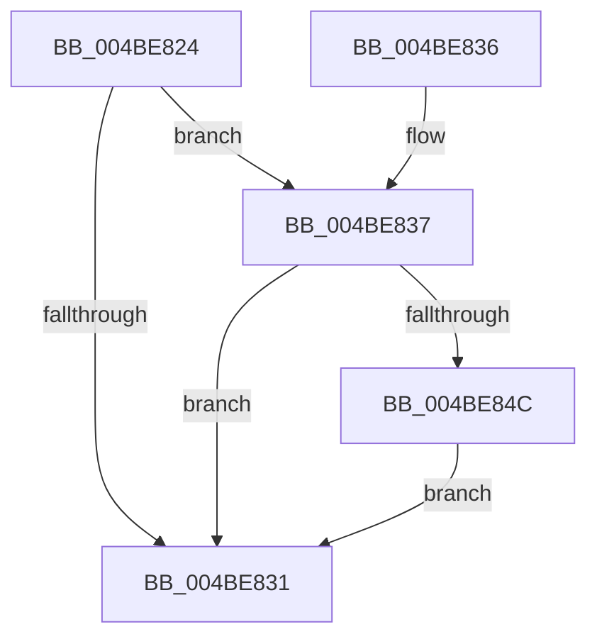

# KeRestoreIptStateAfterProcessorComesOnline

- RVA: `0x004BE824`–`0x004BE85C` (길이 `56` bytes)
- VA: `0x00000001404BE824`
- 실행 섹션: `.text`
- PDB 이름 있음: `예`; PDB Function 태그: `아니요`
- unwind 정보 RVA: `0x00093068`
- 디코드: `14`개 명령, `56/56` bytes 표시
- 미해석 바이트: `0` (있으면 어셈블리에 `.byte`로 보존)

> 이 문서는 커널 이미지의 기계어와 PDB 기호를 분석해 생성했습니다. 4번과 5번은 함수 원형과 자료형을 바이너리 사용 방식에서 추정한 C 해석이며 원본 소스 복구 결과는 아닙니다.

## 1. Dependencies

- 직접 호출 지점: **1**; 고유 호출 대상: **1**
- 직접 호출자로 확인된 함수: **2**
- RIP 상대 이미지 참조: **2**

### Outgoing calls
- `0x004BE855` → [KiRestoreIptState](../4C/KiRestoreIptState_function_004C3E4C.md) (function, `0x004C3E4C`)

### Direct callers
- [PnprQuiesceProcessorDpc](../../pagelk/B6/PnprQuiesceProcessorDpc_function_00B64B50.md) at `0x00B64DC9`
- [PopHandleNextState](../../pagelk/B7/PopHandleNextState_function_00B77350.md) at `0x00B77665`

### Static image references
- `0x004BE828` → RVA `0x00FC6B94` (`ALMOSTRO`; read)
- `0x004BE84C` → RVA `0x00FC50D0` (`ALMOSTRO`; read)

## 2. Other-region calls and transfers

- 다른 실행 섹션으로 향하는 call: **0**
- 별도 외부 분기/꼬리 이동을 확인하지 못했습니다.

## 3. Assembly (complete function range)

```asm
004BE824  48 83 EC 28                     sub rsp, 0x28
004BE828  83 3D 65 83 B0 00 00            cmp dword ptr [rip + 0xb08365], 0
004BE82F  75 06                           jne 0x1404be837
004BE831  48 83 C4 28                     add rsp, 0x28
004BE835  C3                              ret
004BE836  CC                              int3
004BE837  65 48 8B 04 25 20 00 00 00      mov rax, qword ptr gs:[0x20]
004BE840  48 8B 90 D0 8F 00 00            mov rdx, qword ptr [rax + 0x8fd0]
004BE847  48 85 D2                        test rdx, rdx
004BE84A  74 E5                           je 0x1404be831
004BE84C  8B 0D 7E 68 B0 00               mov ecx, dword ptr [rip + 0xb0687e]
004BE852  48 03 CA                        add rcx, rdx
004BE855  E8 F2 55 00 00                  call 0x1404c3e4c
004BE85A  EB D5                           jmp 0x1404be831
```

## 4. C-style interpretation (structured pseudocode)

```c
__int64 __fastcall KeRestoreIptStateAfterProcessorComesOnline(void)
{
    __int64 result;
    __int64 v_rsp;

    v_rsp = (v_rsp) - (40);
    if ((*(unsigned int *)(v_rip + 11567973)) != 0) goto loc_004BE837;
loc_004BE831:
    v_rsp = (v_rsp) + (40);
    return result;
loc_004BE837:
    if (*(unsigned __int64 *)(*(unsigned __int64 *)(gs_base + (0 + 32)) + 36816) == 0) goto loc_004BE831;
    a1 = ((unsigned int)(*(unsigned int *)(v_rip + 11561086))) + (*(unsigned __int64 *)(*(unsigned __int64 *)(gs_base + (0 + 32)) + 36816));
    result = KiRestoreIptState(a1, *(unsigned __int64 *)(*(unsigned __int64 *)(gs_base + (0 + 32)) + 36816), a3, a4);
    goto loc_004BE831;
}
```

## 5. (Beta) C Style

```c
void KeRestoreIptStateAfterProcessorComesOnline(void)
{
    int64_t result;
    int64_t local_rsp;

    local_rsp = (local_rsp) - (40);
    if ((*(uint32_t *)(v_rip + 0xB08365)) != 0) goto loc_004BE837;
loc_004BE831:
    local_rsp = (local_rsp) + (40);
    return result;
loc_004BE837:
    if (*(uint64_t *)(*(uint64_t *)(gs_base + (0 + 0x20)) + 0x8FD0) == 0) goto loc_004BE831;
    a1 = ((uint32_t)(*(uint32_t *)(v_rip + 0xB0687E))) + (*(uint64_t *)(*(uint64_t *)(gs_base + (0 + 0x20)) + 0x8FD0));
    result = KiRestoreIptState(a1, *(uint64_t *)(*(uint64_t *)(gs_base + (0 + 0x20)) + 0x8FD0), a3, a4);
    goto loc_004BE831;
}
```

## 6. Execution-region graph

[열기: 2D/3D 그래프와 함수 탐색 컨트롤 패널](../../../control-panel.html?section=text&rva=0x004BE824&view=graph)

- 2D 그래프는 위에서 아래로 흐르고, 3D 그래프는 빈 공간을 드래그해 회전합니다. Shift+드래그는 이동, 휠은 확대·축소, 함수 노드 선택은 대상 보고서 이동입니다.

### Static fallback


