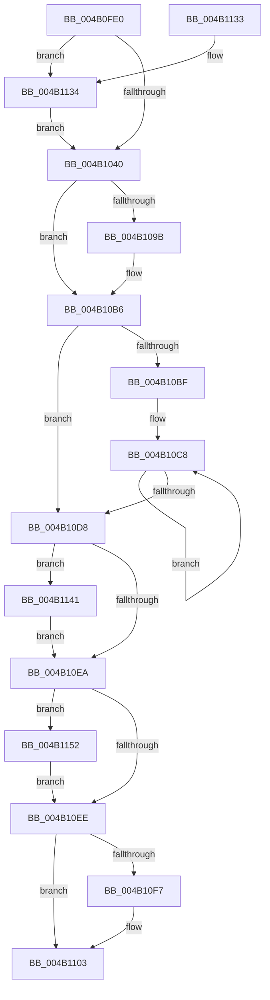

# KeSynchronizeSecurityDomain

- RVA: `0x004B0FE0`–`0x004B117F` (길이 `415` bytes)
- VA: `0x00000001404B0FE0`
- 실행 섹션: `.text`
- PDB 이름 있음: `예`; PDB Function 태그: `아니요`
- unwind 정보 RVA: `0x000B8CDC`
- 디코드: `105`개 명령, `415/415` bytes 표시
- 미해석 바이트: `0` (있으면 어셈블리에 `.byte`로 보존)

> 이 문서는 커널 이미지의 기계어와 PDB 기호를 분석해 생성했습니다. 4번과 5번은 함수 원형과 자료형을 바이너리 사용 방식에서 추정한 C 해석이며 원본 소스 복구 결과는 아닙니다.

## 1. Dependencies

- 직접 호출 지점: **9**; 고유 호출 대상: **8**
- 직접 호출자로 확인된 함수: **2**
- RIP 상대 이미지 참조: **4**

### Outgoing calls
- `0x004B101E` → [memset](../6C/memset_function_006C6C40.md) (function, `0x006C6C40`)
- `0x004B1062` → [memset](../6C/memset_function_006C6C40.md) (function, `0x006C6C40`)
- `0x004B1078` → [KiCopyAffinityEx](../2C/KiCopyAffinityEx_function_002CE860.md) (function, `0x002CE860`)
- `0x004B10FE` → [KiLowerIrqlProcessIrqlFlags](../4F/KiLowerIrqlProcessIrqlFlags_function_004F5698.md) (function, `0x004F5698`)
- `0x004B1112` → [_security_check_cookie](../6A/_security_check_cookie_function_006AC640.md) (function, `0x006AC640`)
- `0x004B1137` → [KiRaiseIrqlProcessIrqlFlags](../4F/KiRaiseIrqlProcessIrqlFlags_function_004F56FC.md) (function, `0x004F56FC`)
- `0x004B114B` → [KiSynchronizeSecurityDomainTarget](../5C/KiSynchronizeSecurityDomainTarget_function_005CA710.md) (function, `0x005CA710`)
- `0x004B116D` → [KiIpiSendPacket](../47/KiIpiSendPacket_function_004711DC.md) (function, `0x004711DC`)
- `0x004B1175` → [KiIpiStallOnPacketTargetsPrcb](../2C/KiIpiStallOnPacketTargetsPrcb_function_002CE670.md) (function, `0x002CE670`)

### Direct callers
- [PspCombineSecurityDomains](../../page/8A/PspCombineSecurityDomains_function_008A18C0.md) at `0x008A1B5E`
- [NtSetInformationProcess](../../page/AE/NtSetInformationProcess_function_00AE5370.md) at `0x00AE873D`

### Static image references
- `0x004B0FFE` → RVA `0x00E0A740` (`.data`; read)
- `0x004B1033` → RVA `0x00FC6D20` (`ALMOSTRO`; read)
- `0x004B1081` → RVA `0x00F231B0` (`.data`; read)
- `0x004B1157` → RVA `0x005CA710` (`KiSynchronizeSecurityDomainTarget`; read)

## 2. Other-region calls and transfers

- 다른 실행 섹션으로 향하는 call: **0**
- 별도 외부 분기/꼬리 이동을 확인하지 못했습니다.

## 3. Assembly (complete function range)

```asm
004B0FE0  48 89 5C 24 10                  mov qword ptr [rsp + 0x10], rbx
004B0FE5  48 89 74 24 18                  mov qword ptr [rsp + 0x18], rsi
004B0FEA  55                              push rbp
004B0FEB  57                              push rdi
004B0FEC  41 54                           push r12
004B0FEE  41 56                           push r14
004B0FF0  41 57                           push r15
004B0FF2  48 8D 6C 24 B0                  lea rbp, [rsp - 0x50]
004B0FF7  48 81 EC 50 01 00 00            sub rsp, 0x150
004B0FFE  48 8B 05 3B 97 95 00            mov rax, qword ptr [rip + 0x95973b]
004B1005  48 33 C4                        xor rax, rsp
004B1008  48 89 45 40                     mov qword ptr [rbp + 0x40], rax
004B100C  48 8B F1                        mov rsi, rcx
004B100F  BB 00 01 00 00                  mov ebx, 0x100
004B1014  44 8B C3                        mov r8d, ebx
004B1017  48 8D 4C 24 38                  lea rcx, [rsp + 0x38]
004B101C  33 D2                           xor edx, edx
004B101E  E8 1D 5C 21 00                  call 0x1406c6c40
004B1023  44 0F 20 C7                     mov rdi, cr8
004B1027  BA 0C 00 00 00                  mov edx, 0xc
004B102C  44 0F 22 C2                     mov cr8, rdx
004B1030  45 33 FF                        xor r15d, r15d
004B1033  44 39 3D E6 5C B1 00            cmp dword ptr [rip + 0xb15ce6], r15d
004B103A  0F 85 F4 00 00 00               jne 0x1404b1134
004B1040  65 4C 8B 34 25 20 00 00 00      mov r14, qword ptr gs:[0x20]
004B1049  48 8D 4C 24 38                  lea rcx, [rsp + 0x38]
004B104E  4C 8B C3                        mov r8, rbx
004B1051  48 C7 44 24 30 01 00 20 00      mov qword ptr [rsp + 0x30], 0x200001
004B105A  33 D2                           xor edx, edx
004B105C  41 BC 01 00 00 00               mov r12d, 1
004B1062  E8 D9 5B 21 00                  call 0x1406c6c40
004B1067  4C 8B 86 80 00 00 00            mov r8, qword ptr [rsi + 0x80]
004B106E  48 8D 4C 24 30                  lea rcx, [rsp + 0x30]
004B1073  0F B7 54 24 32                  movzx edx, word ptr [rsp + 0x32]
004B1078  E8 E3 D7 E1 FF                  call 0x1402ce860
004B107D  41 8B 4E 24                     mov ecx, dword ptr [r14 + 0x24]
004B1081  48 8B 05 28 21 A7 00            mov rax, qword ptr [rip + 0xa72128]
004B1088  0F B7 54 24 30                  movzx edx, word ptr [rsp + 0x30]
004B108D  44 8B 04 88                     mov r8d, dword ptr [rax + rcx*4]
004B1091  41 8B C8                        mov ecx, r8d
004B1094  C1 E9 06                        shr ecx, 6
004B1097  3B D1                           cmp edx, ecx
004B1099  76 1B                           jbe 0x1404b10b6
004B109B  8B D1                           mov edx, ecx
004B109D  41 8B C8                        mov ecx, r8d
004B10A0  83 E1 3F                        and ecx, 0x3f
004B10A3  48 8B 44 D4 38                  mov rax, qword ptr [rsp + rdx*8 + 0x38]
004B10A8  48 0F B3 C8                     btr rax, rcx
004B10AC  48 89 44 D4 38                  mov qword ptr [rsp + rdx*8 + 0x38], rax
004B10B1  0F B7 54 24 30                  movzx edx, word ptr [rsp + 0x30]
004B10B6  41 8B DF                        mov ebx, r15d
004B10B9  66 44 3B FA                     cmp r15w, dx
004B10BD  73 19                           jae 0x1404b10d8
004B10BF  48 8D 4C 24 38                  lea rcx, [rsp + 0x38]
004B10C4  44 0F B7 C2                     movzx r8d, dx
004B10C8  F3 48 0F B8 01                  popcnt rax, qword ptr [rcx]
004B10CD  03 D8                           add ebx, eax
004B10CF  48 8D 49 08                     lea rcx, [rcx + 8]
004B10D3  4D 2B C4                        sub r8, r12
004B10D6  75 F0                           jne 0x1404b10c8
004B10D8  65 48 8B 04 25 88 01 00 00      mov rax, qword ptr gs:[0x188]
004B10E1  48 3B B0 B8 00 00 00            cmp rsi, qword ptr [rax + 0xb8]
004B10E8  74 57                           je 0x1404b1141
004B10EA  85 DB                           test ebx, ebx
004B10EC  75 64                           jne 0x1404b1152
004B10EE  44 39 3D 2B 5C B1 00            cmp dword ptr [rip + 0xb15c2b], r15d
004B10F5  74 0C                           je 0x1404b1103
004B10F7  44 0F 20 C1                     mov rcx, cr8
004B10FB  40 8A D7                        mov dl, dil
004B10FE  E8 95 45 04 00                  call 0x1404f5698
004B1103  40 0F B6 C7                     movzx eax, dil
004B1107  44 0F 22 C0                     mov cr8, rax
004B110B  48 8B 4D 40                     mov rcx, qword ptr [rbp + 0x40]
004B110F  48 33 CC                        xor rcx, rsp
004B1112  E8 29 B5 1F 00                  call 0x1406ac640
004B1117  4C 8D 9C 24 50 01 00 00         lea r11, [rsp + 0x150]
004B111F  49 8B 5B 38                     mov rbx, qword ptr [r11 + 0x38]
004B1123  49 8B 73 40                     mov rsi, qword ptr [r11 + 0x40]
004B1127  49 8B E3                        mov rsp, r11
004B112A  41 5F                           pop r15
004B112C  41 5E                           pop r14
004B112E  41 5C                           pop r12
004B1130  5F                              pop rdi
004B1131  5D                              pop rbp
004B1132  C3                              ret
004B1133  CC                              int3
004B1134  40 8A CF                        mov cl, dil
004B1137  E8 C0 45 04 00                  call 0x1404f56fc
004B113C  E9 FF FE FF FF                  jmp 0x1404b1040
004B1141  45 33 C9                        xor r9d, r9d
004B1144  45 33 C0                        xor r8d, r8d
004B1147  33 D2                           xor edx, edx
004B1149  33 C9                           xor ecx, ecx
004B114B  E8 C0 95 11 00                  call 0x1405ca710
004B1150  EB 98                           jmp 0x1404b10ea
004B1152  4C 89 7C 24 28                  mov qword ptr [rsp + 0x28], r15
004B1157  4C 8D 05 B2 95 11 00            lea r8, [rip + 0x1195b2]
004B115E  4D 8B CC                        mov r9, r12
004B1161  4C 89 7C 24 20                  mov qword ptr [rsp + 0x20], r15
004B1166  48 8D 54 24 30                  lea rdx, [rsp + 0x30]
004B116B  33 C9                           xor ecx, ecx
004B116D  E8 6A 00 FC FF                  call 0x1404711dc
004B1172  49 8B D6                        mov rdx, r14
004B1175  E8 F6 D4 E1 FF                  call 0x1402ce670
004B117A  E9 6F FF FF FF                  jmp 0x1404b10ee
```

## 4. C-style interpretation (structured pseudocode)

```c
__int64 __fastcall KeSynchronizeSecurityDomain(__int64 a1, int a2, __int64 a3, int a4)
{
    __int64 result;
    __int64 v_r15;
    __int64 v_rbx;
    __int64 v_rsp;
    unsigned __int64 v_stack_m120;
    unsigned __int64 v_stack_m128;
    unsigned __int64 v_stack_m130;
    unsigned __int64 v_stack_m140;
    unsigned __int16 v_stack_m146;
    unsigned __int64 v_stack_m148;
    unsigned __int64 v_stack_m28;
    unsigned __int64 v_stack_m38;
    unsigned __int64 v_stack_m78;
    unsigned __int64 v_stack_p10;
    unsigned __int64 v_stack_p18;

    v_stack_p10 = v_rbx;
    v_stack_p18 = v_rsi;
    v_rsp = (v_rsp) - (336);
    result = (*(unsigned __int64 *)(v_rip + 9803579)) ^ (v_rsp);
    v_stack_m38 = result;
    a2 = 0;
    result = memset(v_stack_m140, a2, 256, a4);
    v_r15 = 0;
    if ((*(unsigned int *)(v_rip + 11623654)) != 0) goto loc_004B1134;
loc_004B1040:
    v_stack_m148 = 0x200001ULL;
    a2 = 0;
    result = memset(v_stack_m140, a2, 256, a4);
    result = KiCopyAffinityEx(v_stack_m148, v_stack_m146, *(unsigned __int64 *)(a1 + 128), a4);
    a1 = (unsigned int)(((unsigned int)((unsigned int)((unsigned int)(*(unsigned int *)(*(unsigned __int64 *)(v_rip + 10953000) + (unsigned int)(*(unsigned int *)(*(unsigned __int64 *)(gs_base + (0 + 32)) + 36)) * 4))))) >> (6));
    result = *(unsigned __int64 *)(v_rip + 10953000);
    if (((unsigned int)(v_stack_m148)) >= = ((unsigned int)(a1))) {
        a2 = (unsigned int)(a1);
        a1 = (unsigned int)((unsigned int)(*(unsigned int *)(*(unsigned __int64 *)(v_rip + 10953000) + (unsigned int)(*(unsigned int *)(*(unsigned __int64 *)(gs_base + (0 + 32)) + 36)) * 4)));
        a1 = (unsigned int)((a1) & (63));
        result = *(unsigned __int64 *)(v_rsp + a2 * 8 + 56);
        *(unsigned __int64 *)(v_rsp + a2 * 8 + 56) = result;
        a2 = v_stack_m148;
    }
    if (0 >= ((unsigned __int16)(a2))) goto loc_004B10D8;
loc_004B10C8:
    v_rbx = (unsigned int)((0) + ((unsigned int)(result)));
    a3 = ((unsigned __int16)(a2)) - (1);
    if (condition_is_not_equal) goto loc_004B10C8;
loc_004B10D8:
    if (a1 == (*(unsigned __int64 *)(*(unsigned __int64 *)(gs_base + (0 + 392)) + 184))) goto loc_004B1141;
loc_004B10EA:
    if ((unsigned int)(v_rbx) != 0) goto loc_004B1152;
loc_004B10EE:
    result = *(unsigned __int64 *)(gs_base + (0 + 392));
    if ((*(unsigned int *)(v_rip + 11623467)) != 0) {
        a1 = 12;
        a2 = (unsigned __int8)(v_cr8);
        result = KiLowerIrqlProcessIrqlFlags(a1, a2, a3, a4);
    }
    a1 = (v_stack_m38) ^ (v_rsp);
    result = _security_check_cookie(a1, a2, a3, a4);
    return result;
loc_004B1134:
    result = KiRaiseIrqlProcessIrqlFlags((unsigned __int8)(v_cr8), a2, a3, a4);
    goto loc_004B1040;
loc_004B1141:
    a4 = 0;
    a3 = 0;
    a2 = 0;
    a1 = 0;
    result = KiSynchronizeSecurityDomainTarget(a1, a2, a3, a4);
    goto loc_004B10EA;
loc_004B1152:
    v_stack_m128 = 0;
    v_stack_m130 = 0;
    a1 = 0;
    result = KiIpiSendPacket(a1, v_stack_m120, v_rip + 1152434, 1);
    result = KiIpiStallOnPacketTargetsPrcb(a1, *(unsigned __int64 *)(gs_base + (0 + 32)), v_rip + 1152434, 1);
    goto loc_004B10EE;
}
```

## 5. (Beta) C Style

```c
int64_t KeSynchronizeSecurityDomain(void *Arg1, int32_t Arg2, int64_t Arg3, int32_t Arg4)
{
    uint8_t *arg1 = (uint8_t *)Arg1;

    int64_t result;
    int64_t local_r15;
    int64_t local_rbx;
    int64_t local_rsp;
    uint64_t v_stack_m120;
    uint64_t v_stack_m128;
    uint64_t v_stack_m130;
    uint64_t v_stack_m140;
    uint16_t v_stack_m146;
    uint64_t v_stack_m148;
    uint64_t v_stack_m28;
    uint64_t v_stack_m38;
    uint64_t v_stack_m78;
    uint64_t v_stack_p10;
    uint64_t v_stack_p18;

    v_stack_p10 = local_rbx;
    v_stack_p18 = local_rsi;
    local_rsp = (local_rsp) - (336);
    result = (*(uint64_t *)(v_rip + 0x95973B)) ^ (local_rsp);
    v_stack_m38 = result;
    Arg2 = 0;
    result = memset(v_stack_m140, Arg2, 256, Arg4);
    local_r15 = 0;
    if ((*(uint32_t *)(v_rip + 0xB15CE6)) != 0) goto loc_004B1134;
loc_004B1040:
    v_stack_m148 = 0x200001ULL;
    Arg2 = 0;
    result = memset(v_stack_m140, Arg2, 256, Arg4);
    result = KiCopyAffinityEx(v_stack_m148, v_stack_m146, *(uint64_t *)(arg1 + 0x80), Arg4);
    Arg1 = (uint32_t)(((uint32_t)((uint32_t)((uint32_t)(*(uint32_t *)(*(uint64_t *)(v_rip + 0xA72128) + (uint32_t)(*(uint32_t *)(*(uint64_t *)(gs_base + (0 + 0x20)) + 0x24)) * 4))))) >> (6));
    result = *(uint64_t *)(v_rip + 0xA72128);
    if (((uint32_t)(v_stack_m148)) >= = ((uint32_t)(Arg1))) {
        Arg2 = (uint32_t)(Arg1);
        Arg1 = (uint32_t)((uint32_t)(*(uint32_t *)(*(uint64_t *)(v_rip + 0xA72128) + (uint32_t)(*(uint32_t *)(*(uint64_t *)(gs_base + (0 + 0x20)) + 0x24)) * 4)));
        Arg1 = (uint32_t)((Arg1) & (63));
        result = *(uint64_t *)(local_rsp + Arg2 * 8 + 0x38);
        *(uint64_t *)(local_rsp + Arg2 * 8 + 0x38) = result;
        Arg2 = v_stack_m148;
    }
    if (0 >= ((uint16_t)(Arg2))) goto loc_004B10D8;
loc_004B10C8:
    local_rbx = (uint32_t)((0) + ((uint32_t)(result)));
    Arg3 = ((uint16_t)(Arg2)) - (1);
    if (condition_is_not_equal) goto loc_004B10C8;
loc_004B10D8:
    if (Arg1 == (*(uint64_t *)(*(uint64_t *)(gs_base + (0 + 0x188)) + 0xB8))) goto loc_004B1141;
loc_004B10EA:
    if ((uint32_t)(local_rbx) != 0) goto loc_004B1152;
loc_004B10EE:
    result = *(uint64_t *)(gs_base + (0 + 0x188));
    if ((*(uint32_t *)(v_rip + 0xB15C2B)) != 0) {
        Arg1 = 12;
        Arg2 = (uint8_t)(v_cr8);
        result = KiLowerIrqlProcessIrqlFlags(Arg1, Arg2, Arg3, Arg4);
    }
    Arg1 = (v_stack_m38) ^ (local_rsp);
    result = _security_check_cookie(Arg1, Arg2, Arg3, Arg4);
    return result;
loc_004B1134:
    result = KiRaiseIrqlProcessIrqlFlags((uint8_t)(v_cr8), Arg2, Arg3, Arg4);
    goto loc_004B1040;
loc_004B1141:
    Arg4 = 0;
    Arg3 = 0;
    Arg2 = 0;
    Arg1 = 0;
    result = KiSynchronizeSecurityDomainTarget(Arg1, Arg2, Arg3, Arg4);
    goto loc_004B10EA;
loc_004B1152:
    v_stack_m128 = 0;
    v_stack_m130 = 0;
    Arg1 = 0;
    result = KiIpiSendPacket(Arg1, v_stack_m120, v_rip + 1152434, 1);
    result = KiIpiStallOnPacketTargetsPrcb(Arg1, *(uint64_t *)(gs_base + (0 + 0x20)), v_rip + 1152434, 1);
    goto loc_004B10EE;
}
```

### 관측된 메모리 오프셋

구조체 형식이 확인되지 않은 접근은 인자 기준의 오프셋으로만 기록했습니다.

| 기준 인자 | 오프셋 표현 | 폭 (bit) | 접근 |
|---|---:|---:|---|
| `Arg1` | `+ 0x80` | `64` | `R` |

## 6. Execution-region graph

[열기: 2D/3D 그래프와 함수 탐색 컨트롤 패널](../../../control-panel.html?section=text&rva=0x004B0FE0&view=graph)

- 2D 그래프는 위에서 아래로 흐르고, 3D 그래프는 빈 공간을 드래그해 회전합니다. Shift+드래그는 이동, 휠은 확대·축소, 함수 노드 선택은 대상 보고서 이동입니다.

### Static fallback


