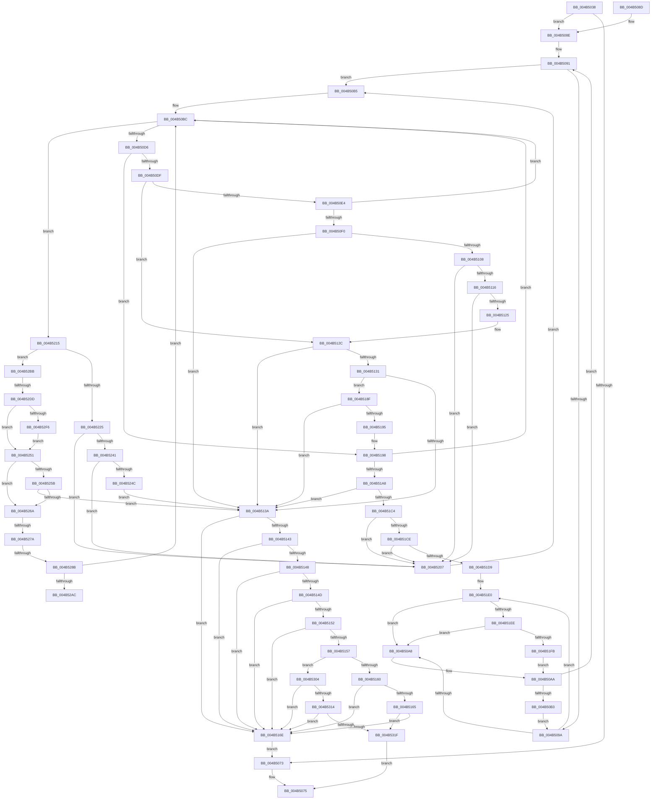

# KeTryToFreezeThreadStack

- RVA: `0x004B5038`–`0x004B532E` (길이 `758` bytes)
- VA: `0x00000001404B5038`
- 실행 섹션: `.text`
- PDB 이름 있음: `예`; PDB Function 태그: `예`
- unwind 정보 RVA: `0x000BA1A0`
- 디코드: `201`개 명령, `758/758` bytes 표시
- 미해석 바이트: `0` (있으면 어셈블리에 `.byte`로 보존)

> 이 문서는 커널 이미지의 기계어와 PDB 기호를 분석해 생성했습니다. 4번과 5번은 함수 원형과 자료형을 바이너리 사용 방식에서 추정한 C 해석이며 원본 소스 복구 결과는 아닙니다.

## 1. Dependencies

- 직접 호출 지점: **10**; 고유 호출 대상: **8**
- 직접 호출자로 확인된 함수: **1**
- RIP 상대 이미지 참조: **5**

### Outgoing calls
- `0x004B50FD` → [KiAcquirePrcbLocksForIsolationUnit](../30/KiAcquirePrcbLocksForIsolationUnit_function_0030ED60.md) (function, `0x0030ED60`)
- `0x004B5181` → [KiReleaseThreadStateLock](../21/KiReleaseThreadStateLock_function_00217910.md) (function, `0x00217910`)
- `0x004B51B5` → [KiAcquirePrcbLocksForIsolationUnit](../30/KiAcquirePrcbLocksForIsolationUnit_function_0030ED60.md) (function, `0x0030ED60`)
- `0x004B51EE` → [KiCheckVpBackingLongSpinWaitHypercall](../30/KiCheckVpBackingLongSpinWaitHypercall_function_0030F490.md) (function, `0x0030F490`)
- `0x004B51FD` → [HvlNotifyLongSpinWait](../30/HvlNotifyLongSpinWait_function_0030F460.md) (function, `0x0030F460`)
- `0x004B520B` → [KiReleasePrcbLocksForIsolationUnit](../39/KiReleasePrcbLocksForIsolationUnit_function_00399C50.md) (function, `0x00399C50`)
- `0x004B5232` → [KiAcquirePrcbLocksForIsolationUnit](../30/KiAcquirePrcbLocksForIsolationUnit_function_0030ED60.md) (function, `0x0030ED60`)
- `0x004B52B0` → [KxWaitForLockChainValid](../21/KxWaitForLockChainValid_function_00217AA0.md) (function, `0x00217AA0`)
- `0x004B52FA` → [KxWaitForLockOwnerShip](../25/KxWaitForLockOwnerShip_function_00257EB0.md) (function, `0x00257EB0`)
- `0x004B5307` → [KiIsKernelStackSwappable](../41/KiIsKernelStackSwappable_function_00415A80.md) (function, `0x00415A80`)

### Direct callers
- [sub_006DAAE6](../6D/Unknown_function_006DAAE6.md) at `0x006DAB06`

### Static image references
- `0x004B5052` → RVA `0x00FCFF00` (`CACHEALI`; read)
- `0x004B509C` → RVA `0x00FC52AC` (`ALMOSTRO`; reference)
- `0x004B50B5` → RVA `0x00FC8C40` (`ALMOSTRO`; read)
- `0x004B51E0` → RVA `0x00FC6AB8` (`ALMOSTRO`; read)
- `0x004B526A` → RVA `0x00FC6B38` (`ALMOSTRO`; read)

## 2. Other-region calls and transfers

- 다른 실행 섹션으로 향하는 call: **0**
- call이 아닌 외부 분기/꼬리 이동: **4**
  - `0x004B5274` → [sub_006FBAB6 + 0x51](../6F/Unknown_function_006FBAB6.md) (`tail-transfer`)
  - `0x004B5285` → [sub_006FBAB6 + 0x23](../6F/Unknown_function_006FBAB6.md) (`tail-transfer`)
  - `0x004B52B6` → [sub_006FBAB6 + 0x23](../6F/Unknown_function_006FBAB6.md) (`tail-transfer`)
  - `0x004B52D7` → [sub_006FBAB6](../6F/Unknown_function_006FBAB6.md) (`tail-transfer`)

## 3. Assembly (complete function range)

```asm
004B5038  48 89 5C 24 10                  mov qword ptr [rsp + 0x10], rbx
004B503D  55                              push rbp
004B503E  56                              push rsi
004B503F  57                              push rdi
004B5040  41 54                           push r12
004B5042  41 55                           push r13
004B5044  41 56                           push r14
004B5046  41 57                           push r15
004B5048  48 8B EC                        mov rbp, rsp
004B504B  48 83 EC 40                     sub rsp, 0x40
004B504F  45 33 ED                        xor r13d, r13d
004B5052  48 8D 05 A7 AE B1 00            lea rax, [rip + 0xb1aea7]
004B5059  0F 57 C0                        xorps xmm0, xmm0
004B505C  4C 8B E2                        mov r12, rdx
004B505F  48 8B D9                        mov rbx, rcx
004B5062  4C 89 6D 50                     mov qword ptr [rbp + 0x50], r13
004B5066  0F 11 45 F0                     movups xmmword ptr [rbp - 0x10], xmm0
004B506A  48 39 81 20 02 00 00            cmp qword ptr [rcx + 0x220], rax
004B5071  75 1B                           jne 0x1404b508e
004B5073  32 C0                           xor al, al
004B5075  48 8B 9C 24 88 00 00 00         mov rbx, qword ptr [rsp + 0x88]
004B507D  48 83 C4 40                     add rsp, 0x40
004B5081  41 5F                           pop r15
004B5083  41 5E                           pop r14
004B5085  41 5D                           pop r13
004B5087  41 5C                           pop r12
004B5089  5F                              pop rdi
004B508A  5E                              pop rsi
004B508B  5D                              pop rbp
004B508C  C3                              ret
004B508D  CC                              int3
004B508E  41 8B FD                        mov edi, r13d
004B5091  F0 48 0F BA 6B 40 00            lock bts qword ptr [rbx + 0x40], 0
004B5098  73 1B                           jae 0x1404b50b5
004B509A  FF C7                           inc edi
004B509C  85 3D 0A 02 B1 00               test dword ptr [rip + 0xb1020a], edi
004B50A2  0F 84 38 01 00 00               je 0x1404b51e0
004B50A8  F3 90                           pause
004B50AA  48 8B 43 40                     mov rax, qword ptr [rbx + 0x40]
004B50AE  48 85 C0                        test rax, rax
004B50B1  74 DE                           je 0x1404b5091
004B50B3  EB E5                           jmp 0x1404b509a
004B50B5  48 8D 15 84 3B B1 00            lea rdx, [rip + 0xb13b84]
004B50BC  44 0F B6 BB 84 01 00 00         movzx r15d, byte ptr [rbx + 0x184]
004B50C4  49 8B F5                        mov rsi, r13
004B50C7  41 8B CF                        mov ecx, r15d
004B50CA  49 8B FD                        mov rdi, r13
004B50CD  83 E9 01                        sub ecx, 1
004B50D0  0F 84 3F 01 00 00               je 0x1404b5215
004B50D6  83 E9 01                        sub ecx, 1
004B50D9  0F 84 B9 00 00 00               je 0x1404b5198
004B50DF  83 E9 01                        sub ecx, 1
004B50E2  75 48                           jne 0x1404b512c
004B50E4  44 8B B3 18 02 00 00            mov r14d, dword ptr [rbx + 0x218]
004B50EB  45 85 F6                        test r14d, r14d
004B50EE  78 CC                           js 0x1404b50bc
004B50F0  4A 8B 34 F2                     mov rsi, qword ptr [rdx + r14*8]
004B50F4  4C 8D 45 50                     lea r8, [rbp + 0x50]
004B50F8  48 8B CE                        mov rcx, rsi
004B50FB  33 D2                           xor edx, edx
004B50FD  E8 5E 9C E5 FF                  call 0x14030ed60
004B5102  48 3B 5E 10                     cmp rbx, qword ptr [rsi + 0x10]
004B5106  74 32                           je 0x1404b513a
004B5108  8A 83 84 01 00 00               mov al, byte ptr [rbx + 0x184]
004B510E  3C 03                           cmp al, 3
004B5110  0F 85 F1 00 00 00               jne 0x1404b5207
004B5116  8B 83 18 02 00 00               mov eax, dword ptr [rbx + 0x218]
004B511C  41 3B C6                        cmp eax, r14d
004B511F  0F 85 E2 00 00 00               jne 0x1404b5207
004B5125  B9 1E 00 00 00                  mov ecx, 0x1e
004B512A  CD 29                           int 0x29
004B512C  83 F9 02                        cmp ecx, 2
004B512F  75 09                           jne 0x1404b513a
004B5131  8A 43 70                        mov al, byte ptr [rbx + 0x70]
004B5134  24 07                           and al, 7
004B5136  3C 01                           cmp al, 1
004B5138  75 55                           jne 0x1404b518f
004B513A  41 0F B6 CF                     movzx ecx, r15b
004B513E  45 84 FF                        test r15b, r15b
004B5141  74 2B                           je 0x1404b516e
004B5143  83 E9 01                        sub ecx, 1
004B5146  74 26                           je 0x1404b516e
004B5148  83 E9 01                        sub ecx, 1
004B514B  74 21                           je 0x1404b516e
004B514D  83 E9 01                        sub ecx, 1
004B5150  74 1C                           je 0x1404b516e
004B5152  83 E9 01                        sub ecx, 1
004B5155  74 17                           je 0x1404b516e
004B5157  83 E9 01                        sub ecx, 1
004B515A  0F 84 A4 01 00 00               je 0x1404b5304
004B5160  83 E9 02                        sub ecx, 2
004B5163  74 09                           je 0x1404b516e
004B5165  83 F9 02                        cmp ecx, 2
004B5168  0F 85 B1 01 00 00               jne 0x1404b531f
004B516E  48 8D 45 F0                     lea rax, [rbp - 0x10]
004B5172  4C 8B CF                        mov r9, rdi
004B5175  4C 8D 45 50                     lea r8, [rbp + 0x50]
004B5179  48 89 44 24 20                  mov qword ptr [rsp + 0x20], rax
004B517E  48 8B D6                        mov rdx, rsi
004B5181  E8 8A 27 D6 FF                  call 0x140217910
004B5186  4C 89 6B 40                     mov qword ptr [rbx + 0x40], r13
004B518A  E9 E4 FE FF FF                  jmp 0x1404b5073
004B518F  2C 03                           sub al, 3
004B5191  3C 03                           cmp al, 3
004B5193  76 A5                           jbe 0x1404b513a
004B5195  41 B7 02                        mov r15b, 2
004B5198  44 8B B3 18 02 00 00            mov r14d, dword ptr [rbx + 0x218]
004B519F  45 85 F6                        test r14d, r14d
004B51A2  0F 88 14 FF FF FF               js 0x1404b50bc
004B51A8  4A 8B 34 F2                     mov rsi, qword ptr [rdx + r14*8]
004B51AC  4C 8D 45 50                     lea r8, [rbp + 0x50]
004B51B0  48 8B CE                        mov rcx, rsi
004B51B3  33 D2                           xor edx, edx
004B51B5  E8 A6 9B E5 FF                  call 0x14030ed60
004B51BA  48 3B 5E 08                     cmp rbx, qword ptr [rsi + 8]
004B51BE  0F 84 76 FF FF FF               je 0x1404b513a
004B51C4  8A 83 84 01 00 00               mov al, byte ptr [rbx + 0x184]
004B51CA  3C 02                           cmp al, 2
004B51CC  75 39                           jne 0x1404b5207
004B51CE  8B 83 18 02 00 00               mov eax, dword ptr [rbx + 0x218]
004B51D4  41 3B C6                        cmp eax, r14d
004B51D7  75 2E                           jne 0x1404b5207
004B51D9  B9 4A 00 00 00                  mov ecx, 0x4a
004B51DE  CD 29                           int 0x29
004B51E0  8B 05 D2 18 B1 00               mov eax, dword ptr [rip + 0xb118d2]
004B51E6  A8 40                           test al, 0x40
004B51E8  0F 84 BA FE FF FF               je 0x1404b50a8
004B51EE  E8 9D A2 E5 FF                  call 0x14030f490
004B51F3  84 C0                           test al, al
004B51F5  0F 84 AD FE FF FF               je 0x1404b50a8
004B51FB  8B CF                           mov ecx, edi
004B51FD  E8 5E A2 E5 FF                  call 0x14030f460
004B5202  E9 A3 FE FF FF                  jmp 0x1404b50aa
004B5207  48 8D 4D 50                     lea rcx, [rbp + 0x50]
004B520B  E8 40 4A EE FF                  call 0x140399c50
004B5210  E9 A0 FE FF FF                  jmp 0x1404b50b5
004B5215  44 8B B3 18 02 00 00            mov r14d, dword ptr [rbx + 0x218]
004B521C  45 85 F6                        test r14d, r14d
004B521F  0F 88 96 00 00 00               js 0x1404b52bb
004B5225  4A 8B 34 F2                     mov rsi, qword ptr [rdx + r14*8]
004B5229  4C 8D 45 50                     lea r8, [rbp + 0x50]
004B522D  48 8B CE                        mov rcx, rsi
004B5230  33 D2                           xor edx, edx
004B5232  E8 29 9B E5 FF                  call 0x14030ed60
004B5237  8A 83 84 01 00 00               mov al, byte ptr [rbx + 0x184]
004B523D  3C 01                           cmp al, 1
004B523F  75 C6                           jne 0x1404b5207
004B5241  8B 83 18 02 00 00               mov eax, dword ptr [rbx + 0x218]
004B5247  41 3B C6                        cmp eax, r14d
004B524A  75 BB                           jne 0x1404b5207
004B524C  E9 E9 FE FF FF                  jmp 0x1404b513a
004B5251  8A 83 84 01 00 00               mov al, byte ptr [rbx + 0x184]
004B5257  3C 01                           cmp al, 1
004B5259  75 0F                           jne 0x1404b526a
004B525B  8B 83 18 02 00 00               mov eax, dword ptr [rbx + 0x218]
004B5261  41 3B C6                        cmp eax, r14d
004B5264  0F 84 D0 FE FF FF               je 0x1404b513a
004B526A  F7 05 C4 18 B1 00 00 00 20 00   test dword ptr [rip + 0xb118c4], 0x200000
004B5274  0F 84 8D 68 24 00               je 0x1406fbb07
004B527A  0F 0D 4D F0                     prefetchw byte ptr [rbp - 0x10]
004B527E  48 8B 45 F0                     mov rax, qword ptr [rbp - 0x10]
004B5282  48 85 C0                        test rax, rax
004B5285  0F 85 4E 68 24 00               jne 0x1406fbad9
004B528B  48 8B 4D F8                     mov rcx, qword ptr [rbp - 8]
004B528F  48 8D 45 F0                     lea rax, [rbp - 0x10]
004B5293  F0 4C 0F B1 29                  lock cmpxchg qword ptr [rcx], r13
004B5298  48 8D 4D F0                     lea rcx, [rbp - 0x10]
004B529C  48 8D 15 9D 39 B1 00            lea rdx, [rip + 0xb1399d]
004B52A3  48 3B C1                        cmp rax, rcx
004B52A6  0F 84 10 FE FF FF               je 0x1404b50bc
004B52AC  48 8D 4D F0                     lea rcx, [rbp - 0x10]
004B52B0  E8 EB 27 D6 FF                  call 0x140217aa0
004B52B5  90                              nop
004B52B6  E9 1E 68 24 00                  jmp 0x1406fbad9
004B52BB  41 8B C6                        mov eax, r14d
004B52BE  0F BA F0 1F                     btr eax, 0x1f
004B52C2  F7 05 6C 18 B1 00 00 00 20 00   test dword ptr [rip + 0xb1186c], 0x200000
004B52CC  48 8B 04 C2                     mov rax, qword ptr [rdx + rax*8]
004B52D0  48 8B B8 48 8E 00 00            mov rdi, qword ptr [rax + 0x8e48]
004B52D7  0F 84 D9 67 24 00               je 0x1406fbab6
004B52DD  48 89 7D F8                     mov qword ptr [rbp - 8], rdi
004B52E1  48 8D 55 F0                     lea rdx, [rbp - 0x10]
004B52E5  4C 89 6D F0                     mov qword ptr [rbp - 0x10], r13
004B52E9  90                              nop
004B52EA  48 87 17                        xchg qword ptr [rdi], rdx
004B52ED  48 85 D2                        test rdx, rdx
004B52F0  0F 84 5B FF FF FF               je 0x1404b5251
004B52F6  48 8D 4D F0                     lea rcx, [rbp - 0x10]
004B52FA  E8 B1 2B DA FF                  call 0x140257eb0
004B52FF  E9 4D FF FF FF                  jmp 0x1404b5251
004B5304  48 8B CB                        mov rcx, rbx
004B5307  E8 74 07 F6 FF                  call 0x140415a80
004B530C  85 C0                           test eax, eax
004B530E  0F 84 5A FE FF FF               je 0x1404b516e
004B5314  8A 4B 71                        mov cl, byte ptr [rbx + 0x71]
004B5317  84 C9                           test cl, cl
004B5319  0F 85 4F FE FF FF               jne 0x1404b516e
004B531F  48 8B 4D 50                     mov rcx, qword ptr [rbp + 0x50]
004B5323  B0 01                           mov al, 1
004B5325  49 89 0C 24                     mov qword ptr [r12], rcx
004B5329  E9 47 FD FF FF                  jmp 0x1404b5075
```

## 4. C-style interpretation (structured pseudocode)

```c
__int64 __fastcall KeTryToFreezeThreadStack(__int64 a1, __int64 a2)
{
    __int64 result;
    __int64 v_r13;
    __int64 v_rdi;
    __int64 v_rsp;
    unsigned __int64 v_stack_m40;
    unsigned __int64 v_stack_m48;
    unsigned __int64 v_stack_p10;
    unsigned __int64 v_stack_p18;
    unsigned __int64 v_stack_p20;

    v_stack_p10 = v_rbx;
    v_rsp = (v_rsp) - (64);
    v_r13 = 0;
    v_stack_p18 = 0;
    v_stack_m48 = v_xmm0;
    if ((*(unsigned __int64 *)(a1 + 544)) != (v_rip + 11644583)) goto loc_004B508E;
loc_004B5073:
    result = 0;
loc_004B5075:
    v_rsp = (v_rsp) + (64);
    return result;
loc_004B508E:
loc_004B5091:
    if (condition_is_above_or_equal) goto loc_004B50B5;
loc_004B509A:
    v_rdi = (unsigned int)((0) + 1);
    if (((*(unsigned int *)(v_rip + 11600394)) & ((unsigned int)(v_rdi))) == 0) goto loc_004B51E0;
loc_004B50A8:
loc_004B50AA:
    if (*(unsigned __int64 *)(v_stack_p10 + 64) == 0) goto loc_004B5091;
    goto loc_004B509A;
loc_004B50B5:
loc_004B50BC:
    a1 = (unsigned int)(((unsigned int)((unsigned int)(*(unsigned __int8 *)(v_stack_p10 + 388)))) - (1));
    if (condition_is_equal) goto loc_004B5215;
    a1 = (unsigned int)((a1) - (1));
    if (condition_is_equal) goto loc_004B5198;
    a1 = (unsigned int)((a1) - (1));
    if (condition_is_not_equal) goto loc_004B512C;
    if (sign_flag) goto loc_004B50BC;
    a2 = 0;
    result = KiAcquirePrcbLocksForIsolationUnit(*(unsigned __int64 *)(v_rip + 11615108 + (unsigned int)(*(unsigned int *)(v_stack_p10 + 536)) * 8), a2, v_stack_p18, a4);
    if (v_stack_p10 == (*(unsigned __int64 *)(*(unsigned __int64 *)(v_rip + 11615108 + (unsigned int)(*(unsigned int *)(v_stack_p10 + 536)) * 8) + 16))) goto loc_004B513A;
    if (((unsigned __int8)(*(unsigned __int8 *)(v_stack_p10 + 388))) != 3) goto loc_004B5207;
    if (((unsigned int)((unsigned int)(*(unsigned int *)(v_stack_p10 + 536)))) != ((unsigned int)((unsigned int)(*(unsigned int *)(v_stack_p10 + 536))))) goto loc_004B5207;
loc_004B512C:
    if (30 != 2) goto loc_004B513A;
    result = (unsigned __int8)((*(unsigned __int8 *)(v_stack_p10 + 112)) & (7));
    if (((unsigned __int8)(result)) != 1) goto loc_004B518F;
loc_004B513A:
    if ((unsigned __int8)(*(unsigned __int8 *)(v_stack_p10 + 388)) == 0) goto loc_004B516E;
    a1 = (unsigned int)(((unsigned __int8)(*(unsigned __int8 *)(v_stack_p10 + 388))) - (1));
    if (condition_is_equal) goto loc_004B516E;
    a1 = (unsigned int)((a1) - (1));
    if (condition_is_equal) goto loc_004B516E;
    a1 = (unsigned int)((a1) - (1));
    if (condition_is_equal) goto loc_004B516E;
    a1 = (unsigned int)((a1) - (1));
    if (condition_is_equal) goto loc_004B516E;
    a1 = (unsigned int)((a1) - (1));
    if (condition_is_equal) goto loc_004B5304;
    a1 = (unsigned int)((a1) - (2));
    if (condition_is_equal) goto loc_004B516E;
    if (((unsigned int)(a1)) != 2) goto loc_004B531F;
loc_004B516E:
    v_stack_p20 = v_stack_m48;
    result = KiReleaseThreadStateLock(a1, *(unsigned __int64 *)(v_rip + 11615108 + (unsigned int)(*(unsigned int *)(v_stack_p10 + 536)) * 8), v_stack_p18, 0);
    *(unsigned __int64 *)(v_stack_p10 + 64) = 0;
    goto loc_004B5073;
loc_004B518F:
    result = (unsigned __int8)((result) - (3));
    if (((unsigned __int8)(result)) <= 3) goto loc_004B513A;
loc_004B5198:
    if (sign_flag) goto loc_004B50BC;
    a2 = 0;
    result = KiAcquirePrcbLocksForIsolationUnit(*(unsigned __int64 *)(*(unsigned __int64 *)(v_rip + 11615108 + (unsigned int)(*(unsigned int *)(v_stack_p10 + 536)) * 8) + (unsigned int)(*(unsigned int *)(v_stack_p10 + 536)) * 8), a2, v_stack_p18, 0);
    if (v_stack_p10 == (*(unsigned __int64 *)(*(unsigned __int64 *)(*(unsigned __int64 *)(v_rip + 11615108 + (unsigned int)(*(unsigned int *)(v_stack_p10 + 536)) * 8) + (unsigned int)(*(unsigned int *)(v_stack_p10 + 536)) * 8) + 8))) goto loc_004B513A;
    if (((unsigned __int8)(*(unsigned __int8 *)(v_stack_p10 + 388))) != 2) goto loc_004B5207;
    if (((unsigned int)((unsigned int)(*(unsigned int *)(v_stack_p10 + 536)))) != ((unsigned int)((unsigned int)(*(unsigned int *)(v_stack_p10 + 536))))) goto loc_004B5207;
loc_004B51E0:
    if ((((unsigned __int8)((unsigned int)(*(unsigned int *)(v_rip + 11606226)))) & (64)) == 0) goto loc_004B50A8;
    result = KiCheckVpBackingLongSpinWaitHypercall(74, a2, v_stack_p18, 0);
    if ((unsigned __int8)(result) == 0) goto loc_004B50A8;
    result = HvlNotifyLongSpinWait(0, a2, v_stack_p18, 0);
    goto loc_004B50AA;
loc_004B5207:
    result = KiReleasePrcbLocksForIsolationUnit(v_stack_p18, a2, v_stack_p18, 0);
    goto loc_004B50B5;
loc_004B5215:
    if (sign_flag) goto loc_004B52BB;
    a2 = 0;
    result = KiAcquirePrcbLocksForIsolationUnit(*(unsigned __int64 *)(a2 + (unsigned int)(*(unsigned int *)(v_stack_p10 + 536)) * 8), a2, v_stack_p18, 0);
    if (((unsigned __int8)(*(unsigned __int8 *)(v_stack_p10 + 388))) != 1) goto loc_004B5207;
    if (((unsigned int)((unsigned int)(*(unsigned int *)(v_stack_p10 + 536)))) != ((unsigned int)((unsigned int)(*(unsigned int *)(v_stack_p10 + 536))))) goto loc_004B5207;
    goto loc_004B513A;
loc_004B5251:
    if (((unsigned __int8)(*(unsigned __int8 *)(v_stack_p10 + 388))) != 1) goto loc_004B526A;
    if (((unsigned int)((unsigned int)(*(unsigned int *)(v_stack_p10 + 536)))) == ((unsigned int)((unsigned int)(*(unsigned int *)(v_stack_p10 + 536))))) goto loc_004B513A;
loc_004B526A:
    if (v_stack_m48 == v_stack_m48) goto loc_004B50BC;
    result = KxWaitForLockChainValid(v_stack_m48, v_rip + 11614621, v_stack_p18, 0);
loc_004B52BB:
    v_stack_m40 = *(unsigned __int64 *)(*(unsigned __int64 *)(v_rip + 11614621 + (unsigned int)((unsigned int)((unsigned int)(*(unsigned int *)(v_stack_p10 + 536)))) * 8) + 36424);
    v_stack_m48 = 0;
    if (v_stack_m48 == 0) goto loc_004B5251;
    result = KxWaitForLockOwnerShip(v_stack_m48, v_stack_m48, v_stack_p18, 0);
    goto loc_004B5251;
loc_004B5304:
    result = KiIsKernelStackSwappable(v_stack_p10, v_stack_m48, v_stack_p18, 0);
    if ((unsigned int)(result) == 0) goto loc_004B516E;
    if ((unsigned __int8)(*(unsigned __int8 *)(v_stack_p10 + 113)) != 0) goto loc_004B516E;
loc_004B531F:
    *(unsigned __int64 *)(a2) = v_stack_p18;
    goto loc_004B5075;
}
```

## 5. (Beta) C Style

```c
int64_t KeTryToFreezeThreadStack(void *Arg1, void *Arg2)
{
    uint8_t *arg1 = (uint8_t *)Arg1;
    uint8_t *arg2 = (uint8_t *)Arg2;

    int64_t result;
    int64_t local_r13;
    int64_t local_rdi;
    int64_t local_rsp;
    uint64_t v_stack_m40;
    uint64_t v_stack_m48;
    uint64_t v_stack_p10;
    uint64_t v_stack_p18;
    uint64_t v_stack_p20;

    v_stack_p10 = local_rbx;
    local_rsp = (local_rsp) - (64);
    local_r13 = 0;
    v_stack_p18 = 0;
    v_stack_m48 = v_xmm0;
    if ((*(uint64_t *)(arg1 + 0x220)) != (v_rip + 11644583)) goto loc_004B508E;
loc_004B5073:
    result = 0;
loc_004B5075:
    local_rsp = (local_rsp) + (64);
    return result;
loc_004B508E:
loc_004B5091:
    if (condition_is_above_or_equal) goto loc_004B50B5;
loc_004B509A:
    local_rdi = (uint32_t)((0) + 1);
    if (((*(uint32_t *)(v_rip + 0xB1020A)) & ((uint32_t)(local_rdi))) == 0) goto loc_004B51E0;
loc_004B50A8:
loc_004B50AA:
    if (*(uint64_t *)(v_stack_p10 + 0x40) == 0) goto loc_004B5091;
    goto loc_004B509A;
loc_004B50B5:
loc_004B50BC:
    Arg1 = (uint32_t)(((uint32_t)((uint32_t)(*(uint8_t *)(v_stack_p10 + 0x184)))) - (1));
    if (condition_is_equal) goto loc_004B5215;
    Arg1 = (uint32_t)((Arg1) - (1));
    if (condition_is_equal) goto loc_004B5198;
    Arg1 = (uint32_t)((Arg1) - (1));
    if (condition_is_not_equal) goto loc_004B512C;
    if (sign_flag) goto loc_004B50BC;
    Arg2 = 0;
    result = KiAcquirePrcbLocksForIsolationUnit(*(uint64_t *)(v_rip + 0xB13B84 + (uint32_t)(*(uint32_t *)(v_stack_p10 + 0x218)) * 8), Arg2, v_stack_p18, a4);
    if (v_stack_p10 == (*(uint64_t *)(*(uint64_t *)(v_rip + 0xB13B84 + (uint32_t)(*(uint32_t *)(v_stack_p10 + 0x218)) * 8) + 0x10))) goto loc_004B513A;
    if (((uint8_t)(*(uint8_t *)(v_stack_p10 + 0x184))) != 3) goto loc_004B5207;
    if (((uint32_t)((uint32_t)(*(uint32_t *)(v_stack_p10 + 0x218)))) != ((uint32_t)((uint32_t)(*(uint32_t *)(v_stack_p10 + 0x218))))) goto loc_004B5207;
loc_004B512C:
    if (30 != 2) goto loc_004B513A;
    result = (uint8_t)((*(uint8_t *)(v_stack_p10 + 0x70)) & (7));
    if (((uint8_t)(result)) != 1) goto loc_004B518F;
loc_004B513A:
    if ((uint8_t)(*(uint8_t *)(v_stack_p10 + 0x184)) == 0) goto loc_004B516E;
    Arg1 = (uint32_t)(((uint8_t)(*(uint8_t *)(v_stack_p10 + 0x184))) - (1));
    if (condition_is_equal) goto loc_004B516E;
    Arg1 = (uint32_t)((Arg1) - (1));
    if (condition_is_equal) goto loc_004B516E;
    Arg1 = (uint32_t)((Arg1) - (1));
    if (condition_is_equal) goto loc_004B516E;
    Arg1 = (uint32_t)((Arg1) - (1));
    if (condition_is_equal) goto loc_004B516E;
    Arg1 = (uint32_t)((Arg1) - (1));
    if (condition_is_equal) goto loc_004B5304;
    Arg1 = (uint32_t)((Arg1) - (2));
    if (condition_is_equal) goto loc_004B516E;
    if (((uint32_t)(Arg1)) != 2) goto loc_004B531F;
loc_004B516E:
    v_stack_p20 = v_stack_m48;
    result = KiReleaseThreadStateLock(Arg1, *(uint64_t *)(v_rip + 0xB13B84 + (uint32_t)(*(uint32_t *)(v_stack_p10 + 0x218)) * 8), v_stack_p18, 0);
    *(uint64_t *)(v_stack_p10 + 0x40) = 0;
    goto loc_004B5073;
loc_004B518F:
    result = (uint8_t)((result) - (3));
    if (((uint8_t)(result)) <= 3) goto loc_004B513A;
loc_004B5198:
    if (sign_flag) goto loc_004B50BC;
    Arg2 = 0;
    result = KiAcquirePrcbLocksForIsolationUnit(*(uint64_t *)(*(uint64_t *)(v_rip + 0xB13B84 + (uint32_t)(*(uint32_t *)(v_stack_p10 + 0x218)) * 8) + (uint32_t)(*(uint32_t *)(v_stack_p10 + 0x218)) * 8), Arg2, v_stack_p18, 0);
    if (v_stack_p10 == (*(uint64_t *)(*(uint64_t *)(*(uint64_t *)(v_rip + 0xB13B84 + (uint32_t)(*(uint32_t *)(v_stack_p10 + 0x218)) * 8) + (uint32_t)(*(uint32_t *)(v_stack_p10 + 0x218)) * 8) + 0x8))) goto loc_004B513A;
    if (((uint8_t)(*(uint8_t *)(v_stack_p10 + 0x184))) != 2) goto loc_004B5207;
    if (((uint32_t)((uint32_t)(*(uint32_t *)(v_stack_p10 + 0x218)))) != ((uint32_t)((uint32_t)(*(uint32_t *)(v_stack_p10 + 0x218))))) goto loc_004B5207;
loc_004B51E0:
    if ((((uint8_t)((uint32_t)(*(uint32_t *)(v_rip + 0xB118D2)))) & (64)) == 0) goto loc_004B50A8;
    result = KiCheckVpBackingLongSpinWaitHypercall(74, Arg2, v_stack_p18, 0);
    if ((uint8_t)(result) == 0) goto loc_004B50A8;
    result = HvlNotifyLongSpinWait(0, Arg2, v_stack_p18, 0);
    goto loc_004B50AA;
loc_004B5207:
    result = KiReleasePrcbLocksForIsolationUnit(v_stack_p18, Arg2, v_stack_p18, 0);
    goto loc_004B50B5;
loc_004B5215:
    if (sign_flag) goto loc_004B52BB;
    Arg2 = 0;
    result = KiAcquirePrcbLocksForIsolationUnit(*(uint64_t *)(arg2 + (uint32_t)(*(uint32_t *)(v_stack_p10 + 0x218)) * 8), Arg2, v_stack_p18, 0);
    if (((uint8_t)(*(uint8_t *)(v_stack_p10 + 0x184))) != 1) goto loc_004B5207;
    if (((uint32_t)((uint32_t)(*(uint32_t *)(v_stack_p10 + 0x218)))) != ((uint32_t)((uint32_t)(*(uint32_t *)(v_stack_p10 + 0x218))))) goto loc_004B5207;
    goto loc_004B513A;
loc_004B5251:
    if (((uint8_t)(*(uint8_t *)(v_stack_p10 + 0x184))) != 1) goto loc_004B526A;
    if (((uint32_t)((uint32_t)(*(uint32_t *)(v_stack_p10 + 0x218)))) == ((uint32_t)((uint32_t)(*(uint32_t *)(v_stack_p10 + 0x218))))) goto loc_004B513A;
loc_004B526A:
    if (v_stack_m48 == v_stack_m48) goto loc_004B50BC;
    result = KxWaitForLockChainValid(v_stack_m48, v_rip + 11614621, v_stack_p18, 0);
loc_004B52BB:
    v_stack_m40 = *(uint64_t *)(*(uint64_t *)(v_rip + 0xB1399D + (uint32_t)((uint32_t)((uint32_t)(*(uint32_t *)(v_stack_p10 + 0x218)))) * 8) + 0x8E48);
    v_stack_m48 = 0;
    if (v_stack_m48 == 0) goto loc_004B5251;
    result = KxWaitForLockOwnerShip(v_stack_m48, v_stack_m48, v_stack_p18, 0);
    goto loc_004B5251;
loc_004B5304:
    result = KiIsKernelStackSwappable(v_stack_p10, v_stack_m48, v_stack_p18, 0);
    if ((uint32_t)(result) == 0) goto loc_004B516E;
    if ((uint8_t)(*(uint8_t *)(v_stack_p10 + 0x71)) != 0) goto loc_004B516E;
loc_004B531F:
    *(uint64_t *)(arg2) = v_stack_p18;
    goto loc_004B5075;
}
```

### 관측된 메모리 오프셋

구조체 형식이 확인되지 않은 접근은 인자 기준의 오프셋으로만 기록했습니다.

| 기준 인자 | 오프셋 표현 | 폭 (bit) | 접근 |
|---|---:|---:|---|
| `Arg1` | `+ 0x220` | `64` | `R` |
| `Arg2` | `+ 0x0` | `64` | `W` |

## 6. Execution-region graph

[열기: 2D/3D 그래프와 함수 탐색 컨트롤 패널](../../../control-panel.html?section=text&rva=0x004B5038&view=graph)

- 2D 그래프는 위에서 아래로 흐르고, 3D 그래프는 빈 공간을 드래그해 회전합니다. Shift+드래그는 이동, 휠은 확대·축소, 함수 노드 선택은 대상 보고서 이동입니다.

### Static fallback


