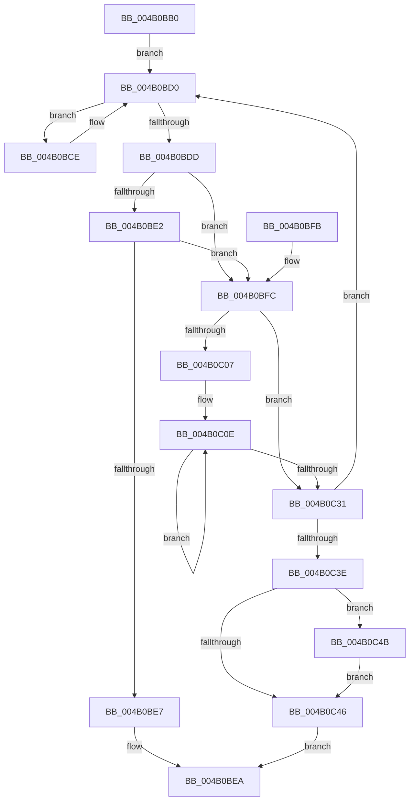

# KiComputeCpuSetAffinityMask

- RVA: `0x004B0BB0`–`0x004B0C50` (길이 `160` bytes)
- VA: `0x00000001404B0BB0`
- 실행 섹션: `.text`
- PDB 이름 있음: `예`; PDB Function 태그: `아니요`
- unwind 정보 RVA: `0x000B8B60`
- 디코드: `50`개 명령, `160/160` bytes 표시
- 미해석 바이트: `0` (있으면 어셈블리에 `.byte`로 보존)

> 이 문서는 커널 이미지의 기계어와 PDB 기호를 분석해 생성했습니다. 4번과 5번은 함수 원형과 자료형을 바이너리 사용 방식에서 추정한 C 해석이며 원본 소스 복구 결과는 아닙니다.

## 1. Dependencies

- 직접 호출 지점: **0**; 고유 호출 대상: **0**
- 직접 호출자로 확인된 함수: **1**
- RIP 상대 이미지 참조: **2**

### Outgoing calls
- 직접 디코드된 call 명령이 없습니다.

### Direct callers
- [KiIntSteerComputeCpuSet](KiIntSteerComputeCpuSet_function_004B0B24.md) at `0x004B0B53`

### Static image references
- `0x004B0BD0` → RVA `0x00FC6BF8` (`ALMOSTRO`; read)
- `0x004B0C0E` → RVA `0x00FC6E18` (`ALMOSTRO`; read)

## 2. Other-region calls and transfers

- 다른 실행 섹션으로 향하는 call: **0**
- 별도 외부 분기/꼬리 이동을 확인하지 못했습니다.

## 3. Assembly (complete function range)

```asm
004B0BB0  48 89 5C 24 10                  mov qword ptr [rsp + 0x10], rbx
004B0BB5  48 89 6C 24 18                  mov qword ptr [rsp + 0x18], rbp
004B0BBA  48 89 74 24 20                  mov qword ptr [rsp + 0x20], rsi
004B0BBF  57                              push rdi
004B0BC0  49 8B F1                        mov rsi, r9
004B0BC3  41 8B E8                        mov ebp, r8d
004B0BC6  48 8B FA                        mov rdi, rdx
004B0BC9  4C 8B D9                        mov r11, rcx
004B0BCC  EB 02                           jmp 0x1404b0bd0
004B0BCE  F3 90                           pause
004B0BD0  4C 8B 15 21 60 B1 00            mov r10, qword ptr [rip + 0xb16021]
004B0BD7  41 F6 C2 01                     test r10b, 1
004B0BDB  75 F1                           jne 0x1404b0bce
004B0BDD  4D 85 DB                        test r11, r11
004B0BE0  74 1A                           je 0x1404b0bfc
004B0BE2  4C 39 17                        cmp qword ptr [rdi], r10
004B0BE5  75 15                           jne 0x1404b0bfc
004B0BE7  49 8B 03                        mov rax, qword ptr [r11]
004B0BEA  48 8B 5C 24 18                  mov rbx, qword ptr [rsp + 0x18]
004B0BEF  48 8B 6C 24 20                  mov rbp, qword ptr [rsp + 0x20]
004B0BF4  48 8B 74 24 28                  mov rsi, qword ptr [rsp + 0x28]
004B0BF9  5F                              pop rdi
004B0BFA  C3                              ret
004B0BFB  CC                              int3
004B0BFC  45 33 C0                        xor r8d, r8d
004B0BFF  48 8B DE                        mov rbx, rsi
004B0C02  48 85 F6                        test rsi, rsi
004B0C05  74 2A                           je 0x1404b0c31
004B0C07  44 8B CD                        mov r9d, ebp
004B0C0A  41 C1 E1 06                     shl r9d, 6
004B0C0E  48 8B 05 03 62 B1 00            mov rax, qword ptr [rip + 0xb16203]
004B0C15  83 64 24 10 00                  and dword ptr [rsp + 0x10], 0
004B0C1A  48 0F BC D3                     bsf rdx, rbx
004B0C1E  41 8D 0C 11                     lea ecx, [r9 + rdx]
004B0C22  4C 0B 04 C8                     or r8, qword ptr [rax + rcx*8]
004B0C26  8B C2                           mov eax, edx
004B0C28  48 0F B3 C3                     btr rbx, rax
004B0C2C  48 85 DB                        test rbx, rbx
004B0C2F  75 DD                           jne 0x1404b0c0e
004B0C31  90                              nop
004B0C32  48 8B 05 BF 5F B1 00            mov rax, qword ptr [rip + 0xb15fbf]
004B0C39  49 3B C2                        cmp rax, r10
004B0C3C  75 92                           jne 0x1404b0bd0
004B0C3E  4C 89 17                        mov qword ptr [rdi], r10
004B0C41  4D 85 DB                        test r11, r11
004B0C44  75 05                           jne 0x1404b0c4b
004B0C46  49 8B C0                        mov rax, r8
004B0C49  EB 9F                           jmp 0x1404b0bea
004B0C4B  4D 89 03                        mov qword ptr [r11], r8
004B0C4E  EB F6                           jmp 0x1404b0c46
```

## 4. C-style interpretation (structured pseudocode)

```c
__int64 __fastcall KiComputeCpuSetAffinityMask(__int64 a1, __int64 a2, int a3, __int64 a4)
{
    unsigned __int64 v_stack_p10;
    unsigned __int64 v_stack_p18;
    unsigned __int64 v_stack_p20;

    v_stack_p10 = v_rbx;
    v_stack_p18 = v_rbp;
    v_stack_p20 = v_rsi;
    goto loc_004B0BD0;
loc_004B0BCE:
loc_004B0BD0:
    if ((((unsigned __int8)(*(unsigned __int64 *)(v_rip + 11624481))) & (1)) != 0) goto loc_004B0BCE;
    if (a1 == 0) goto loc_004B0BFC;
    if ((*(unsigned __int64 *)(a2)) != (*(unsigned __int64 *)(v_rip + 11624481))) goto loc_004B0BFC;
loc_004B0BEA:
    return *(unsigned __int64 *)(a1);
loc_004B0BFC:
    a3 = 0;
    if (v_stack_p20 == 0) goto loc_004B0C31;
    a4 = (unsigned int)(((unsigned int)((unsigned int)(v_stack_p18))) << (6));
loc_004B0C0E:
    a3 = (a3) | (*(unsigned __int64 *)(*(unsigned __int64 *)(v_rip + 11624963) + a4 + a2 * 1 * 8));
    if (v_stack_p20 != 0) goto loc_004B0C0E;
loc_004B0C31:
    if ((*(unsigned __int64 *)(v_rip + 11624383)) != (*(unsigned __int64 *)(v_rip + 11624481))) goto loc_004B0BD0;
    *(unsigned __int64 *)(a2) = *(unsigned __int64 *)(v_rip + 11624481);
    if (a1 != 0) goto loc_004B0C4B;
loc_004B0C46:
    goto loc_004B0BEA;
loc_004B0C4B:
    *(unsigned __int64 *)(a1) = a3;
    goto loc_004B0C46;
}
```

## 5. (Beta) C Style

```c
int64_t KiComputeCpuSetAffinityMask(int64_t Arg1, void *Arg2, int32_t Arg3, int64_t Arg4)
{
    uint8_t *arg2 = (uint8_t *)Arg2;

    uint64_t v_stack_p10;
    uint64_t v_stack_p18;
    uint64_t v_stack_p20;

    v_stack_p10 = local_rbx;
    v_stack_p18 = local_rbp;
    v_stack_p20 = local_rsi;
    goto loc_004B0BD0;
loc_004B0BCE:
loc_004B0BD0:
    if ((((uint8_t)(*(uint64_t *)(v_rip + 0xB16021))) & (1)) != 0) goto loc_004B0BCE;
    if (Arg1 == 0) goto loc_004B0BFC;
    if ((*(uint64_t *)(arg2)) != (*(uint64_t *)(v_rip + 0xB16021))) goto loc_004B0BFC;
loc_004B0BEA:
    return *(uint64_t *)(Arg1);
loc_004B0BFC:
    Arg3 = 0;
    if (v_stack_p20 == 0) goto loc_004B0C31;
    Arg4 = (uint32_t)(((uint32_t)((uint32_t)(v_stack_p18))) << (6));
loc_004B0C0E:
    Arg3 = (Arg3) | (*(uint64_t *)(*(uint64_t *)(v_rip + 0xB16203) + Arg4 + arg2 * 1 * 8));
    if (v_stack_p20 != 0) goto loc_004B0C0E;
loc_004B0C31:
    if ((*(uint64_t *)(v_rip + 0xB15FBF)) != (*(uint64_t *)(v_rip + 0xB16021))) goto loc_004B0BD0;
    *(uint64_t *)(arg2) = *(uint64_t *)(v_rip + 0xB16021);
    if (Arg1 != 0) goto loc_004B0C4B;
loc_004B0C46:
    goto loc_004B0BEA;
loc_004B0C4B:
    *(uint64_t *)(Arg1) = Arg3;
    goto loc_004B0C46;
}
```

### 관측된 메모리 오프셋

구조체 형식이 확인되지 않은 접근은 인자 기준의 오프셋으로만 기록했습니다.

| 기준 인자 | 오프셋 표현 | 폭 (bit) | 접근 |
|---|---:|---:|---|
| `Arg2` | `+ 0x0` | `64` | `R` |
| `Arg2` | `+ 0x0` | `64` | `W` |

## 6. Execution-region graph

[열기: 2D/3D 그래프와 함수 탐색 컨트롤 패널](../../../control-panel.html?section=text&rva=0x004B0BB0&view=graph)

- 2D 그래프는 위에서 아래로 흐르고, 3D 그래프는 빈 공간을 드래그해 회전합니다. Shift+드래그는 이동, 휠은 확대·축소, 함수 노드 선택은 대상 보고서 이동입니다.

### Static fallback


