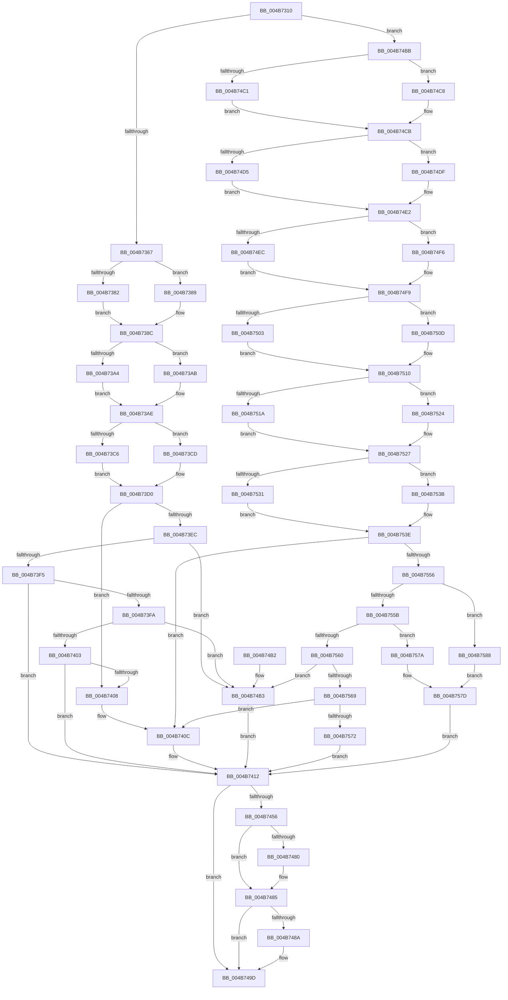

# KiComputeHeteroSet

- RVA: `0x004B7310`–`0x004B758D` (길이 `637` bytes)
- VA: `0x00000001404B7310`
- 실행 섹션: `.text`
- PDB 이름 있음: `예`; PDB Function 태그: `아니요`
- unwind 정보 RVA: `0x000BA8B4`
- 디코드: `174`개 명령, `637/637` bytes 표시
- 미해석 바이트: `0` (있으면 어셈블리에 `.byte`로 보존)

> 이 문서는 커널 이미지의 기계어와 PDB 기호를 분석해 생성했습니다. 4번과 5번은 함수 원형과 자료형을 바이너리 사용 방식에서 추정한 C 해석이며 원본 소스 복구 결과는 아닙니다.

## 1. Dependencies

- 직접 호출 지점: **2**; 고유 호출 대상: **2**
- 직접 호출자로 확인된 함수: **1**
- RIP 상대 이미지 참조: **1**

### Outgoing calls
- `0x004B73E3` → [Feature_PpmParkEx__private_IsEnabledDeviceUsageNoInline](../4F/Feature_PpmParkEx__private_IsEnabledDeviceUsageNoInline_function_004F135C.md) (function, `0x004F135C`)
- `0x004B744D` → [KeIsEmptyAffinityEx](../2D/KeIsEmptyAffinityEx_function_002D1580.md) (function, `0x002D1580`)

### Direct callers
- [KiInstallSubNodeHeteroSets](KiInstallSubNodeHeteroSets_function_004B71D4.md) at `0x004B7251`

### Static image references
- `0x004B734A` → RVA `0x00FC6C34` (`ALMOSTRO`; read)

## 2. Other-region calls and transfers

- 다른 실행 섹션으로 향하는 call: **0**
- 별도 외부 분기/꼬리 이동을 확인하지 못했습니다.

## 3. Assembly (complete function range)

```asm
004B7310  48 8B C4                        mov rax, rsp
004B7313  48 89 58 18                     mov qword ptr [rax + 0x18], rbx
004B7317  4C 89 48 20                     mov qword ptr [rax + 0x20], r9
004B731B  89 50 10                        mov dword ptr [rax + 0x10], edx
004B731E  89 48 08                        mov dword ptr [rax + 8], ecx
004B7321  55                              push rbp
004B7322  56                              push rsi
004B7323  57                              push rdi
004B7324  41 54                           push r12
004B7326  41 55                           push r13
004B7328  41 56                           push r14
004B732A  41 57                           push r15
004B732C  48 83 EC 20                     sub rsp, 0x20
004B7330  4C 8B AC 24 88 00 00 00         mov r13, qword ptr [rsp + 0x88]
004B7338  4D 8B E1                        mov r12, r9
004B733B  4C 63 CA                        movsxd r9, edx
004B733E  41 8B E8                        mov ebp, r8d
004B7341  45 0F B7 44 24 08               movzx r8d, word ptr [r12 + 8]
004B7347  45 33 F6                        xor r14d, r14d
004B734A  44 39 35 E3 F8 B0 00            cmp dword ptr [rip + 0xb0f8e3], r14d
004B7351  41 8B C6                        mov eax, r14d
004B7354  4C 8B BC 24 80 00 00 00         mov r15, qword ptr [rsp + 0x80]
004B735C  0F 95 C0                        setne al
004B735F  85 C0                           test eax, eax
004B7361  0F 84 54 01 00 00               je 0x1404b74bb
004B7367  48 63 D1                        movsxd rdx, ecx
004B736A  48 8D 42 03                     lea rax, [rdx + 3]
004B736E  49 8D 04 41                     lea rax, [r9 + rax*2]
004B7372  48 69 C8 08 01 00 00            imul rcx, rax, 0x108
004B7379  49 03 CF                        add rcx, r15
004B737C  66 44 3B 01                     cmp r8w, word ptr [rcx]
004B7380  73 07                           jae 0x1404b7389
004B7382  4E 8B 5C C1 08                  mov r11, qword ptr [rcx + r8*8 + 8]
004B7387  EB 03                           jmp 0x1404b738c
004B7389  4D 8B DE                        mov r11, r14
004B738C  48 8D 42 11                     lea rax, [rdx + 0x11]
004B7390  49 8D 04 41                     lea rax, [r9 + rax*2]
004B7394  48 69 C8 08 01 00 00            imul rcx, rax, 0x108
004B739B  49 03 CF                        add rcx, r15
004B739E  66 44 3B 01                     cmp r8w, word ptr [rcx]
004B73A2  73 07                           jae 0x1404b73ab
004B73A4  4E 8B 54 C1 08                  mov r10, qword ptr [rcx + r8*8 + 8]
004B73A9  EB 03                           jmp 0x1404b73ae
004B73AB  4D 8B D6                        mov r10, r14
004B73AE  48 8D 42 0A                     lea rax, [rdx + 0xa]
004B73B2  49 8D 04 41                     lea rax, [r9 + rax*2]
004B73B6  48 69 C8 08 01 00 00            imul rcx, rax, 0x108
004B73BD  49 03 CF                        add rcx, r15
004B73C0  66 44 3B 01                     cmp r8w, word ptr [rcx]
004B73C4  73 07                           jae 0x1404b73cd
004B73C6  4A 8B 54 C1 08                  mov rdx, qword ptr [rcx + r8*8 + 8]
004B73CB  EB 03                           jmp 0x1404b73d0
004B73CD  49 8B D6                        mov rdx, r14
004B73D0  49 8B 3C 24                     mov rdi, qword ptr [r12]
004B73D4  48 8B DF                        mov rbx, rdi
004B73D7  48 8B F7                        mov rsi, rdi
004B73DA  49 23 DB                        and rbx, r11
004B73DD  49 23 F2                        and rsi, r10
004B73E0  48 23 FA                        and rdi, rdx
004B73E3  E8 74 9F 03 00                  call 0x1404f135c
004B73E8  85 ED                           test ebp, ebp
004B73EA  74 1C                           je 0x1404b7408
004B73EC  83 ED 01                        sub ebp, 1
004B73EF  0F 84 BE 00 00 00               je 0x1404b74b3
004B73F5  83 ED 01                        sub ebp, 1
004B73F8  74 18                           je 0x1404b7412
004B73FA  83 ED 01                        sub ebp, 1
004B73FD  0F 84 B0 00 00 00               je 0x1404b74b3
004B7403  83 FD 01                        cmp ebp, 1
004B7406  74 0A                           je 0x1404b7412
004B7408  49 8B 1C 24                     mov rbx, qword ptr [r12]
004B740C  48 8B FB                        mov rdi, rbx
004B740F  48 8B F3                        mov rsi, rbx
004B7412  41 BC 08 00 00 00               mov r12d, 8
004B7418  49 8B D5                        mov rdx, r13
004B741B  49 8B CD                        mov rcx, r13
004B741E  49 8B C5                        mov rax, r13
004B7421  48 89 32                        mov qword ptr [rdx], rsi
004B7424  41 8D 6C 24 08                  lea ebp, [r12 + 8]
004B7429  49 89 3C 0C                     mov qword ptr [r12 + rcx], rdi
004B742D  48 89 1C 28                     mov qword ptr [rax + rbp], rbx
004B7431  48 63 4C 24 68                  movsxd rcx, dword ptr [rsp + 0x68]
004B7436  48 63 44 24 60                  movsxd rax, dword ptr [rsp + 0x60]
004B743B  48 83 C1 30                     add rcx, 0x30
004B743F  48 8D 04 41                     lea rax, [rcx + rax*2]
004B7443  48 69 C8 08 01 00 00            imul rcx, rax, 0x108
004B744A  49 03 CF                        add rcx, r15
004B744D  E8 2E A1 E1 FF                  call 0x1402d1580
004B7452  85 C0                           test eax, eax
004B7454  75 47                           jne 0x1404b749d
004B7456  48 63 4C 24 68                  movsxd rcx, dword ptr [rsp + 0x68]
004B745B  4C 63 4C 24 60                  movsxd r9, dword ptr [rsp + 0x60]
004B7460  48 83 C1 30                     add rcx, 0x30
004B7464  48 8B 54 24 78                  mov rdx, qword ptr [rsp + 0x78]
004B7469  4A 8D 04 49                     lea rax, [rcx + r9*2]
004B746D  0F B7 52 08                     movzx edx, word ptr [rdx + 8]
004B7471  48 69 C8 08 01 00 00            imul rcx, rax, 0x108
004B7478  49 03 CF                        add rcx, r15
004B747B  66 3B 11                        cmp dx, word ptr [rcx]
004B747E  73 05                           jae 0x1404b7485
004B7480  4C 8B 74 D1 08                  mov r14, qword ptr [rcx + rdx*8 + 8]
004B7485  49 23 DE                        and rbx, r14
004B7488  74 13                           je 0x1404b749d
004B748A  49 23 FE                        and rdi, r14
004B748D  49 89 5C 2D 00                  mov qword ptr [r13 + rbp], rbx
004B7492  49 23 F6                        and rsi, r14
004B7495  4B 89 3C 2C                     mov qword ptr [r12 + r13], rdi
004B7499  49 89 75 00                     mov qword ptr [r13], rsi
004B749D  48 8B 5C 24 70                  mov rbx, qword ptr [rsp + 0x70]
004B74A2  48 83 C4 20                     add rsp, 0x20
004B74A6  41 5F                           pop r15
004B74A8  41 5E                           pop r14
004B74AA  41 5D                           pop r13
004B74AC  41 5C                           pop r12
004B74AE  5F                              pop rdi
004B74AF  5E                              pop rsi
004B74B0  5D                              pop rbp
004B74B1  C3                              ret
004B74B2  CC                              int3
004B74B3  48 8B DF                        mov rbx, rdi
004B74B6  E9 57 FF FF FF                  jmp 0x1404b7412
004B74BB  66 45 3B 07                     cmp r8w, word ptr [r15]
004B74BF  73 07                           jae 0x1404b74c8
004B74C1  4B 8B 4C C7 08                  mov rcx, qword ptr [r15 + r8*8 + 8]
004B74C6  EB 03                           jmp 0x1404b74cb
004B74C8  49 8B CE                        mov rcx, r14
004B74CB  66 45 3B 87 08 01 00 00         cmp r8w, word ptr [r15 + 0x108]
004B74D3  73 0A                           jae 0x1404b74df
004B74D5  4B 8B 94 C7 10 01 00 00         mov rdx, qword ptr [r15 + r8*8 + 0x110]
004B74DD  EB 03                           jmp 0x1404b74e2
004B74DF  49 8B D6                        mov rdx, r14
004B74E2  66 45 3B 87 10 02 00 00         cmp r8w, word ptr [r15 + 0x210]
004B74EA  73 0A                           jae 0x1404b74f6
004B74EC  4B 8B BC C7 18 02 00 00         mov rdi, qword ptr [r15 + r8*8 + 0x218]
004B74F4  EB 03                           jmp 0x1404b74f9
004B74F6  49 8B FE                        mov rdi, r14
004B74F9  66 45 3B 87 18 03 00 00         cmp r8w, word ptr [r15 + 0x318]
004B7501  73 0A                           jae 0x1404b750d
004B7503  4B 8B B4 C7 20 03 00 00         mov rsi, qword ptr [r15 + r8*8 + 0x320]
004B750B  EB 03                           jmp 0x1404b7510
004B750D  49 8B F6                        mov rsi, r14
004B7510  66 45 3B 87 20 04 00 00         cmp r8w, word ptr [r15 + 0x420]
004B7518  73 0A                           jae 0x1404b7524
004B751A  4F 8B 94 C7 28 04 00 00         mov r10, qword ptr [r15 + r8*8 + 0x428]
004B7522  EB 03                           jmp 0x1404b7527
004B7524  4D 8B D6                        mov r10, r14
004B7527  66 45 3B 87 28 05 00 00         cmp r8w, word ptr [r15 + 0x528]
004B752F  73 0A                           jae 0x1404b753b
004B7531  4F 8B 84 C7 30 05 00 00         mov r8, qword ptr [r15 + r8*8 + 0x530]
004B7539  EB 03                           jmp 0x1404b753e
004B753B  4D 8B C6                        mov r8, r14
004B753E  49 8B 1C 24                     mov rbx, qword ptr [r12]
004B7542  48 23 CB                        and rcx, rbx
004B7545  48 23 D3                        and rdx, rbx
004B7548  48 23 FB                        and rdi, rbx
004B754B  48 23 F3                        and rsi, rbx
004B754E  85 ED                           test ebp, ebp
004B7550  0F 84 B6 FE FF FF               je 0x1404b740c
004B7556  83 ED 01                        sub ebp, 1
004B7559  74 2D                           je 0x1404b7588
004B755B  83 ED 01                        sub ebp, 1
004B755E  74 1A                           je 0x1404b757a
004B7560  83 ED 01                        sub ebp, 1
004B7563  0F 84 4A FF FF FF               je 0x1404b74b3
004B7569  83 FD 01                        cmp ebp, 1
004B756C  0F 85 9A FE FF FF               jne 0x1404b740c
004B7572  49 23 DA                        and rbx, r10
004B7575  E9 98 FE FF FF                  jmp 0x1404b7412
004B757A  49 23 D8                        and rbx, r8
004B757D  48 8B F9                        mov rdi, rcx
004B7580  48 8B F2                        mov rsi, rdx
004B7583  E9 8A FE FF FF                  jmp 0x1404b7412
004B7588  48 8B D9                        mov rbx, rcx
004B758B  EB F0                           jmp 0x1404b757d
```

## 4. C-style interpretation (structured pseudocode)

```c
__int64 __fastcall KiComputeHeteroSet(int a1, int a2, int a3, __int64 a4, __int64 a5, __int64 a6)
{
    __int64 result;
    __int64 v_r14;
    __int64 v_rbp;
    __int64 v_rbx;
    __int64 v_rdi;
    __int64 v_rsi;
    __int64 v_rsp;
    unsigned int v_stack_p10;
    unsigned __int64 v_stack_p18;
    unsigned __int64 v_stack_p20;
    unsigned int v_stack_p8;

    *(unsigned __int64 *)(v_rsp + 24) = v_rbx;
    *(unsigned __int64 *)(v_rsp + 32) = a4;
    *(unsigned int *)(v_rsp + 16) = a2;
    *(unsigned int *)(v_rsp + 8) = a1;
    v_rsp = (v_rsp) - (32);
    v_r14 = 0;
    result = ((*(unsigned int *)(v_rip + 11598051)) != 0) ? 1 : 0;
    if ((unsigned int)(result) == 0) goto loc_004B74BB;
    a1 = (a1) * ((int)(a2) + (int)(a1) + 3 * 2);
    a1 = (a1) + (a5);
    if (((unsigned __int16)(*(unsigned __int16 *)(a4 + 8))) >= (*(unsigned __int16 *)(a1))) goto loc_004B7389;
    goto loc_004B738C;
loc_004B7389:
loc_004B738C:
    a1 = (a1) * ((int)(a2) + (int)(a1) + 17 * 2);
    a1 = (a1) + (a5);
    if (((unsigned __int16)(*(unsigned __int16 *)(a4 + 8))) >= (*(unsigned __int16 *)(a1))) goto loc_004B73AB;
    goto loc_004B73AE;
loc_004B73AB:
loc_004B73AE:
    a1 = (a1) * ((int)(a2) + (int)(a1) + 10 * 2);
    a1 = (a1) + (a5);
    if (((unsigned __int16)(*(unsigned __int16 *)(a4 + 8))) >= (*(unsigned __int16 *)(a1))) goto loc_004B73CD;
    goto loc_004B73D0;
loc_004B73CD:
loc_004B73D0:
    v_rbx = (*(unsigned __int64 *)(a4)) & (0);
    v_rsi = (*(unsigned __int64 *)(a4)) & (0);
    v_rdi = (*(unsigned __int64 *)(a4)) & (0);
    result = Feature_PpmParkEx__private_IsEnabledDeviceUsageNoInline(a1, 0, *(unsigned __int16 *)(a4 + 8), (int)(a2));
    if ((unsigned int)((unsigned int)(a3)) == 0) goto loc_004B7408;
    v_rbp = (unsigned int)(((unsigned int)(a3)) - (1));
    if (condition_is_equal) goto loc_004B74B3;
    v_rbp = (unsigned int)((v_rbp) - (1));
    if (condition_is_equal) goto loc_004B7412;
    v_rbp = (unsigned int)((v_rbp) - (1));
    if (condition_is_equal) goto loc_004B74B3;
    if (((unsigned int)(v_rbp)) == 1) goto loc_004B7412;
loc_004B7408:
loc_004B740C:
loc_004B7412:
    *(unsigned __int64 *)(a6) = *(unsigned __int64 *)(a4);
    *(unsigned __int64 *)(8 + a6 * 1) = *(unsigned __int64 *)(a4);
    *(unsigned __int64 *)(a6 + 8 + 8 * 1) = *(unsigned __int64 *)(a4);
    a1 = ((int)(v_stack_p10)) + (48);
    a1 = (a1) * (a1 + (int)(v_stack_p8) * 2);
    a1 = (a1) + (a5);
    result = KeIsEmptyAffinityEx(a1, a6, *(unsigned __int16 *)(a4 + 8), (int)(a2));
    if ((unsigned int)(result) != 0) goto loc_004B749D;
    a1 = ((int)(v_stack_p10)) + (48);
    a1 = (a1) * (a1 + (int)(v_stack_p8) * 2);
    a1 = (a1) + (a5);
    if (((unsigned __int16)(*(unsigned __int16 *)(v_stack_p20 + 8))) < (*(unsigned __int16 *)(a1))) {
        v_r14 = *(unsigned __int64 *)(a1 + *(unsigned __int16 *)(v_stack_p20 + 8) * 8 + 8);
    }
    v_rbx = (*(unsigned __int64 *)(a4)) & (v_r14);
    v_rsi = *(unsigned __int64 *)(a4);
    v_rdi = *(unsigned __int64 *)(a4);
    if (!(condition_is_equal)) {
        v_rdi = (*(unsigned __int64 *)(a4)) & (v_r14);
        *(unsigned __int64 *)(a6 + 8 + 8 * 1) = v_rbx;
        v_rsi = (*(unsigned __int64 *)(a4)) & (v_r14);
        *(unsigned __int64 *)(8 + a6 * 1) = v_rdi;
        *(unsigned __int64 *)(a6) = v_rsi;
    }
    v_rsp = (v_rsp) + (32);
    return a1 + (int)(v_stack_p8) * 2;
loc_004B74B3:
    goto loc_004B7412;
loc_004B74BB:
    if (((unsigned __int16)(*(unsigned __int16 *)(a4 + 8))) >= (*(unsigned __int16 *)(a5))) goto loc_004B74C8;
    goto loc_004B74CB;
loc_004B74C8:
loc_004B74CB:
    if (((unsigned __int16)(*(unsigned __int16 *)(a4 + 8))) >= (*(unsigned __int16 *)(a5 + 264))) goto loc_004B74DF;
    goto loc_004B74E2;
loc_004B74DF:
loc_004B74E2:
    if (((unsigned __int16)(*(unsigned __int16 *)(a4 + 8))) >= (*(unsigned __int16 *)(a5 + 528))) goto loc_004B74F6;
    goto loc_004B74F9;
loc_004B74F6:
loc_004B74F9:
    if (((unsigned __int16)(*(unsigned __int16 *)(a4 + 8))) >= (*(unsigned __int16 *)(a5 + 792))) goto loc_004B750D;
    goto loc_004B7510;
loc_004B750D:
loc_004B7510:
    if (((unsigned __int16)(*(unsigned __int16 *)(a4 + 8))) >= (*(unsigned __int16 *)(a5 + 1056))) goto loc_004B7524;
    goto loc_004B7527;
loc_004B7524:
loc_004B7527:
    if (((unsigned __int16)(*(unsigned __int16 *)(a4 + 8))) >= (*(unsigned __int16 *)(a5 + 1320))) goto loc_004B753B;
    goto loc_004B753E;
loc_004B753B:
loc_004B753E:
    a1 = (v_r14) & (*(unsigned __int64 *)(8));
    a2 = (v_r14) & (*(unsigned __int64 *)(8));
    v_rdi = (v_r14) & (*(unsigned __int64 *)(8));
    v_rsi = (v_r14) & (*(unsigned __int64 *)(8));
    if ((unsigned int)(8 + 8) == 0) goto loc_004B740C;
    v_rbp = (unsigned int)((8 + 8) - (1));
    if (condition_is_equal) goto loc_004B7588;
    v_rbp = (unsigned int)((v_rbp) - (1));
    if (condition_is_equal) goto loc_004B757A;
    v_rbp = (unsigned int)((v_rbp) - (1));
    if (condition_is_equal) goto loc_004B74B3;
    if (((unsigned int)(v_rbp)) != 1) goto loc_004B740C;
    v_rbx = (*(unsigned __int64 *)(8)) & (v_r14);
    goto loc_004B7412;
loc_004B757A:
    v_rbx = (v_rbx) & (v_r14);
loc_004B757D:
    goto loc_004B7412;
loc_004B7588:
    goto loc_004B757D;
}
```

## 5. (Beta) C Style

```c
int64_t KiComputeHeteroSet(void *Arg1, void *Arg2, int32_t Arg3, void *Arg4, void *Arg5, void *Arg6)
{
    uint8_t *arg1 = (uint8_t *)Arg1;
    uint8_t *arg2 = (uint8_t *)Arg2;
    uint8_t *arg4 = (uint8_t *)Arg4;
    uint8_t *arg5 = (uint8_t *)Arg5;
    uint8_t *arg6 = (uint8_t *)Arg6;

    int64_t result;
    int64_t local_r14;
    int64_t local_rbp;
    int64_t local_rbx;
    int64_t local_rdi;
    int64_t local_rsi;
    int64_t local_rsp;
    uint32_t v_stack_p10;
    uint64_t v_stack_p18;
    uint64_t v_stack_p20;
    uint32_t v_stack_p8;

    *(uint64_t *)(local_rsp + 0x18) = local_rbx;
    *(void **)(local_rsp + 0x20) = Arg4;
    *(uint32_t *)(local_rsp + 0x10) = Arg2;
    *(uint32_t *)(local_rsp + 0x8) = Arg1;
    local_rsp = (local_rsp) - (32);
    local_r14 = 0;
    result = ((*(uint32_t *)(v_rip + 0xB0F8E3)) != 0) ? 1 : 0;
    if ((uint32_t)(result) == 0) goto loc_004B74BB;
    Arg1 = (Arg1) * ((int32_t)(Arg2) + (int32_t)(Arg1) + 3 * 2);
    Arg1 = (Arg1) + (Arg5);
    if (((uint16_t)(*(uint16_t *)(arg4 + 0x8))) >= (*(uint16_t *)(arg1))) goto loc_004B7389;
    goto loc_004B738C;
loc_004B7389:
loc_004B738C:
    Arg1 = (Arg1) * ((int32_t)(Arg2) + (int32_t)(Arg1) + 17 * 2);
    Arg1 = (Arg1) + (Arg5);
    if (((uint16_t)(*(uint16_t *)(arg4 + 0x8))) >= (*(uint16_t *)(arg1))) goto loc_004B73AB;
    goto loc_004B73AE;
loc_004B73AB:
loc_004B73AE:
    Arg1 = (Arg1) * ((int32_t)(Arg2) + (int32_t)(Arg1) + 10 * 2);
    Arg1 = (Arg1) + (Arg5);
    if (((uint16_t)(*(uint16_t *)(arg4 + 0x8))) >= (*(uint16_t *)(arg1))) goto loc_004B73CD;
    goto loc_004B73D0;
loc_004B73CD:
loc_004B73D0:
    local_rbx = (*(uint64_t *)(arg4)) & (0);
    local_rsi = (*(uint64_t *)(arg4)) & (0);
    local_rdi = (*(uint64_t *)(arg4)) & (0);
    result = Feature_PpmParkEx__private_IsEnabledDeviceUsageNoInline(Arg1, 0, *(uint16_t *)(arg4 + 0x8), (int32_t)(Arg2));
    if ((uint32_t)((uint32_t)(Arg3)) == 0) goto loc_004B7408;
    local_rbp = (uint32_t)(((uint32_t)(Arg3)) - (1));
    if (condition_is_equal) goto loc_004B74B3;
    local_rbp = (uint32_t)((local_rbp) - (1));
    if (condition_is_equal) goto loc_004B7412;
    local_rbp = (uint32_t)((local_rbp) - (1));
    if (condition_is_equal) goto loc_004B74B3;
    if (((uint32_t)(local_rbp)) == 1) goto loc_004B7412;
loc_004B7408:
loc_004B740C:
loc_004B7412:
    *(uint64_t *)(arg6) = *(uint64_t *)(arg4);
    *(uint64_t *)(8 + arg6 * 1) = *(uint64_t *)(arg4);
    *(uint64_t *)(arg6 + 0x8 + 0x8 * 1) = *(uint64_t *)(arg4);
    Arg1 = ((int32_t)(v_stack_p10)) + (48);
    Arg1 = (Arg1) * (Arg1 + (int32_t)(v_stack_p8) * 2);
    Arg1 = (Arg1) + (Arg5);
    result = KeIsEmptyAffinityEx(Arg1, Arg6, *(uint16_t *)(arg4 + 0x8), (int32_t)(Arg2));
    if ((uint32_t)(result) != 0) goto loc_004B749D;
    Arg1 = ((int32_t)(v_stack_p10)) + (48);
    Arg1 = (Arg1) * (Arg1 + (int32_t)(v_stack_p8) * 2);
    Arg1 = (Arg1) + (Arg5);
    if (((uint16_t)(*(uint16_t *)(v_stack_p20 + 0x8))) < (*(uint16_t *)(arg1))) {
        local_r14 = *(uint64_t *)(arg1 + *(uint16_t *)(v_stack_p20 + 0x8) * 8 + 0x8);
    }
    local_rbx = (*(uint64_t *)(arg4)) & (local_r14);
    local_rsi = *(uint64_t *)(arg4);
    local_rdi = *(uint64_t *)(arg4);
    if (!(condition_is_equal)) {
        local_rdi = (*(uint64_t *)(arg4)) & (local_r14);
        *(uint64_t *)(arg6 + 0x8 + 0x8 * 1) = local_rbx;
        local_rsi = (*(uint64_t *)(arg4)) & (local_r14);
        *(uint64_t *)(8 + arg6 * 1) = local_rdi;
        *(uint64_t *)(arg6) = local_rsi;
    }
    local_rsp = (local_rsp) + (32);
    return Arg1 + (int32_t)(v_stack_p8) * 2;
loc_004B74B3:
    goto loc_004B7412;
loc_004B74BB:
    if (((uint16_t)(*(uint16_t *)(arg4 + 0x8))) >= (*(uint16_t *)(arg5))) goto loc_004B74C8;
    goto loc_004B74CB;
loc_004B74C8:
loc_004B74CB:
    if (((uint16_t)(*(uint16_t *)(arg4 + 0x8))) >= (*(uint16_t *)(arg5 + 0x108))) goto loc_004B74DF;
    goto loc_004B74E2;
loc_004B74DF:
loc_004B74E2:
    if (((uint16_t)(*(uint16_t *)(arg4 + 0x8))) >= (*(uint16_t *)(arg5 + 0x210))) goto loc_004B74F6;
    goto loc_004B74F9;
loc_004B74F6:
loc_004B74F9:
    if (((uint16_t)(*(uint16_t *)(arg4 + 0x8))) >= (*(uint16_t *)(arg5 + 0x318))) goto loc_004B750D;
    goto loc_004B7510;
loc_004B750D:
loc_004B7510:
    if (((uint16_t)(*(uint16_t *)(arg4 + 0x8))) >= (*(uint16_t *)(arg5 + 0x420))) goto loc_004B7524;
    goto loc_004B7527;
loc_004B7524:
loc_004B7527:
    if (((uint16_t)(*(uint16_t *)(arg4 + 0x8))) >= (*(uint16_t *)(arg5 + 0x528))) goto loc_004B753B;
    goto loc_004B753E;
loc_004B753B:
loc_004B753E:
    Arg1 = (local_r14) & (*(uint64_t *)(8));
    Arg2 = (local_r14) & (*(uint64_t *)(8));
    local_rdi = (local_r14) & (*(uint64_t *)(8));
    local_rsi = (local_r14) & (*(uint64_t *)(8));
    if ((uint32_t)(8 + 8) == 0) goto loc_004B740C;
    local_rbp = (uint32_t)((8 + 8) - (1));
    if (condition_is_equal) goto loc_004B7588;
    local_rbp = (uint32_t)((local_rbp) - (1));
    if (condition_is_equal) goto loc_004B757A;
    local_rbp = (uint32_t)((local_rbp) - (1));
    if (condition_is_equal) goto loc_004B74B3;
    if (((uint32_t)(local_rbp)) != 1) goto loc_004B740C;
    local_rbx = (*(uint64_t *)(8)) & (local_r14);
    goto loc_004B7412;
loc_004B757A:
    local_rbx = (local_rbx) & (local_r14);
loc_004B757D:
    goto loc_004B7412;
loc_004B7588:
    goto loc_004B757D;
}
```

### 관측된 메모리 오프셋

구조체 형식이 확인되지 않은 접근은 인자 기준의 오프셋으로만 기록했습니다.

| 기준 인자 | 오프셋 표현 | 폭 (bit) | 접근 |
|---|---:|---:|---|
| `Arg1` | `+ 0x0` | `16` | `R` |
| `Arg1` | `+ 0x3` | `64` | `R` |
| `Arg1` | `+ 0x8 + r8*8` | `64` | `R` |
| `Arg1` | `+ 0xA` | `64` | `R` |
| `Arg1` | `+ 0x11` | `64` | `R` |
| `Arg2` | `+ 0x0 + rax*2` | `64` | `R` |
| `Arg4` | `+ 0x0` | `64` | `R` |
| `Arg4` | `+ 0x8` | `16` | `R` |
| `Arg5` | `+ 0x0` | `16` | `R` |
| `Arg5` | `+ 0x8 + r8*8` | `64` | `R` |
| `Arg5` | `+ 0x108` | `16` | `R` |
| `Arg5` | `+ 0x110 + r8*8` | `64` | `R` |
| `Arg5` | `+ 0x210` | `16` | `R` |
| `Arg5` | `+ 0x218 + r8*8` | `64` | `R` |
| `Arg5` | `+ 0x318` | `16` | `R` |
| `Arg5` | `+ 0x320 + r8*8` | `64` | `R` |
| `Arg5` | `+ 0x420` | `16` | `R` |
| `Arg5` | `+ 0x428 + r8*8` | `64` | `R` |
| `Arg5` | `+ 0x528` | `16` | `R` |
| `Arg5` | `+ 0x530 + r8*8` | `64` | `R` |
| `Arg6` | `+ 0x0` | `64` | `W` |
| `Arg6` | `+ 0x0 + rbp*1` | `64` | `W` |

## 6. Execution-region graph

[열기: 2D/3D 그래프와 함수 탐색 컨트롤 패널](../../../control-panel.html?section=text&rva=0x004B7310&view=graph)

- 2D 그래프는 위에서 아래로 흐르고, 3D 그래프는 빈 공간을 드래그해 회전합니다. Shift+드래그는 이동, 휠은 확대·축소, 함수 노드 선택은 대상 보고서 이동입니다.

### Static fallback


