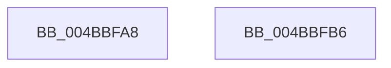

# KiComputeProcessAutoBoostTreeCount

- RVA: `0x004BBFA8`–`0x004BBFB7` (길이 `15` bytes)
- VA: `0x00000001404BBFA8`
- 실행 섹션: `.text`
- PDB 이름 있음: `예`; PDB Function 태그: `아니요`
- unwind 정보 RVA: `0x000DB714`
- 디코드: `6`개 명령, `15/15` bytes 표시
- 미해석 바이트: `0` (있으면 어셈블리에 `.byte`로 보존)

> 이 문서는 커널 이미지의 기계어와 PDB 기호를 분석해 생성했습니다. 4번과 5번은 함수 원형과 자료형을 바이너리 사용 방식에서 추정한 C 해석이며 원본 소스 복구 결과는 아닙니다.

## 1. Dependencies

- 직접 호출 지점: **0**; 고유 호출 대상: **0**
- 직접 호출자로 확인된 함수: **1**
- RIP 상대 이미지 참조: **1**

### Outgoing calls
- 직접 디코드된 call 명령이 없습니다.

### Direct callers
- [KeInitializeProcess](../../page/A6/KeInitializeProcess_function_00A63CF4.md) at `0x00A64080`

### Static image references
- `0x004BBFA8` → RVA `0x00FC6AE8` (`ALMOSTRO`; read)

## 2. Other-region calls and transfers

- 다른 실행 섹션으로 향하는 call: **0**
- 별도 외부 분기/꼬리 이동을 확인하지 못했습니다.

## 3. Assembly (complete function range)

```asm
004BBFA8  8B 05 3A AB B0 00               mov eax, dword ptr [rip + 0xb0ab3a]
004BBFAE  FF C8                           dec eax
004BBFB0  C1 E8 03                        shr eax, 3
004BBFB3  FF C0                           inc eax
004BBFB5  C3                              ret
004BBFB6  CC                              int3
```

## 4. C-style interpretation (structured pseudocode)

```c
__int64 __fastcall KiComputeProcessAutoBoostTreeCount(void)
{
    __int64 result;

    result = (unsigned int)(((unsigned int)(*(unsigned int *)(v_rip + 11578170))) - 1);
    result = (unsigned int)((result) >> (3));
    result = (unsigned int)((result) + 1);
    return result;
}
```

## 5. (Beta) C Style

```c
void KiComputeProcessAutoBoostTreeCount(void)
{
    int64_t result;

    result = (uint32_t)(((uint32_t)(*(uint32_t *)(v_rip + 0xB0AB3A))) - 1);
    result = (uint32_t)((result) >> (3));
    result = (uint32_t)((result) + 1);
    return result;
}
```

## 6. Execution-region graph

[열기: 2D/3D 그래프와 함수 탐색 컨트롤 패널](../../../control-panel.html?section=text&rva=0x004BBFA8&view=graph)

- 2D 그래프는 위에서 아래로 흐르고, 3D 그래프는 빈 공간을 드래그해 회전합니다. Shift+드래그는 이동, 휠은 확대·축소, 함수 노드 선택은 대상 보고서 이동입니다.

### Static fallback


