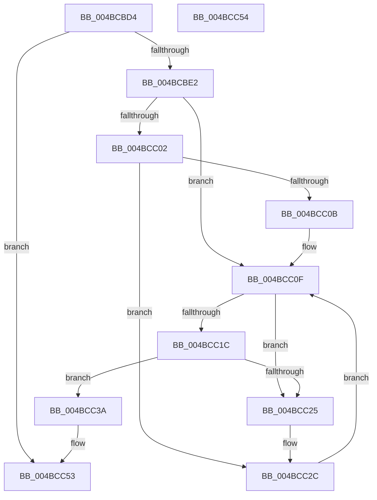

# KiDisconnectSecondaryInterruptInternal

- RVA: `0x004BCBD4`–`0x004BCC55` (길이 `129` bytes)
- VA: `0x00000001404BCBD4`
- 실행 섹션: `.text`
- PDB 이름 있음: `예`; PDB Function 태그: `아니요`
- unwind 정보 RVA: `0x000DB714`
- 디코드: `38`개 명령, `129/129` bytes 표시
- 미해석 바이트: `0` (있으면 어셈블리에 `.byte`로 보존)

> 이 문서는 커널 이미지의 기계어와 PDB 기호를 분석해 생성했습니다. 4번과 5번은 함수 원형과 자료형을 바이너리 사용 방식에서 추정한 C 해석이며 원본 소스 복구 결과는 아닙니다.

## 1. Dependencies

- 직접 호출 지점: **0**; 고유 호출 대상: **0**
- 직접 호출자로 확인된 함수: **3**
- RIP 상대 이미지 참조: **1**

### Outgoing calls
- 직접 디코드된 call 명령이 없습니다.

### Direct callers
- [KiDisconnectInterruptCommon](../2D/KiDisconnectInterruptCommon_function_002D36A8.md) at `0x002D3888`
- [sub_006E61FC](../6E/Unknown_function_006E61FC.md) at `0x006E61FC`
- [sub_006E622C](../6E/Unknown_function_006E622C.md) at `0x006E622C`

### Static image references
- `0x004BCBF2` → RVA `0x00F11028` (`.data`; read)

## 2. Other-region calls and transfers

- 다른 실행 섹션으로 향하는 call: **0**
- 별도 외부 분기/꼬리 이동을 확인하지 못했습니다.

## 3. Assembly (complete function range)

```asm
004BCBD4  45 33 D2                        xor r10d, r10d
004BCBD7  B8 EF 00 00 C0                  mov eax, 0xc00000ef
004BCBDC  44 38 51 5F                     cmp byte ptr [rcx + 0x5f], r10b
004BCBE0  74 71                           je 0x1404bcc53
004BCBE2  8B 41 58                        mov eax, dword ptr [rcx + 0x58]
004BCBE5  2D 00 01 00 00                  sub eax, 0x100
004BCBEA  48 8D 14 40                     lea rdx, [rax + rax*2]
004BCBEE  48 C1 E2 04                     shl rdx, 4
004BCBF2  48 03 15 2F 44 A5 00            add rdx, qword ptr [rip + 0xa5442f]
004BCBF9  48 8B 42 28                     mov rax, qword ptr [rdx + 0x28]
004BCBFD  48 3B C1                        cmp rax, rcx
004BCC00  75 0D                           jne 0x1404bcc0f
004BCC02  48 83 C0 08                     add rax, 8
004BCC06  48 39 00                        cmp qword ptr [rax], rax
004BCC09  75 21                           jne 0x1404bcc2c
004BCC0B  4C 89 52 28                     mov qword ptr [rdx + 0x28], r10
004BCC0F  48 8D 41 08                     lea rax, [rcx + 8]
004BCC13  4C 8B 08                        mov r9, qword ptr [rax]
004BCC16  49 39 41 08                     cmp qword ptr [r9 + 8], rax
004BCC1A  75 09                           jne 0x1404bcc25
004BCC1C  4C 8B 40 08                     mov r8, qword ptr [rax + 8]
004BCC20  49 39 00                        cmp qword ptr [r8], rax
004BCC23  74 15                           je 0x1404bcc3a
004BCC25  B9 03 00 00 00                  mov ecx, 3
004BCC2A  CD 29                           int 0x29
004BCC2C  48 8B 41 08                     mov rax, qword ptr [rcx + 8]
004BCC30  48 83 E8 08                     sub rax, 8
004BCC34  48 89 42 28                     mov qword ptr [rdx + 0x28], rax
004BCC38  EB D5                           jmp 0x1404bcc0f
004BCC3A  4D 89 08                        mov qword ptr [r8], r9
004BCC3D  4D 89 41 08                     mov qword ptr [r9 + 8], r8
004BCC41  48 8B 42 28                     mov rax, qword ptr [rdx + 0x28]
004BCC45  48 F7 D8                        neg rax
004BCC48  44 88 51 5F                     mov byte ptr [rcx + 0x5f], r10b
004BCC4C  1B C0                           sbb eax, eax
004BCC4E  25 28 01 00 00                  and eax, 0x128
004BCC53  C3                              ret
004BCC54  CC                              int3
```

## 4. C-style interpretation (structured pseudocode)

```c
__int64 __fastcall KiDisconnectSecondaryInterruptInternal(__int64 a1)
{
    __int64 result;
    __int64 v_r10;

    v_r10 = 0;
    if ((*(unsigned __int8 *)(a1 + 95)) == 0) goto loc_004BCC53;
    result = (unsigned int)(((unsigned int)(*(unsigned int *)(a1 + 88))) - (256));
    a2 = (result + result * 2) << (4);
    a2 = (a2) + (*(unsigned __int64 *)(v_rip + 10830895));
    if ((*(unsigned __int64 *)(a2 + 40)) != a1) goto loc_004BCC0F;
    result = (*(unsigned __int64 *)(a2 + 40)) + (8);
    if ((*(unsigned __int64 *)(result)) != result) goto loc_004BCC2C;
    *(unsigned __int64 *)(a2 + 40) = 0;
loc_004BCC0F:
    if ((*(unsigned __int64 *)(*(unsigned __int64 *)(a1 + 8) + 8)) != (a1 + 8)) goto loc_004BCC25;
    if ((*(unsigned __int64 *)(*(unsigned __int64 *)(a1 + 8 + 8))) == (a1 + 8)) goto loc_004BCC3A;
loc_004BCC25:
loc_004BCC2C:
    result = (*(unsigned __int64 *)(3 + 8)) - (8);
    *(unsigned __int64 *)(a2 + 40) = result;
    goto loc_004BCC0F;
loc_004BCC3A:
    *(unsigned __int64 *)(*(unsigned __int64 *)(a1 + 8 + 8)) = *(unsigned __int64 *)(a1 + 8);
    *(unsigned __int64 *)(*(unsigned __int64 *)(a1 + 8) + 8) = *(unsigned __int64 *)(a1 + 8 + 8);
    result = -(*(unsigned __int64 *)(a2 + 40));
    *(unsigned __int8 *)(3 + 95) = 0;
    result = (unsigned int)((result) & (296));
loc_004BCC53:
    return result;
}
```

## 5. (Beta) C Style

```c
int64_t KiDisconnectSecondaryInterruptInternal(void *Arg1)
{
    uint8_t *arg1 = (uint8_t *)Arg1;

    int64_t result;
    int64_t local_r10;

    local_r10 = 0;
    if ((*(uint8_t *)(arg1 + 0x5F)) == 0) goto loc_004BCC53;
    result = (uint32_t)(((uint32_t)(*(uint32_t *)(arg1 + 0x58))) - (256));
    a2 = (result + result * 2) << (4);
    a2 = (a2) + (*(uint64_t *)(v_rip + 0xA5442F));
    if ((*(uint64_t *)(a2 + 0x28)) != Arg1) goto loc_004BCC0F;
    result = (*(uint64_t *)(a2 + 0x28)) + (8);
    if ((*(uint64_t *)(result)) != result) goto loc_004BCC2C;
    *(uint64_t *)(a2 + 0x28) = 0;
loc_004BCC0F:
    if ((*(uint64_t *)(*(uint64_t *)(arg1 + 0x8) + 0x8)) != (Arg1 + 8)) goto loc_004BCC25;
    if ((*(uint64_t *)(*(uint64_t *)(arg1 + 0x8 + 0x8))) == (Arg1 + 8)) goto loc_004BCC3A;
loc_004BCC25:
loc_004BCC2C:
    result = (*(uint64_t *)(3 + 0x8)) - (8);
    *(uint64_t *)(a2 + 0x28) = result;
    goto loc_004BCC0F;
loc_004BCC3A:
    *(uint64_t *)(*(uint64_t *)(arg1 + 0x8 + 0x8)) = *(uint64_t *)(arg1 + 0x8);
    *(uint64_t *)(*(uint64_t *)(arg1 + 0x8) + 0x8) = *(uint64_t *)(arg1 + 0x8 + 0x8);
    result = -(*(uint64_t *)(a2 + 0x28));
    *(uint8_t *)(3 + 0x5F) = 0;
    result = (uint32_t)((result) & (296));
loc_004BCC53:
    return result;
}
```

### 관측된 메모리 오프셋

구조체 형식이 확인되지 않은 접근은 인자 기준의 오프셋으로만 기록했습니다.

| 기준 인자 | 오프셋 표현 | 폭 (bit) | 접근 |
|---|---:|---:|---|
| `Arg1` | `+ 0x58` | `32` | `R` |
| `Arg1` | `+ 0x5F` | `8` | `R` |

## 6. Execution-region graph

[열기: 2D/3D 그래프와 함수 탐색 컨트롤 패널](../../../control-panel.html?section=text&rva=0x004BCBD4&view=graph)

- 2D 그래프는 위에서 아래로 흐르고, 3D 그래프는 빈 공간을 드래그해 회전합니다. Shift+드래그는 이동, 휠은 확대·축소, 함수 노드 선택은 대상 보고서 이동입니다.

### Static fallback


