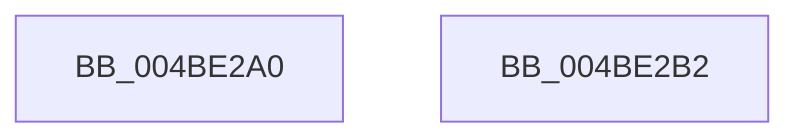

# KiGetCpuSetData

- RVA: `0x004BE2A0`–`0x004BE2B3` (길이 `19` bytes)
- VA: `0x00000001404BE2A0`
- 실행 섹션: `.text`
- PDB 이름 있음: `예`; PDB Function 태그: `아니요`
- unwind 정보 RVA: `0x000DB714`
- 디코드: `6`개 명령, `19/19` bytes 표시
- 미해석 바이트: `0` (있으면 어셈블리에 `.byte`로 보존)

> 이 문서는 커널 이미지의 기계어와 PDB 기호를 분석해 생성했습니다. 4번과 5번은 함수 원형과 자료형을 바이너리 사용 방식에서 추정한 C 해석이며 원본 소스 복구 결과는 아닙니다.

## 1. Dependencies

- 직접 호출 지점: **0**; 고유 호출 대상: **0**
- 직접 호출자로 확인된 함수: **1**
- RIP 상대 이미지 참조: **1**

### Outgoing calls
- 직접 디코드된 call 명령이 없습니다.

### Direct callers
- [KeQueryCpuSetInformation](../../page/A8/KeQueryCpuSetInformation_function_00A8ED54.md) at `0x00A8EE1F`

### Static image references
- `0x004BE2AA` → RVA `0x00FC72F8` (`ALMOSTRO`; read)

## 2. Other-region calls and transfers

- 다른 실행 섹션으로 향하는 call: **0**
- 별도 외부 분기/꼬리 이동을 확인하지 못했습니다.

## 3. Assembly (complete function range)

```asm
004BE2A0  C1 E1 06                        shl ecx, 6
004BE2A3  8D 04 0A                        lea eax, [rdx + rcx]
004BE2A6  48 C1 E0 04                     shl rax, 4
004BE2AA  48 03 05 47 90 B0 00            add rax, qword ptr [rip + 0xb09047]
004BE2B1  C3                              ret
004BE2B2  CC                              int3
```

## 4. C-style interpretation (structured pseudocode)

```c
__int64 __fastcall KiGetCpuSetData(int a1, __int64 a2)
{
    __int64 result;

    a1 = (unsigned int)((a1) << (6));
    result = (a2 + a1 * 1) << (4);
    result = (result) + (*(unsigned __int64 *)(v_rip + 11571271));
    return result;
}
```

## 5. (Beta) C Style

```c
int64_t KiGetCpuSetData(int32_t Arg1, void *Arg2)
{
    uint8_t *arg2 = (uint8_t *)Arg2;

    int64_t result;

    Arg1 = (uint32_t)((Arg1) << (6));
    result = (Arg2 + Arg1 * 1) << (4);
    result = (result) + (*(uint64_t *)(v_rip + 0xB09047));
    return result;
}
```

### 관측된 메모리 오프셋

구조체 형식이 확인되지 않은 접근은 인자 기준의 오프셋으로만 기록했습니다.

| 기준 인자 | 오프셋 표현 | 폭 (bit) | 접근 |
|---|---:|---:|---|
| `Arg2` | `+ 0x0 + rcx*1` | `32` | `R` |

## 6. Execution-region graph

[열기: 2D/3D 그래프와 함수 탐색 컨트롤 패널](../../../control-panel.html?section=text&rva=0x004BE2A0&view=graph)

- 2D 그래프는 위에서 아래로 흐르고, 3D 그래프는 빈 공간을 드래그해 회전합니다. Shift+드래그는 이동, 휠은 확대·축소, 함수 노드 선택은 대상 보고서 이동입니다.

### Static fallback


