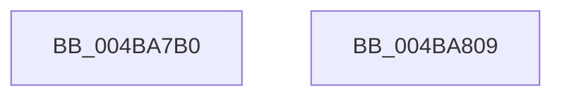

# KiInitializeIdealProcessorAssignmentBlock

- RVA: `0x004BA7B0`–`0x004BA80A` (길이 `90` bytes)
- VA: `0x00000001404BA7B0`
- 실행 섹션: `.text`
- PDB 이름 있음: `예`; PDB Function 태그: `아니요`
- unwind 정보 RVA: `0x0005CF00`
- 디코드: `23`개 명령, `90/90` bytes 표시
- 미해석 바이트: `0` (있으면 어셈블리에 `.byte`로 보존)

> 이 문서는 커널 이미지의 기계어와 PDB 기호를 분석해 생성했습니다. 4번과 5번은 함수 원형과 자료형을 바이너리 사용 방식에서 추정한 C 해석이며 원본 소스 복구 결과는 아닙니다.

## 1. Dependencies

- 직접 호출 지점: **2**; 고유 호출 대상: **1**
- 직접 호출자로 확인된 함수: **1**
- RIP 상대 이미지 참조: **0**

### Outgoing calls
- `0x004BA7C1` → [memset](../6C/memset_function_006C6C40.md) (function, `0x006C6C40`)
- `0x004BA7E6` → [memset](../6C/memset_function_006C6C40.md) (function, `0x006C6C40`)

### Direct callers
- [KeInitializeProcess](../../page/A6/KeInitializeProcess_function_00A63CF4.md) at `0x00A63E3C`

### Static image references
- 디코드된 RIP-relative 메모리 참조가 없습니다.

## 2. Other-region calls and transfers

- 다른 실행 섹션으로 향하는 call: **0**
- 별도 외부 분기/꼬리 이동을 확인하지 못했습니다.

## 3. Assembly (complete function range)

```asm
004BA7B0  40 53                           push rbx
004BA7B2  48 83 EC 20                     sub rsp, 0x20
004BA7B6  33 D2                           xor edx, edx
004BA7B8  41 B8 D8 01 00 00               mov r8d, 0x1d8
004BA7BE  48 8B D9                        mov rbx, rcx
004BA7C1  E8 7A C4 20 00                  call 0x1406c6c40
004BA7C6  83 A3 D4 00 00 00 00            and dword ptr [rbx + 0xd4], 0
004BA7CD  48 8D 8B D8 00 00 00            lea rcx, [rbx + 0xd8]
004BA7D4  33 D2                           xor edx, edx
004BA7D6  C7 83 D0 00 00 00 20 00 20 00   mov dword ptr [rbx + 0xd0], 0x200020
004BA7E0  41 B8 00 01 00 00               mov r8d, 0x100
004BA7E6  E8 55 C4 20 00                  call 0x1406c6c40
004BA7EB  33 C0                           xor eax, eax
004BA7ED  48 89 43 04                     mov qword ptr [rbx + 4], rax
004BA7F1  8B 43 08                        mov eax, dword ptr [rbx + 8]
004BA7F4  25 FF FF 03 00                  and eax, 0x3ffff
004BA7F9  0D 00 00 04 20                  or eax, 0x20040000
004BA7FE  FF C8                           dec eax
004BA800  89 43 08                        mov dword ptr [rbx + 8], eax
004BA803  48 83 C4 20                     add rsp, 0x20
004BA807  5B                              pop rbx
004BA808  C3                              ret
004BA809  CC                              int3
```

## 4. C-style interpretation (structured pseudocode)

```c
__int64 __fastcall KiInitializeIdealProcessorAssignmentBlock(__int64 a1, int a2)
{
    __int64 result;
    __int64 v_rsp;

    v_rsp = (v_rsp) - (32);
    a2 = 0;
    result = memset(a1, a2, 472, a4);
    a2 = 0;
    *(unsigned int *)(a1 + 208) = 0x200020ULL;
    result = memset(a1 + 216, a2, 256, a4);
    result = 0;
    *(unsigned __int64 *)(a1 + 4) = 0;
    result = (unsigned int)(((unsigned int)(*(unsigned int *)(a1 + 8))) & (0x3FFFFULL));
    result = (unsigned int)((result) | (0x20040000ULL));
    result = (unsigned int)((result) - 1);
    *(unsigned int *)(a1 + 8) = (unsigned int)(result);
    v_rsp = (v_rsp) + (32);
    return result;
}
```

## 5. (Beta) C Style

```c
int64_t KiInitializeIdealProcessorAssignmentBlock(void *Arg1, int32_t Arg2)
{
    uint8_t *arg1 = (uint8_t *)Arg1;

    int64_t result;
    int64_t local_rsp;

    local_rsp = (local_rsp) - (32);
    Arg2 = 0;
    result = memset(Arg1, Arg2, 472, a4);
    Arg2 = 0;
    *(uint32_t *)(arg1 + 0xD0) = 0x200020ULL;
    result = memset(Arg1 + 216, Arg2, 256, a4);
    result = 0;
    *(uint64_t *)(arg1 + 0x4) = 0;
    result = (uint32_t)(((uint32_t)(*(uint32_t *)(arg1 + 0x8))) & (0x3FFFFULL));
    result = (uint32_t)((result) | (0x20040000ULL));
    result = (uint32_t)((result) - 1);
    *(uint32_t *)(arg1 + 0x8) = (uint32_t)(result);
    local_rsp = (local_rsp) + (32);
    return result;
}
```

### 관측된 메모리 오프셋

구조체 형식이 확인되지 않은 접근은 인자 기준의 오프셋으로만 기록했습니다.

| 기준 인자 | 오프셋 표현 | 폭 (bit) | 접근 |
|---|---:|---:|---|
| `Arg1` | `+ 0x4` | `64` | `W` |
| `Arg1` | `+ 0x8` | `32` | `R` |
| `Arg1` | `+ 0x8` | `32` | `W` |
| `Arg1` | `+ 0xD0` | `32` | `W` |
| `Arg1` | `+ 0xD4` | `32` | `R/W` |
| `Arg1` | `+ 0xD8` | `64` | `R` |

## 6. Execution-region graph

[열기: 2D/3D 그래프와 함수 탐색 컨트롤 패널](../../../control-panel.html?section=text&rva=0x004BA7B0&view=graph)

- 2D 그래프는 위에서 아래로 흐르고, 3D 그래프는 빈 공간을 드래그해 회전합니다. Shift+드래그는 이동, 휠은 확대·축소, 함수 노드 선택은 대상 보고서 이동입니다.

### Static fallback


