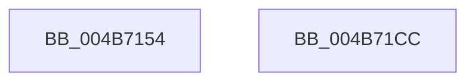

# KiInitializeProcessAvailableCpuState

- RVA: `0x004B7154`–`0x004B71CD` (길이 `121` bytes)
- VA: `0x00000001404B7154`
- 실행 섹션: `.text`
- PDB 이름 있음: `예`; PDB Function 태그: `아니요`
- unwind 정보 RVA: `0x0005CAAC`
- 디코드: `33`개 명령, `121/121` bytes 표시
- 미해석 바이트: `0` (있으면 어셈블리에 `.byte`로 보존)

> 이 문서는 커널 이미지의 기계어와 PDB 기호를 분석해 생성했습니다. 4번과 5번은 함수 원형과 자료형을 바이너리 사용 방식에서 추정한 C 해석이며 원본 소스 복구 결과는 아닙니다.

## 1. Dependencies

- 직접 호출 지점: **1**; 고유 호출 대상: **1**
- 직접 호출자로 확인된 함수: **1**
- RIP 상대 이미지 참조: **2**

### Outgoing calls
- `0x004B7191` → [memset](../6C/memset_function_006C6C40.md) (function, `0x006C6C40`)

### Direct callers
- [KeInitializeProcess](../../page/A6/KeInitializeProcess_function_00A63CF4.md) at `0x00A63E22`

### Static image references
- `0x004B719A` → RVA `0x005B9A90` (`KiAvailableCpusWorkItemCallbackWrapper`; read)
- `0x004B71A5` → RVA `0x00746140` (`KiAvailableCpusProcessWorkItemCallback`; read)

## 2. Other-region calls and transfers

- 다른 실행 섹션으로 향하는 call: **0**
- 별도 외부 분기/꼬리 이동을 확인하지 못했습니다.

## 3. Assembly (complete function range)

```asm
004B7154  48 89 5C 24 08                  mov qword ptr [rsp + 8], rbx
004B7159  57                              push rdi
004B715A  48 83 EC 20                     sub rsp, 0x20
004B715E  33 C0                           xor eax, eax
004B7160  48 8D 59 38                     lea rbx, [rcx + 0x38]
004B7164  0F 57 C0                        xorps xmm0, xmm0
004B7167  49 8B F8                        mov rdi, r8
004B716A  0F 11 01                        movups xmmword ptr [rcx], xmm0
004B716D  48 89 41 10                     mov qword ptr [rcx + 0x10], rax
004B7171  48 89 41 30                     mov qword ptr [rcx + 0x30], rax
004B7175  48 21 41 20                     and qword ptr [rcx + 0x20], rax
004B7179  48 8D 41 28                     lea rax, [rcx + 0x28]
004B717D  48 89 51 18                     mov qword ptr [rcx + 0x18], rdx
004B7181  33 D2                           xor edx, edx
004B7183  48 8B CB                        mov rcx, rbx
004B7186  48 89 40 08                     mov qword ptr [rax + 8], rax
004B718A  48 89 00                        mov qword ptr [rax], rax
004B718D  44 8D 42 40                     lea r8d, [rdx + 0x40]
004B7191  E8 AA FA 20 00                  call 0x1406c6c40
004B7196  48 83 23 00                     and qword ptr [rbx], 0
004B719A  48 8D 05 EF 28 10 00            lea rax, [rip + 0x1028ef]
004B71A1  48 89 43 10                     mov qword ptr [rbx + 0x10], rax
004B71A5  48 8D 05 94 EF 28 00            lea rax, [rip + 0x28ef94]
004B71AC  48 89 5B 18                     mov qword ptr [rbx + 0x18], rbx
004B71B0  48 83 63 20 00                  and qword ptr [rbx + 0x20], 0
004B71B5  83 63 28 00                     and dword ptr [rbx + 0x28], 0
004B71B9  48 89 43 30                     mov qword ptr [rbx + 0x30], rax
004B71BD  48 89 7B 38                     mov qword ptr [rbx + 0x38], rdi
004B71C1  48 8B 5C 24 30                  mov rbx, qword ptr [rsp + 0x30]
004B71C6  48 83 C4 20                     add rsp, 0x20
004B71CA  5F                              pop rdi
004B71CB  C3                              ret
004B71CC  CC                              int3
```

## 4. C-style interpretation (structured pseudocode)

```c
__int64 __fastcall KiInitializeProcessAvailableCpuState(__int64 a1, __int64 a2, __int64 a3)
{
    __int64 result;
    __int64 v_rsp;
    unsigned __int64 v_stack_p8;

    v_stack_p8 = v_rbx;
    v_rsp = (v_rsp) - (32);
    result = 0;
    *(unsigned __int64 *)(a1) = v_xmm0;
    *(unsigned __int64 *)(a1 + 16) = 0;
    *(unsigned __int64 *)(a1 + 48) = 0;
    *(unsigned __int64 *)(a1 + 24) = a2;
    a2 = 0;
    *(unsigned __int64 *)(a1 + 40 + 8) = a1 + 40;
    *(unsigned __int64 *)(a1 + 40) = a1 + 40;
    result = memset(a1 + 56, a2, a2 + 64, a4);
    *(unsigned __int64 *)(a1 + 56 + 16) = v_rip + 1059055;
    *(unsigned __int64 *)(a1 + 56 + 24) = a1 + 56;
    *(unsigned __int64 *)(a1 + 56 + 48) = v_rip + 2682772;
    *(unsigned __int64 *)(a1 + 56 + 56) = a3;
    v_rsp = (v_rsp) + (32);
    return v_rip + 2682772;
}
```

## 5. (Beta) C Style

```c
int64_t KiInitializeProcessAvailableCpuState(void *Arg1, int64_t Arg2, int64_t Arg3)
{
    uint8_t *arg1 = (uint8_t *)Arg1;

    int64_t result;
    int64_t local_rsp;
    uint64_t v_stack_p8;

    v_stack_p8 = local_rbx;
    local_rsp = (local_rsp) - (32);
    result = 0;
    *(uint64_t *)(arg1) = v_xmm0;
    *(uint64_t *)(arg1 + 0x10) = 0;
    *(uint64_t *)(arg1 + 0x30) = 0;
    *(uint64_t *)(arg1 + 0x18) = Arg2;
    Arg2 = 0;
    *(void **)(arg1 + 0x28 + 0x8) = Arg1 + 40;
    *(void **)(arg1 + 0x28) = Arg1 + 40;
    result = memset(Arg1 + 56, Arg2, Arg2 + 64, a4);
    *(uint64_t *)(arg1 + 0x38 + 0x10) = v_rip + 1059055;
    *(void **)(arg1 + 0x38 + 0x18) = Arg1 + 56;
    *(uint64_t *)(arg1 + 0x38 + 0x30) = v_rip + 2682772;
    *(uint64_t *)(arg1 + 0x38 + 0x38) = Arg3;
    local_rsp = (local_rsp) + (32);
    return v_rip + 2682772;
}
```

### 관측된 메모리 오프셋

구조체 형식이 확인되지 않은 접근은 인자 기준의 오프셋으로만 기록했습니다.

| 기준 인자 | 오프셋 표현 | 폭 (bit) | 접근 |
|---|---:|---:|---|
| `Arg1` | `+ 0x0` | `64` | `R/W` |
| `Arg1` | `+ 0x0` | `64` | `W` |
| `Arg1` | `+ 0x0` | `128` | `R` |
| `Arg1` | `+ 0x8` | `64` | `W` |
| `Arg1` | `+ 0x10` | `64` | `W` |
| `Arg1` | `+ 0x18` | `64` | `W` |
| `Arg1` | `+ 0x20` | `64` | `R/W` |
| `Arg1` | `+ 0x28` | `32` | `R/W` |
| `Arg1` | `+ 0x28` | `64` | `R` |
| `Arg1` | `+ 0x30` | `64` | `W` |
| `Arg1` | `+ 0x38` | `64` | `R` |
| `Arg1` | `+ 0x38` | `64` | `W` |

## 6. Execution-region graph

[열기: 2D/3D 그래프와 함수 탐색 컨트롤 패널](../../../control-panel.html?section=text&rva=0x004B7154&view=graph)

- 2D 그래프는 위에서 아래로 흐르고, 3D 그래프는 빈 공간을 드래그해 회전합니다. Shift+드래그는 이동, 휠은 확대·축소, 함수 노드 선택은 대상 보고서 이동입니다.

### Static fallback


