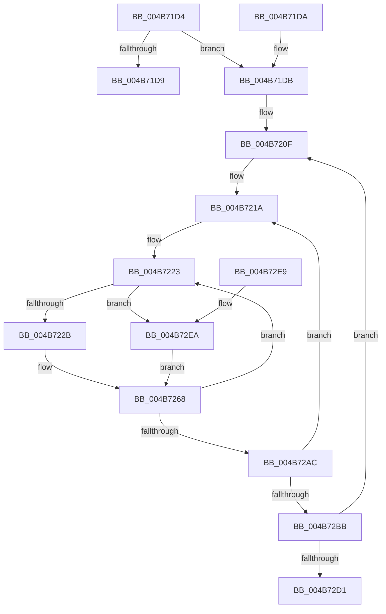

# KiInstallSubNodeHeteroSets

- RVA: `0x004B71D4`–`0x004B7307` (길이 `307` bytes)
- VA: `0x00000001404B71D4`
- 실행 섹션: `.text`
- PDB 이름 있음: `예`; PDB Function 태그: `아니요`
- unwind 정보 RVA: `0x000BA898`
- 디코드: `85`개 명령, `307/307` bytes 표시
- 미해석 바이트: `0` (있으면 어셈블리에 `.byte`로 보존)

> 이 문서는 커널 이미지의 기계어와 PDB 기호를 분석해 생성했습니다. 4번과 5번은 함수 원형과 자료형을 바이너리 사용 방식에서 추정한 C 해석이며 원본 소스 복구 결과는 아닙니다.

## 1. Dependencies

- 직접 호출 지점: **1**; 고유 호출 대상: **1**
- 직접 호출자로 확인된 함수: **3**
- RIP 상대 이미지 참조: **1**

### Outgoing calls
- `0x004B7251` → [KiComputeHeteroSet](KiComputeHeteroSet_function_004B7310.md) (function, `0x004B7310`)

### Direct callers
- [KeConfigureHeteroProcessors](../42/KeConfigureHeteroProcessors_function_00427338.md) at `0x0042752E`
- [KeUpdateProcessorRestrictions](../5B/KeUpdateProcessorRestrictions_function_005B6208.md) at `0x005B64C3`
- [KeUpdateProcessorRestrictionsEx](../5B/KeUpdateProcessorRestrictionsEx_function_005B64E8.md) at `0x005B68CC`

### Static image references
- `0x004B722B` → RVA `0x00FC5460` (`ALMOSTRO`; read)

## 2. Other-region calls and transfers

- 다른 실행 섹션으로 향하는 call: **0**
- 별도 외부 분기/꼬리 이동을 확인하지 못했습니다.

## 3. Assembly (complete function range)

```asm
004B71D4  45 85 C9                        test r9d, r9d
004B71D7  75 02                           jne 0x1404b71db
004B71D9  C3                              ret
004B71DA  CC                              int3
004B71DB  48 89 5C 24 08                  mov qword ptr [rsp + 8], rbx
004B71E0  44 89 4C 24 20                  mov dword ptr [rsp + 0x20], r9d
004B71E5  89 54 24 10                     mov dword ptr [rsp + 0x10], edx
004B71E9  55                              push rbp
004B71EA  56                              push rsi
004B71EB  57                              push rdi
004B71EC  41 54                           push r12
004B71EE  41 55                           push r13
004B71F0  41 56                           push r14
004B71F2  41 57                           push r15
004B71F4  48 83 EC 50                     sub rsp, 0x50
004B71F8  33 C0                           xor eax, eax
004B71FA  0F 57 C0                        xorps xmm0, xmm0
004B71FD  0F 11 44 24 30                  movups xmmword ptr [rsp + 0x30], xmm0
004B7202  48 89 44 24 40                  mov qword ptr [rsp + 0x40], rax
004B7207  33 FF                           xor edi, edi
004B7209  49 8B E8                        mov rbp, r8
004B720C  4C 8B E9                        mov r13, rcx
004B720F  33 DB                           xor ebx, ebx
004B7211  4D 8D B5 80 00 00 00            lea r14, [r13 + 0x80]
004B7218  33 F6                           xor esi, esi
004B721A  45 33 FF                        xor r15d, r15d
004B721D  8D 04 1B                        lea eax, [rbx + rbx]
004B7220  45 33 E4                        xor r12d, r12d
004B7223  85 D2                           test edx, edx
004B7225  0F 84 BF 00 00 00               je 0x1404b72ea
004B722B  48 8D 0D 2E E2 B0 00            lea rcx, [rip + 0xb0e22e]
004B7232  4D 8B CE                        mov r9, r14
004B7235  4E 8D 04 26                     lea r8, [rsi + r12]
004B7239  41 8B D7                        mov edx, r15d
004B723C  46 8B 04 81                     mov r8d, dword ptr [rcx + r8*4]
004B7240  48 8D 44 24 30                  lea rax, [rsp + 0x30]
004B7245  48 89 44 24 28                  mov qword ptr [rsp + 0x28], rax
004B724A  8B CB                           mov ecx, ebx
004B724C  48 89 6C 24 20                  mov qword ptr [rsp + 0x20], rbp
004B7251  E8 BA 00 00 00                  call 0x1404b7310
004B7256  4C 8B 4C 24 40                  mov r9, qword ptr [rsp + 0x40]
004B725B  8D 04 1B                        lea eax, [rbx + rbx]
004B725E  4C 8B 44 24 38                  mov r8, qword ptr [rsp + 0x38]
004B7263  48 8B 54 24 30                  mov rdx, qword ptr [rsp + 0x30]
004B7268  42 8D 0C 38                     lea ecx, [rax + r15]
004B726C  49 FF C4                        inc r12
004B726F  41 0F B6 85 B9 00 00 00         movzx eax, byte ptr [r13 + 0xb9]
004B7277  41 FF C7                        inc r15d
004B727A  0F AF C8                        imul ecx, eax
004B727D  49 8B 85 C0 00 00 00            mov rax, qword ptr [r13 + 0xc0]
004B7284  03 CF                           add ecx, edi
004B7286  48 8D 0C 49                     lea rcx, [rcx + rcx*2]
004B728A  4C 89 4C C8 10                  mov qword ptr [rax + rcx*8 + 0x10], r9
004B728F  4C 89 44 C8 08                  mov qword ptr [rax + rcx*8 + 8], r8
004B7294  48 89 14 C8                     mov qword ptr [rax + rcx*8], rdx
004B7298  8D 04 1B                        lea eax, [rbx + rbx]
004B729B  8B 94 24 98 00 00 00            mov edx, dword ptr [rsp + 0x98]
004B72A2  41 83 FF 02                     cmp r15d, 2
004B72A6  0F 8C 77 FF FF FF               jl 0x1404b7223
004B72AC  FF C3                           inc ebx
004B72AE  48 83 C6 02                     add rsi, 2
004B72B2  83 FB 07                        cmp ebx, 7
004B72B5  0F 8C 5F FF FF FF               jl 0x1404b721a
004B72BB  FF C7                           inc edi
004B72BD  48 81 C5 F0 3F 00 00            add rbp, 0x3ff0
004B72C4  3B BC 24 A8 00 00 00            cmp edi, dword ptr [rsp + 0xa8]
004B72CB  0F 82 3E FF FF FF               jb 0x1404b720f
004B72D1  48 8B 9C 24 90 00 00 00         mov rbx, qword ptr [rsp + 0x90]
004B72D9  48 83 C4 50                     add rsp, 0x50
004B72DD  41 5F                           pop r15
004B72DF  41 5E                           pop r14
004B72E1  41 5D                           pop r13
004B72E3  41 5C                           pop r12
004B72E5  5F                              pop rdi
004B72E6  5E                              pop rsi
004B72E7  5D                              pop rbp
004B72E8  C3                              ret
004B72E9  CC                              int3
004B72EA  49 8B 16                        mov rdx, qword ptr [r14]
004B72ED  48 89 54 24 30                  mov qword ptr [rsp + 0x30], rdx
004B72F2  4C 8B C2                        mov r8, rdx
004B72F5  48 89 54 24 38                  mov qword ptr [rsp + 0x38], rdx
004B72FA  4C 8B CA                        mov r9, rdx
004B72FD  48 89 54 24 40                  mov qword ptr [rsp + 0x40], rdx
004B7302  E9 61 FF FF FF                  jmp 0x1404b7268
```

## 4. C-style interpretation (structured pseudocode)

```c
__int64 __fastcall KiInstallSubNodeHeteroSets(__int64 a1, int a2, __int64 a3, int a4)
{
    __int64 result;
    __int64 v_r12;
    __int64 v_r15;
    __int64 v_rbp;
    __int64 v_rbx;
    __int64 v_rdi;
    __int64 v_rsi;
    __int64 v_rsp;
    unsigned __int64 v_stack_m48;
    unsigned __int64 v_stack_m50;
    unsigned __int64 v_stack_m58;
    unsigned __int64 v_stack_m60;
    unsigned __int64 v_stack_m68;
    unsigned int v_stack_p10;
    unsigned int v_stack_p20;
    unsigned __int64 v_stack_p30;
    unsigned __int64 v_stack_p38;
    unsigned __int64 v_stack_p40;
    unsigned __int64 v_stack_p8;

    if (a4 != 0) goto loc_004B71DB;
    return result;
loc_004B71DB:
    v_stack_p8 = v_rbx;
    v_stack_p20 = a4;
    v_stack_p10 = a2;
    v_rsp = (v_rsp) - (80);
    result = 0;
    v_stack_m58 = v_xmm0;
    v_stack_m48 = 0;
    v_rdi = 0;
loc_004B720F:
    v_rbx = 0;
    v_rsi = 0;
loc_004B721A:
    v_r15 = 0;
    v_r12 = 0;
loc_004B7223:
    if (a2 == 0) goto loc_004B72EA;
    v_stack_m60 = v_stack_m58;
    v_stack_m68 = a3;
    result = KiComputeHeteroSet(0, 0, (unsigned int)(*(unsigned int *)(v_rip + 11592238 + v_rsi + v_r12 * 1 * 4)), a1 + 128);
loc_004B7268:
    v_r12 = (v_r12) + 1;
    v_r15 = (unsigned int)((v_r15) + 1);
    a1 = (unsigned int)((v_rbx + v_rbx * 1 + v_r15 * 1) * ((unsigned int)(*(unsigned __int8 *)(a1 + 185))));
    a1 = (unsigned int)((a1) + (0));
    *(unsigned __int64 *)(*(unsigned __int64 *)(a1 + 192) + a1 + a1 * 2 * 8 + 16) = v_stack_m48;
    *(unsigned __int64 *)(*(unsigned __int64 *)(a1 + 192) + a1 + a1 * 2 * 8 + 8) = v_stack_m50;
    *(unsigned __int64 *)(*(unsigned __int64 *)(a1 + 192) + a1 + a1 * 2 * 8) = v_stack_m58;
    if (((unsigned int)(v_r15)) < 2) goto loc_004B7223;
    v_rbx = (unsigned int)((v_rbx) + 1);
    v_rsi = (v_rsi) + (2);
    if (((unsigned int)(v_rbx)) < 7) goto loc_004B721A;
    v_rdi = (unsigned int)((v_rdi) + 1);
    v_rbp = (a3) + (0x3FF0ULL);
    if (((unsigned int)(v_rdi)) < v_stack_p20) goto loc_004B720F;
    v_rsp = (v_rsp) + (80);
    return v_rbx + v_rbx * 1;
loc_004B72EA:
    v_stack_p30 = *(unsigned __int64 *)(a1 + 128);
    v_stack_p38 = *(unsigned __int64 *)(a1 + 128);
    v_stack_p40 = *(unsigned __int64 *)(a1 + 128);
    goto loc_004B7268;
}
```

## 5. (Beta) C Style

```c
int64_t KiInstallSubNodeHeteroSets(void *Arg1, int32_t Arg2, int64_t Arg3, int32_t Arg4)
{
    uint8_t *arg1 = (uint8_t *)Arg1;

    int64_t result;
    int64_t local_r12;
    int64_t local_r15;
    int64_t local_rbp;
    int64_t local_rbx;
    int64_t local_rdi;
    int64_t local_rsi;
    int64_t local_rsp;
    uint64_t v_stack_m48;
    uint64_t v_stack_m50;
    uint64_t v_stack_m58;
    uint64_t v_stack_m60;
    uint64_t v_stack_m68;
    uint32_t v_stack_p10;
    uint32_t v_stack_p20;
    uint64_t v_stack_p30;
    uint64_t v_stack_p38;
    uint64_t v_stack_p40;
    uint64_t v_stack_p8;

    if (Arg4 != 0) goto loc_004B71DB;
    return result;
loc_004B71DB:
    v_stack_p8 = local_rbx;
    v_stack_p20 = Arg4;
    v_stack_p10 = Arg2;
    local_rsp = (local_rsp) - (80);
    result = 0;
    v_stack_m58 = v_xmm0;
    v_stack_m48 = 0;
    local_rdi = 0;
loc_004B720F:
    local_rbx = 0;
    local_rsi = 0;
loc_004B721A:
    local_r15 = 0;
    local_r12 = 0;
loc_004B7223:
    if (Arg2 == 0) goto loc_004B72EA;
    v_stack_m60 = v_stack_m58;
    v_stack_m68 = Arg3;
    result = KiComputeHeteroSet(0, 0, (uint32_t)(*(uint32_t *)(v_rip + 0xB0E22E + local_rsi + local_r12 * 1 * 4)), Arg1 + 128);
loc_004B7268:
    local_r12 = (local_r12) + 1;
    local_r15 = (uint32_t)((local_r15) + 1);
    Arg1 = (uint32_t)((local_rbx + local_rbx * 1 + local_r15 * 1) * ((uint32_t)(*(uint8_t *)(arg1 + 0xB9))));
    Arg1 = (uint32_t)((Arg1) + (0));
    *(uint64_t *)(*(uint64_t *)(arg1 + 0xC0) + arg1 + arg1 * 2 * 8 + 0x10) = v_stack_m48;
    *(uint64_t *)(*(uint64_t *)(arg1 + 0xC0) + arg1 + arg1 * 2 * 8 + 0x8) = v_stack_m50;
    *(uint64_t *)(*(uint64_t *)(arg1 + 0xC0) + arg1 + arg1 * 2 * 8) = v_stack_m58;
    if (((uint32_t)(local_r15)) < 2) goto loc_004B7223;
    local_rbx = (uint32_t)((local_rbx) + 1);
    local_rsi = (local_rsi) + (2);
    if (((uint32_t)(local_rbx)) < 7) goto loc_004B721A;
    local_rdi = (uint32_t)((local_rdi) + 1);
    local_rbp = (Arg3) + (0x3FF0ULL);
    if (((uint32_t)(local_rdi)) < v_stack_p20) goto loc_004B720F;
    local_rsp = (local_rsp) + (80);
    return local_rbx + local_rbx * 1;
loc_004B72EA:
    v_stack_p30 = *(uint64_t *)(arg1 + 0x80);
    v_stack_p38 = *(uint64_t *)(arg1 + 0x80);
    v_stack_p40 = *(uint64_t *)(arg1 + 0x80);
    goto loc_004B7268;
}
```

### 관측된 메모리 오프셋

구조체 형식이 확인되지 않은 접근은 인자 기준의 오프셋으로만 기록했습니다.

| 기준 인자 | 오프셋 표현 | 폭 (bit) | 접근 |
|---|---:|---:|---|
| `Arg1` | `+ 0x0` | `64` | `R` |
| `Arg1` | `+ 0x80` | `64` | `R` |
| `Arg1` | `+ 0xB9` | `8` | `R` |
| `Arg1` | `+ 0xC0` | `64` | `R` |

## 6. Execution-region graph

[열기: 2D/3D 그래프와 함수 탐색 컨트롤 패널](../../../control-panel.html?section=text&rva=0x004B71D4&view=graph)

- 2D 그래프는 위에서 아래로 흐르고, 3D 그래프는 빈 공간을 드래그해 회전합니다. Shift+드래그는 이동, 휠은 확대·축소, 함수 노드 선택은 대상 보고서 이동입니다.

### Static fallback


