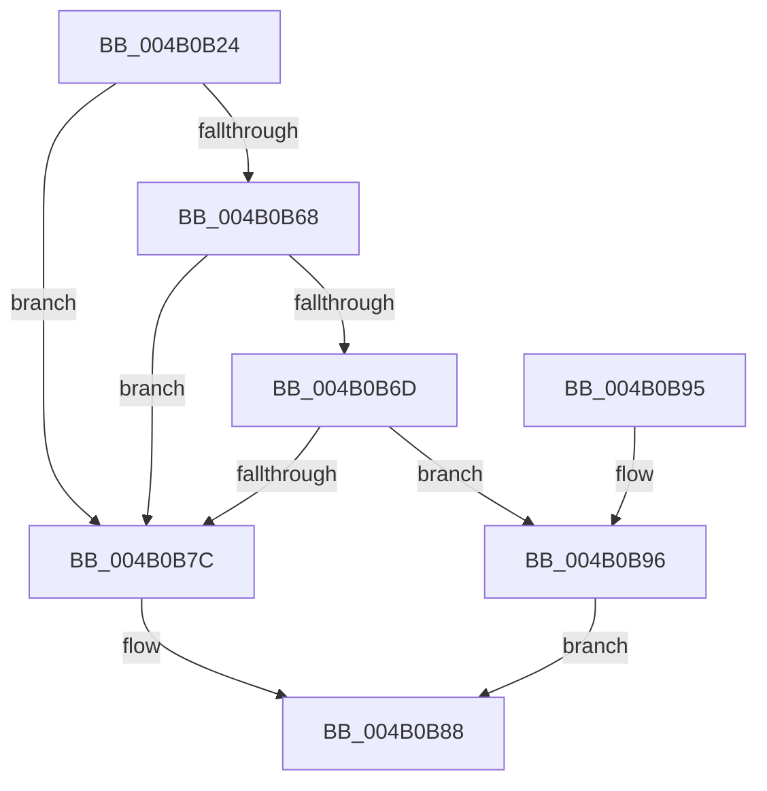

# KiIntSteerComputeCpuSet

- RVA: `0x004B0B24`–`0x004B0BA7` (길이 `131` bytes)
- VA: `0x00000001404B0B24`
- 실행 섹션: `.text`
- PDB 이름 있음: `예`; PDB Function 태그: `아니요`
- unwind 정보 RVA: `0x00081618`
- 디코드: `34`개 명령, `131/131` bytes 표시
- 미해석 바이트: `0` (있으면 어셈블리에 `.byte`로 보존)

> 이 문서는 커널 이미지의 기계어와 PDB 기호를 분석해 생성했습니다. 4번과 5번은 함수 원형과 자료형을 바이너리 사용 방식에서 추정한 C 해석이며 원본 소스 복구 결과는 아닙니다.

## 1. Dependencies

- 직접 호출 지점: **1**; 고유 호출 대상: **1**
- 직접 호출자로 확인된 함수: **2**
- RIP 상대 이미지 참조: **0**

### Outgoing calls
- `0x004B0B53` → [KiComputeCpuSetAffinityMask](KiComputeCpuSetAffinityMask_function_004B0BB0.md) (function, `0x004B0BB0`)

### Direct callers
- [KiIntSteerCalculateDistribution](../2D/KiIntSteerCalculateDistribution_function_002D7420.md) at `0x002D768A`
- [KiIntSteerAssignCpuSet](../5C/KiIntSteerAssignCpuSet_function_005C57B0.md) at `0x005C57EA`

### Static image references
- 디코드된 RIP-relative 메모리 참조가 없습니다.

## 2. Other-region calls and transfers

- 다른 실행 섹션으로 향하는 call: **0**
- 별도 외부 분기/꼬리 이동을 확인하지 못했습니다.

## 3. Assembly (complete function range)

```asm
004B0B24  48 89 5C 24 08                  mov qword ptr [rsp + 8], rbx
004B0B29  57                              push rdi
004B0B2A  48 83 EC 30                     sub rsp, 0x30
004B0B2E  44 0F B7 81 90 00 00 00         movzx r8d, word ptr [rcx + 0x90]
004B0B36  48 8D 91 98 00 00 00            lea rdx, [rcx + 0x98]
004B0B3D  4C 8B 89 88 00 00 00            mov r9, qword ptr [rcx + 0x88]
004B0B44  48 8B D9                        mov rbx, rcx
004B0B47  0F 57 C0                        xorps xmm0, xmm0
004B0B4A  33 C9                           xor ecx, ecx
004B0B4C  0F 11 44 24 20                  movups xmmword ptr [rsp + 0x20], xmm0
004B0B51  33 FF                           xor edi, edi
004B0B53  E8 58 00 00 00                  call 0x1404b0bb0
004B0B58  44 0F B7 44 24 28               movzx r8d, word ptr [rsp + 0x28]
004B0B5E  48 8B D0                        mov rdx, rax
004B0B61  66 44 39 43 48                  cmp word ptr [rbx + 0x48], r8w
004B0B66  75 14                           jne 0x1404b0b7c
004B0B68  48 85 C0                        test rax, rax
004B0B6B  74 0F                           je 0x1404b0b7c
004B0B6D  48 8B 4B 40                     mov rcx, qword ptr [rbx + 0x40]
004B0B71  48 8B C1                        mov rax, rcx
004B0B74  48 0B C2                        or rax, rdx
004B0B77  48 3B C1                        cmp rax, rcx
004B0B7A  74 1A                           je 0x1404b0b96
004B0B7C  48 89 BB B0 00 00 00            mov qword ptr [rbx + 0xb0], rdi
004B0B83  BF 01 00 00 C0                  mov edi, 0xc0000001
004B0B88  48 8B 5C 24 40                  mov rbx, qword ptr [rsp + 0x40]
004B0B8D  8B C7                           mov eax, edi
004B0B8F  48 83 C4 30                     add rsp, 0x30
004B0B93  5F                              pop rdi
004B0B94  C3                              ret
004B0B95  CC                              int3
004B0B96  66 44 89 83 B8 00 00 00         mov word ptr [rbx + 0xb8], r8w
004B0B9E  48 89 93 B0 00 00 00            mov qword ptr [rbx + 0xb0], rdx
004B0BA5  EB E1                           jmp 0x1404b0b88
```

## 4. C-style interpretation (structured pseudocode)

```c
__int64 __fastcall KiIntSteerComputeCpuSet(__int64 a1)
{
    __int64 result;
    __int64 v_rdi;
    __int64 v_rsp;
    unsigned __int16 v_stack_m10;
    unsigned __int64 v_stack_m18;
    unsigned __int64 v_stack_p8;

    v_stack_p8 = v_rbx;
    v_rsp = (v_rsp) - (48);
    a1 = 0;
    v_stack_m18 = v_xmm0;
    v_rdi = 0;
    result = KiComputeCpuSetAffinityMask(a1, a1 + 152, *(unsigned __int16 *)(a1 + 144), *(unsigned __int64 *)(a1 + 136));
    if ((*(unsigned __int16 *)(a1 + 72)) != ((unsigned __int16)(v_stack_m10))) goto loc_004B0B7C;
    if (result == 0) goto loc_004B0B7C;
    result = (*(unsigned __int64 *)(a1 + 64)) | (result);
    if (result == (*(unsigned __int64 *)(a1 + 64))) goto loc_004B0B96;
loc_004B0B7C:
    *(unsigned __int64 *)(a1 + 176) = 0;
loc_004B0B88:
    v_rsp = (v_rsp) + (48);
    return (unsigned int)((unsigned int)((unsigned int)(0xC0000001ULL)));
loc_004B0B96:
    *(unsigned __int16 *)(v_stack_p8 + 184) = (unsigned __int16)(v_stack_m10);
    *(unsigned __int64 *)(v_stack_p8 + 176) = result;
    goto loc_004B0B88;
}
```

## 5. (Beta) C Style

```c
int64_t KiIntSteerComputeCpuSet(void *Arg1)
{
    uint8_t *arg1 = (uint8_t *)Arg1;

    int64_t result;
    int64_t local_rdi;
    int64_t local_rsp;
    uint16_t v_stack_m10;
    uint64_t v_stack_m18;
    uint64_t v_stack_p8;

    v_stack_p8 = local_rbx;
    local_rsp = (local_rsp) - (48);
    Arg1 = 0;
    v_stack_m18 = v_xmm0;
    local_rdi = 0;
    result = KiComputeCpuSetAffinityMask(Arg1, Arg1 + 152, *(uint16_t *)(arg1 + 0x90), *(uint64_t *)(arg1 + 0x88));
    if ((*(uint16_t *)(arg1 + 0x48)) != ((uint16_t)(v_stack_m10))) goto loc_004B0B7C;
    if (result == 0) goto loc_004B0B7C;
    result = (*(uint64_t *)(arg1 + 0x40)) | (result);
    if (result == (*(uint64_t *)(arg1 + 0x40))) goto loc_004B0B96;
loc_004B0B7C:
    *(uint64_t *)(arg1 + 0xB0) = 0;
loc_004B0B88:
    local_rsp = (local_rsp) + (48);
    return (uint32_t)((uint32_t)((uint32_t)(0xC0000001ULL)));
loc_004B0B96:
    *(uint16_t *)(v_stack_p8 + 0xB8) = (uint16_t)(v_stack_m10);
    *(uint64_t *)(v_stack_p8 + 0xB0) = result;
    goto loc_004B0B88;
}
```

### 관측된 메모리 오프셋

구조체 형식이 확인되지 않은 접근은 인자 기준의 오프셋으로만 기록했습니다.

| 기준 인자 | 오프셋 표현 | 폭 (bit) | 접근 |
|---|---:|---:|---|
| `Arg1` | `+ 0x40` | `64` | `R` |
| `Arg1` | `+ 0x48` | `16` | `R` |
| `Arg1` | `+ 0x88` | `64` | `R` |
| `Arg1` | `+ 0x90` | `16` | `R` |
| `Arg1` | `+ 0x98` | `64` | `R` |
| `Arg1` | `+ 0xB0` | `64` | `W` |
| `Arg1` | `+ 0xB8` | `16` | `W` |

## 6. Execution-region graph

[열기: 2D/3D 그래프와 함수 탐색 컨트롤 패널](../../../control-panel.html?section=text&rva=0x004B0B24&view=graph)

- 2D 그래프는 위에서 아래로 흐르고, 3D 그래프는 빈 공간을 드래그해 회전합니다. Shift+드래그는 이동, 휠은 확대·축소, 함수 노드 선택은 대상 보고서 이동입니다.

### Static fallback


