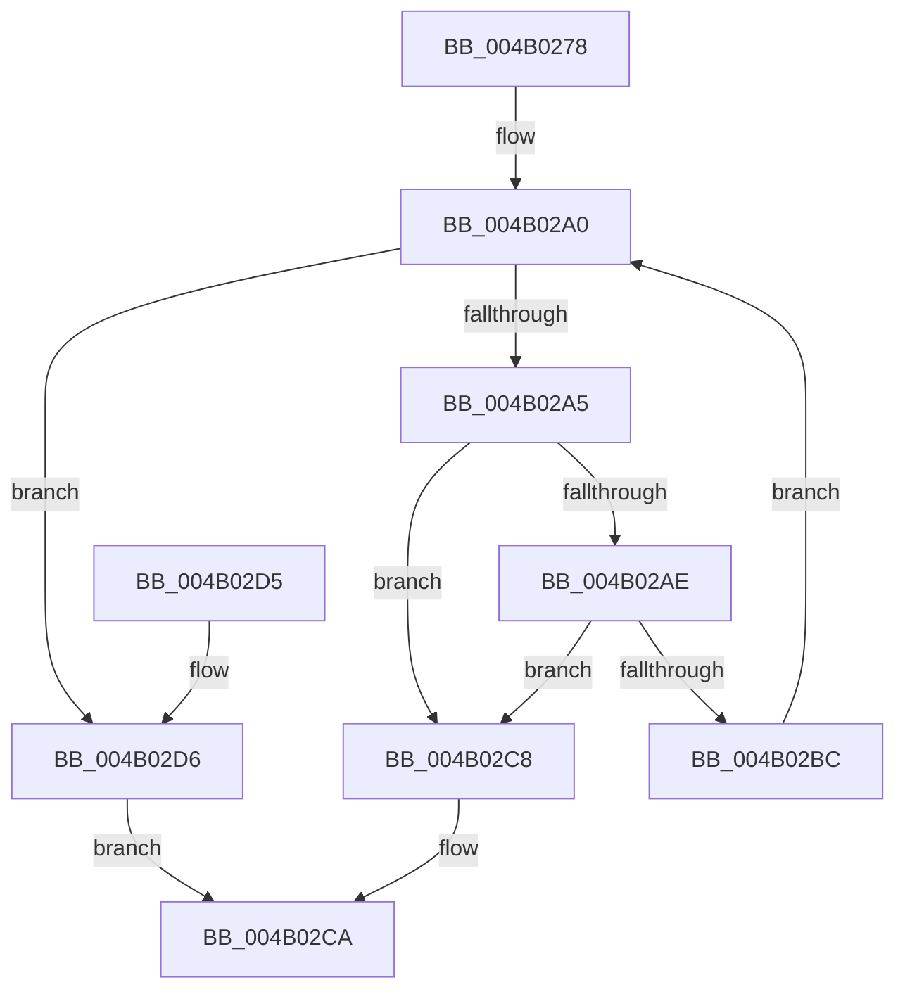

# KiIsAddressRangeValid

- RVA: `0x004B0278`–`0x004B02DA` (길이 `98` bytes)
- VA: `0x00000001404B0278`
- 실행 섹션: `.text`
- PDB 이름 있음: `예`; PDB Function 태그: `아니요`
- unwind 정보 RVA: `0x00065BB8`
- 디코드: `29`개 명령, `98/98` bytes 표시
- 미해석 바이트: `0` (있으면 어셈블리에 `.byte`로 보존)

> 이 문서는 커널 이미지의 기계어와 PDB 기호를 분석해 생성했습니다. 4번과 5번은 함수 원형과 자료형을 바이너리 사용 방식에서 추정한 C 해석이며 원본 소스 복구 결과는 아닙니다.

## 1. Dependencies

- 직접 호출 지점: **1**; 고유 호출 대상: **1**
- 직접 호출자로 확인된 함수: **4**
- RIP 상대 이미지 참조: **0**

### Outgoing calls
- `0x004B02B3` → [MmIsAddressValidEx](../27/MmIsAddressValidEx_function_0027FDD0.md) (function, `0x0027FDD0`)

### Direct callers
- [KeAddTriageDumpDataBlock](../5B/KeAddTriageDumpDataBlock_function_005B26B0.md) at `0x005B26EE`
- [KiCollectTriageDumpDataBlocks](../5B/KiCollectTriageDumpDataBlocks_function_005B43F8.md) at `0x005B46B6`
- [KiValidateTriageDumpDataArray](../5B/KiValidateTriageDumpDataArray_function_005B55E8.md) at `0x005B5608`
- [KiValidateTriageDumpDataArray](../5B/KiValidateTriageDumpDataArray_function_005B55E8.md) at `0x005B5643`
- [KiValidateTriageDumpDataArray](../5B/KiValidateTriageDumpDataArray_function_005B55E8.md) at `0x005B5652`
- [KiValidateTriageDumpDataArray](../5B/KiValidateTriageDumpDataArray_function_005B55E8.md) at `0x005B5662`
- [PopInternalSaveStackToDumpFile](../5C/PopInternalSaveStackToDumpFile_function_005CE6F0.md) at `0x005CE71B`
- [PopInternalSaveStackToDumpFile](../5C/PopInternalSaveStackToDumpFile_function_005CE6F0.md) at `0x005CE743`
- [PopInternalSaveStackToDumpFile](../5C/PopInternalSaveStackToDumpFile_function_005CE6F0.md) at `0x005CE782`
- [PopInternalSaveStackToDumpFile](../5C/PopInternalSaveStackToDumpFile_function_005CE6F0.md) at `0x005CE7D3`
- [PopInternalSaveStackToDumpFile](../5C/PopInternalSaveStackToDumpFile_function_005CE6F0.md) at `0x005CE7F6`

### Static image references
- 디코드된 RIP-relative 메모리 참조가 없습니다.

## 2. Other-region calls and transfers

- 다른 실행 섹션으로 향하는 call: **0**
- 별도 외부 분기/꼬리 이동을 확인하지 못했습니다.

## 3. Assembly (complete function range)

```asm
004B0278  48 89 5C 24 08                  mov qword ptr [rsp + 8], rbx
004B027D  57                              push rdi
004B027E  48 83 EC 20                     sub rsp, 0x20
004B0282  48 8B D9                        mov rbx, rcx
004B0285  48 8D BA FF 0F 00 00            lea rdi, [rdx + 0xfff]
004B028C  81 E1 FF 0F 00 00               and ecx, 0xfff
004B0292  48 81 E3 00 F0 FF FF            and rbx, 0xfffffffffffff000
004B0299  48 03 F9                        add rdi, rcx
004B029C  48 C1 EF 0C                     shr rdi, 0xc
004B02A0  48 85 FF                        test rdi, rdi
004B02A3  74 31                           je 0x1404b02d6
004B02A5  48 81 FB 00 00 01 00            cmp rbx, 0x10000
004B02AC  72 1A                           jb 0x1404b02c8
004B02AE  33 D2                           xor edx, edx
004B02B0  48 8B CB                        mov rcx, rbx
004B02B3  E8 18 FB DC FF                  call 0x14027fdd0
004B02B8  84 C0                           test al, al
004B02BA  74 0C                           je 0x1404b02c8
004B02BC  48 81 C3 00 10 00 00            add rbx, 0x1000
004B02C3  48 FF CF                        dec rdi
004B02C6  EB D8                           jmp 0x1404b02a0
004B02C8  32 C0                           xor al, al
004B02CA  48 8B 5C 24 30                  mov rbx, qword ptr [rsp + 0x30]
004B02CF  48 83 C4 20                     add rsp, 0x20
004B02D3  5F                              pop rdi
004B02D4  C3                              ret
004B02D5  CC                              int3
004B02D6  B0 01                           mov al, 1
004B02D8  EB F0                           jmp 0x1404b02ca
```

## 4. C-style interpretation (structured pseudocode)

```c
__int64 __fastcall KiIsAddressRangeValid(__int64 a1, __int64 a2)
{
    __int64 result;
    __int64 v_rbx;
    __int64 v_rdi;
    __int64 v_rsp;
    unsigned __int64 v_stack_p8;

    v_stack_p8 = v_rbx;
    v_rsp = (v_rsp) - (32);
    a1 = (unsigned int)((a1) & (0xFFFULL));
    v_rbx = (a1) & (0xFFFFFFFFFFFFF000ULL);
    v_rdi = (a2 + 4095) + (a1);
    v_rdi = (v_rdi) >> (12);
loc_004B02A0:
    if (v_rdi == 0) goto loc_004B02D6;
    if (v_rbx < 0x10000ULL) goto loc_004B02C8;
    a2 = 0;
    result = MmIsAddressValidEx(v_rbx, a2, a3, a4);
    if ((unsigned __int8)(result) == 0) goto loc_004B02C8;
    v_rbx = (v_rbx) + (0x1000ULL);
    v_rdi = (v_rdi) - 1;
    goto loc_004B02A0;
loc_004B02C8:
    result = 0;
loc_004B02CA:
    v_rsp = (v_rsp) + (32);
    return result;
loc_004B02D6:
    goto loc_004B02CA;
}
```

## 5. (Beta) C Style

```c
int64_t KiIsAddressRangeValid(int64_t Arg1, void *Arg2)
{
    uint8_t *arg2 = (uint8_t *)Arg2;

    int64_t result;
    int64_t local_rbx;
    int64_t local_rdi;
    int64_t local_rsp;
    uint64_t v_stack_p8;

    v_stack_p8 = local_rbx;
    local_rsp = (local_rsp) - (32);
    Arg1 = (uint32_t)((Arg1) & (0xFFFULL));
    local_rbx = (Arg1) & (0xFFFFFFFFFFFFF000ULL);
    local_rdi = (Arg2 + 4095) + (Arg1);
    local_rdi = (local_rdi) >> (12);
loc_004B02A0:
    if (local_rdi == 0) goto loc_004B02D6;
    if (local_rbx < 0x10000ULL) goto loc_004B02C8;
    Arg2 = 0;
    result = MmIsAddressValidEx(local_rbx, Arg2, a3, a4);
    if ((uint8_t)(result) == 0) goto loc_004B02C8;
    local_rbx = (local_rbx) + (0x1000ULL);
    local_rdi = (local_rdi) - 1;
    goto loc_004B02A0;
loc_004B02C8:
    result = 0;
loc_004B02CA:
    local_rsp = (local_rsp) + (32);
    return result;
loc_004B02D6:
    goto loc_004B02CA;
}
```

### 관측된 메모리 오프셋

구조체 형식이 확인되지 않은 접근은 인자 기준의 오프셋으로만 기록했습니다.

| 기준 인자 | 오프셋 표현 | 폭 (bit) | 접근 |
|---|---:|---:|---|
| `Arg2` | `+ 0xFFF` | `64` | `R` |

## 6. Execution-region graph

[열기: 2D/3D 그래프와 함수 탐색 컨트롤 패널](../../../control-panel.html?section=text&rva=0x004B0278&view=graph)

- 2D 그래프는 위에서 아래로 흐르고, 3D 그래프는 빈 공간을 드래그해 회전합니다. Shift+드래그는 이동, 휠은 확대·축소, 함수 노드 선택은 대상 보고서 이동입니다.

### Static fallback


