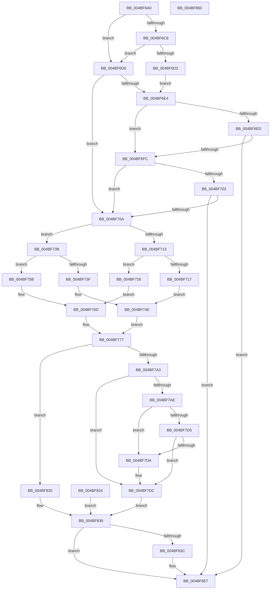

# KiOp_SGDTSIDT

- RVA: `0x004BF6A0`–`0x004BF861` (길이 `449` bytes)
- VA: `0x00000001404BF6A0`
- 실행 섹션: `.text`
- PDB 이름 있음: `예`; PDB Function 태그: `아니요`
- unwind 정보 RVA: `0x000BC5B0`
- 디코드: `113`개 명령, `449/449` bytes 표시
- 미해석 바이트: `0` (있으면 어셈블리에 `.byte`로 보존)

> 이 문서는 커널 이미지의 기계어와 PDB 기호를 분석해 생성했습니다. 4번과 5번은 함수 원형과 자료형을 바이너리 사용 방식에서 추정한 C 해석이며 원본 소스 복구 결과는 아닙니다.

## 1. Dependencies

- 직접 호출 지점: **2**; 고유 호출 대상: **2**
- 직접 호출자로 확인된 함수: **0**
- RIP 상대 이미지 참조: **11**

### Outgoing calls
- `0x004BF796` → [KiOpRetrieveRegMemAddress](../48/KiOpRetrieveRegMemAddress_function_00480B64.md) (function, `0x00480B64`)
- `0x004BF7F4` → [memcpy](../6C/memcpy_function_006C6840.md) (function, `0x006C6840`)

### Direct callers
- 이 함수 시작 RVA로 연결되는 직접 call은 확인되지 않았습니다. 간접 호출은 완전히 역산할 수 없습니다.

### Static image references
- `0x004BF6BE` → RVA `0x00F4754C` (`.data`; read)
- `0x004BF6C8` → RVA `0x00F0DE5C` (`.data`; read)
- `0x004BF6DB` → RVA `0x00FC6A84` (`ALMOSTRO`; read)
- `0x004BF6E4` → RVA `0x00FC6DC0` (`ALMOSTRO`; read)
- `0x004BF6ED` → RVA `0x00FC6B60` (`ALMOSTRO`; read)
- `0x004BF717` → RVA `0x00028C30` (`.rdata`; read)
- `0x004BF71F` → RVA `0x00028C38` (`.rdata`; read)
- `0x004BF73F` → RVA `0x00028C40` (`.rdata`; read)
- `0x004BF747` → RVA `0x00028C48` (`.rdata`; read)
- `0x004BF810` → RVA `0x00F10A38` (`.data`; read)
- `0x004BF818` → RVA `0x00F10A38` (`.data`; write)

## 2. Other-region calls and transfers

- 다른 실행 섹션으로 향하는 call: **0**
- 별도 외부 분기/꼬리 이동을 확인하지 못했습니다.

## 3. Assembly (complete function range)

```asm
004BF6A0  48 8B C4                        mov rax, rsp
004BF6A3  48 89 48 08                     mov qword ptr [rax + 8], rcx
004BF6A7  53                              push rbx
004BF6A8  57                              push rdi
004BF6A9  48 83 EC 48                     sub rsp, 0x48
004BF6AD  48 8B D9                        mov rbx, rcx
004BF6B0  48 83 60 18 00                  and qword ptr [rax + 0x18], 0
004BF6B5  C6 40 10 00                     mov byte ptr [rax + 0x10], 0
004BF6B9  48 83 60 D2 00                  and qword ptr [rax - 0x2e], 0
004BF6BE  8B 05 88 7E A8 00               mov eax, dword ptr [rip + 0xa87e88]
004BF6C4  A8 03                           test al, 3
004BF6C6  75 0E                           jne 0x1404bf6d6
004BF6C8  8B 05 8E E7 A4 00               mov eax, dword ptr [rip + 0xa4e78e]
004BF6CE  85 C0                           test eax, eax
004BF6D0  75 04                           jne 0x1404bf6d6
004BF6D2  33 C9                           xor ecx, ecx
004BF6D4  EB 0E                           jmp 0x1404bf6e4
004BF6D6  B9 01 00 00 00                  mov ecx, 1
004BF6DB  80 3D A2 73 B0 00 00            cmp byte ptr [rip + 0xb073a2], 0
004BF6E2  75 26                           jne 0x1404bf70a
004BF6E4  83 3D D5 76 B0 00 00            cmp dword ptr [rip + 0xb076d5], 0
004BF6EB  75 0F                           jne 0x1404bf6fc
004BF6ED  48 8B 05 6C 74 B0 00            mov rax, qword ptr [rip + 0xb0746c]
004BF6F4  A8 04                           test al, 4
004BF6F6  0F 84 5B 01 00 00               je 0x1404bf857
004BF6FC  80 7B 51 01                     cmp byte ptr [rbx + 0x51], 1
004BF700  74 08                           je 0x1404bf70a
004BF702  85 C9                           test ecx, ecx
004BF704  0F 84 4D 01 00 00               je 0x1404bf857
004BF70A  8A 4B 51                        mov cl, byte ptr [rbx + 0x51]
004BF70D  F6 43 41 38                     test byte ptr [rbx + 0x41], 0x38
004BF711  75 28                           jne 0x1404bf73b
004BF713  84 C9                           test cl, cl
004BF715  74 11                           je 0x1404bf728
004BF717  F2 0F 10 05 11 95 B6 FF         movsd xmm0, qword ptr [rip - 0x496aef]
004BF71F  0F B7 05 12 95 B6 FF            movzx eax, word ptr [rip - 0x496aee]
004BF726  EB 26                           jmp 0x1404bf74e
004BF728  65 48 8B 04 25 18 00 00 00      mov rax, qword ptr gs:[0x18]
004BF731  48 8B 08                        mov rcx, qword ptr [rax]
004BF734  B8 57 00 00 00                  mov eax, 0x57
004BF739  EB 32                           jmp 0x1404bf76d
004BF73B  84 C9                           test cl, cl
004BF73D  74 1C                           je 0x1404bf75b
004BF73F  F2 0F 10 05 F9 94 B6 FF         movsd xmm0, qword ptr [rip - 0x496b07]
004BF747  0F B7 05 FA 94 B6 FF            movzx eax, word ptr [rip - 0x496b06]
004BF74E  F2 0F 11 44 24 28               movsd qword ptr [rsp + 0x28], xmm0
004BF754  66 89 44 24 30                  mov word ptr [rsp + 0x30], ax
004BF759  EB 1C                           jmp 0x1404bf777
004BF75B  65 48 8B 04 25 18 00 00 00      mov rax, qword ptr gs:[0x18]
004BF764  48 8B 48 38                     mov rcx, qword ptr [rax + 0x38]
004BF768  B8 FF 0F 00 00                  mov eax, 0xfff
004BF76D  66 89 44 24 28                  mov word ptr [rsp + 0x28], ax
004BF772  48 89 4C 24 2A                  mov qword ptr [rsp + 0x2a], rcx
004BF777  48 8B 7B 20                     mov rdi, qword ptr [rbx + 0x20]
004BF77B  48 89 7C 24 78                  mov qword ptr [rsp + 0x78], rdi
004BF780  C7 07 05 00 00 C0               mov dword ptr [rdi], 0xc0000005
004BF786  45 33 C9                        xor r9d, r9d
004BF789  4C 8D 44 24 68                  lea r8, [rsp + 0x68]
004BF78E  48 8D 54 24 70                  lea rdx, [rsp + 0x70]
004BF793  48 8B CB                        mov rcx, rbx
004BF796  E8 C9 13 FC FF                  call 0x140480b64
004BF79B  85 C0                           test eax, eax
004BF79D  0F 88 8D 00 00 00               js 0x1404bf830
004BF7A3  44 8A 43 3A                     mov r8b, byte ptr [rbx + 0x3a]
004BF7A7  80 7C 24 68 01                  cmp byte ptr [rsp + 0x68], 1
004BF7AC  75 2E                           jne 0x1404bf7dc
004BF7AE  41 8A C0                        mov al, r8b
004BF7B1  F6 D8                           neg al
004BF7B3  48 1B C9                        sbb rcx, rcx
004BF7B6  48 83 E1 FC                     and rcx, 0xfffffffffffffffc
004BF7BA  48 8D 51 0A                     lea rdx, [rcx + 0xa]
004BF7BE  48 8B 44 24 70                  mov rax, qword ptr [rsp + 0x70]
004BF7C3  48 03 D0                        add rdx, rax
004BF7C6  48 B9 00 00 FF FF FF 7F 00 00   movabs rcx, 0x7fffffff0000
004BF7D0  48 3B D1                        cmp rdx, rcx
004BF7D3  77 05                           ja 0x1404bf7da
004BF7D5  48 3B D0                        cmp rdx, rax
004BF7D8  73 02                           jae 0x1404bf7dc
004BF7DA  8A 01                           mov al, byte ptr [rcx]
004BF7DC  41 F6 D8                        neg r8b
004BF7DF  4D 1B C0                        sbb r8, r8
004BF7E2  49 83 E0 FC                     and r8, 0xfffffffffffffffc
004BF7E6  49 83 C0 0A                     add r8, 0xa
004BF7EA  48 8D 54 24 28                  lea rdx, [rsp + 0x28]
004BF7EF  48 8B 4C 24 70                  mov rcx, qword ptr [rsp + 0x70]
004BF7F4  E8 47 70 20 00                  call 0x1406c6840
004BF7F9  8B 43 10                        mov eax, dword ptr [rbx + 0x10]
004BF7FC  2B 03                           sub eax, dword ptr [rbx]
004BF7FE  48 8B 4B 18                     mov rcx, qword ptr [rbx + 0x18]
004BF802  48 03 81 F8 00 00 00            add rax, qword ptr [rcx + 0xf8]
004BF809  48 89 81 F8 00 00 00            mov qword ptr [rcx + 0xf8], rax
004BF810  8B 05 22 12 A5 00               mov eax, dword ptr [rip + 0xa51222]
004BF816  FF C0                           inc eax
004BF818  89 05 1A 12 A5 00               mov dword ptr [rip + 0xa5121a], eax
004BF81E  C6 43 60 01                     mov byte ptr [rbx + 0x60], 1
004BF822  EB 12                           jmp 0x1404bf836
004BF824  48 8B 5C 24 60                  mov rbx, qword ptr [rsp + 0x60]
004BF829  48 8B 7C 24 78                  mov rdi, qword ptr [rsp + 0x78]
004BF82E  EB 06                           jmp 0x1404bf836
004BF830  48 83 4C 24 70 FF               or qword ptr [rsp + 0x70], 0xffffffffffffffff
004BF836  80 7B 60 00                     cmp byte ptr [rbx + 0x60], 0
004BF83A  75 1B                           jne 0x1404bf857
004BF83C  C7 07 05 00 00 C0               mov dword ptr [rdi], 0xc0000005
004BF842  48 C7 47 20 01 00 00 00         mov qword ptr [rdi + 0x20], 1
004BF84A  48 8B 44 24 70                  mov rax, qword ptr [rsp + 0x70]
004BF84F  48 89 47 28                     mov qword ptr [rdi + 0x28], rax
004BF853  C6 43 61 01                     mov byte ptr [rbx + 0x61], 1
004BF857  33 C0                           xor eax, eax
004BF859  48 83 C4 48                     add rsp, 0x48
004BF85D  5F                              pop rdi
004BF85E  5B                              pop rbx
004BF85F  C3                              ret
004BF860  CC                              int3
```

## 4. C-style interpretation (structured pseudocode)

```c
__int64 __fastcall KiOp_SGDTSIDT(__int64 a1, __int64 a2, __int64 a3, int a4)
{
    __int64 result;
    __int64 v_rsp;
    unsigned __int16 v_stack_m28;
    unsigned __int64 v_stack_m2E;
    unsigned __int64 v_stack_m30;
    unsigned __int64 v_stack_p10;
    unsigned __int64 v_stack_p18;
    unsigned __int64 v_stack_p20;
    unsigned __int64 v_stack_p8;

    *(unsigned __int64 *)(v_rsp + 8) = a1;
    v_rsp = (v_rsp) - (72);
    *(unsigned __int8 *)(v_rsp + 16) = 0;
    if ((((unsigned __int8)((unsigned int)(*(unsigned int *)(v_rip + 11042440)))) & (3)) != 0) goto loc_004BF6D6;
    if ((unsigned int)((unsigned int)(*(unsigned int *)(v_rip + 10807182))) != 0) goto loc_004BF6D6;
    a1 = 0;
    goto loc_004BF6E4;
loc_004BF6D6:
    if ((*(unsigned __int8 *)(v_rip + 11563938)) != 0) goto loc_004BF70A;
loc_004BF6E4:
    if ((*(unsigned int *)(v_rip + 11564757)) != 0) goto loc_004BF6FC;
    if ((((unsigned __int8)(*(unsigned __int64 *)(v_rip + 11564140))) & (4)) == 0) goto loc_004BF857;
loc_004BF6FC:
    if ((*(unsigned __int8 *)(a1 + 81)) == 1) goto loc_004BF70A;
    if (1 == 0) goto loc_004BF857;
loc_004BF70A:
    if (((*(unsigned __int8 *)(a1 + 65)) & (56)) != 0) goto loc_004BF73B;
    if ((unsigned __int8)(*(unsigned __int8 *)(a1 + 81)) == 0) goto loc_004BF728;
    goto loc_004BF74E;
loc_004BF728:
    goto loc_004BF76D;
loc_004BF73B:
    if ((unsigned __int8)(*(unsigned __int64 *)(*(unsigned __int64 *)(gs_base + (0 + 24)))) == 0) goto loc_004BF75B;
loc_004BF74E:
    v_stack_m30 = v_xmm0;
    v_stack_m28 = (unsigned __int16)(*(unsigned __int16 *)(v_rip - 4811526));
    goto loc_004BF777;
loc_004BF75B:
loc_004BF76D:
    v_stack_m30 = (unsigned __int16)((unsigned int)(0xFFFULL));
    v_stack_m2E = *(unsigned __int64 *)(*(unsigned __int64 *)(gs_base + (0 + 24)) + 56);
loc_004BF777:
    v_stack_p20 = *(unsigned __int64 *)(a1 + 32);
    *(unsigned int *)(*(unsigned __int64 *)(a1 + 32)) = 0xC0000005ULL;
    a4 = 0;
    result = KiOpRetrieveRegMemAddress(0, v_stack_p18, v_stack_p10, a4);
    if (sign_flag) goto loc_004BF830;
    if (v_stack_p10 != 1) goto loc_004BF7DC;
    result = (unsigned __int8)(-((unsigned __int8)(*(unsigned __int8 *)(a1 + 58))));
    a1 = (0) & (-4);
    a2 = (a1 + 10) + (v_stack_p18);
    if (a2 > a1) goto loc_004BF7DA;
    result = v_stack_p18;
    if (a2 < v_stack_p18) {
        result = *(unsigned __int8 *)(a1);
    }
    a3 = (unsigned __int8)(-(*(unsigned __int8 *)(a1 + 58)));
    a3 = (a3) & (-4);
    a3 = (a3) + (10);
    result = memcpy(v_stack_p18, v_stack_m30, a3, a4);
    result = (unsigned int)(((unsigned int)(*(unsigned int *)(a1 + 16))) - (*(unsigned int *)(a1)));
    result = (result) + (*(unsigned __int64 *)(*(unsigned __int64 *)(a1 + 24) + 248));
    *(unsigned __int64 *)(*(unsigned __int64 *)(a1 + 24) + 248) = result;
    result = (unsigned int)(((unsigned int)(*(unsigned int *)(v_rip + 10818082))) + 1);
    *(unsigned int *)(v_rip + 10818074) = (unsigned int)(result);
    *(unsigned __int8 *)(a1 + 96) = 1;
    goto loc_004BF836;
loc_004BF830:
loc_004BF836:
    if ((*(unsigned __int8 *)(a1 + 96)) == 0) {
        *(unsigned int *)(*(unsigned __int64 *)(a1 + 32)) = 0xC0000005ULL;
        *(unsigned __int64 *)(*(unsigned __int64 *)(a1 + 32) + 32) = 1;
        result = v_stack_p18;
        *(unsigned __int64 *)(*(unsigned __int64 *)(a1 + 32) + 40) = result;
        *(unsigned __int8 *)(a1 + 97) = 1;
    }
    result = 0;
    v_rsp = (v_rsp) + (72);
    return result;
}
```

## 5. (Beta) C Style

```c
int64_t KiOp_SGDTSIDT(void *Arg1, int64_t Arg2, int64_t Arg3, int32_t Arg4)
{
    uint8_t *arg1 = (uint8_t *)Arg1;

    int64_t result;
    int64_t local_rsp;
    uint16_t v_stack_m28;
    uint64_t v_stack_m2E;
    uint64_t v_stack_m30;
    uint64_t v_stack_p10;
    uint64_t v_stack_p18;
    uint64_t v_stack_p20;
    uint64_t v_stack_p8;

    *(void **)(local_rsp + 0x8) = Arg1;
    local_rsp = (local_rsp) - (72);
    *(uint8_t *)(local_rsp + 0x10) = 0;
    if ((((uint8_t)((uint32_t)(*(uint32_t *)(v_rip + 0xA87E88)))) & (3)) != 0) goto loc_004BF6D6;
    if ((uint32_t)((uint32_t)(*(uint32_t *)(v_rip + 0xA4E78E))) != 0) goto loc_004BF6D6;
    Arg1 = 0;
    goto loc_004BF6E4;
loc_004BF6D6:
    if ((*(uint8_t *)(v_rip + 0xB073A2)) != 0) goto loc_004BF70A;
loc_004BF6E4:
    if ((*(uint32_t *)(v_rip + 0xB076D5)) != 0) goto loc_004BF6FC;
    if ((((uint8_t)(*(uint64_t *)(v_rip + 0xB0746C))) & (4)) == 0) goto loc_004BF857;
loc_004BF6FC:
    if ((*(uint8_t *)(arg1 + 0x51)) == 1) goto loc_004BF70A;
    if (1 == 0) goto loc_004BF857;
loc_004BF70A:
    if (((*(uint8_t *)(arg1 + 0x41)) & (56)) != 0) goto loc_004BF73B;
    if ((uint8_t)(*(uint8_t *)(arg1 + 0x51)) == 0) goto loc_004BF728;
    goto loc_004BF74E;
loc_004BF728:
    goto loc_004BF76D;
loc_004BF73B:
    if ((uint8_t)(*(uint64_t *)(*(uint64_t *)(gs_base + (0 + 0x18)))) == 0) goto loc_004BF75B;
loc_004BF74E:
    v_stack_m30 = v_xmm0;
    v_stack_m28 = (uint16_t)(*(uint16_t *)(v_rip - 0x496B06));
    goto loc_004BF777;
loc_004BF75B:
loc_004BF76D:
    v_stack_m30 = (uint16_t)((uint32_t)(0xFFFULL));
    v_stack_m2E = *(uint64_t *)(*(uint64_t *)(gs_base + (0 + 0x18)) + 0x38);
loc_004BF777:
    v_stack_p20 = *(uint64_t *)(arg1 + 0x20);
    *(uint32_t *)(*(uint64_t *)(arg1 + 0x20)) = 0xC0000005ULL;
    Arg4 = 0;
    result = KiOpRetrieveRegMemAddress(0, v_stack_p18, v_stack_p10, Arg4);
    if (sign_flag) goto loc_004BF830;
    if (v_stack_p10 != 1) goto loc_004BF7DC;
    result = (uint8_t)(-((uint8_t)(*(uint8_t *)(arg1 + 0x3A))));
    Arg1 = (0) & (-4);
    Arg2 = (Arg1 + 10) + (v_stack_p18);
    if (Arg2 > Arg1) goto loc_004BF7DA;
    result = v_stack_p18;
    if (Arg2 < v_stack_p18) {
        result = *(uint8_t *)(arg1);
    }
    Arg3 = (uint8_t)(-(*(uint8_t *)(arg1 + 0x3A)));
    Arg3 = (Arg3) & (-4);
    Arg3 = (Arg3) + (10);
    result = memcpy(v_stack_p18, v_stack_m30, Arg3, Arg4);
    result = (uint32_t)(((uint32_t)(*(uint32_t *)(arg1 + 0x10))) - (*(uint32_t *)(arg1)));
    result = (result) + (*(uint64_t *)(*(uint64_t *)(arg1 + 0x18) + 0xF8));
    *(uint64_t *)(*(uint64_t *)(arg1 + 0x18) + 0xF8) = result;
    result = (uint32_t)(((uint32_t)(*(uint32_t *)(v_rip + 0xA51222))) + 1);
    *(uint32_t *)(v_rip + 0xA5121A) = (uint32_t)(result);
    *(uint8_t *)(arg1 + 0x60) = 1;
    goto loc_004BF836;
loc_004BF830:
loc_004BF836:
    if ((*(uint8_t *)(arg1 + 0x60)) == 0) {
        *(uint32_t *)(*(uint64_t *)(arg1 + 0x20)) = 0xC0000005ULL;
        *(uint64_t *)(*(uint64_t *)(arg1 + 0x20) + 0x20) = 1;
        result = v_stack_p18;
        *(uint64_t *)(*(uint64_t *)(arg1 + 0x20) + 0x28) = result;
        *(uint8_t *)(arg1 + 0x61) = 1;
    }
    result = 0;
    local_rsp = (local_rsp) + (72);
    return result;
}
```

### 관측된 메모리 오프셋

구조체 형식이 확인되지 않은 접근은 인자 기준의 오프셋으로만 기록했습니다.

| 기준 인자 | 오프셋 표현 | 폭 (bit) | 접근 |
|---|---:|---:|---|
| `Arg1` | `+ 0x0` | `32` | `R` |
| `Arg1` | `+ 0x10` | `32` | `R` |
| `Arg1` | `+ 0x18` | `64` | `R` |
| `Arg1` | `+ 0x20` | `64` | `R` |
| `Arg1` | `+ 0x3A` | `8` | `R` |
| `Arg1` | `+ 0x41` | `8` | `R` |
| `Arg1` | `+ 0x51` | `8` | `R` |
| `Arg1` | `+ 0x60` | `8` | `R` |
| `Arg1` | `+ 0x60` | `8` | `W` |
| `Arg1` | `+ 0x61` | `8` | `W` |

## 6. Execution-region graph

[열기: 2D/3D 그래프와 함수 탐색 컨트롤 패널](../../../control-panel.html?section=text&rva=0x004BF6A0&view=graph)

- 2D 그래프는 위에서 아래로 흐르고, 3D 그래프는 빈 공간을 드래그해 회전합니다. Shift+드래그는 이동, 휠은 확대·축소, 함수 노드 선택은 대상 보고서 이동입니다.

### Static fallback


