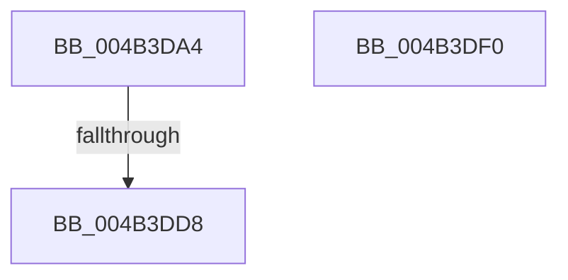

# KiSetClockTimerDeadlineNoWake

- RVA: `0x004B3DA4`–`0x004B3DF1` (길이 `77` bytes)
- VA: `0x00000001404B3DA4`
- 실행 섹션: `.text`
- PDB 이름 있음: `예`; PDB Function 태그: `예`
- unwind 정보 RVA: `0x000B9BCC`
- 디코드: `15`개 명령, `77/77` bytes 표시
- 미해석 바이트: `0` (있으면 어셈블리에 `.byte`로 보존)

> 이 문서는 커널 이미지의 기계어와 PDB 기호를 분석해 생성했습니다. 4번과 5번은 함수 원형과 자료형을 바이너리 사용 방식에서 추정한 C 해석이며 원본 소스 복구 결과는 아닙니다.

## 1. Dependencies

- 직접 호출 지점: **1**; 고유 호출 대상: **1**
- 직접 호출자로 확인된 함수: **3**
- RIP 상대 이미지 참조: **2**

### Outgoing calls
- `0x004B3DE3` → [_security_check_cookie](../6A/_security_check_cookie_function_006AC640.md) (function, `0x006AC640`)

### Direct callers
- [KiComputeGroupSchedulingRank](../21/KiComputeGroupSchedulingRank_function_0021EB84.md) at `0x0021ED48`
- [sub_00356086](../35/Unknown_function_00356086.md) at `0x00356207`
- [KePrepareClockTimerForIdle](../5B/KePrepareClockTimerForIdle_function_005BA49C.md) at `0x005BA52D`
- [KePrepareClockTimerForIdle](../5B/KePrepareClockTimerForIdle_function_005BA49C.md) at `0x005BA5BD`

### Static image references
- `0x004B3DAB` → RVA `0x00E0A740` (`.data`; read)
- `0x004B3DCB` → RVA `0x00E070D8` (`.data`; read)

## 2. Other-region calls and transfers

- 다른 실행 섹션으로 향하는 call: **0**
- call이 아닌 외부 분기/꼬리 이동: **1**
  - `0x004B3DD2` → [sub_006FB7DC](../6F/Unknown_function_006FB7DC.md) (`tail-transfer`)

## 3. Assembly (complete function range)

```asm
004B3DA4  48 81 EC 98 00 00 00            sub rsp, 0x98
004B3DAB  48 8B 05 8E 69 95 00            mov rax, qword ptr [rip + 0x95698e]
004B3DB2  48 33 C4                        xor rax, rsp
004B3DB5  48 89 84 24 80 00 00 00         mov qword ptr [rsp + 0x80], rax
004B3DBD  48 63 C2                        movsxd rax, edx
004B3DC0  48 03 C0                        add rax, rax
004B3DC3  80 A4 C1 A4 95 00 00 FD         and byte ptr [rcx + rax*8 + 0x95a4], 0xfd
004B3DCB  83 3D 06 33 95 00 05            cmp dword ptr [rip + 0x953306], 5
004B3DD2  0F 87 04 7A 24 00               ja 0x1406fb7dc
004B3DD8  48 8B 8C 24 80 00 00 00         mov rcx, qword ptr [rsp + 0x80]
004B3DE0  48 33 CC                        xor rcx, rsp
004B3DE3  E8 58 88 1F 00                  call 0x1406ac640
004B3DE8  48 81 C4 98 00 00 00            add rsp, 0x98
004B3DEF  C3                              ret
004B3DF0  CC                              int3
```

## 4. C-style interpretation (structured pseudocode)

```c
__int64 __fastcall KiSetClockTimerDeadlineNoWake(__int64 a1, int a2)
{
    __int64 result;
    __int64 v_rsp;
    unsigned __int64 v_stack_m18;

    v_rsp = (v_rsp) - (152);
    result = (*(unsigned __int64 *)(v_rip + 9791886)) ^ (v_rsp);
    v_stack_m18 = result;
    result = ((int)(a2)) + ((int)(a2));
    a1 = (v_stack_m18) ^ (v_rsp);
    result = _security_check_cookie(a1, a2, a3, a4);
    v_rsp = (v_rsp) + (152);
    return result;
}
```

## 5. (Beta) C Style

```c
int64_t KiSetClockTimerDeadlineNoWake(void *Arg1, int32_t Arg2)
{
    uint8_t *arg1 = (uint8_t *)Arg1;

    int64_t result;
    int64_t local_rsp;
    uint64_t v_stack_m18;

    local_rsp = (local_rsp) - (152);
    result = (*(uint64_t *)(v_rip + 0x95698E)) ^ (local_rsp);
    v_stack_m18 = result;
    result = ((int32_t)(Arg2)) + ((int32_t)(Arg2));
    Arg1 = (v_stack_m18) ^ (local_rsp);
    result = _security_check_cookie(Arg1, Arg2, a3, a4);
    local_rsp = (local_rsp) + (152);
    return result;
}
```

### 관측된 메모리 오프셋

구조체 형식이 확인되지 않은 접근은 인자 기준의 오프셋으로만 기록했습니다.

| 기준 인자 | 오프셋 표현 | 폭 (bit) | 접근 |
|---|---:|---:|---|
| `Arg1` | `+ 0x95A4 + rax*8` | `8` | `R/W` |

## 6. Execution-region graph

[열기: 2D/3D 그래프와 함수 탐색 컨트롤 패널](../../../control-panel.html?section=text&rva=0x004B3DA4&view=graph)

- 2D 그래프는 위에서 아래로 흐르고, 3D 그래프는 빈 공간을 드래그해 회전합니다. Shift+드래그는 이동, 휠은 확대·축소, 함수 노드 선택은 대상 보고서 이동입니다.

### Static fallback


