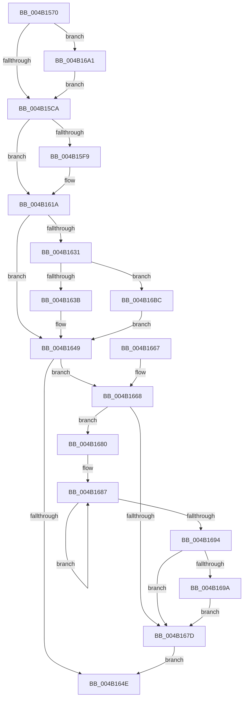

# KiUpdateSystemTime

- RVA: `0x004B1570`–`0x004B16D0` (길이 `352` bytes)
- VA: `0x00000001404B1570`
- 실행 섹션: `.text`
- PDB 이름 있음: `예`; PDB Function 태그: `아니요`
- unwind 정보 RVA: `0x000B8EF0`
- 디코드: `82`개 명령, `352/352` bytes 표시
- 미해석 바이트: `0` (있으면 어셈블리에 `.byte`로 보존)

> 이 문서는 커널 이미지의 기계어와 PDB 기호를 분석해 생성했습니다. 4번과 5번은 함수 원형과 자료형을 바이너리 사용 방식에서 추정한 C 해석이며 원본 소스 복구 결과는 아닙니다.

## 1. Dependencies

- 직접 호출 지점: **5**; 고유 호출 대상: **5**
- 직접 호출자로 확인된 함수: **3**
- RIP 상대 이미지 참조: **5**

### Outgoing calls
- `0x004B1598` → [KeDisableInterrupts](../21/KeDisableInterrupts_function_00217BE0.md) (function, `0x00217BE0`)
- `0x004B15A7` → [RtlWriteAcquireTickLock](../39/RtlWriteAcquireTickLock_function_0039D3B4.md) (function, `0x0039D3B4`)
- `0x004B15AE` → [KeQueryPerformanceCounter](../37/KeQueryPerformanceCounter_function_0037E7E0.md) (function, `0x0037E7E0`)
- `0x004B15B9` → [KiComputeNewSystemTime](../39/KiComputeNewSystemTime_function_0039D2B8.md) (function, `0x0039D2B8`)
- `0x004B169A` → [KiRemoveSystemWorkPriorityKick](../26/KiRemoveSystemWorkPriorityKick_function_002631D0.md) (function, `0x002631D0`)

### Direct callers
- [KeSetTimeAdjustment](../23/KeSetTimeAdjustment_function_00235670.md) at `0x002356DC`
- [KiSetSystemTimeDpc](../48/KiSetSystemTimeDpc_function_00486130.md) at `0x00486208`
- [KiCalibrateTimeAdjustment](../../pagelk/B7/KiCalibrateTimeAdjustment_function_00B797E0.md) at `0x00B7997F`

### Static image references
- `0x004B1588` → RVA `0x00FC5008` (`ALMOSTRO`; read)
- `0x004B163B` → RVA `0x00FC6E28` (`ALMOSTRO`; read/write)
- `0x004B1642` → RVA `0x00FC7068` (`ALMOSTRO`; read/write)
- `0x004B16AB` → RVA `0x00E668C0` (`.data`; read/write)
- `0x004B16C4` → RVA `0x00FC6E28` (`ALMOSTRO`; write)

## 2. Other-region calls and transfers

- 다른 실행 섹션으로 향하는 call: **0**
- 별도 외부 분기/꼬리 이동을 확인하지 못했습니다.

## 3. Assembly (complete function range)

```asm
004B1570  48 89 5C 24 08                  mov qword ptr [rsp + 8], rbx
004B1575  48 89 6C 24 10                  mov qword ptr [rsp + 0x10], rbp
004B157A  48 89 74 24 18                  mov qword ptr [rsp + 0x18], rsi
004B157F  57                              push rdi
004B1580  41 56                           push r14
004B1582  41 57                           push r15
004B1584  48 83 EC 20                     sub rsp, 0x20
004B1588  48 8B 35 79 3A B1 00            mov rsi, qword ptr [rip + 0xb13a79]
004B158F  41 8B E8                        mov ebp, r8d
004B1592  48 8B FA                        mov rdi, rdx
004B1595  48 8B D9                        mov rbx, rcx
004B1598  E8 43 66 D6 FF                  call 0x140217be0
004B159D  48 8D 8E 40 03 00 00            lea rcx, [rsi + 0x340]
004B15A4  44 8A F0                        mov r14b, al
004B15A7  E8 08 BE EE FF                  call 0x14039d3b4
004B15AC  33 C9                           xor ecx, ecx
004B15AE  E8 2D D2 EC FF                  call 0x14037e7e0
004B15B3  48 8B C8                        mov rcx, rax
004B15B6  4C 8B F8                        mov r15, rax
004B15B9  E8 FA BC EE FF                  call 0x14039d2b8
004B15BE  4C 8B D8                        mov r11, rax
004B15C1  48 85 DB                        test rbx, rbx
004B15C4  0F 85 D7 00 00 00               jne 0x1404b16a1
004B15CA  48 8B 0D 37 3A B1 00            mov rcx, qword ptr [rip + 0xb13a37]
004B15D1  49 8B C3                        mov rax, r11
004B15D4  48 C1 E8 20                     shr rax, 0x20
004B15D8  4C 89 B9 48 03 00 00            mov qword ptr [rcx + 0x348], r15
004B15DF  48 8B 0D 22 3A B1 00            mov rcx, qword ptr [rip + 0xb13a22]
004B15E6  89 41 1C                        mov dword ptr [rcx + 0x1c], eax
004B15E9  48 8B 05 18 3A B1 00            mov rax, qword ptr [rip + 0xb13a18]
004B15F0  4C 89 58 14                     mov qword ptr [rax + 0x14], r11
004B15F4  48 85 FF                        test rdi, rdi
004B15F7  74 21                           je 0x1404b161a
004B15F9  48 8B 05 08 3A B1 00            mov rax, qword ptr [rip + 0xb13a08]
004B1600  48 8B 0F                        mov rcx, qword ptr [rdi]
004B1603  48 89 88 58 03 00 00            mov qword ptr [rax + 0x358], rcx
004B160A  48 8B 05 F7 39 B1 00            mov rax, qword ptr [rip + 0xb139f7]
004B1611  8A 4F 08                        mov cl, byte ptr [rdi + 8]
004B1614  88 88 68 03 00 00               mov byte ptr [rax + 0x368], cl
004B161A  48 8B 86 40 03 00 00            mov rax, qword ptr [rsi + 0x340]
004B1621  48 FF C0                        inc rax
004B1624  48 89 86 40 03 00 00            mov qword ptr [rsi + 0x340], rax
004B162B  40 F6 C5 01                     test bpl, 1
004B162F  75 18                           jne 0x1404b1649
004B1631  40 F6 C5 04                     test bpl, 4
004B1635  0F 85 81 00 00 00               jne 0x1404b16bc
004B163B  48 01 1D E6 57 B1 00            add qword ptr [rip + 0xb157e6], rbx
004B1642  48 01 1D 1F 5A B1 00            add qword ptr [rip + 0xb15a1f], rbx
004B1649  45 84 F6                        test r14b, r14b
004B164C  75 1A                           jne 0x1404b1668
004B164E  48 8B 5C 24 40                  mov rbx, qword ptr [rsp + 0x40]
004B1653  48 8B 6C 24 48                  mov rbp, qword ptr [rsp + 0x48]
004B1658  48 8B 74 24 50                  mov rsi, qword ptr [rsp + 0x50]
004B165D  48 83 C4 20                     add rsp, 0x20
004B1661  41 5F                           pop r15
004B1663  41 5E                           pop r14
004B1665  5F                              pop rdi
004B1666  C3                              ret
004B1667  CC                              int3
004B1668  65 48 8B 0C 25 20 00 00 00      mov rcx, qword ptr gs:[0x20]
004B1671  4C 8B 81 B8 8E 00 00            mov r8, qword ptr [rcx + 0x8eb8]
004B1678  4D 85 C0                        test r8, r8
004B167B  75 03                           jne 0x1404b1680
004B167D  FB                              sti
004B167E  EB CE                           jmp 0x1404b164e
004B1680  41 0F 0D 08                     prefetchw byte ptr [r8]
004B1684  41 8B 00                        mov eax, dword ptr [r8]
004B1687  8B D0                           mov edx, eax
004B1689  0F BA F2 15                     btr edx, 0x15
004B168D  F0 41 0F B1 10                  lock cmpxchg dword ptr [r8], edx
004B1692  75 F3                           jne 0x1404b1687
004B1694  0F BA E0 15                     bt eax, 0x15
004B1698  73 E3                           jae 0x1404b167d
004B169A  E8 31 1B DB FF                  call 0x1402631d0
004B169F  EB DC                           jmp 0x1404b167d
004B16A1  48 A1 14 00 00 00 80 F7 FF FF   movabs rax, qword ptr [0xfffff78000000014]
004B16AB  48 83 25 0D 52 9B 00 00         and qword ptr [rip + 0x9b520d], 0
004B16B3  4C 8D 1C 03                     lea r11, [rbx + rax]
004B16B7  E9 0E FF FF FF                  jmp 0x1404b15ca
004B16BC  48 83 25 A4 59 B1 00 00         and qword ptr [rip + 0xb159a4], 0
004B16C4  4C 89 1D 5D 57 B1 00            mov qword ptr [rip + 0xb1575d], r11
004B16CB  E9 79 FF FF FF                  jmp 0x1404b1649
```

## 4. C-style interpretation (structured pseudocode)

```c
__int64 __fastcall KiUpdateSystemTime(__int64 a1, __int64 a2, int a3)
{
    __int64 result;
    __int64 v_rsp;
    unsigned __int64 v_stack_p10;
    unsigned __int64 v_stack_p18;
    unsigned __int64 v_stack_p8;

    v_stack_p8 = v_rbx;
    v_stack_p10 = v_rbp;
    v_stack_p18 = v_rsi;
    v_rsp = (v_rsp) - (32);
    result = KeDisableInterrupts(a1, a2, a3, a4);
    result = RtlWriteAcquireTickLock(*(unsigned __int64 *)(v_rip + 11614841) + 832, a2, a3, a4);
    a1 = 0;
    result = KeQueryPerformanceCounter(a1, a2, a3, a4);
    result = KiComputeNewSystemTime(result, a2, a3, a4);
    if (0 != 0) goto loc_004B16A1;
loc_004B15CA:
    result = (result) >> (32);
    *(unsigned __int64 *)(*(unsigned __int64 *)(v_rip + 11614775) + 840) = result;
    *(unsigned int *)(*(unsigned __int64 *)(v_rip + 11614754) + 28) = (unsigned int)(result);
    *(unsigned __int64 *)(*(unsigned __int64 *)(v_rip + 11614744) + 20) = result;
    result = *(unsigned __int64 *)(v_rip + 11614744);
    if (a2 != 0) {
        result = *(unsigned __int64 *)(v_rip + 11614728);
        a1 = *(unsigned __int64 *)(a2);
        *(unsigned __int64 *)(result + 856) = a1;
        result = *(unsigned __int64 *)(v_rip + 11614711);
        a1 = *(unsigned __int8 *)(a2 + 8);
        *(unsigned __int8 *)(result + 872) = (unsigned __int8)(a1);
    }
    result = (*(unsigned __int64 *)(*(unsigned __int64 *)(v_rip + 11614841) + 832)) + 1;
    *(unsigned __int64 *)(*(unsigned __int64 *)(v_rip + 11614841) + 832) = result;
    if ((((unsigned __int8)((unsigned int)(a3))) & (1)) != 0) goto loc_004B1649;
    if ((((unsigned __int8)((unsigned int)(a3))) & (4)) != 0) goto loc_004B16BC;
loc_004B1649:
    if ((unsigned __int8)((unsigned __int8)(result)) != 0) goto loc_004B1668;
loc_004B164E:
    v_rsp = (v_rsp) + (32);
    return result;
loc_004B1668:
    if (*(unsigned __int64 *)(*(unsigned __int64 *)(gs_base + (0 + 32)) + 36536) != 0) goto loc_004B1680;
loc_004B167D:
    goto loc_004B164E;
loc_004B1680:
loc_004B1687:
    if (*(unsigned __int64 *)(*(unsigned __int64 *)(gs_base + (0 + 32)) + 36536) != 0) goto loc_004B1687;
    if (condition_is_above_or_equal) goto loc_004B167D;
    result = KiRemoveSystemWorkPriorityKick(*(unsigned __int64 *)(gs_base + (0 + 32)), (unsigned int)((unsigned int)((unsigned int)(*(unsigned int *)(*(unsigned __int64 *)(*(unsigned __int64 *)(gs_base + (0 + 32)) + 36536))))), *(unsigned __int64 *)(*(unsigned __int64 *)(gs_base + (0 + 32)) + 36536), a4);
    goto loc_004B167D;
loc_004B16A1:
    goto loc_004B15CA;
loc_004B16BC:
    *(unsigned __int64 *)(v_rip + 11622237) = v_stack_p8 + result * 1;
    goto loc_004B1649;
}
```

## 5. (Beta) C Style

```c
int64_t KiUpdateSystemTime(int64_t Arg1, int64_t Arg2, int32_t Arg3)
{
    int64_t result;
    int64_t local_rsp;
    uint64_t v_stack_p10;
    uint64_t v_stack_p18;
    uint64_t v_stack_p8;

    v_stack_p8 = local_rbx;
    v_stack_p10 = local_rbp;
    v_stack_p18 = local_rsi;
    local_rsp = (local_rsp) - (32);
    result = KeDisableInterrupts(Arg1, Arg2, Arg3, a4);
    result = RtlWriteAcquireTickLock(*(uint64_t *)(v_rip + 0xB13A79) + 832, Arg2, Arg3, a4);
    Arg1 = 0;
    result = KeQueryPerformanceCounter(Arg1, Arg2, Arg3, a4);
    result = KiComputeNewSystemTime(result, Arg2, Arg3, a4);
    if (0 != 0) goto loc_004B16A1;
loc_004B15CA:
    result = (result) >> (32);
    *(uint64_t *)(*(uint64_t *)(v_rip + 0xB13A37) + 0x348) = result;
    *(uint32_t *)(*(uint64_t *)(v_rip + 0xB13A22) + 0x1C) = (uint32_t)(result);
    *(uint64_t *)(*(uint64_t *)(v_rip + 0xB13A18) + 0x14) = result;
    result = *(uint64_t *)(v_rip + 0xB13A18);
    if (Arg2 != 0) {
        result = *(uint64_t *)(v_rip + 0xB13A08);
        Arg1 = *(uint64_t *)(Arg2);
        *(uint64_t *)(result + 0x358) = Arg1;
        result = *(uint64_t *)(v_rip + 0xB139F7);
        Arg1 = *(uint8_t *)(Arg2 + 0x8);
        *(uint8_t *)(result + 0x368) = (uint8_t)(Arg1);
    }
    result = (*(uint64_t *)(*(uint64_t *)(v_rip + 0xB13A79) + 0x340)) + 1;
    *(uint64_t *)(*(uint64_t *)(v_rip + 0xB13A79) + 0x340) = result;
    if ((((uint8_t)((uint32_t)(Arg3))) & (1)) != 0) goto loc_004B1649;
    if ((((uint8_t)((uint32_t)(Arg3))) & (4)) != 0) goto loc_004B16BC;
loc_004B1649:
    if ((uint8_t)((uint8_t)(result)) != 0) goto loc_004B1668;
loc_004B164E:
    local_rsp = (local_rsp) + (32);
    return result;
loc_004B1668:
    if (*(uint64_t *)(*(uint64_t *)(gs_base + (0 + 0x20)) + 0x8EB8) != 0) goto loc_004B1680;
loc_004B167D:
    goto loc_004B164E;
loc_004B1680:
loc_004B1687:
    if (*(uint64_t *)(*(uint64_t *)(gs_base + (0 + 0x20)) + 0x8EB8) != 0) goto loc_004B1687;
    if (condition_is_above_or_equal) goto loc_004B167D;
    result = KiRemoveSystemWorkPriorityKick(*(uint64_t *)(gs_base + (0 + 0x20)), (uint32_t)((uint32_t)((uint32_t)(*(uint32_t *)(*(uint64_t *)(*(uint64_t *)(gs_base + (0 + 0x20)) + 0x8EB8))))), *(uint64_t *)(*(uint64_t *)(gs_base + (0 + 0x20)) + 0x8EB8), a4);
    goto loc_004B167D;
loc_004B16A1:
    goto loc_004B15CA;
loc_004B16BC:
    *(uint64_t *)(v_rip + 0xB1575D) = v_stack_p8 + result * 1;
    goto loc_004B1649;
}
```

## 6. Execution-region graph

[열기: 2D/3D 그래프와 함수 탐색 컨트롤 패널](../../../control-panel.html?section=text&rva=0x004B1570&view=graph)

- 2D 그래프는 위에서 아래로 흐르고, 3D 그래프는 빈 공간을 드래그해 회전합니다. Shift+드래그는 이동, 휠은 확대·축소, 함수 노드 선택은 대상 보고서 이동입니다.

### Static fallback


